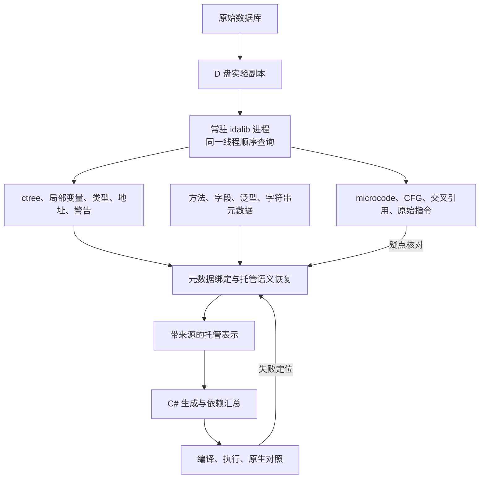

# IDA 接入方案

## 目标与边界

借助 IDA 已有的指令分析、变量恢复和控制流整理，将主要开发投入放在 IL2CPP 托管语义上。先完成一个有状态的小型业务类，再扩展覆盖率；不先重建底层反编译器，也不先全量导出所有函数。

输入为 Project Sekai 7.0.0 的已分析 ARM64 数据库及匹配元数据。ctree 是分析结果，类型、条件、函数签名和异常路径仍可能有误，不能作为未经核对的正确答案。

## 接入结构



### 进程边界

- IDA 侧使用 Python + idalib。先用本地 JSON 请求验证接口；MCP 可作为交互外壳，不作为恢复核心的必要依赖。
- 一个进程打开一份数据库，所有 IDA API 在初始化线程顺序执行。首阶段不并发共享数据库、不同时启动多份全量分析。
- 主程序只消费可序列化结果，不持有 IDA/SWIG 对象。缓存按数据库哈希、IDA 版本、方法地址和类型修订版本区分。
- 原始数据库不修改。需要修正类型或调用原型时，只作用于实验副本，并记录修改前后证据；默认退出不保存。

### 结构化输入

ctree 导出需要显式保存节点操作、子节点角色与顺序、变量索引、类型、位宽、常量位型、成员偏移、调用实参、标签及原生地址。语句可能没有有效地址，不能假设一条 C# 对应一条机器指令。

当前探针是接口调查工具，只保存节点和父链等基础信息，尚不是无损 ctree 序列化器。生产适配器必须补齐 switch、goto、浮点常量、子节点角色等信息，并报告不支持的节点。

microcode 仅按疑点查询。探针目前导出优化后的块边和指令文本，尚未导出各优化阶段、结构化操作数或异常信息。不能宣称这些证据已经完整。

### 元数据与托管恢复

- 方法身份使用程序集、元数据方法索引、泛型上下文及地址；不能只按 IDA 函数名匹配，共享地址可能属于多个方法。
- 字段按对象类型和累计偏移核对；IDA 的 `fields` 包装、对象头以及泛型继承必须显式处理。
- 调用按目标、MethodInfo 和实参绑定泛型；先识别运行时辅助函数，再处理委托和虚调用。
- 保留类初始化、对象分配、读写顺序与异常行为。内联集合操作只有证据完整时才折叠为标准库调用。
- 托管表示采用结构化语句和带类型的表达式，保留证据来源、未解决问题和依赖。优先直接生成 C#，暂不把 CIL + ILSpy 设为必经步骤。
- 来源不足时报告阻塞，不用默认值或占位方法冒充已恢复代码。

## IDA 缺陷的处理

1. 有警告或反编译失败：保留失败地址与说明，检查函数范围、类型及调用原型；不把无头启动当作自动修复。
2. 可局部核对的问题：同时读取 ctree、microcode、原始指令及元数据。例如 ctree 的布尔赋值可能对应 microcode 的 `& 1`。
3. 修正有证据的原型后，失效相关缓存、重新反编译，比较变化；本轮不进行批量类型修正。
4. 异常、异步和复杂间接调用：纳入明确的能力阶段，未实现时不通过验收。完整伪代码也不能证明异常边完整。

## 交付顺序

### 第一步：接入验证

验证 D 盘副本可打开、输入哈希匹配、同一进程连续查询、节点类型与地址可用、警告可读、退出不保存。选择简单 setter、坐标计算、API 调用、带警告的异步入口及异常相关方法。

### 第二步：最小转换闭环

实现必要的 ctree 导出、元数据绑定、托管表示和 C# 输出。以 `GridAreaData.SetOverlapState` 与 `GetSquareMin` 验证参数、字段、条件、整数运算、结构体及构造调用；它们只是转换管线验收，不作为完整业务成果。

复用第九次坐标计算的原生对照思路，覆盖整数边界及实际构造参数。仅按明确需要迁移独立测试或元数据组件，不复制旧管线。

### 第三步：完整的小型 case

第一交付候选为 `GridAreaData` 整类：构造、复制、Setup、Rotate、范围与重叠判断及必要依赖。先列出它的实际依赖和异常路径，再固定验收范围。

验收要求：目标方法没有占位体、所有依赖有明确实现或宿主契约、生成 C# 能编译，复制独立性、布局状态变化、旋转、边界输入和异常路径有可执行检查。宿主替身验证与 Unity 运行验收分开报告。

第二候选为 `GetSuiteUserPartsApi`，验证泛型基类、委托、字符串与回调链。离线记录调用参数不能当作真实 API 请求成功。

### 第四步：扩展与衡量

以完整类或入口为单位扩展，跟踪每个 case 的人工介入、阻塞类别、依赖完成度和执行结果。暂不承诺全量日期；先通过同一批样例的实际开发耗时评价新路线。

## 探针使用

本机 Python 已安装 `idapro`，IDA 目录可通过 `IDADIR` 覆盖。原始数据库约 3.3 GB；解包还需要额外空间。Windows 的终端配置可能改变当前目录，交互启动使用绝对路径。

```powershell
python -X utf8 -u E:/Desktop/il2cppLab/Cpp2CS/scripts/ida_probe.py D:/Cpp2CS/attempt-10/ida-session/libil2cpp.i64 D:/Cpp2CS/attempt-10/ida-session/probe
```

等待 `ready` 后，在同一进程的 stdin 逐条发送：

```json
{"action":"decompile","address":"0x5868910"}
{"action":"decompile","address":"0x51f75f8"}
{"action":"close"}
```

每个方法结果写入 `<地址>.json`。输出包含 IDA 插件自身消息，因此当前 stdout 不是严格纯 JSON 协议；生产适配器需隔离诊断输出。正常关闭调用 `close_database(False)`。

## 本机实测（2026-10-15）

- IDA 9.3，Hex-Rays 9.3.0.251224；数据库内含 688,090 个函数。此数量包含全部函数，不等于目标方法数量。
- 数据库 SHA-256：`01B5E541C3F81A4ED6C5FDD0AA23EBB1541D6C7EA4E88D15ED1466B46B3207A8`。
- 数据库记录的输入 SHA-256：`6CE1DE5C0357E122F153F62D648DE1655B7F8A339B2AE1C575595868A361E4BB`，与目标 ARM64 二进制一致。
- D 盘副本完成交互查询和最终顺序回归。最终打开耗时约 33.2 秒，五次方法查询耗时 0.012～0.210 秒；其他启动曾耗时约 70 秒。这是本次环境下的样例测量，不是全量性能保证。
- 最终回归结果位于 `D:/Cpp2CS/attempt-10/ida-session/verified/`。五份结果的节点编号唯一且非负，父节点引用完整，microcode 块数量一致。

| 方法 | 地址 | ctree 节点 | microcode 块 | 警告 |
| --- | --- | ---: | ---: | ---: |
| GridAreaData.SetOverlapState | 0x5868910 | 7 | 3 | 0 |
| GridAreaData.GetSquareMin | 0x58688ac | 109 | 7 | 0 |
| GetSuiteUserPartsApi.Execute | 0x51f75f8 | 148 | 12 | 9 |
| MysekaiBlueprint3DPreview.WaitLoading | 0x56f9590 | 133 | 7 | 6 |
| GridAreaData 复制构造 | 0x585e904 | 329 | 21 | 14 |

具体发现：

- setter 的 ctree 已是 bool 字段赋值，microcode 仍保留 `& 1`，说明两层证据都值得保留。
- Execute 能读取委托合并、装箱及调用结构，但辅助函数和全局符号仍有推测类型警告。
- WaitLoading 本次没有旧文本中的局部变量分配失败警告，但仍有六项推测类型警告；未证明语义正确，未恢复 async。
- 复制构造包含循环、条件和内联列表操作，但 ctree 没有直接给出异常清理结构，并报告两个可能未定义的变量。
- 部分元数据初始化调用在新查询中显示为无参调用。不得据此判定原生代码没有参数，需要核对辅助函数原型及指令。

适配时发现 ctree 的 `index` 只有生成显示文本后才有效；探针先调用 `get_pseudocode()`，再遍历结构化节点。该调用用于准备节点索引，恢复过程无需解析显示文本。

查询未修改函数原型或数据库类型；正常退出不保存。原始数据库和实验副本在测试后仍保持原哈希。当前只证明数据库与结构化接口可用，未交付 ctree → C# 转换器或业务运行结果。
