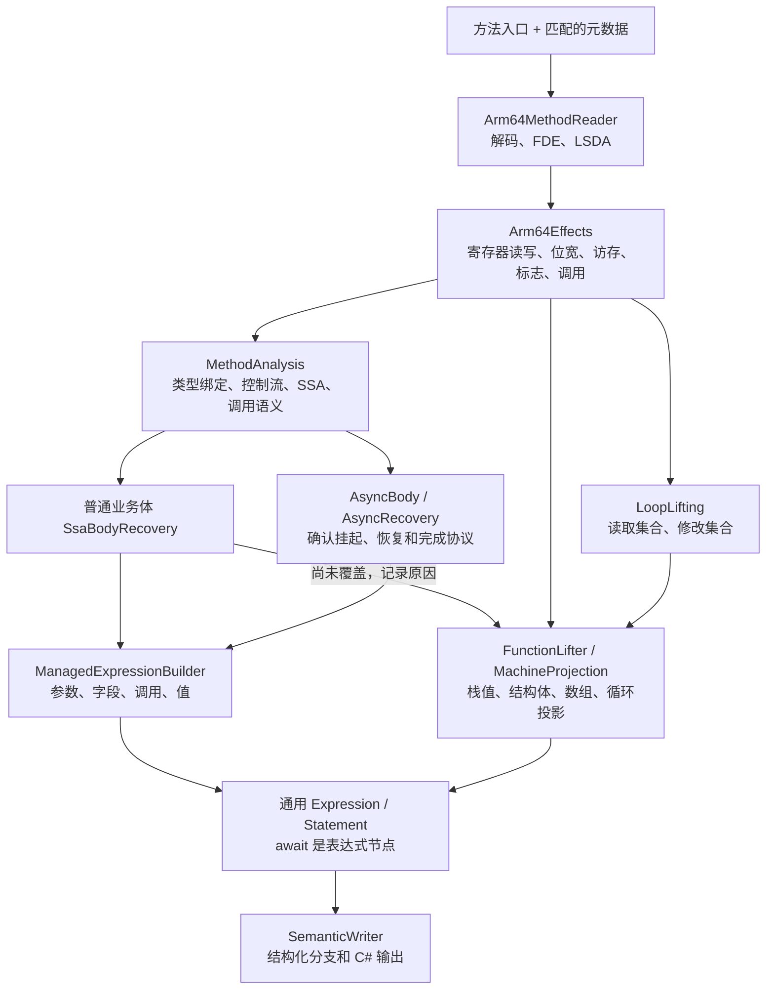

# ARM64 方法恢复流水线

以方法为单位分析。ARM64 指令先转成统一的机器效果，普通方法、async 和循环分析消费同一套指令定义。async 额外识别状态机协议。



## 边界

- `Arm64MethodReader` 只缓存指令和函数范围。优先采用入口匹配的 FDE；缺失时仍使用相邻符号作为候选边界，不能据此认定整个 IL2CPP 区域连续。当前单方法上限为 16 KiB。
- `Arm64Effects` 是指令效果的唯一实现。操作数扩展、移位、W/X 与 S/D/V 位宽、成对访存、前后索引写回、比较标志都在这里定义。所有输入来自执行前状态，访存完成后提交写回。
- `NativeSsa` 只把机器效果绑定到 SSA 身份和 Phi；`MachineProjection` 把机器效果投影到已有的有类型值与语句，不再有独立的 ARM64 指令解释器。两者可以有不同的源码恢复覆盖，但不能各自猜测一条指令的含义。
- `Arm64Registers` 统一调用破坏和部分保存范围，`Arm64Calls` 统一 helper 参数摘要。循环活跃值来自机器效果与实际 ABI，包括 X29、X8 返回缓冲及尾调用参数；不返回的 helper 仍然读取参数。
- 指令写入的高位清零与 ABI 未定义的高位分开处理。未知指令破坏已知写目标与内存；未知调用使栈缓存失效，不能继续引用调用前的旧值。
- `MethodAnalysis` 保存一次分析中的方法签名、控制流、SSA、调用解释和分派结果。嵌套分析保留传入的方法身份，不重新按地址选择其他签名。
- `ManagedTypeBindings` 在入口绑定参数和继承类型。元数据共享，每个方法的推断类型表独立；表达式恢复器与静态属性投影不跨方法复用可变状态。
- `ManagedExpressionBuilder` 不解码指令。它把 SSA 的业务值映射为表达式，按实际签名读取调用参数，只移除明确的 MethodInfo 隐藏参数。
- async 归约只处理协议与路径收缩。业务调用、字段写入、返回及 await 生成通用语句节点；单 await 构造模式也使用同一个输出器。
- 普通 SSA 路径在原读取位置生成字段快照，避免把读取推迟到后续调用之后。属性访问器内保留自己的后备字段，避免生成递归属性访问；存储和写屏障始终指向实际字段。

## 当前覆盖

普通 SSA 路径覆盖已绑定字段、部分直接或虚调用、整数或引用返回和无环分支。局部异常区域、尾调用、循环、未确认的栈存储效果等仍走 `FunctionLifter`，保留第七次的恢复能力。两种路径的区别在值传播和源码投影，指令效果已经统一。

机器效果目前覆盖已有样例使用的整数、标量浮点、常见访存和分支指令，不等于完整 ARM64 ISA。SIMD 算术、原子指令和部分 C# 数值投影仍有未支持项。循环投影仅支持已有的有类型标量；堆别名、栈地址逃逸和任意调用副作用仍需进一步证明，统一指令层不会自动解决这些问题。

async 支持现有已验证的 UniTask 协议。通用表达式转换拒绝未支持的位宽变化；不能因为包进 await 就忽略未知值。复杂业务 Phi、任意异常处理和完整 ARM64 指令覆盖仍不支持。async 业务字段读取跨副作用的普遍快照处理尚未接入，不能把当前样例通过解释为一般等价证明。

诊断报告中的 `recoveryPath` 区分 `ssa`、`ssa-async`、`ssa-async-single` 与 `expression`；`OrdinaryProblems` 保留 SSA 路径回退的原因。`.ssa.json` 保存机器值，`.source.semantics.json` 保存最终通用语句树；协议证据另存于 `.async*.json`。

## 回归检查

```powershell
dotnet run --project tests/Cpp2CS.Tests -c Release --no-build -- method-pipeline <配置.json> artifacts/recovered
```

固定使用 `Sekai.Api` 和 `Sekai.Mysekai` 的 15 个入口（含单 await 构造模式），检查正常恢复、同会话逆序、新会话逆序，以及恢复其他方法后再次输出旧结果。C# 文本、语句树和诊断必须一致；14 个无未恢复项，`OnGUI` 保留原有的一个未恢复项。

`SharedBodyChecks` 检查普通与 await 分支合流只输出一次、字段快照不跨调用移动、未知值不被 await 遮蔽。`async-body-native` 对真实 SSA 做反例变异，破坏挂起分支、token 或异常边后必须拒绝归约。

`python tests/machine_effects_oracle.py` 使用 `native.local.json` 中的 Clang 和 Capstone，组装 `tests/machine_effects.s`，将机器效果与 Unicorn 逐条对照。覆盖寄存器重叠、W 高位清零、标量浮点高位、移位类别、有符号扩展、标志、前后索引及成对访存；47 条指令 × 32 组状态，共 1,824 次寄存器和内存比较。

`arithmetic-native` 保留浮点、数组与成对字段读取回归；`closures-native`、`finally-native`、`call-arguments-native`、`call-storage-native` 分别检查闭包、循环清理、调用实参与调用后的结构体存储。`multi_async_oracle.py --ssa` 对真实方法做逐指令 SSA 对照，再由 `compile_multi_async.py` 编译并执行生成的 C#。

生成代码的测试桩编译执行与 ARM64 模拟执行仅覆盖各自的输入和外部调用契约，不代表真实游戏或 UniTask 调度器已验证。
