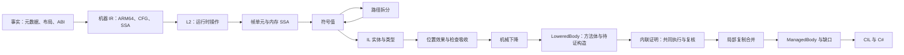

# 架构

IL2CPP 的生成链是 IL →（il2cpp codegen）C++ →（clang）机器码。一次构建只生成一份 C++，各 ABI 共用；Android Release 的生成代码按 `-Os -mllvm -hoist-common-insts=1` 编译，后一项让 SimplifyCFG 把两臂开头相同的指令提到分支之前。恢复按相反次序分层：事实与机器层还原原生码，L2 还原 codegen 生成的运行时惯用法，恢复层还原 clang 优化打散的 IL 结构。

恢复层不按形态补规则。clang 中破坏 IL 结构的变换各对应一个模型：

| clang 变换 | 破坏的结构 | 模型 |
|---|---|---|
| SROA、mem2reg、寄存器对、HFA、向量打包 | 结构体与局部被拆成位片 | 符号值的位来源：数据搬运在规范化中消去 |
| 栈着色、溢出与重载 | 一个栈槽承载多个存储实例 | 帧单元的内存 SSA |
| SimplifyCFG 合并与下沉、GVN | 不同路径的访问合成 φ | φ 的符号值与通用路径拆分 |
| InstCombine 位技巧 | 移位、掩码代替字段操作 | 位代数规范化 |
| 调用约定 | 参数与返回散落在寄存器、栈和缓冲区 | 双向 ABI 与调用内存效果 |

## 分层



| 层 | 位置 | 产物 |
|---|---|---|
| 事实 | `Image`、`Model`、`Facts` | 注册表、布局、`ManagedAbi`（签名 ↔ 机器位置、调用内存效果） |
| 机器 IR | `Machine` | 寄存器 SSA 的控制流图 |
| L2 | `Idioms` | 调用上的 `RuntimeOp`、元数据实体 `Symbol` |
| 帧单元 | `Recovery/Memory` | 帧访问划分为单元；可提升的单元成为存储单元，经 SSA 构建得到版本 |
| 符号值 | `Recovery/Values` | 每个机器值对应的符号值 |
| 路径拆分 | `Recovery/Shape` | 唯一修改控制流图的恢复步骤 |
| IL 实体与类型 | `Recovery/Typing` | 参数、局部、位置读写、调用结果及其类型 |
| 效果分析 | `Recovery/Effects` | 类型解与异常区域上的非空事实、检查吸收和初始化顺序证明 |
| 下降 | `Recovery/Lowering` | `LoweredBody`：方法体、缺口、待证构造与局部分配边界 |
| 内联证明 | `Recovery/Inlining` | 以被调方法恢复体为模板的等价证明、区域替换与未证明的缺口 |
| 输出 | `Output` | 元数据骨架、CIL、ILSpy 生成的 C# |

`IdiomPipeline` 是 L2 的规则表：规则只在证明成立时改写，改写后清理并继续，一轮没有变化即稳定。规则依赖另一条的结果时会在下一轮看到它，不靠手工重跑传递事实；表的次序只影响到达不动点的轮数。把检查成功一侧的值改写为一次转换的三条规则不是幂等的，只应用一次。超过轮数上限时记录仍在改写的规则。

`MethodDecompiler` 负责阶段调度。`BodyBuilder` 处理机器值和托管语句，`InlineProof` 只接收托管方法体、类型模型和其他方法的摘要，不读取机器状态或类型求解器。内联证明结束后再合并局部复制，汇总各阶段缺口。

调用事实通过 `Call.Site` 关联：原调用的改写保留身份，路径复制产生新身份并记录来源。把语句复制到另一条路径统一经 `Machine/Flow/PathCopy`：操作数按映射改写，定义得到新变量，调用得到新身份。原生地址仅用于追溯，不能代替调用身份。分派与内存提升每轮从稳定机器图建立独立分析副本，目标发现只读图并累积事实；解稳定后采用最终副本，不恢复语句数组或按调用序号回填，也不沿用旧签名下的分析缓存。

内联类型检查（继承深度比较加继承链比较）由 `TypeChecksPass` 归一。clang 可以在两次比较之间排入不读内存的判断：这些判断的另一侧都进入失败一侧、失败一侧的 φ 在这些边上取相同的值时，失败提前到深度比较处不改变行为。相等判断成立的一侧值被换成常量（GVN）时，沿这条边两者相同，比较前换回。类的继承深度和继承链不可变，各入边读取同一类的同一项时合流仍是这一项。类元数据的 φ 由路径拆分分开后，检查才有单一类型，拆分之后按同样的证明识别。

`il2cpp::utils::Finally` 的闭包和 codegen 头文件里的内联成员函数（`Array::SetAt`、`ArrayElementTypeCheck`）clang 不内联时成为没有元数据的函数。`Machine/Flow/ClosureInlining` 在 SSA 之前把它们展开回调用方，之后与内联的形式相同。闭包由“只把第一个实参当基址”的形态和栈地址实参判定，自身可以带异常表（finally 体里的 catch）：其中的调用按被调函数的表进入副本的落地块，表外的调用进入调用点的落地块。内联成员函数由“很小、不引用元数据或全局数据、其中的调用只有写屏障、实例检查和抛出”判定。

机器控制流判定的“不返回”事实保留在调用上。目标已解析的普通调用在 void 方法中以不可达的 `return` 补齐托管块结束形式；调用及异常边照常保留。其他返回类型仍需能表达其结束形式，不能补默认返回值。

路径拆分先查询类型模型：合流后的地址已能定位为托管字段、元素或引用位置时，保留合流访问；只有位置无法表示且各入边指向不同实体时才复制路径。数组或原生指针的变量下标也参与地址身份。对象引用来自不同读取不构成拆分理由，方法实体等必须静态确定的实参仍逐路径处理。clang 把公共的构造或装箱调用下沉到多层合流时，这类 φ 的来源可以是另一层同样的 φ：先拆外层，φ 随之下移到前驱，下一轮再拆。没有解析的间接调用，目标从 φ 选出的对象上读取时也逐路径处理：不同类型的委托合流后共用一次调用，只有拆开才各有 `Invoke`。复制量按前驱数与语句数之积限制，分支很多的 switch 汇到短合流块也在此内。

调用的完整签名只使用寄存器时，保存的 SP 记录不再作为输入；运行时 helper 在归一时处理，托管调用在内存划分前处理。失去用途的地址计算随后按活跃性清理，避免动态栈分配的根地址让其他私有栈槽误报逃逸。栈参数、栈上的 MethodInfo 和未知签名保留 SP。

## 帧内存模型

`Machine/Storage/FrameModel` 是固定帧内存的唯一事实来源，从 L2 起可用。地址的指向关系流不敏感地经寄存器、私有栈槽、常量偏移与选择传递；动态分配的区域不覆盖固定帧，帧地址加变量下标只作为读写地址时不算逃逸，下标取自帧上计数槽时数组止于该槽。地址的使用分为直接访问、调用的有界访问与逃逸。查询回答某程序点上一段内存来自哪些完整写入、是否可能被破坏。调用的影响由 `CallMemoryEffects` 按调用形状与运行时操作表给出，目标确定后精度随之提高。

`FrameForwarding` 据此把每条路径都到达同值完整写入的读取改写为该值，并删除不再被观察的写入。L2 的 `Cleanup` 和内存提升都运行它，因此规则看到的表达式不含私有栈槽的搬运，不需要自行追溯。未直接读取过的槽可能是未解析调用的栈实参，在调用目标解析结束前保留写入。

## 幂等初始化守卫

`if (!flag) init();` 之后 clang 可把后续计算复制到两臂，并让快路径复用守卫之前读到的值。快路径上初始化已经完成，在其开头补上 init 也不改变行为，所以两臂的差别只在写法。`OnceGuardsPass` 把两臂的写入、合流值或出口分支归一到“守卫处的内存内容”后逐项比较，相同时只保留初始化一臂。归一时路径上的定义代入，读取经守卫之前的写入转发；守卫之前读到的值，只有在其后每条路径都未改写该内存时才等于守卫处的内容。类构造、类布局与方法元数据的守卫共用这一证明；类自身的静态构造中，类构造标志的含义不同，不参与。

L2 的 `ConstantMemoryNormalizer` 将已知长度的 `memcpy` / `memmove` 展开为读取与写入，不限制源和目标必须在栈上。全部读取先于写入，保留重叠复制语义；展开后重新核对调用，使随后的 GC 屏障能够引用这些真实存储。字段类型和整体结构体赋值仍由类型模型确定。

`Machine/Flow/InductionVariables` 统一给出双入边合流的初值、步长、边序和运算位宽；查询不改写 IR。`AffineInduction` 使用该事实证明 64 位计数器之间的线性关系，`ArrayPointerLoopsPass` 使用同一事实寻找或创建同宽遍历下标。替换保留模 2^64 的回绕；入边或运算宽度不一致时不推断该关系。数组类型与初值不变性的检查仍由数组恢复负责。

数组的常步长偏移若没有可复用的同宽计数器，`ArrayPointerLoopsPass` 可单独重建 64 位遍历下标。偏移必须与已知数组相加；完整指针的初值须位于数组数据区，独立字节偏移可从零开始，数组头偏移保留在访问表达式中。步长必须等于元素大小，回边更新须为 64 位；原有其他位宽的计数器不作等同替换。

`RuntimeHelpers` 对 GC 屏障另行检查纯通知实现：仅沿无操作的直接跳板前进，完整核对开关、全局位图地址计算和原子置位循环。该实现不访问目标地址中的引用，其通知由托管 GC 承担；其他实现仍须在调用点证明对应的存储或未改变的引用，不仅凭导出名称省去调用。

`TypeOracle.DelegateTargetOf` 给出委托的直接目标、虚表绑定或条件选择。下降按该结果构造委托，条件分支中只创建实际选中的委托，接收者保持一次求值。

`RuntimeOps.IsInstArrayElement` 对引用元素数组按运行时元素类型进行实例检查，成功返回原对象，否则返回 null。它通过 `GetType / GetElementType / IsInstanceOfType` 保留数组协变与检查时机，不把动态元素类替换成静态元素类型，也不将异常顺序不同的检查直接吸收到数组写入。展开所需的临时局部由下降器统一分配；值类型元素及未确定的元素类型继续报洞。

## 符号值

`Model/ValueProjection` 统一描述结构体字段相对整体的位范围、具体类型和字段路径。类型定位、位片下降与内联出口使用同一套直接字段和叶子投影；完整嵌套字段保留整体，跨字段或填充范围不能冒充字段。结构体打包为整数还须证明整数叶子无重叠地覆盖全部位，不能重解释引用或猜测填充。

`TypeOracle.Aggregates` 根据投影和位来源产生结构体表示计划：完整读取或非零字段组成。符号切片、嵌套字段展开与整体复制证明均在这里完成；下降只将计划中的值写成托管节点。未定义位不会作为零字段省略，缺少布局也不能视为空结构体。

跨多个字段的位片没有自然类型，`TypeOracle.FieldPieces` 按字段边界分段。作为结构体使用时走上面的表示计划（`Vector4` 的前 96 位作 `Vector3`），作为整数使用时各段在其字段内取片，再移位与或（寄存器里按整数测试或搬运的相邻字段）。段落到填充或布局未知时不成立，不解释没有字段的位。非标准宽度的按位取反、取负与二元运算一样按模运算，由能容纳该位宽的 IL 整数承载并掩码。

`ValueModel.Abi` 提供实参、调用单元和返回值的整体来源，统一经 `SymTable.Assemble` 按位偏移组装。缺失范围保持未定义，重叠范围必须具有相同来源；顺序覆盖或跳过冲突不能作为证明。下降不再自行拼回这三类 ABI 值。

`ManagedProjections` 将同一字段投影应用于已求值的托管整体，统一完整值、嵌套字段、叶子组成和默认字段的关系。投影同时列出未选中字段的求值义务，不能直接据此删除副作用；内联出口用它比较已经执行完区域的快照，读取仍携带原路径的观察时刻。

符号值描述一个机器值在 IL 中是什么。节点在单个方法内驻留（相同结构只有一个实例），φ 节点按身份区分。

| 种类 | 含义 |
|---|---|
| 参数 | IL 参数整体（结构体参数是整个值） |
| 常量、未定义、未知 | 未定义用于填充和被破坏的位；未知带原因，下降时成为洞 |
| 实体 | 元数据实体：类、方法、字段、字符串、静态字段块等 |
| 调用结果、调用写出 | 调用或运行时操作的返回值；经指针实参写入单元的值 |
| 读取 | 某程序点对堆位置（字段、数组元素、静态字段、经引用）的一次读取 |
| 运算 | IL 层的计算：算术、比较、转换、选择 |
| 切片、拼接 | 位来源：取原子的一段位；按低位在前拼接多个片 |
| φ | 块入口的合流 |
| 帧地址 | 相对入口 SP 的栈地址 |

规范化在构造时完成：移位、掩码、插入、提取、零扩展、截断和位转换只改变片的排列；φ 的来源按相同边界拆开时，φ 下推到各片。由寄存器对、向量车道或溢出搬运的值因此回到原来的原子，不需要按形态识别。

低一位的加减按模 2 归一为异或，乘法归一为与；位片不能直接成为宽度不一致的布尔算术。只取 0/1 的值（1 位值，或高位为常量 0 的拼接）与 0、1 的相等比较归一为该位或其否定；按条件选 1 或 0 归一为条件位的零扩展。模板与调用方因此得到相同的 0/1 形状；1 位真值作为整数使用时，下降显式零扩展。

InstCombine 把 `sext(x + c) << k` 写成 `((x << n) + (c << n)) asr (n - k)`（`arr[arr.Length - 1]` 的下标）。低半部分全零的加减不产生进位，下推到高半部分；符号扩展低位的零片留在原位，与 `sext(x) << k` 同形，比例下标按同一规则识别。限于低半部分是为了不改变普通比例下标加常量偏移的形状。

加减的高段切片同样可以下推：一个加数（减法时是减数）在切点以下全为零时，低位不产生进位或借位，高段只由两侧的高段决定。SROA 把结构体拆进一个 64 位寄存器后，`(a.hi << 32) + b` 的高 32 位因此直接是 `a.hi + b.hi`。

向量宽度的常量是低 64 位与全零高位的拼接，移位量同样按常量处理；`ext`、`rev64` 等车道搬运由此化为片的排列。

浮点值被按位观察时，`TypeOracle.IntegerRepresentation` 给出同宽整数载体；下降先按位转换，再取片、移位或拼接，保留 NaN、符号位和负零，不作数值转换。

φ 的片来源证明沿整个合流环查找，访问到回边不代表其余路径没有证据；投影先驻留身份再连接来源。相邻投影若来自同一个整体的连续区间，拼接时还原为该整体的切片，避免丢失已有整体值。

多个 φ 的拼接若在每条入边上分别连续覆盖同一个完整值，则合为整体的 φ；错位复制把一个标量跨在两个寄存器 φ 上时，各片都只是 φ 的一部分，覆盖的是值的连续一段，也合为这一段的 φ；更宽的值按字段逐个取片，不需要合流。证明逐边进行，不混用不同路径的片；来源变化时同步更新整体来源。各入边都是相邻字段合并的宽读取、自身没有类型的 φ 只是搬运，它的片按各入边的片合流，类型由字段给出。

投影所属的整体已具有结构体类型时，`TypeOracle.ProjectedField` 给出整体及字段路径，下降保留整体局部。这样多处字段访问仍共享一个接收者，内联证明可以恢复对完整结构体的调用。

合流来源经过寄存器拼装后，取片若已经归一到另一整体值的片，也构成投影依据；例如结构体字段装入向量寄存器后再合流，只保留该字段的同宽合流，不要求先给整个含填充位的寄存器确定托管类型。

## 帧单元

帧访问包括直接读写和经指针实参的调用效果。重叠的访问区间合并成单元；地址没有逃逸到未知用途的单元可以提升：读写改为单元的部分读写，调用按 ABI 读取或写出单元，然后对单元构建 SSA。栈槽被复用时，完整写入开始新的版本；溢出读回经 SSA 得到原值。逃逸到未知用途的单元保留为可寻址的 IL 局部。

调用经 ref 改写单元时抛出，处理块读到的是被调方留下的内容（`try/finally` 里的结构体枚举器）。SSA 的版本只有调用前后两个完整状态，表达不了这个中间状态；单元在机器和 IL 里都是同一块存储，所以异常路径仍读它时不提升，由可寻址局部承接。试构建的剪枝 SSA 给出落地块 φ 上表达不了的来源；部分写入在 SSA 里读取整个单元，它的活跃性偏宽（栈槽复用时连续的部分写入覆盖整个单元），是否读到旧内容按字节的活跃性判断。结果缓冲区指向未提升的位置时，调用结果写回该位置；提升的单元由调用写出的版本承接。不透明值的 ref 实参按位置定位，不用固定位宽。

可寻址局部的类型来自调用签名或装箱类型；地址经 φ 或条件选择合流时，约束传播到各来源单元。单元地址具有 `ref T` 类型，与单元内容分别下降，不能用局部值代替其地址。

经原生指针传出的标量栈槽，若没有上述类型约束，且直接读写位于 1、2、4 或 8 字节单元内、写入值仅由基元数值的位组成，则以同宽无符号整数保存原始位。部分访问要求此前有完整写入支配，按位截取或掩码更新；首字节也不能当作整值赋值。传参仍取同一局部的地址；指针元素大小不代表缓冲区大小，引用位和冲突约束不据此恢复。

对值类型调用其基类（Object、ValueType、Enum）上的实例方法时，IL2CPP 把临时装箱对象放在栈帧上：写入类指针、monitor（-1，标记栈上临时对象）与值，以对象地址作为接收者调用，对象只在这次调用期间存在。`StackBoxingPass` 查询帧内存模型：三项写入在每条路径上都到达调用，且被调方法声明在值类型的基类链上时，接收者换成对值的装箱，值保留在原栈槽中。L2 和路径拆分之后各运行一次。

未被类型约束的标准宽度拼接按同宽整数解释。结构体被整数运算观察时，仅在整数叶子无重叠、无填充地覆盖全部位的情况下，按字段布局移位并组合；字段访问仍须有权限或访问器证明。

同一次调用的多个 `ref` 实参覆盖重叠区间时，单元保留共同存储，不能分别生成副本。字段取址递归取得值类型接收者的地址。结构体组合按直接字段检查位来源：已有完整类型的嵌套值直接赋给字段，其余片段继续展开并核对字段权限或构造证明。

## 调用

`CallShapes` 按事实给出调用的候选与机器签名；相同代码折叠的候选机器签名一致时共用。MethodInfo 方法指针已携带确切方法时，按该方法签名进行非虚托管调用；路径拆分或符号求值后才确定的完整方法指针读取也进入分派解析，未确定目标时仍保留运行时缺口。虚表槽和接口查找结果上的方法指针同样如此：L2 匹配模板时目标还是合流值，路径拆分之后才成为单一读取，由分派解析按相同的形态确定。返回值、内存效果与下降统一查询调用分类。`DispatchResolution` 解析分派：虚调用按接收者静态类型与虚表槽号，数组从 `System.Array` 查询继承的虚方法；接口调用按接口与槽号，委托调用取 Invoke，结果记在 `Call.Resolved`。先在内存提升前解析；提升后若栈上的值又证明了新的目标，只带回该目标，从提升前的读写重新计算内存效果，直到没有新增目标。块和调用次序保持不变，已确定目标不撤销，因此迭代终止。`TypeOracle.Callee` 取确切实例：调用传入的 MethodInfo 实参指名实例时取它；约束调用的 RGCTX 项指名接收者的确切类型时，取折叠候选中声明在该类型上的方法；否则按接收者类型代入声明类型的类型实参。方法自身的 RGCTX 项写的是元数据里的类型参数，代入当前入口的实参后才带上原生布局见证。

多次接口查找共享慢路径与调用尾部时，L2 先逐一配对快慢路径，再恢复各自的接口分派。配对优先按接收者或槽位的 φ 对齐；对不齐时（同一接收者分支各调用一次、各槽位的命中计算各占一块）由支配关系决定：慢路径入边沿支配树向上，第一个支配某条命中入边的块决定归属，两侧都明确给出槽位时必须一致。尾部复制本身对任何划分都保持语义，配对只决定各组能否再被证明为一次查找。配对必须覆盖全部入边，各组的其他合流输入也须一致。尾部只复制到消费查找结果的第一次间接调用（其间可有泛型虚方法解析这样的直接调用）；之后的语句切到续接块，只保留一份，调用结果和其他后续使用经续接块入口的 φ 按路径汇合。通用尾调用拆分在此之后进行，避免提前破坏查找区域。

clang 可把与查找无关的纯计算下沉进查找的两臂。合流 φ 两侧展开后是同一个不读内存、只依赖区域之外的值的表达式时，它与走哪一臂无关，提到查找之前定义一次。

`MethodInfo.invoker_method` 在方法指针、MethodInfo 和入口同源时可拆包。`ManagedAbi.Invoker` 描述其独立传参方式：引用按值，值参数按副本地址，ref/out 保留存储，非 void 结果写入返回缓冲区。参数数组槽的内容由帧内存转发得到。MethodInfo 也可以是分派查找的结果（接口槽的 `VirtualInvokeData.method`、泛型虚方法的解析结果）：指针取 `virtualMethodPointer`，查找的对象必须就是接收者，下降为 callvirt。路径拆分之后 MethodInfo 才成为单一实体的调用在拆分后再归一一次。

`il2cpp_codegen_runtime_constrained_call(klass, method, boxBuffer, objBuffer, args, ret)` 按完整指令证据识别。实参形式与 invoker 相同，接收者是约束类型的位置，`boxBuffer` 只服务于运行时的装箱路径，下降为 `constrained. callvirt`。

### 不透明值

完全共享泛型的 `T` 大小和种类只有运行时元数据可知，codegen 只经地址操作它。实例字段（沿值类型递归）含 `T` 的泛型值类型同样没有固定布局，`SharedTypes.IsVariableSized` 把它们归为一类，占一个整数实参位置，返回缓冲区在显式参数之后、MethodInfo 之前；只含 `T[]` 或引用的实例布局固定，仍按普通结构传递。句柄对值类型是数据指针，对引用类型是引用本身。`SharedValuesPass` 把这些写法命名一次，下游只按位置处理：

- 类元数据的栈槽大小与值类型位成为 `ClassProperty`。
- 向下分配 `stackslot_size(T)` 成为 `StackAllocation`，即类型为 `T` 的局部。它是不提升的单元，类型由分配点给出。
- 形参地址 `isValue(T) ? h : &saved`（`saved` 保存 `h`）和 invoker 槽 `isValue(T) ? a : *a` 都归一为句柄；两臂只有纯定义、合流值都是同一句柄的值类型分支随之消除。
- 按 `stackslot_size(T)` 的 `memcpy`、`memset` 成为对 `T` 位置的 `CopyGenericValue`、`ClearGenericValue`。

不透明值的实参、返回缓冲区和局部都按位置（位宽为负）定位：实参取形参，局部取单元；元素地址按数组类的 `element_size` 计算时取元素；调用后把结果写入调用者给出的位置，返回时读取缓冲区对应的局部。

`UnBoxAny(obj, klass, storage)` 按完整指令证据识别为 `unbox.any`，返回值所在位置（盒内或 `storage`）的地址，下降时统一为局部的地址。`il2cpp_codegen_write_barrier_for_class(klass, ptr)` 丢弃 `klass` 后进入写屏障的实现，纯通知的证明对它同样成立。

完全共享入口的候选以占位类型作类型实参。不读 MethodInfo 的被调方（不用 RGCTX 的构造函数）调用点上没有实例实体，占位按实参的静态类型代入，没有实参能确定的保持原样。

调用的原始实参与内存提升追加的单元分开解释。L2 运行时操作可省略原始实参的存储身份，`Sources` 与 `Arguments` 尾部对齐；所有按存储查询实参的恢复步骤统一使用 `Call.ArgumentIndex`。运行时规则的 `Inputs` 声明实际使用的值及类型，区分值、位置和被指内容；用途分析直接读取契约，下降通过 `Input` 取得同一契约下的托管值，不另行指定期望类型。指针内容按共同的位片组装规则读取；结构体实例调用写回的 `this` 具有声明类型。

运行时操作通过 `ResultWidths` 按签名声明结果的有效位宽，符号值与下降使用同一编号。单精度数学调用只产生低 32 位，寄存器高位保持未定义，不把浮点结果误作 64 位整数切片。`sincosf` 保留已有 `libm` 依赖中的原入口，以两个独立的 `float` 局部承接出参；不拆成两次函数调用或近似公式。

间接返回的尾调用先保留对结果缓冲区的内存效果，再显式读取缓冲区返回；被调用者自身可以返回 `void`。运行时尾调用也必须保留结果寄存器。`isinst` 的值始终是引用或 null，值类型目标保留装箱状态。接口引用上的对象虚表槽从 `Object` 解析，接口槽仍按接口分派。引用类型参数的虚表槽从基类约束解析，并代入调用方的泛型实参；没有基类约束时仅使用 `Object` 的槽。

已证明的引用比较交换具有读写内存效果，结果类型取自目标位置，下降为 `Interlocked.CompareExchange<T>(ref location, value, comparand)`，保留原子比较与返回旧值的语义。

GC 写屏障由托管存储承担；内存顺序屏障单独恢复为 `Thread.MemoryBarrier()`。没有对应运行时方法时保留缺口，不能当作空操作。单线程执行对照不证明并发内存顺序。

共享泛型的 `FieldAddress` 按字段元数据恢复托管字段地址，结果为代入类型实参后的 `ref T`，不依赖编译时固定偏移；字段访问约束照常检查。

写到泛型定义上的方法体来自某个实例，原生调用目标是实例上的方法。接收者的静态类型是同一泛型定义的开放实例时（类型参数可以嵌在实参里，如 `Func<Task<T>>`），调用写在接收者的实例上，共享占位类型（如 `System.Int32Enum`）不进入 CIL，泛型定义也不引用实例所在的程序集。虚调用的接收者是类型参数的值时走受约束调用（ECMA-335 III.2.1）；非虚调用一般不改，原生不判空。

值类型实例的方法体里，原生直接调用实参类型自己的方法（如 `Start<TStateMachine>` 里状态机的 `MoveNext`）。接收者是类型参数的存储、被调方法按 vtable 和 interface offset 实现了约束里的接口方法时，写成对接口方法的受约束调用：值类型自己实现了该方法时以存储地址直接调用，不装箱也不判空，和原生相同。约束是泛型接口时只接受和实例的接口完全相同的写法。局部的类型仍按实例求出，取自具体实例的局部会让定义引用实例的类型，这一点尚未处理。

注册的非泛型值类型调整桩若恰为 `add x0, x0, #16; b body`，且签名完整、目标无身份歧义，`AdjustorTargets` 将目标记为该注册方法的本体。身份来自注册表与精确跳转，不需要猜测隐藏参数；泛型桩和其他指令序列不接受。此事实与未注册方法的 MethodInfo A+B 推断分别建立。

元数据 `Type` 实体具有 `RuntimeTypeHandle` 类型，按 `ldtoken` 写出，保留开放泛型类型参数。

## 类型

`TypeUseAnalysis` 从返回签名、调用 ABI、读写位置、运行时输入和符号运算收集用途，`TypeOracle` 重新求解，直到完整类型解稳定；稳定结果包含跨语句读取的落点集合。分析不生成托管节点，不调用下降器或构造模板。`TypeSolution` 区分变化、稳定、循环和预算耗尽，后两者形成缺口。求解预算为 64 轮，不把达到轮数当成收敛。泛型实参代入由 `MethodRef.Concrete` 提供。共享泛型代码经自身 MethodInfo 与 RGCTX 得到的元数据实体以定义的类型参数表达，L2 之后由 `GenericContext` 按当前实例（封闭实例或带原生绑定的开放形式）对符号与运行时操作数代入一次，之后各层直接使用实体，不再各自代入。字段叶子与托管值宽度由 `ManagedTypes` 提供，不依赖求解状态。

原子的类型由定义给出：参数按签名，调用结果按被调用者，读取按位置。φ 的类型由约束求解：下界是来源定义类型的汇合，上界是独立用途分析收集的期望类型；下界满足全部使用时取下界，否则取能容纳全部定义且满足全部使用的最具体使用类型。选择的类型是各路定义类型的汇合，常量、未定义值与只由它们组成的选择不约束，都不约束时按期望类型解释。补码的加减乘与按位运算不决定有无符号，操作数无类型时不给定义类型；只有带符号或无符号语义的运算（除、取余、右移）给出类型。都不约束的值按 IL 栈语义解释为同宽有符号整数，这一缺省只在取值的类型时使用，不参与汇合。

值类型恰由一个与自身同宽的实例字段组成（无填充、无其他字段）时，它与该字段的机器位型相同。`TypeOracle.Representation` 给出这条表示链（类型自身、唯一字段、字段的唯一字段……）：合流取外层；写入的层级取值的定义类型；取值时进入内层；以内层值构成外层时，公开字段直接组成，非公开字段须由构造函数证明；比较两侧等宽时使用最内层的整数或引用。字段访问照常检查权限与访问器。

显式布局中从起点覆盖整个值的字段，也可提供同一位型的视图。不同值类型之间仅在全部叶子无填充、无重叠且逐字段同宽时允许复制；引用不能重解释为数值。整数与浮点的同宽位搬运写成核心库位转换调用，不当作数值转换。

泛型嵌套枚举的 CIL 栈按底层整数检查，`IntPtr`/`UIntPtr` 可装箱，裸指针和托管地址不可装箱。

### 地址值

不落在单一实体上的地址由 `TypeOracle.Addresses` 定义，下降只查询：

- `fixed (T* p = array)` 的首元素指针（长度为零取空指针，否则取首元素地址）下降为 `PinnedArrayValue`，类型是 `T*`。固定本身不判空也不读长度，机器上的长度读取保持在原处，空数组引用在那里抛出。
- 来源都是位置地址的 φ 是托管指针：IL 把地址留在栈上跨分支合流，或 clang 把同构访问下沉成一次经 φ 的访问。指向的类型取各来源从外到内的位置类型中第一个共同的，常量零保留为空指针。路径拆分优先，只有拆不开的合流才这样表示。
- 数组上按元素大小递进的 φ 是循环强度削减留下的游标：`Decompose` 把它还原成数组根、合成的 32 位下标 φ 和元素内偏移，之后按普通元素访问处理；单独递推的字节偏移（`array + φ`）同样处理。下标读写按 ldelem/stelem 检查边界，原生在界内访问时结果相同。

### 结构体值的写法

`BodyBuilder.TryCompose` 决定按叶子给出的结构体值如何写出：字段都可访问时逐字段组成；否则依次是构造函数证明、同一结构体的复制（列出的叶子覆盖全部字段时才成立）、内层结构体的叶子收拢成直接字段的值后重试，最后是对象初始化器 `new S { A = a }`，不可访问的字段经证明过的 setter 写入。显式布局中与可访问字段重叠的不可访问字段不必写，读取时按小端拼接那些字段。需要语句时写在当前语句之前；φ 入边上的值写在前驱末尾，前驱还有其他出边时要求被写的值求值没有效果。

写入经过不可访问的值类型字段，而该字段有证明过的 getter 和 setter 时，写成取值、改叶子、写回（`BodyBuilder.StoreThroughProperty`），其余叶子写回原值，与只写一个叶子不可区分。

### 位置的整体访问

Android ARM64 的栈保护检查在帧提升后归一：保存值和退出时的值都必须来自 `TPIDR_EL0 + 40` 的 64 位读取，不等分支只通往 `__stack_chk_fail`。帧提升证明保存值未被改写后，去掉该编译器检查；未证明的帧读写仍报洞。槽位依据是 [Bionic 的 TLS_SLOT_STACK_GUARD](https://android.googlesource.com/platform/bionic/+/refs/heads/main/libc/platform/bionic/tls_defines.h)，不推广到其他 TLS 读取或终止调用。

带比例下标的非托管指针访问由 `TypeOracle` 定义为元素位置和字节偏移，下降使用 `PointerOffsetValue` 后解引用。偏移按 64 位模运算保留，截短下标先零扩展再乘比例；不引入托管数组的边界检查。只有元素大小、访问宽度和比例一致时才认定完整元素访问。

clang 把结构体的复制拆成对各段的读写（SROA），并可能重排互不重叠的写入。在未提升的位置（对象字段、元素、经引用、可寻址局部）上，这些段在 IL 中是对同一个结构体位置的一次读写，由 `TypeOracle` 的整体访问给出（`TypeOracle.Accesses`）：

- 写入组：同一块中根与下标相同、互不重叠的写入恰好铺满一个结构体位置，之间只有不读内存的定义、空语句与写屏障时，是对该位置的一次写入，值为按偏移拼接的各段，在第一个成员处写出。成员取语句次序上能铺满结构体的最长前缀。已有聚合布局绑定的泛型参数也按完整位置合并，写出仍保留 `T`，不引入绑定实例的字段。
- 整体读取：结构体的全部叶子来自同一块中同段内存的读取，之间只有不读其他内存的定义时，在第一次读取处读取整体。整体读取按（读取处、地址、宽度）驻留。拼接恰好覆盖完整结构体位置时，这一证明也给出拼接的定义类型，使合流保留外层结构体。

两者都不跨越调用、其他写入或无关读取，原有的异常与副作用次序不变；结果只依赖机器 IR 与类型，下降只查询，不以语句为键保存状态，也不创建符号值。

虚方法委托构造由 `TypeOracle.VirtualMethod` 核对虚表偏移与接收者身份，按接收者静态类型确定槽的声明方法；输出使用 `ldvirtftn`，保留派生类型的覆盖，不能降为 `ldftn`。

## 源码形态

反编译器的结构恢复放不进 if 和循环的跳转会写成 goto。`GotoCleanup` 在声明局部之前整理它们，这些改写都不改变 C# 语义，局部随后按新位置声明：

- 正常结束后本来就到达目标的 goto 删去；目标紧跟在最近的循环或 switch 之后时换成 break。
- 只有一个入口且上方不会落入的目标块，移到跳转处。移进 try 会让处理块接住它的异常，所以不跨 try。
- 很短的出口（`return`、`throw`，或一次局部赋值之后再跳转）复制到各入口；复制进 try 的只能是不会抛出的出口。

下面几种写法只是反编译器没认出编译器的形态，改写后语义不变：

- `FieldLikeEvents`：访问器带编译器标记，恰好调用 `Delegate.Combine` 或 `Remove` 和一次 `CompareExchange` 时，写回字段式事件，后备字段的引用改成事件名。C# 编译器重新生成访问器。
- `ReferenceNullTests`：类型重载了相等运算符时，反编译器把引用判空写成 `(object)x == null`，这里写成 `x is null`、`x is not null`，优化编译的结果相同。这不是类型恢复的改善，只是 C# 9 的写法。
- `ClosureValues`（IL 层，状态机提升前后各一次）：闭包对象由 `newobj` 创建，外层闭包的引用只写一次，闭包值不为空。删去闭包值的判空，把合并到局部的读取和局部副本换回来源，反编译器才能折叠闭包。捕获全被优化掉时，没有读者的闭包创建也删去。
- `CachedLambdas`：clang 把 `cache ?? (cache = lambda)` 打散后，读写缓存都换成 lambda，只被赋过缓存委托（lambda 或单例 `<>c.<>9` 上的方法组）的局部判空折叠，死分支删去。C# 编译器重新生成缓存；委托按方法和目标比较相等，差别只在是否为同一个实例。
- `ImplicitChecks`（IL 层，状态机提升前后各一次）：IL2CPP 的判空、越界和数组存入类型检查，恢复层只吸收机器层能证明的部分，其余写成 `if (条件) throw`。C# 的实例访问、`ldelem` 和 `stelem.ref` 自己就做这些检查：检查成立时随后的访问必定抛同一异常，中间又没有可观察的动作时，删去检查，局部才能内联回表达式。多个检查都失败时抛哪个也保持不变：判空之前只能隔着最多抛空引用的读取；越界检查和访问之间隔着判空时，要能一起删去；类型检查只删下标在范围内的新数组上的存入。`InvalidCastException` 的检查不删：`!(x is T)` 对空值抛出，`(T)x` 不抛。
- `BooleanIntegers`：bool 扩展成整数后再比较或按位运算，反编译器写成 `(c ? 1u : 0u) == (byte)0`。取值只有 0、1 的整数表达式和 0、1 比较时写回条件本身，bool 的 `&`、`|`、`^` 不短路，求值次序相同。`x is T ? x as T : null` 在 `x` 是局部或字段时写成 `x as T`。

实现接口方法的私有方法（IL 的 `.override`，如状态机的 `MoveNext`）让反编译器多写一个转发的显式实现。同名且只有这一个目标时，`ForwardingImplementations` 把私有方法改成公开方法并删去转发，C# 的隐式实现与之等价，从外层类型调用它也能编译。

## 导出的工程

`--source-layout project` 按程序集写出工程。工程自成一体，不继承所在目录的编译设置；引用都是同一次导出的骨架，不按目标框架筛选。目标语言是 C# 9.0。

工程引用自带的 `references/`，由 `SourceReferences` 在 `assemblies/` 的副本上生成，方法体不变，`assemblies/` 保持原样。主程序集按方法体的实际用法放宽声明：别的类型的私有成员写成 internal，虚方法族写成 public，构造函数之外写入的只读字段去掉只读，地址被写入或没有访问器可用的自动属性退回普通属性。外部程序集不放宽，只补 IL2CPP 裁掉、真实库里存在的成员（构建器的 `AwaitOnCompleted`、`Unsafe.AsPointer`、`RuntimeMethodHandle.GetFunctionPointer`），占位声明只为绑定，方法体抛异常。

CIL 能表达、C# 不能表达的写法在反编译的语法树上改写（`Decompile/Legality`）：

| 变换 | 改写 | 语义差别 |
|---|---|---|
| `ConstructorCalls` | `base..ctor(a)` 写成构造函数初始化器，前面定义实参的语句求值代回 | 其余前置语句改到基类构造之后，基类构造经虚调用读这些字段时不同 |
| `StructConstructors` | `this = new T { ... }` 拆成逐字段赋值，字段没写全时先 `this = default` | 没写的字段原本是调用方的内容 |
| `DefiniteAssignment` | 按 C# 规则分析流，给未赋值的局部和 out 形参补默认值；goto 可能跳过声明时提到函数开头；ref 局部绑定到同作用域的占位 | 无，CIL 的局部从零开始 |
| `LibraryInternals` | 内联留下的引擎和运行时私有成员折回公开写法，只读字段的展开写回构造函数 | 内部抛异常的方法换成同类型的异常，没有消息；形状不完整的欧拉角多一次弧度换算，差浮点舍入 |
| `ExpressionForms` | 共享泛型的转换和实参写回类型参数；类型参数和具体类型之间经 object 转换；判空后的空接收者写回被判空的对象 | 经 object 转换要求运行时类型一致，具体化代码按整数读取枚举时可能抛异常 |
| `ExpressionForms` | 跨过中间重写的非虚调用走函数指针 | 依赖运行时能取到方法地址 |
| `ExpressionForms` | async 和迭代器里的 ref 局部：目标稳定时换回目标，只读时改成值 | 改成值后读到的是绑定时的值 |
| `ExpressionForms` | 结构体方法里 lambda 读的引用类型字段先复制到局部 | 无，闭包对象是同一个引用 |
| `ExpressionForms` | 反编译器写成 `0f - x` 的 `neg` 写回 `-x`，保留负零和 NaN 的符号 | 无 |
| `ExpressionForms` | 结构体的 `constrained.` 调用写成直接调用，不再转换到接口后装箱 | 无 |
| `ExpressionForms` | 被调方法不用的实参或接收者，恢复出来是寄存器残留的无关对象；`(T)(object)x` 在两个类没有继承关系时必抛异常，接收者是当前类且方法非虚时写回 `this`，其余用 `Unsafe.As` | 写回 `this` 不再判空，残留值原本也不影响被调方法 |
| `ExpressionForms` | 乱序的命名实参按 CIL 的求值位置判断：常量和局部可以交换，只读表达式之间可以交换，顺序允许就写回按位置传参，否则按 CIL 的位置排列 | 只读表达式交换后，判空的先后可能不同，异常类型相同 |
| `InitializerOrder` | 字段初始化器按元数据的字段顺序排列（反编译器把字段排在属性前面，C# 按文字顺序初始化） | 无 |
| `ShadowedLocals`、`DistinctLocalNames` | 同名局部和 lambda 形参改名 | 无 |

被按名引用的隐藏类型单独写出：匿名类型和 `<PrivateImplementationDetails>` 写出声明。反编译器折叠不了某个成员的闭包时，这个成员换成不折叠的写法，再按需写出它用到的闭包类、lambda 方法和字段（名字沿外层类型查找，`<>c` 只留用到的成员），其余成员保持折叠。带 try 的迭代器提升失败时用同样的办法保留状态机。

工程默认引用骨架。要对真实的外部库编译，把 `assemblies/` 里的同名程序集换成真实库后重新运行 `source-project`，反编译器按真实库解析类型，被裁掉的同名类型也能消歧。只替换 `references/` 不重新反编译时，这些类型会造成名字冲突（CS0104）。

编译通过不代表语义已验证，C# 的语义用执行对照的 `--csharp` 检查（见“验证”）。下面几类差别比较时会报不一致，都已知：

- 折回公开写法的调用，事件和原生不同。
- `string.Format` 经字符串插值写出，C# 编译器可能改成 `string.Concat`。
- C# 编译器把部分数组初始化写成逐元素赋值，少一次 `InitializeArray` 调用。
- 字段初始化器先于构造函数体，字段写入比原生早；这时对象还没有传出去。
- C# 的实例调用都判空。原生不判空、接收者又可能为空的调用，C# 会抛空引用异常；没有判空可用的空接收者写成 `((T)null).M()`，同样如此。
- 闭包的创建可能被省去或推迟，原生有 `new`，C# 没有或位置不同。
- C# 编译器重新生成 lambda 缓存，字段地址不同，比较内存时报原生写入了委托指针。C# 执行对照因此报不一致的方法，原因要逐个从源码差异确认。

反编译器提升 await 失败时留下 `/*Error near ...*/` 注释，这些方法语法合法，控制流不可靠。

IL2CPP 裁掉了只对运行时有意义的伪特性类型（`StructLayoutAttribute`、`FieldOffsetAttribute`、`MethodImplAttribute` 及其枚举），反编译器仍按元数据的标志写出它们。核心库里没有时写到工程的 `Properties/StrippedAttributes.cs`。元数据没有保留的信息（接口实现上的元组元素名称）从方法签名补回，别的程序集的内部特性不写进源码。

`--stubs-only` 跳过恢复，每个方法都是骨架的占位体（实例构造函数先调用可访问的基类构造函数，再 `throw null`），只用来得到能编译的接口。

`--keep-going` 让单个方法的失败不中断整轮，用来得到结构完整的工程：方法在独立线程上恢复，崩溃或超过 `--method-timeout`（默认 600 秒）记为洞；写出检查崩溃记为写出失败；反编译失败的类型退回成占位体，文件开头有注释说明。没有方法体的方法写成 `throw Unrecovered.Fail(原生地址)`，原因在 `recovery.jsonl`，实例构造函数保留基类调用。.NET 不能中止线程，超时的线程留在后台运行到进程结束；栈溢出不能捕获，仍会让进程退出；反编译阶段的卡死没有时限。排查问题时不要开这个选项。


## 内联

内联的逆以被调方法自身原生代码的恢复体为证据（模板），在调用方中找到一段与一次调用行为等价的代码，换成这次调用；证明不成立时记为洞。实现在 `Recovery/Inlining`。

调用方中对其不可访问的成员访问，主要来自 il2cpp 为小方法生成的 `_inline` 副本：访问器、运算符、`List<T>.Add` 一类短方法在每个用到它的翻译单元里另有一份，clang 上标为 `always_inline`，一定被内联；其余是 clang 自己在同一翻译单元内的内联。两种情况下，被调方法自己带注册入口的定义都在产物中，可作为模板。

**锚点与候选。**

- **锚点**有两种：
  - 待证访问：对调用方不可访问的实例或静态字段；
  - 待证构造：分配之后只剩基类构造调用，或构造函数缺少直接基类构造。
- **候选**由 `InlineEvidence` 给出，来源有四类，不按名称猜测方法：
  - 字段所在类型及其嵌套类型；
  - 接收者到所在类型的基类链上的类型；
  - 同程序集中以所在引用类型为唯一参数的静态方法；
  - 调用点实际引用的方法元数据。
- **调用合法性**：写出的每个调用都经同一判定：
  - 访问权限（`ManagedAccess`，受保护成员核对接收者类型）；
  - 还原的调用不能分派到别的方法体；
  - 不额外触发原生没有的精确类初始化。
- 泛型方法的封闭证据体访问自身实例的字段时，权限由原泛型定义决定。

**语义模型。** 方法体按托管语义解释。

- **事件**：不透明调用、分配、精确类初始化、抛出（含判空、越界、类型检查的隐式抛出）和其他运行时操作。每个事件观察此刻的整个堆。
- **写入不是事件**：写入只在下一个事件或结局处被观察，所以观察点之间的写入重排、下沉、合并（两次自增合成一次 `+2`）都不影响等价。
- **等价**：在入口事实描述的状态上，事件序列逐个相同，结局（汇合、返回、抛出）相同。

**项与规范形（`Terms`）。** 证明使用独立于托管 IR 的项：

- 常量、调用方的入口局部与实参、模板形参（按叶子路径）、堆版本上的读取、事件结果、运算、结构体元组、位置地址。
- 模板只产生形参项，调用方只产生入口项与实参项，两侧经绑定 θ 才能比较。
- 项在构造时规范化并驻留：比较的方向与严格性、0/1 值的各种写法、数组下标的扩展、转换的折叠。
- 结构体一律按叶子，整体写与逐字段写不区分；显式布局按主叶子与视图。

**堆（`Execution`）。**

- **位置**：根加叶子路径。
- **别名判定**只有一处：
  - 不同字段不重叠；
  - 同一字段只在所在类型可能相同时重叠；
  - 经引用的位置，按类型嵌套接上另一位置的路径时才重叠；
  - 两次不同分配的结果不重叠。
- **读取**：每条路径维护写入表，读取沿写入表倒查；遇到可能重叠又不可判定的写入时，这条路径失败。
- **屏障**：不透明调用开始新的堆版本；模板的效果摘要收窄屏障。

**共同执行（`Joint`、`Solver`）。** 模板与调用方在共享的路径条件 Φ 与绑定 θ 下同步执行：

- 可判定的分支走确定的一侧，否则分叉。
- 两侧都到达事件时，要求事件同种、操作数在 θ 下相等，并且此刻两侧写过的位置内容相等。
- 已证明的内联调用和透明构造，在另一侧没有对应调用时展开为其模板。这覆盖了嵌套内联、构造链和相邻的内联点。
- θ 遵守静态类型，只由存在的路径建立。

**区域与替换（`Regions`）。**

- **出口**：每条联合路径上，模板已返回、其写入与事件都已在调用方出现的最早一点。
- **自有写入**：区域内调用方额外的写入移到调用之前或之后，并证明移动不改变观察。
- **区域外的使用**：区域内定义、区域外使用的值，改写成调用前的表达式（只依赖入口状态）或调用后的表达式（依赖返回值与调用后的堆）。
- **续接**：各路径出口不同时，保留一条路径的续接，并证明它在其他路径的出口状态上，与原续接共同执行到汇合。按返回值谓词分到两侧的出口，写成调用后的分派。
- **异常**：异常上下文必须一致；处理块入口活跃的局部，在区域内各抛出点的值相同，或者差别可以由调用前的赋值解释。

**复核。** 候选替换应用后，把新调用展开为模板，与原方法体共同执行，直到两侧在同一块入口以相同的活跃状态汇合，或者都返回、都抛出。

- 复核是唯一的采纳标准。发现过程中的启发式（起点、保留哪条续接、候选次序）只影响能否找到证明，不影响正确性。
- 复核之前先核对结构约束：替换不能引入死赋值或死复制，一串新写入不能对同一位置写两次。

**摘要（`Summaries`）。** 模板单独执行得到语义摘要，有三种用途：

- **访问器**：只有一条路径、只读一个位置并返回它（getter），或只把第一个形参写入一个位置（setter）。访问在原位置换成调用。
- **值类型构造**：在新值上只有写入，并且写入覆盖全部叶子。给定叶子值时解出全部形参，写成 `new S(args)`。
- **调用效果**：各路径可能写入的位置集合，用于收窄屏障。

**构造。**

- `newobj T(args)` 是分配，再以新对象为 this 执行 `T..ctor`。
- 待证构造从分配开始，以 T 的构造函数为模板，基类与本类构造逐层展开，直到 `object..ctor`。
- 构造函数缺少直接基类构造时，以直接基类的构造函数为模板，写成 `base(...)`。这个区域必须吸收被内联的更上层祖先构造调用。

**收尾。**

- 证明不成立的同程序集访问按原生代码直接写出（`inline.unfolded`），其余记为洞。
- 结果不再使用的待证读取，只剩接收者为空时的异常，写成原位置的判空。
- 显式布局中不可访问字段的位片恰好是另一个可访问字段时，写成那个字段。

**界限与诊断。**

- 尚不支持的情形：
  - 模板含循环或异常区域时，不作候选；
  - 两次内联合并了写入、中间又没有可分开的事件（调用序列）。
- 失败原因取覆盖最多的那次尝试，写明第一处不等价的联合路径，以及不等价的种类：事件、堆、结局、别名、写回、合法性、预算。

模板分析与定义写出使用不同身份：`Summary` 根据具体实例、入口和原生布局绑定缓存证据；`RecoverDefinition` 根据方法定义选择写出见证。`MethodEntries` 为自动选择和依赖补齐提供同一策略：优先引用共享实例，再按入口和实参身份排序。显式方法清单仍可指定入口，选中的根方法不被依赖覆盖。一个见证不代表已验证全部泛型实例。

入口索引只接收方法本体注册。调整桩、反向包装和调用器具有不同的参数约定，不能因地址较小而被选成方法体。

依赖闭包遍历普通语句及跳转边的局部赋值，保留实例引用供分析，按定义补齐输出体；执行对照透明执行这些调用。写出前检查全部透明依赖，缺失时逐层阻止调用方发布。

## 下降

`BodyBuilder` 接收稳定类型解与读取落点计划，只下降一次，在原位保存跨语句使用的读取。运算的输入与结果类型、未使用 ABI 参数的供值方式分别由 `TypeOracle.OperationTypes`、`Supply` 定义，约束分析与下降共用。调用按机器签名重组 IL 实参：按值的片拼接、副本取被指单元在调用前的内容、ref 实参指向已提升单元时成为局部并取地址、结果缓冲区成为调用结果。分配之后的构造函数调用合为 newobj 或委托构造。φ 成为局部，在入边上并行赋值；之后由 `LocalCoalescing` 按活跃性合并复制两端：类型相同且不冲突的局部合成一个，恒等复制删去（取过地址或在入口活跃的局部除外）。跳转表按目标中表项读取的比例下标下降为 switch。

beforefieldinit 类型的初始化时机不受约束（ECMA-335 II.10.5.3：首次访问静态字段之前的任意时刻），运行时在字段访问处自行保证。IL2CPP 在调用这类类型的方法之前写的显式初始化没有对应的 IL，L2 直接删去（`ClassInitializationFacts.DropUnconstrained`），执行对照也不把它计为事件。

显式检查与类初始化的跨语句证明由 `EffectAnalysis` 提供，下降不扫描前后路径。判空、越界与初始化必须保持副作用和异常去向；路径遍历共用 `StraightLine`，前向和后向扫描均按访问集合终止。类型求解期间查询当前类型解，不缓存过期的证明。`TypeOracle.ArrayIndex` 是元素访问与边界检查共同的下标定义；它不用于非托管指针的字节偏移。对象头的类指针归属同样由类型模型查询。

`EffectSummary` 统一记录读、写、捕获、分配、初始化、顺序约束与异常上界；`MachineEffects` 和 `ManagedEffects` 分别解释机器与托管表示。未知操作保留全部可能效果。可丢弃、可重复和是否使内存快照失效是不同查询；局部读取不抛出，也不能因此跨写入重复求值。运行时规则同时登记整体效果与指针实参的具体访问，检查吸收、内联复制和调用后的快照失效共用这些定义。`MemoryFootprint` 提供字段路径别名关系，未知位置保守按可能重叠处理。普通方法的精确调用效果尚未由跨方法摘要证明，仍使用未知上界。 结果没人读的长度或字段读取，只要随后第一次访问同一对象会抛同样的异常，就不写出；被元素访问吸收的越界检查等于不存在。 `AsReceivers` 把 `(x as T).M()` 被拆开的判空和类型判断并回 `isinst` 和随后的访问。

结构体由位片组成时，零叶子由 `initobj` 提供，不逐一访问私有字段；非零叶子仍须满足访问与内联证明。对位置的整体写入，值由位片组成、非零叶子中有不可访问的字段，而该类型没有可能证明它的构造函数（最终写入覆盖全部叶子、写入的都是形参或常量）时，等于对每个字段的写入（结构体的全部字节都被覆盖，填充不可观察）：逐个字段按同一规则整体写入或继续分解，值类型字段因而可经其访问器整体写入。这一判定只看位片与类型，不预先求叶子的值，不留下读取的落点或洞。非标准位宽的符号扩展先把原符号位移至 IL 整数最高位，再算术右移，不能用来源容器的宽度代替位片宽度。

整体读取也覆盖带原生布局的开放值类型：按连续位片证明完整复制，输出仍保留 `T`，不借用原生实例的字段定义解释它。读取须来自同一块、同一段内存，片段之间不能夹杂写入、调用或无关读取。

选择地址后的读取分发成条件表达式时，跨语句使用需要快照整个选择，不能分别提前读取两侧字段；未选中的分支保持不求值，读取时刻仍在原生读取位置。

不含原生抛出点的块可以没有异常边。显式检查并入这类块中的 IL 访问时，要求起点与访问点在全部 try 和处理区域中的归属一致，且中间没有副作用；处理入口所需的复制仍在原检查点保存。已有异常边的两点仍核对处理入口与各输入值。

## 扩展点

补规则时按所属层选择注册面，不在下降或类型中加入对单个形态的分支：

| 要表达的事实 | 位置 |
|---|---|
| codegen 与运行时的固定指令序列 | `Idioms`：归一为 `RuntimeOp` 或 `Symbol`，在 `IdiomPipeline` 的规则表登记一条规则 |
| 这个栈槽里是什么、调用是否看得到它 | `FrameModel` 的查询；调用的影响登记在 `RuntimeOps` 的 `PointerEffects` 或机器签名，不在规则内自行追溯 |
| 完全共享泛型 `T` 的操作 | `SharedValuesPass` 的句柄与位置：新操作按位置定义，不观察值类型分支 |
| 初始化守卫的新种类 | `OnceGuardsPass` 的识别与初始化语句；两臂比较不变 |
| 内联比对失败 | 先看洞说明里走得最远的候选；补规范化或路径事实使两边同形，不增加出口分类 |
| extern 方法 | 只恢复声明：`PlatformInvokeStub` 从原生桩的描述符读库名和入口，不恢复桩的方法体 |
| 没有注册入口的方法 | `UnregisteredMethods`：调用点的 `MethodInfo` 见证，或机器码（常量按内容比较）与唯一一个注册的非泛型方法同形（翻译单元内的 inline 副本） |
| C++ 模板助手 | 能展开成已有操作时在 L2 展开（`SharedFieldTemplates` 展开成字段地址加写入），不新增下降 |
| 复制路径 | `PathCopy`，不手写语句复制 |
| 一种运行时操作在 IL 中的意义 | `Recovery/Runtime/RuntimeOps`：一项登记输入用途、结果类型、整体及指针内存效果与下降 |
| 机器运算的位搬运 | `SymTable` 的规范化：按运算定义一次，对所有来源成立 |
| 托管值的机器位置 | `ManagedAbi.Machine`：签名的寄存器、栈片与指针传递 |
| 地址对应的 IL 位置 | `TypeOracle.Locate`：按运行时布局 |
| 不同类型共用同一位型 | `TypeOracle.Representation`：表示链 |
| 多次机器访问构成一次 IL 访问 | `TypeOracle.Accesses`：写入组与整体读取 |
| 原子的类型 | `TypeOracle.TypeOf`：由定义给出；常量与拼接由使用处的期望类型决定 |
| 运行时元数据上的读取 | `MethodEnvironment.MetadataRead`：已知实体加常量偏移按事实解析 |

标量数学导入共用 `MathImportSignature` 的 C ABI。L2 保留实参寄存器身份并截取有效位，`RuntimeOps` 给出结果类型与托管调用；映像明确依赖 libm 时，输出为原库、原符号的 P/Invoke 声明。未知签名与指针出参不套用标量规则。

## 异常

`ExceptionNormalization` 把 C++ 异常机制规范到 IL 语义。托管异常总以 Il2CppExceptionWrapper 抛出，落地块的 selector 取 catch 动作的序号，其余分支不可达。规范化由三部分组成：

- 不产生托管异常的抛出点没有异常边。全映像的 wrapper 抛出与 catch 类型检查均通过（`ExceptionFacts.WrapperWithoutDestructor`）时，wrapper 的析构回调为空，结束 catch 不会再次抛出：删去只含 `EndCatch` 的块的异常边，`EndCatch` 不生成托管效果。
- 落地链收缩（`ContractLandingChains`）：落地链是从落地块起、只含 φ、跳转、空语句、异常值与纯计算的直线路径，后续块只从前一块进入，止于第一个其他块（目标）。clang 为调用点生成的跳板、在共享处理体之前装载常量的入口都是落地链，在 IL 中没有对应：抛出点的异常边直接指向目标，链上的 φ 按每条异常入边代入来源，常量在抛出点之前定义，异常值在目标入口取得。链上的定义只能作为目标 φ 的输入；目标中由异常值组成的 φ 要求目标的每个前驱都是给出异常值的链。变换后检查 SSA。
- 没有托管效果的处理体：只取异常与 selector、装载常量后调用 std::terminate（noexcept 析构中再次抛出），或只取异常后继续向外展开（可以跨块）。IL 中异常照常向外传播，指向它的异常边删去。必须看到实际的终止或展开调用。

IL2CPP 的 catch 先判断异常的类是否匹配，不匹配时再次抛出。托管异常都是 `System.Exception`，`catch (Exception)` 的这次判断恒成立，L2 的 `CaughtExceptionChecks` 把它折叠，再次抛出的路径和它的清理随之不可达。

内存提升可能消去落地链中保存异常的私有栈副本，因此提升结束后再次运行同一规范化，再划分异常区域。

内存提升前，`CleanupCalls` 使用原生事实还原与托管清理方法等价的辅助调用。证明核对接收者的解引用链、状态分区和各分区的调用序列；隐藏 MethodInfo 与调用点保存的 SP 不参与托管行为比较。还原后的调用只保留真实实参，使私有栈中的接收者副本可以提升；执行对照按已证明的方法体展开调用。

委托调用可在内存提升后再次归一，使用 `TypeOracle` 提供的接收者类型。调用入口、method_code 和 MethodInfo 仍须来自同一个 SSA 对象，并符合具体 Invoke 的 ABI；已有调用内存效果时保留未知，避免沿用旧签名的效果。

`ExceptionRegions` 以异常边指向落地块的块的最近公共支配者为 try 入口，加上它支配的、能到达这些块的全部块，处理块为落地块支配的块；取得托管异常时为 catch，否则为 fault。这样的 try 会接管发往其他处理体的块时，收缩到位于两个抛出块之间的块；仍然接管时区域构造失败并记为洞。区域之间只能嵌套或不相交。内层 try 位于外层 try 中时，内层处理块末尾到不了外层抛出点的块（只跳回循环头）也并入外层 try，它们的异常不发往别处，语义不变。

try 可以有多个入口：状态机的分派被线程化后，会直接跳到 try 中间的恢复点。IL 只能从 try 的第一条指令进入，`ExceptionEntries` 在 try 开头加一个分派块，从外部进入的边写入口序号后跳到分派块。嵌套时从内向外收拢，外层把内层的分派块当作入口，进入外层的边同时带两层序号。分派块只读刚写入的局部，不会抛出，放进 try 不改变异常语义。

异常边的 φ 赋值放在块中可能抛出的语句之前，异常离开时局部已持有入边的值。

### finally

`il2cpp::utils::Finally` 在 C++ 里是析构函数：catch 把异常存进闭包，离开作用域时运行处理体，异常不为空就重新抛出。clang 把它展开成存异常的局部和 cleanup.dest.slot（去向局部），再按路径复制合并。`FinallyRecovery` 在写出 CIL 之前把这些 catch 还原成 try/finally（ECMA-335 I.12.4.2），内联证明用的方法体不经过这一步。条件是 catch 除了运行处理体、再抛出同一个异常之外什么都不做，try 的每个出口都运行同样的处理体，然后继续。

判定按路径求值，不看块的形状：沿路径把这两种局部当作已知常量折叠条件，同步比较 catch 路径和每个出口路径上的语句。catch 路径到达“抛出异常”时，出口路径所在的位置就是 leave 的目标。不满足条件的 catch 保持原样。

- 同一条语句在两条路径上可以写不同的局部（clang 给每个副本一个临时变量），比较时按对应关系改名。
- catch 路径上写给后续代码的复制在抛出之后没有读者，处理体不读它们就丢弃。
- 处理体之后的复制只读局部和常量、处理体也不碰它们时，提到出口上。
- 区域的 try 只覆盖有异常边的块，循环里没有异常边的块在 try 之外，出口又回到 try。C++ 作用域的出口都运行处理体，所以这条路径还在作用域里，这些块没有异常边说明其中的调用不会抛出，并入 try 不改变行为，try 于是包住整个循环。块里有显式抛出或检查时不并入。
- 局部合并可能让几个 catch 共用保存异常的局部。还原时不再写它，所以要核对从 leave 的目标往后不会在重新赋值之前读它。

还原之后只为异常到达而赋值的局部不再有读者，局部再合并一次。finally 的处理体在 leave 和目标之间运行，`LocalCoalescing` 让它定义的局部与各目标活跃的局部冲突。

`EnumeratorForms` 还原 foreach 降级之后被改变的两处。结构体枚举器的 `Dispose` 在 IL 里是 `constrained. T callvirt IDisposable.Dispose`，IL2CPP 去虚化成直接调用。`Current` 在 IL 里循环体开头读一次，内联之后 clang 把字段读取沉到各使用处。枚举器除了 `MoveNext` 没有其他写入，读取都在进入循环体之后时，它们是同一个值，提到循环体开头读一次。

### async

反编译器提升 await 时只认 Roslyn 降级后的形态。`AsyncForms` 把写出的方法体还原成这个形态，内联证明用的方法体不经过这一步。还原写回的调用标为内联认回，执行对照按被调方法的方法体透明执行，所以它们和原生代码逐事件比较。

- kickoff：`Start`、`Create` 被内联，`get_Task` 对空构建器也被内联，都写回调用。状态机的初始值拆成逐字段赋值，`<>1__state` 放在最后。只有 `MoveNext` 也能还原时才改写 kickoff：反编译器认出 kickoff 后就按 Roslyn 形态读 `MoveNext`，形态不符时结果是错的。
- 主 try：C# 里 `MoveNext` 的方法体都在 try 里。原生的 try 只覆盖有异常边的块，没有异常边说明其中的调用不会抛出，并入 try 不改变行为；有显式抛出的块不并入。入口只留读状态和 `<>4__this` 的语句。
- 收尾：`SetResult` 被 clang 按路径复制时合并成一个块，返回值经局部传入。
- await：只有编译器降级会写出 `AwaitUnsafeOnCompleted`，它之前的分支就是 `IsCompleted` 的判断。内联留下的判断（`UniTask.Status`）和 `new Awaiter(in X)` 写回 `GetAwaiter`、`IsCompleted`；被折叠的常量判断和空的 `GetResult` 依据被调方法的恢复体写回。

- 带 try 的状态机：finally 开头的 `if (num < 0)` 被 clang 算成沿路径赋值的布尔局部，还原成比较 `num`，挂起和恢复时写回 `num`。定义按路径核对：常量 0 只能在写过非负状态之后，常量 1 只能在写过 -1 之后，符号位只能在没写过状态的路径上。主 try 先扩大，finally 在这之后还原，它的处理体才和 try 在同样的外层区域。try 的多入口分派换成按 `num` 比较，恢复段在 try 外时移到分派目标上。挂起时不运行 finally，挂起路径的出口不和处理体比较，其他路径上状态局部是负的，比较时只走运行处理体的一支。源码里的 `try { try { } catch { } } finally { }` 落地块是串起来的，内层 catch 整个算进 finally 的 try。
反编译器追踪状态局部时只认和常量的直接比较、switch 的下标，遇到别的语句就停下，分派之后的比较留在输出里读未赋值的局部：无符号范围检查拆成两个有符号比较，夹在分派中间的读 this 提到读状态之后，其他形态拒绝。
clang 把 SetException 的收尾和别的路径合并时，别的路径用自己的一份，收尾归到处理块。try 和 catch 末尾下沉成的共用块不会抛出，只从 try 进入时并入 try。
- 主 catch：方法体不会抛出时 clang 删掉了它，写回一个，处理块到不了。

反编译器提升后 `num` 没有定义，只认方法和 try 开头的分派、finally 开头的判断这两处读取；还有其他读取时方法保持原样。其他形态不符时也保持原样。

### 迭代器

反编译器提升 yield return 时要求 yield 点依次是 `current = 值；state = 常量；return true`。clang 把写状态和 return 按路径合并，状态值和返回值经局部传入共用块。`IteratorForms` 按路径复制回来，调整这几个写字段语句的次序。分派的处理和 async 共用 `StateMachineForm`：无符号范围检查拆开，读 this 提到读状态之后。

Roslyn 把带 try 的迭代器的 MoveNext 整个包在 try 里，fault 块只调用 Dispose，try 的范围由状态决定：-3 及以下表示在 finally 保护的范围内。`IteratorForms` 还原这几处：

- fault：IL2CPP 把 fault 写成捕获后重新抛出，clang 又把 Dispose 内联进去。处理体只判断状态、运行 Dispose 或 finally 方法（调用名都出现在这些方法的恢复结果里）再重新抛出时，写回 `fault { Dispose(); }`。其他 catch 是用户写的，留作内层区域；没有 finally 方法时 Roslyn 不生成 fault。try 之外的块不会抛出，并入 try 不改变行为。
- 写 try 状态：Roslyn 在进入 try 和 yield 恢复处各写一次再跳到循环头，clang 把这些写入合并进循环头。反编译器按状态写入划定 try 的范围，合并后恢复点跳回写状态的块，成了离开 try 再进入，finally 会在每轮迭代运行（能编译，CIL 对照也看不出来）。写入按路径拆回去。
- finally 方法：第一条语句是写状态，读字段的语句和它可以交换。
- Dispose：clang 把状态集合写成范围和位图比较，反编译器追踪不了。没有区域、每个状态最多运行一个方法时，逐个状态求值后写回相等比较。

形态不符时保持原样。

反编译器仍可能尝试提升，结果丢失 yield 的语义并留下错误注释（`stateMachine`、`Unexpected return in MoveNext()`），这些成员换回不提升的写法，保留状态机类。

### 合流

clang 把相同的收尾合并成一个块，比如 `a?.b ?? c` 的失败路径，成功路径要跳过它到后面的合流。两次判断之间隔着语句时，结构化控制流写不出这样的图，反编译器只能写 goto。`JoinCopies` 在写出前处理：收尾覆盖了刚判过空的局部时，还原被跳转穿透的判断（空路径把局部写成空，在判断前合流）；其他情况每条路径复制一份收尾。复制和还原都不改变语义，但复制会多出几行。入边全是无条件跳转时，普通的 `if/else` 合流不复制，只有从块的直接支配者出发能绕过它到达后继时才复制。判断之间没有语句（反编译器能合并成 `||`）、回到循环的块（它要认 `continue` 和 `for`）、含委托的语句（复制等于复制整个 lambda）、状态机的 `MoveNext` 不处理。

## 尚未接入

尚未建模的部分及其所属层见 [缺陷修补](缺陷修补.md)，发现缺陷时的定位与修补方式也在其中。

## 验证

`BodyValidation` 在生成 CIL 前检查支持范围、参数索引、取址位置与浮点操作数的同宽表示。`CilOperators` 是校验与写出共用的运算定义；未实现的运算记为写出失败，不替换为其他运算，也不靠捕获异常继续。

`ConstructorInitialization` 检查各路径的 `this` 初始化及初始化前使用。`ConstructorSourceForm` 另行检查 C# 构造链和字段初始化器，两者共用局部定义与参数来源。恢复 CIL 不受源码形式限制；`SourceSuitability` 对已发布体单独报告这些限制，写入 `source-diagnostics.jsonl`。源码检查目前覆盖构造形式，通过不代表完整 C# 已编译。显式选择 `Source` 写出策略时，两层检查都要通过。

写出前先检查 CIL 的求值栈类型（`Output/Emit/CilStackTypes`，ECMA-335 III.1.5、III.1.6）：运算与比较的操作数、实参与存储的隐式转换、合流处的栈形状。不通过的方法记为写出失败（桶"栈类型"），连同依赖它的方法一起不写出。执行对照的解释器按位执行，不能代替这一检查。

`tests/Cpp2CS.Tests` 的 `execute` 恢复清单中的方法并写出 CIL，按若干种子合成输入与环境，在同一合成内存上分别解释 CIL、在 Unicorn 中执行原机器码，比较事件序列与事件发生时两侧写过的内存（按事件次序重放两侧的写入日志，增量比较）。`--time-limit <秒>` 给每个方法设墙钟上限；超时或写入日志超过上限的用例记为不可检查，不计入一致。结果区分 `verified`（全部请求用例一致）、`partial`（部分一致、其余不支持）、`mismatch`、`not-checkable` 和 `not-written`。退出码 0 表示全部请求用例通过，1 表示存在行为差异，3 表示验证不完整，空清单也返回 3。对照器内部异常直接传播；已知的不支持情况单独记录。写出数量、用例通过数和原生覆盖率分别报告。

```bash
dotnet run --project tests/Cpp2CS.Tests -c Release -- execute <binary> <metadata> <方法清单> [--fact-cache-file 快照] [--output 结果.tsv] [--time-limit 秒] [--verbose] [--csharp 编译出的程序集 --csharp-assembly 程序集名 --csharp-references 引用目录]
dotnet run --project tests/Cpp2CS.Tests -c Release -- check-models <binary> <metadata> <事实缓存>
```

`--csharp` 让解释器执行导出工程编译出的方法体，事件比较不变，用来检查 C# 这一层的语义。定义按全名对应到骨架；Roslyn 生成的闭包和 lambda 名字带方法序号，按同一方法里的方法名和方法体内容配对；状态机和匿名类型两边不对应，按不可检查处理。编译体没有逐指令的内联标记，按恢复体里同一目标的写法判断透明执行，两种写法都有时按不可检查处理。`typeof(T).TypeHandle` 还原成 `ldtoken`，这两次调用来自 C# 的写法。

`check-models` 检查类型收敛、泛型身份、边复制中的依赖、模板证明的成功与拒绝、字段权限、屏障保留和验证结果分类。执行对照使用 Unicorn；无法自动找到动态库时通过 `UNICORN_LIB` 指定路径。

普通调用桩只模拟正常返回。原生控制流证明调用不会正常返回时，用例报告不支持；判定读取原始机器码，不采用恢复体的结束形式，也不将该路径计入一致用例。

## 项目与依赖

| 项目 | 职责 | 允许依赖 |
|---|---|---|
| Core | 映像、模型、事实、机器 IR、L2、托管 IR、恢复 | BCL |
| Input | Il2CppDumper 适配、事实构建与缓存 | Core |
| Output | 元数据骨架、CIL、反编译与合法性修正 | Core |
| Pipeline | 请求、阶段、摘要和报告 | 上述项目 |
| Cli | 参数、日志与退出状态 | Pipeline 等入口 |

`Managed` 是恢复与写出的契约。Core、Output 不读取环境变量，也不直接写控制台；诊断通过 `IDiagnosticSink` 输出。

## 产物

| 产物 | 内容 |
|---|---|
| `recovery.jsonl`、`emitted.tsv` | 状态、缺口、部分体和完整写出清单 |
| `publication.jsonl` | 各方法的程序集、token 和 CIL 摘要 |
| `source-diagnostics.jsonl` | 已写出体的已知 C# 形式限制，不改变 CIL 写出状态 |
| `run.json` | 解析后选项、输入与实现摘要、阶段状态 |

输出目录必须为空。全部阶段完成后才发布 `complete`。写出成功、源码编译、执行对照和实际运行是独立结论。
