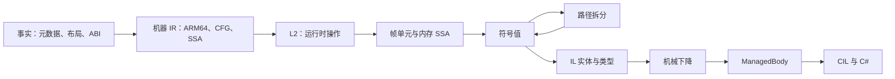

# 架构

IL2CPP 的生成链是 IL →（il2cpp codegen）C++ →（clang -O2）ARM64。恢复按相反次序分层：事实与机器层还原原生码，L2 还原 codegen 生成的运行时惯用法，恢复层还原 clang 优化打散的 IL 结构。

恢复层不按形态补规则。clang 中破坏 IL 结构的变换各对应一个模型：

| clang 变换 | 破坏的结构 | 模型 |
|---|---|---|
| SROA、mem2reg、寄存器对、HFA、向量打包 | 结构体与局部被拆成位片 | 符号值的位来源：数据搬运在规范化中消去 |
| 栈着色、溢出与重载 | 一个栈槽承载多个存储实例 | 帧单元的内存 SSA |
| SimplifyCFG 合并与下沉、GVN | 不同路径的访问合成 φ | φ 的符号值与通用路径拆分 |
| InstCombine 位技巧 | 移位、掩码代替字段操作 | 位代数规范化 |
| 调用约定 | 参数与返回散落在寄存器、栈和缓冲区 | 双向 ABI 与调用内存效果 |

## 分层

| 层 | 位置 | 产物 |
|---|---|---|
| 事实 | `Image`、`Model`、`Facts` | 注册表、布局、`ManagedAbi`（签名 ↔ 机器位置、调用内存效果） |
| 机器 IR | `Machine` | 寄存器 SSA 的控制流图 |
| L2 | `Idioms` | 调用上的 `RuntimeOp`、元数据实体 `Symbol` |
| 帧单元 | `Recovery/Memory` | 帧访问划分为单元；可提升的单元成为存储单元，经 SSA 构建得到版本 |
| 符号值 | `Recovery/Values` | 每个机器值对应的符号值 |
| 路径拆分 | `Recovery/Shape` | 唯一修改控制流图的恢复步骤 |
| IL 实体与类型 | `Recovery/Typing` | 参数、局部、位置读写、调用结果及其类型 |
| 下降 | `Recovery/Lowering` | `ManagedBody` |
| 输出 | `Output` | 元数据骨架、CIL、ILSpy 生成的 C# |

`MethodDecompiler` 按上表顺序运行。机器层与帧单元步骤改写机器函数；之后的分析只读，结果以值、单元、实体的编号为键，不以语句对象为键。

## 符号值

符号值描述一个机器值在 IL 中是什么。节点在单个方法内驻留（相同结构只有一个实例），φ 节点按身份区分。

| 种类 | 含义 |
|---|---|
| 参数 | IL 参数整体（结构体参数是整个值） |
| 常量、未定义、未知 | 未定义用于填充和被破坏的位；未知带原因，下降时成为洞 |
| 实体 | 元数据实体：类、方法、字段、字符串、静态字段块等 |
| 调用结果、调用写出 | 调用或运行时操作的返回值；经指针实参写入单元的值 |
| 读取 | 某程序点对堆位置（字段、数组元素、静态字段、经引用）的一次读取 |
| 运算 | IL 层的计算：算术、比较、转换、选择 |
| 切片、拼接 | 位来源：取原子的一段位；按低位在前拼接多个片 |
| φ | 块入口的合流 |
| 帧地址 | 相对入口 SP 的栈地址 |

规范化在构造时完成：移位、掩码、插入、提取、零扩展、截断和位转换只改变片的排列；φ 的来源按相同边界拆开时，φ 下推到各片。由寄存器对、向量车道或溢出搬运的值因此回到原来的原子，不需要按形态识别。

## 帧单元

帧访问包括直接读写和经指针实参的调用效果。重叠的访问区间合并成单元；地址没有逃逸到未知用途的单元可以提升：读写改为单元的部分读写，调用按 ABI 读取或写出单元，然后对单元构建 SSA。栈槽被复用时，完整写入开始新的版本；溢出读回经 SSA 得到原值。逃逸到未知用途的单元保留为可寻址的 IL 局部。

## 调用

`CallShapes` 按事实给出调用的候选与机器签名；相同代码折叠的候选机器签名一致时共用。`DispatchResolution` 在内存提升之前用未提升内存的符号值解析分派：虚调用按接收者静态类型与虚表槽号，接口调用按接口与槽号，委托调用取 Invoke，结果记在 `Call.Resolved`。`TypeOracle.Callee` 取确切实例：调用传入的 MethodInfo 实参指名实例时取它，否则按接收者类型代入声明类型的类型实参。

## 下降

`BodyBuilder` 先空跑一遍记录每个读取被哪些语句的 IL 值用到，只在所在语句之外被用到时于原位落成局部。调用按机器签名重组 IL 实参：按值的片拼接、副本取被指单元在调用前的内容、ref 实参指向已提升单元时成为局部并取地址、结果缓冲区成为调用结果。分配之后的构造函数调用合为 newobj 或委托构造。判空在直线路径上被随后经同一对象的访问吸收。φ 成为局部，在入边上并行赋值。跳转表按目标中表项读取的比例下标下降为 switch。

## 扩展点

补规则时按所属层选择注册面，不在下降或类型中加入对单个形态的分支：

| 要表达的事实 | 位置 |
|---|---|
| codegen 与运行时的固定指令序列 | `Idioms`：归一为 `RuntimeOp` 或 `Symbol` |
| 一种运行时操作在 IL 中的意义 | `Recovery/Runtime/RuntimeOps`：一项登记结果类型、经指针的内存效果与下降 |
| 机器运算的位搬运 | `SymTable` 的规范化：按运算定义一次，对所有来源成立 |
| 托管值的机器位置 | `ManagedAbi.Machine`：签名的寄存器、栈片与指针传递 |
| 地址对应的 IL 位置 | `TypeOracle.Locate`：按运行时布局 |
| 原子的类型 | `TypeOracle.TypeOf`：由定义给出；常量与拼接由使用处的期望类型决定 |

## 异常

`ExceptionNormalization` 把 C++ 异常机制规范到 IL 语义：托管异常总以 Il2CppExceptionWrapper 抛出，落地块的 selector 取 catch 动作的序号，其余分支不可达；每个调用点的落地跳板合并到跳转目标；只调用 std::terminate 的落地块对应 noexcept 析构中再次抛出，指向它的异常边删去。`ExceptionRegions` 以异常边指向落地块的块的最近公共支配者为 try 入口，加上它支配的、能到达这些块的全部块，处理块为落地块支配的块；取得托管异常时为 catch，否则为 fault。IL2CPP 对 finally 生成“保存异常的 catch + 共享的 finally 体 + 有异常时重新抛出”，下降保持这一结构。

## 尚未接入

- 已知元数据实体上的读取（类的虚表槽、元素类等）按事实解析为实体。
- 使用处对类型的细化（常量与 φ 的类型、共享泛型实例的类型实参）。
- 相邻读取合并为结构体读取，φ 入边复制的合并。
- L2 中依赖类元数据 φ 的尾复制（ClassTails）改由路径拆分完成，运行时操作的类操作数取自符号值。
- 平台调用（P/Invoke）包装与异步状态机的整理。

## 项目与依赖

| 项目 | 职责 | 允许依赖 |
|---|---|---|
| Core | 映像、模型、事实、机器 IR、L2、托管 IR、恢复 | BCL |
| Input | Il2CppDumper 适配、事实构建与缓存 | Core |
| Output | 元数据骨架、CIL、反编译与合法性修正 | Core |
| Pipeline | 请求、阶段、摘要和报告 | 上述项目 |
| Cli | 参数、日志与退出状态 | Pipeline 等入口 |

`Managed` 是恢复与写出的契约。Core、Output 不读取环境变量，也不直接写控制台；诊断通过 `IDiagnosticSink` 输出。

## 产物

| 产物 | 内容 |
|---|---|
| `recovery.jsonl`、`emitted.tsv` | 状态、缺口、部分体和完整写出清单 |
| `publication.jsonl` | 各方法的程序集、token 和 CIL 摘要 |
| `run.json` | 解析后选项、输入与实现摘要、阶段状态 |

输出目录必须为空。全部阶段完成后才发布 `complete`。写出成功、源码编译、执行对照和实际运行是独立结论。
