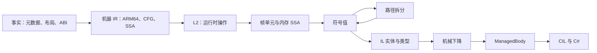

# 架构

IL2CPP 的生成链是 IL →（il2cpp codegen）C++ →（clang -O2）ARM64。恢复按相反次序分层：事实与机器层还原原生码，L2 还原 codegen 生成的运行时惯用法，恢复层还原 clang 优化打散的 IL 结构。

恢复层不按形态补规则。clang 中破坏 IL 结构的变换各对应一个模型：

| clang 变换 | 破坏的结构 | 模型 |
|---|---|---|
| SROA、mem2reg、寄存器对、HFA、向量打包 | 结构体与局部被拆成位片 | 符号值的位来源：数据搬运在规范化中消去 |
| 栈着色、溢出与重载 | 一个栈槽承载多个存储实例 | 帧单元的内存 SSA |
| SimplifyCFG 合并与下沉、GVN | 不同路径的访问合成 φ | φ 的符号值与通用路径拆分 |
| InstCombine 位技巧 | 移位、掩码代替字段操作 | 位代数规范化 |
| 调用约定 | 参数与返回散落在寄存器、栈和缓冲区 | 双向 ABI 与调用内存效果 |

## 分层



| 层 | 位置 | 产物 |
|---|---|---|
| 事实 | `Image`、`Model`、`Facts` | 注册表、布局、`ManagedAbi`（签名 ↔ 机器位置、调用内存效果） |
| 机器 IR | `Machine` | 寄存器 SSA 的控制流图 |
| L2 | `Idioms` | 调用上的 `RuntimeOp`、元数据实体 `Symbol` |
| 帧单元 | `Recovery/Memory` | 帧访问划分为单元；可提升的单元成为存储单元，经 SSA 构建得到版本 |
| 符号值 | `Recovery/Values` | 每个机器值对应的符号值 |
| 路径拆分 | `Recovery/Shape` | 唯一修改控制流图的恢复步骤 |
| IL 实体与类型 | `Recovery/Typing` | 参数、局部、位置读写、调用结果及其类型 |
| 下降 | `Recovery/Lowering` | `ManagedBody` |
| 输出 | `Output` | 元数据骨架、CIL、ILSpy 生成的 C# |

`MethodDecompiler` 按上表顺序运行。机器层与帧单元步骤改写机器函数；之后的分析只读，结果以值、单元、实体的编号为键，不以语句对象为键。

## 符号值

符号值描述一个机器值在 IL 中是什么。节点在单个方法内驻留（相同结构只有一个实例），φ 节点按身份区分。

| 种类 | 含义 |
|---|---|
| 参数 | IL 参数整体（结构体参数是整个值） |
| 常量、未定义、未知 | 未定义用于填充和被破坏的位；未知带原因，下降时成为洞 |
| 实体 | 元数据实体：类、方法、字段、字符串、静态字段块等 |
| 调用结果、调用写出 | 调用或运行时操作的返回值；经指针实参写入单元的值 |
| 读取 | 某程序点对堆位置（字段、数组元素、静态字段、经引用）的一次读取 |
| 运算 | IL 层的计算：算术、比较、转换、选择 |
| 切片、拼接 | 位来源：取原子的一段位；按低位在前拼接多个片 |
| φ | 块入口的合流 |
| 帧地址 | 相对入口 SP 的栈地址 |

规范化在构造时完成：移位、掩码、插入、提取、零扩展、截断和位转换只改变片的排列；φ 的来源按相同边界拆开时，φ 下推到各片。由寄存器对、向量车道或溢出搬运的值因此回到原来的原子，不需要按形态识别。

## 帧单元

帧访问包括直接读写和经指针实参的调用效果。重叠的访问区间合并成单元；地址没有逃逸到未知用途的单元可以提升：读写改为单元的部分读写，调用按 ABI 读取或写出单元，然后对单元构建 SSA。栈槽被复用时，完整写入开始新的版本；溢出读回经 SSA 得到原值。逃逸到未知用途的单元保留为可寻址的 IL 局部。

可寻址局部的类型来自调用签名或装箱类型；地址经 φ 或条件选择合流时，约束传播到各来源单元。单元地址具有 `ref T` 类型，与单元内容分别下降，不能用局部值代替其地址。

未被类型约束的标准宽度拼接按同宽整数解释。结构体被整数运算观察时，仅在整数叶子无重叠、无填充地覆盖全部位的情况下，按字段布局移位并组合；字段访问仍须有权限或访问器证明。

## 调用

`CallShapes` 按事实给出调用的候选与机器签名；相同代码折叠的候选机器签名一致时共用。`DispatchResolution` 在内存提升之前用未提升内存的符号值解析分派：虚调用按接收者静态类型与虚表槽号，接口调用按接口与槽号，委托调用取 Invoke，结果记在 `Call.Resolved`。`TypeOracle.Callee` 取确切实例：调用传入的 MethodInfo 实参指名实例时取它，否则按接收者类型代入声明类型的类型实参。

调用的原始实参与内存提升追加的单元分开解释。L2 运行时操作可省略原始实参的存储身份，`Sources` 与 `Arguments` 尾部对齐；所有按存储查询实参的恢复步骤统一使用 `Call.ArgumentIndex`。运行时下降只接收原始实参，指针内容通过内存效果读取；结构体实例调用写回的 `this` 具有声明类型。

已证明的引用比较交换具有读写内存效果，结果类型取自目标位置，下降为 `Interlocked.CompareExchange<T>(ref location, value, comparand)`，保留原子比较与返回旧值的语义。

共享泛型的 `FieldAddress` 按字段元数据恢复托管字段地址，结果为代入类型实参后的 `ref T`，不依赖编译时固定偏移；字段访问约束照常检查。

注册的非泛型值类型调整桩若恰为 `add x0, x0, #16; b body`，且签名完整、目标无身份歧义，`AdjustorTargets` 将目标记为该注册方法的本体。身份来自注册表与精确跳转，不需要猜测隐藏参数；泛型桩和其他指令序列不接受。此事实与未注册方法的 MethodInfo A+B 推断分别建立。

元数据 `Type` 实体具有 `RuntimeTypeHandle` 类型，按 `ldtoken` 写出，保留开放泛型类型参数。

## 类型

原子的类型由定义给出：参数按签名，调用结果按被调用者，读取按位置。φ 的类型由约束求解：下界是来源定义类型的汇合，上界是使用处要求的类型（下降空跑时收集）；下界满足全部使用时取下界，否则取能容纳全部定义且满足全部使用的最具体使用类型。选择的类型是各路定义类型的汇合，常量、未定义值与只由它们组成的选择不约束，都不约束时按期望类型解释。补码的加减乘与按位运算不决定有无符号，操作数无类型时不给定义类型；只有带符号或无符号语义的运算（除、取余、右移）给出类型。都不约束的值按 IL 栈语义解释为同宽有符号整数，这一缺省只在取值的类型时使用，不参与汇合。

## 内联

内联的逆以被调方法自身原生代码的恢复体为证据，证明不成立时记为洞。

- 构造函数：分配 T 之后调用的是基类构造时，T 的构造函数只把参数原样转给这个基类构造，则调用点即对它的 newobj，标为透明。
- 访问器：字段对调用方不可访问（ECMA-335 II.10.3）时，字段所在类型中恢复体恰为该字段单一读取或写入的方法即被内联的访问器，访问写成对它的调用。
- 多语句方法（`BodyBuilder.Inlining`）：仍不可访问的访问先标为待证。能访问该字段的类型（所在类型及其嵌套类型）中访问它、方法体无环的实例方法是候选；以候选的恢复体为模板，在调用方从锚点之前的某一语句起两边同步符号执行：读取按路径上已知的写入归一（不同字段不相干，调用之后分代），写入、调用、检查与抛出逐一对应，分支相同或取反，形参在首次出现时绑定；所有路径在同一点结束，返回值由出口处同一个局部承接，区域内的值不在区域外使用，区域内的块只从区域内进入。成立时区域换成一次调用（标为内联）；不成立时洞的说明写明每个候选第一处失败的原因。该步在复制合并之前进行。

依赖闭包按方法实例的原生入口恢复这些方法（泛型实例为开放共享体），执行对照透明执行它们。

## 下降

`BodyBuilder` 先空跑一遍记录每个读取被哪些语句的 IL 值用到，只在所在语句之外被用到时于原位落成局部。调用按机器签名重组 IL 实参：按值的片拼接、副本取被指单元在调用前的内容、ref 实参指向已提升单元时成为局部并取地址、结果缓冲区成为调用结果。分配之后的构造函数调用合为 newobj 或委托构造。原生的显式检查与类初始化按副作用与异常的次序模型（`BodyBuilder.Effects`）并入随后的 IL 操作：判空被经同一对象的访问吸收，越界检查被同一数组同一下标的元素访问吸收，显式类构造被按 II.10.5.3 触发同一初始化的访问代替；两点之间的语句须对可观察行为透明（无副作用，抛出的异常不改变结果，异常去向相同），已知非空的对象上的判空直接省去。φ 成为局部，在入边上并行赋值；之后由 `LocalCoalescing` 按活跃性合并复制两端：类型相同且不冲突的局部合成一个，恒等复制删去（取过地址或在入口活跃的局部除外）。跳转表按目标中表项读取的比例下标下降为 switch。

结构体由位片组成时，零叶子由 `initobj` 提供，不逐一访问私有字段；非零叶子仍须满足访问与内联证明。同块中的连续写入完整覆盖一个结构体位置时，拼接其位来源，恢复为整体赋值；合并不跨越读取、调用或其他副作用。结构体的全部叶子来自同段内存的连续读取时，在第一次读取处保存整体值；不跨越无关读取、写入或调用。非标准位宽的符号扩展先把原符号位移至 IL 整数最高位，再算术右移，不能用来源容器的宽度代替位片宽度。

## 扩展点

补规则时按所属层选择注册面，不在下降或类型中加入对单个形态的分支：

| 要表达的事实 | 位置 |
|---|---|
| codegen 与运行时的固定指令序列 | `Idioms`：归一为 `RuntimeOp` 或 `Symbol` |
| 一种运行时操作在 IL 中的意义 | `Recovery/Runtime/RuntimeOps`：一项登记结果类型、经指针的内存效果与下降 |
| 机器运算的位搬运 | `SymTable` 的规范化：按运算定义一次，对所有来源成立 |
| 托管值的机器位置 | `ManagedAbi.Machine`：签名的寄存器、栈片与指针传递 |
| 地址对应的 IL 位置 | `TypeOracle.Locate`：按运行时布局 |
| 原子的类型 | `TypeOracle.TypeOf`：由定义给出；常量与拼接由使用处的期望类型决定 |
| 运行时元数据上的读取 | `MethodEnvironment.MetadataRead`：已知实体加常量偏移按事实解析 |

## 异常

`ExceptionNormalization` 把 C++ 异常机制规范到 IL 语义：托管异常总以 Il2CppExceptionWrapper 抛出，落地块的 selector 取 catch 动作的序号，其余分支不可达；每个调用点的落地跳板合并到跳转目标；只调用 std::terminate 的落地块对应 noexcept 析构中再次抛出，指向它的异常边删去。`ExceptionRegions` 以异常边指向落地块的块的最近公共支配者为 try 入口，加上它支配的、能到达这些块的全部块，处理块为落地块支配的块；取得托管异常时为 catch，否则为 fault。IL2CPP 对 finally 生成“保存异常的 catch + 共享的 finally 体 + 有异常时重新抛出”，下降保持这一结构。

多个落地跳板仅取异常、装载常量并汇入同一处理体时，共用一个异常入口：异常值在共同入口取得，常量在各抛出点之前定义，其他 φ 输入仍保留各路径的值。跳板定义若在共同入口的 φ 之外使用，则不合并；变换后检查 SSA。

全映像的 wrapper 抛出与 catch 类型检查均通过时，wrapper 的析构回调已证明为空；只含 `EndCatch` 调用的块不产生新的托管异常，删除它的异常边及不可达清理体。任一事实检查失败时保留原边。

带异常表的方法在每次调用后分块。条件抛出折叠成判空时，只给判空所在块附加异常边，避免把前一个不受保护的调用误放进 catch。

只含 φ 与跳转的落地跳板可合并到目标入口，目标 φ 按每条异常入边展开来源。跳板定义若用于目标 φ 之外则保留原结构，变换后仍检查 SSA。

原生比较的两侧等宽，且结构体恰由一个同宽整数或布尔字段组成时，比较该字段的标量值。字段读取仍须通过访问权限与访问器证明，不把任意结构体当作整数比较。

引用类型构造函数缺少直接基类初始化时，尝试与直接基类的无环构造体逐条对齐。调用、写入、分支和出口均吻合才恢复 `base(...)`，并作为透明依赖验证；构造调用始终使用直接调用。

删除终止处理的异常边必须看到实际的 `Terminate` 调用，只有异常值或常量的入口不能算终止。已证明为空析构的 `EndCatch` 不生成托管效果；去除后合并单入清理路径与共享入口。只取得异常并继续展开的空 cleanup 不生成跨 catch 的 fault。

## 尚未接入

尚未建模的部分及其所属层见 [缺陷修补](缺陷修补.md)，发现缺陷时的定位与修补方式也在其中。

## 验证

写出前先检查 CIL 的求值栈类型（`Output/Emit/CilStackTypes`，ECMA-335 III.1.5、III.1.6）：运算与比较的操作数、实参与存储的隐式转换、合流处的栈形状。不通过的方法记为写出失败（桶"栈类型"），连同依赖它的方法一起不写出。执行对照的解释器按位执行，不能代替这一检查。

`tests/Cpp2CS.Tests` 的 `execute` 恢复清单中的方法并写出 CIL，按若干种子合成输入与环境，在同一合成内存上分别解释 CIL、在 Unicorn 中执行原机器码，比较事件序列与事件发生时两侧写过的内存。判定为 verified、mismatch 或 not-checkable；只对完整写出的方法执行。写出数量不说明语义正确，模型的改动以执行对照判断。

```bash
dotnet run --project tests/Cpp2CS.Tests -c Release -- execute <binary> <metadata> <方法清单> [--fact-cache-file 快照] [--output 结果.tsv] [--verbose]
```

## 项目与依赖

| 项目 | 职责 | 允许依赖 |
|---|---|---|
| Core | 映像、模型、事实、机器 IR、L2、托管 IR、恢复 | BCL |
| Input | Il2CppDumper 适配、事实构建与缓存 | Core |
| Output | 元数据骨架、CIL、反编译与合法性修正 | Core |
| Pipeline | 请求、阶段、摘要和报告 | 上述项目 |
| Cli | 参数、日志与退出状态 | Pipeline 等入口 |

`Managed` 是恢复与写出的契约。Core、Output 不读取环境变量，也不直接写控制台；诊断通过 `IDiagnosticSink` 输出。

## 产物

| 产物 | 内容 |
|---|---|
| `recovery.jsonl`、`emitted.tsv` | 状态、缺口、部分体和完整写出清单 |
| `publication.jsonl` | 各方法的程序集、token 和 CIL 摘要 |
| `run.json` | 解析后选项、输入与实现摘要、阶段状态 |

输出目录必须为空。全部阶段完成后才发布 `complete`。写出成功、源码编译、执行对照和实际运行是独立结论。
