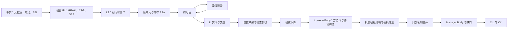

# 架构

IL2CPP 的生成链是 IL →（il2cpp codegen）C++ →（clang -O2）ARM64。恢复按相反次序分层：事实与机器层还原原生码，L2 还原 codegen 生成的运行时惯用法，恢复层还原 clang 优化打散的 IL 结构。

恢复层不按形态补规则。clang 中破坏 IL 结构的变换各对应一个模型：

| clang 变换 | 破坏的结构 | 模型 |
|---|---|---|
| SROA、mem2reg、寄存器对、HFA、向量打包 | 结构体与局部被拆成位片 | 符号值的位来源：数据搬运在规范化中消去 |
| 栈着色、溢出与重载 | 一个栈槽承载多个存储实例 | 帧单元的内存 SSA |
| SimplifyCFG 合并与下沉、GVN | 不同路径的访问合成 φ | φ 的符号值与通用路径拆分 |
| InstCombine 位技巧 | 移位、掩码代替字段操作 | 位代数规范化 |
| 调用约定 | 参数与返回散落在寄存器、栈和缓冲区 | 双向 ABI 与调用内存效果 |

## 分层



| 层 | 位置 | 产物 |
|---|---|---|
| 事实 | `Image`、`Model`、`Facts` | 注册表、布局、`ManagedAbi`（签名 ↔ 机器位置、调用内存效果） |
| 机器 IR | `Machine` | 寄存器 SSA 的控制流图 |
| L2 | `Idioms` | 调用上的 `RuntimeOp`、元数据实体 `Symbol` |
| 帧单元 | `Recovery/Memory` | 帧访问划分为单元；可提升的单元成为存储单元，经 SSA 构建得到版本 |
| 符号值 | `Recovery/Values` | 每个机器值对应的符号值 |
| 路径拆分 | `Recovery/Shape` | 唯一修改控制流图的恢复步骤 |
| IL 实体与类型 | `Recovery/Typing` | 参数、局部、位置读写、调用结果及其类型 |
| 效果分析 | `Recovery/Effects` | 类型解与异常区域上的非空事实、检查吸收和初始化顺序证明 |
| 下降 | `Recovery/Lowering` | `LoweredBody`：方法体、缺口、待证构造与局部分配边界 |
| 内联证明 | `Recovery/Inlining` | 托管模板证据、区域替换计划与未证明的缺口 |
| 输出 | `Output` | 元数据骨架、CIL、ILSpy 生成的 C# |

`MethodDecompiler` 负责阶段调度。`BodyBuilder` 处理机器值和托管语句，`TemplateRecovery` 只接收托管方法体、类型模型和其他方法的摘要，不读取机器状态或类型求解器。模板阶段结束后再合并局部复制，汇总各阶段缺口。

路径拆分先查询类型模型：合流后的地址已能定位为托管字段、元素或引用位置时，保留合流访问；只有位置无法表示且各入边指向不同实体时才复制路径。对象引用来自不同读取不构成拆分理由，方法实体等必须静态确定的实参仍逐路径处理。

私有栈槽中暂存的局部地址，在单次完整写入支配全部同宽读取、槽未逃逸且调用不访问它时，读回等于原指针。`MemoryPromotion` 先传播这类副本，再重新划分单元，避免将私有暂存误报为结果缓冲区逃逸；不满足证明的地址流向仍保留逃逸原因。

L2 前的 `FrameSlotPromotion.ForwardSingleStores` 复用栈槽的重叠与逃逸检查，转发唯一写入支配所有读取的标量值，使接口查找的快慢路径能共享同一接收者。它保留原写入供调用 ABI 使用，不提前拆分聚合局部。

L2 的 `ConstantMemoryNormalizer` 将已知长度的 `memcpy` / `memmove` 展开为读取与写入，不限制源和目标必须在栈上。全部读取先于写入，保留重叠复制语义；展开后重新核对调用，使随后的 GC 屏障能够引用这些真实存储。字段类型和整体结构体赋值仍由类型模型确定。

`Machine/Flow/InductionVariables` 统一给出双入边合流的初值、步长、边序和运算位宽；查询不改写 IR。`AffineInduction` 使用该事实证明 64 位计数器之间的线性关系，`ArrayPointerLoopsPass` 使用同一事实寻找或创建同宽遍历下标。替换保留模 2^64 的回绕；入边或运算宽度不一致时不推断该关系。数组类型与初值不变性的检查仍由数组恢复负责。

数组的常步长偏移若没有可复用的同宽计数器，`ArrayPointerLoopsPass` 可单独重建 64 位遍历下标。偏移必须与已知数组相加，初值位于数组数据区，步长必须等于元素大小，回边更新须为 64 位；原有其他位宽的计数器不作等同替换。

`RuntimeHelpers` 对 GC 屏障另行检查纯通知实现：仅沿无操作的直接跳板前进，完整核对开关、全局位图地址计算和原子置位循环。该实现不访问目标地址中的引用，其通知由托管 GC 承担；其他实现仍须在调用点证明对应的存储或未改变的引用，不仅凭导出名称省去调用。

`TypeOracle.DelegateTargetOf` 给出委托的直接目标、虚表绑定或条件选择。下降按该结果构造委托，条件分支中只创建实际选中的委托，接收者保持一次求值。

`RuntimeOps.IsInstArrayElement` 对引用元素数组按运行时元素类型进行实例检查，成功返回原对象，否则返回 null。它通过 `GetType / GetElementType / IsInstanceOfType` 保留数组协变与检查时机，不把动态元素类替换成静态元素类型，也不将异常顺序不同的检查直接吸收到数组写入。展开所需的临时局部由下降器统一分配；值类型元素及未确定的元素类型继续报洞。

## 符号值

符号值描述一个机器值在 IL 中是什么。节点在单个方法内驻留（相同结构只有一个实例），φ 节点按身份区分。

| 种类 | 含义 |
|---|---|
| 参数 | IL 参数整体（结构体参数是整个值） |
| 常量、未定义、未知 | 未定义用于填充和被破坏的位；未知带原因，下降时成为洞 |
| 实体 | 元数据实体：类、方法、字段、字符串、静态字段块等 |
| 调用结果、调用写出 | 调用或运行时操作的返回值；经指针实参写入单元的值 |
| 读取 | 某程序点对堆位置（字段、数组元素、静态字段、经引用）的一次读取 |
| 运算 | IL 层的计算：算术、比较、转换、选择 |
| 切片、拼接 | 位来源：取原子的一段位；按低位在前拼接多个片 |
| φ | 块入口的合流 |
| 帧地址 | 相对入口 SP 的栈地址 |

规范化在构造时完成：移位、掩码、插入、提取、零扩展、截断和位转换只改变片的排列；φ 的来源按相同边界拆开时，φ 下推到各片。由寄存器对、向量车道或溢出搬运的值因此回到原来的原子，不需要按形态识别。

低一位的加减按模 2 归一为异或，乘法归一为与；位片不能直接成为宽度不一致的布尔算术。只取 0/1 的值（1 位值，或高位为常量 0 的拼接）与 0、1 的相等比较归一为该位或其否定；按条件选 1 或 0 归一为条件位的零扩展。模板与调用方因此得到相同的 0/1 形状；1 位真值作为整数使用时，下降显式零扩展。

浮点值被按位观察时，`TypeOracle.IntegerRepresentation` 给出同宽整数载体；下降先按位转换，再取片、移位或拼接，保留 NaN、符号位和负零，不作数值转换。

φ 的片来源证明沿整个合流环查找，访问到回边不代表其余路径没有证据；投影先驻留身份再连接来源。相邻投影若来自同一个整体的连续区间，拼接时还原为该整体的切片，避免丢失已有整体值。

多个 φ 的拼接若在每条入边上分别连续覆盖同一个完整值，则合为整体的 φ。证明逐边进行，不混用不同路径的片；来源变化时同步更新整体来源。

合流来源经过寄存器拼装后，取片若已经归一到另一整体值的片，也构成投影依据；例如结构体字段装入向量寄存器后再合流，只保留该字段的同宽合流，不要求先给整个含填充位的寄存器确定托管类型。

## 帧单元

帧访问包括直接读写和经指针实参的调用效果。重叠的访问区间合并成单元；地址没有逃逸到未知用途的单元可以提升：读写改为单元的部分读写，调用按 ABI 读取或写出单元，然后对单元构建 SSA。栈槽被复用时，完整写入开始新的版本；溢出读回经 SSA 得到原值。逃逸到未知用途的单元保留为可寻址的 IL 局部。

可寻址局部的类型来自调用签名或装箱类型；地址经 φ 或条件选择合流时，约束传播到各来源单元。单元地址具有 `ref T` 类型，与单元内容分别下降，不能用局部值代替其地址。

对值类型调用其基类（Object、ValueType、Enum）上的实例方法时，IL2CPP 把临时装箱对象放在栈帧上：依次写入类指针、monitor（-1，标记栈上临时对象）与值，以对象地址作为接收者调用，对象只在这次调用期间存在。`StackBoxing` 在内存提升之前以这三项为证据，并要求被调方法是引用类型上的实例方法、装箱对象可赋给其声明类型（装箱结果是值类型基类链上的实例）；成立时接收者换成对值的装箱。

未被类型约束的标准宽度拼接按同宽整数解释。结构体被整数运算观察时，仅在整数叶子无重叠、无填充地覆盖全部位的情况下，按字段布局移位并组合；字段访问仍须有权限或访问器证明。

同一次调用的多个 `ref` 实参覆盖重叠区间时，单元保留共同存储，不能分别生成副本。字段取址递归取得值类型接收者的地址。结构体组合按直接字段检查位来源：已有完整类型的嵌套值直接赋给字段，其余片段继续展开并核对字段权限或构造证明。

## 调用

`CallShapes` 按事实给出调用的候选与机器签名；相同代码折叠的候选机器签名一致时共用。MethodInfo 方法指针已携带确切方法时，按该方法签名进行非虚托管调用；未确定目标时仍保留运行时缺口。返回值、内存效果与下降统一查询调用分类。`DispatchResolution` 解析分派：虚调用按接收者静态类型与虚表槽号，数组从 `System.Array` 查询继承的虚方法；接口调用按接口与槽号，委托调用取 Invoke，结果记在 `Call.Resolved`。先在内存提升前解析；提升后若栈上的值又证明了新的目标，只带回该目标，从提升前的读写重新计算内存效果，直到没有新增目标。块和调用次序保持不变，已确定目标不撤销，因此迭代终止。`TypeOracle.Callee` 取确切实例：调用传入的 MethodInfo 实参指名实例时取它，否则按接收者类型代入声明类型的类型实参。

调用的原始实参与内存提升追加的单元分开解释。L2 运行时操作可省略原始实参的存储身份，`Sources` 与 `Arguments` 尾部对齐；所有按存储查询实参的恢复步骤统一使用 `Call.ArgumentIndex`。运行时下降只接收原始实参，指针内容通过内存效果读取；结构体实例调用写回的 `this` 具有声明类型。

间接返回的尾调用先保留对结果缓冲区的内存效果，再显式读取缓冲区返回；被调用者自身可以返回 `void`。运行时尾调用也必须保留结果寄存器。`isinst` 的值始终是引用或 null，值类型目标保留装箱状态。接口引用上的对象虚表槽从 `Object` 解析，接口槽仍按接口分派。

已证明的引用比较交换具有读写内存效果，结果类型取自目标位置，下降为 `Interlocked.CompareExchange<T>(ref location, value, comparand)`，保留原子比较与返回旧值的语义。

GC 写屏障由托管存储承担；内存顺序屏障单独恢复为 `Thread.MemoryBarrier()`。没有对应运行时方法时保留缺口，不能当作空操作。单线程执行对照不证明并发内存顺序。

共享泛型的 `FieldAddress` 按字段元数据恢复托管字段地址，结果为代入类型实参后的 `ref T`，不依赖编译时固定偏移；字段访问约束照常检查。

注册的非泛型值类型调整桩若恰为 `add x0, x0, #16; b body`，且签名完整、目标无身份歧义，`AdjustorTargets` 将目标记为该注册方法的本体。身份来自注册表与精确跳转，不需要猜测隐藏参数；泛型桩和其他指令序列不接受。此事实与未注册方法的 MethodInfo A+B 推断分别建立。

元数据 `Type` 实体具有 `RuntimeTypeHandle` 类型，按 `ldtoken` 写出，保留开放泛型类型参数。

## 类型

下降空跑收集使用约束，`TypeOracle` 重新求解，直到完整类型解稳定；正式下降使用稳定轮次记录的读取用途。`TypeSolution` 区分变化、稳定、循环和预算耗尽，后两者形成缺口。求解预算为 64 轮，不把达到轮数当成收敛。泛型实参代入由 `MethodRef.Concrete` 提供。共享泛型代码经自身 MethodInfo 与 RGCTX 得到的元数据实体以定义的类型参数表达，L2 之后由 `GenericContext` 按当前实例（封闭实例或带原生绑定的开放形式）对符号与运行时操作数代入一次，之后各层直接使用实体，不再各自代入。字段叶子与托管值宽度由 `ManagedTypes` 提供，不依赖求解状态。

原子的类型由定义给出：参数按签名，调用结果按被调用者，读取按位置。φ 的类型由约束求解：下界是来源定义类型的汇合，上界是使用处要求的类型（下降空跑时收集）；下界满足全部使用时取下界，否则取能容纳全部定义且满足全部使用的最具体使用类型。选择的类型是各路定义类型的汇合，常量、未定义值与只由它们组成的选择不约束，都不约束时按期望类型解释。补码的加减乘与按位运算不决定有无符号，操作数无类型时不给定义类型；只有带符号或无符号语义的运算（除、取余、右移）给出类型。都不约束的值按 IL 栈语义解释为同宽有符号整数，这一缺省只在取值的类型时使用，不参与汇合。

值类型恰由一个与自身同宽的实例字段组成（无填充、无其他字段）时，它与该字段的机器位型相同。`TypeOracle.Representation` 给出这条表示链（类型自身、唯一字段、字段的唯一字段……）：合流取外层；写入的层级取值的定义类型；取值时进入内层；以内层值构成外层时，公开字段直接组成，非公开字段须由构造函数证明；比较两侧等宽时使用最内层的整数或引用。字段访问照常检查权限与访问器。

显式布局中从起点覆盖整个值的字段，也可提供同一位型的视图。不同值类型之间仅在全部叶子无填充、无重叠且逐字段同宽时允许复制；引用不能重解释为数值。整数与浮点的同宽位搬运写成核心库位转换调用，不当作数值转换。

泛型嵌套枚举的 CIL 栈按底层整数检查，`IntPtr`/`UIntPtr` 可装箱，裸指针和托管地址不可装箱。

### 位置的整体访问

Android ARM64 的栈保护检查在帧提升后归一：保存值和退出时的值都必须来自 `TPIDR_EL0 + 40` 的 64 位读取，不等分支只通往 `__stack_chk_fail`。帧提升证明保存值未被改写后，去掉该编译器检查；未证明的帧读写仍报洞。槽位依据是 [Bionic 的 TLS_SLOT_STACK_GUARD](https://android.googlesource.com/platform/bionic/+/refs/heads/main/libc/platform/bionic/tls_defines.h)，不推广到其他 TLS 读取或终止调用。

带比例下标的非托管指针访问由 `TypeOracle` 定义为元素位置和字节偏移，下降使用 `PointerOffsetValue` 后解引用。偏移按 64 位模运算保留，截短下标先零扩展再乘比例；不引入托管数组的边界检查。只有元素大小、访问宽度和比例一致时才认定完整元素访问。

clang 把结构体的复制拆成对各段的读写（SROA），并可能重排互不重叠的写入。在未提升的位置（对象字段、元素、经引用、可寻址局部）上，这些段在 IL 中是对同一个结构体位置的一次读写，由 `TypeOracle` 的整体访问给出（`TypeOracle.Accesses`）：

- 写入组：同一块中根与下标相同、互不重叠的写入恰好铺满一个结构体位置，之间只有不读内存的定义、空语句与写屏障时，是对该位置的一次写入，值为按偏移拼接的各段，在第一个成员处写出。成员取语句次序上能铺满结构体的最长前缀。已有聚合布局绑定的泛型参数也按完整位置合并，写出仍保留 `T`，不引入绑定实例的字段。
- 整体读取：结构体的全部叶子来自同一块中同段内存的读取，之间只有不读其他内存的定义时，在第一次读取处读取整体。整体读取按（读取处、地址、宽度）驻留。拼接恰好覆盖完整结构体位置时，这一证明也给出拼接的定义类型，使合流保留外层结构体。

两者都不跨越调用、其他写入或无关读取，原有的异常与副作用次序不变；结果只依赖机器 IR 与类型，下降只查询，不以语句为键保存状态，也不创建符号值。

虚方法委托构造由 `TypeOracle.VirtualMethod` 核对虚表偏移与接收者身份，按接收者静态类型确定槽的声明方法；输出使用 `ldvirtftn`，保留派生类型的覆盖，不能降为 `ldftn`。

## 内联

内联的逆以被调方法自身原生代码的恢复体为证据，证明不成立时记为洞。

`InlineEvidence` 给出字段权限、候选来源与调用合法性，访问器与多语句模板共用：候选来自字段所在类型及其嵌套类型、接收者到所在类型的基类链上的类型、同程序集中以所在引用类型为唯一参数的静态方法，以及调用点实际引用的方法元数据（不遍历名称猜测方法）；调用须满足 `ManagedAccess` 的权限（受保护成员核对接收者类型），且不能额外触发原生访问未触发的精确静态构造（方法体不含进入静态方法前的隐式类初始化）。下降只查询可访问性，不可访问的实例与静态字段访问都记为待证，全部内联的逆在模板层进行；写出层再次检查恢复出的调用。`TemplateRecovery` 进行路径与副作用比对；`PlanReplacement` 核对实参、区域入口、活跃值和异常边界后生成 `InlineReplacement`，应用计划时不再推断语义。值类型构造查询同一模板层的写入证据，机器值的转换留在下降层。

- 构造函数（`InlineConstructions`）：分配 T 之后调用的是基类构造时，T 的构造函数被内联。下降先写成新对象上的基类构造调用；以 T 的各构造函数的恢复体为模板，从这次调用起与调用方同步执行（与多语句方法相同），成立时区域写成对该构造函数的 newobj（透明），都不成立时记为洞。本类构造中缺少直接基类初始化时，同样以直接基类的构造函数为模板证明，写成 `base(...)` 调用（直接调用）。
- 值类型构造函数（`TemplateRecovery.ValueConstructions`）：统一缓存构造体的最终字段写入和完整覆盖证据，候选查询与实际证明共用该缓存。模板层把给定叶子值与写入逐项合一，全部形参绑定后返回 `ValueConstruction`；下降仅转换实参类型并生成透明 newobj，不再枚举构造函数或执行合一。新值在构造完成前不可见，只比较最终写入。
- 访问器：字段对调用方不可访问（ECMA-335 II.10.3）时，候选的恢复体沿唯一路径求值后恰为该字段的单一读取（读入局部的值都用于结果，不省略额外求值）或把第一个形参写入该字段，即被内联的访问器，访问在原位置写成对它的调用。getter 可以返回字段引用的基类或接口，输出在必要时转回字段的具体类型。访问器不改变语句结构，先于多语句模板证明；缓存区分字段、值类型、读写方向和接收者类型。

泛型方法的封闭证据体访问自身实例的字段时，权限由原泛型定义决定，不能因实际类型参数在该程序集外不可见而否定自身字段访问。此上下文不授予外部调用方访问私有字段的权限。
- 多语句方法（`TemplateRecovery`）：访问器不成立的待证访问（实例或静态字段）以共同候选中访问该字段、方法体无环的非泛型方法（实例或静态）为模板；候选次序是启发式（先含写入的模板，再按方法体从小到大），任何成立的证明都与原生代码等价；以候选的恢复体为模板，在调用方从锚点之前的某一语句起两边同步符号执行：读取按路径上已知的写入归一（不同字段不相干，调用之后分代），写入、调用、检查与抛出逐一对应，分支相同或取反，形参在首次出现时绑定；所有路径在同一点结束，返回值由出口处同一个局部承接，区域内的值不在区域外使用，区域内的块只从区域内进入。成立时区域换成一次调用（标为内联）；不成立时洞的说明写明每个候选第一处失败的原因。该步在复制合并之前进行。
- 证明结束后，结果不再使用的待证字段读取只剩接收者为空时的异常，写成原位置的判空。

### 证明细则

**区域与异常。** 内联逆变换保留异常处理需要的局部副本：只有区域内各次赋值相同、源值不被改写或取址、目标旧值在入口已不再使用，才能把副本移到还原的调用之前。生存范围检查包含异常出边和边赋值；值类型构造仅在自身方法体证明为纯字段赋值时视为不抛异常。

内联区域替换时，实际操作须保持起点的异常上下文。仅含跳转及局部、参数、常量复制的块不会抛异常，可作为区域末尾一并收缩，即使位于 try 外；处理入口仍不得删除。

**出口。** 出口由 `TemplateRecovery.Exits` 统一判定：模板每条返回路径在调用方的终点先纳入组成返回值的分段读取，再沿无条件跳转到达续接点；各路径按返回值的使用者归为条件（与常量比较后分支）、返回（调用方直接返回该值）或汇合（同一点继续，由同一个局部承接或丢弃）。

返回值比较可由同一个布尔局部承接：从非常量返回路径提出比较式，逐路径代入模板返回值，确认调用方的复制与它等价；常量路径须符合实际比较结果。比较式和条件分支共用同一返回值载体证明。

返回值直接参与分支时，条件证明包含整数宽度转换及引用判空。各路径的返回项统一为恢复调用的结果，再比较续接边；结果还被后续语句使用时，保留其局部副本，不能只还原分支条件。

返回值被丢弃时仍还原完整调用。仅当所有路径的返回项都是已执行调用的结果或可证明不抛异常的纯取值时，才允许没有接收局部；区域外仍使用的定义不得删去。

返回表达式的证明可承接分段读取与直接返回，但不吞掉无关读取，也不跨过共享续接块收集返回项。模板从同块较早的位置起比对以纳入前导调用；失败原因取离锚点最近的起点。

布尔返回值若由整数局部承接，须证明各路径保存的都是该返回值的 0/1 表达。恢复后先接收布尔结果，再显式零扩展到原整数局部，保留后续使用的类型。

**构造。** 基类构造被内联时，纯转发的构造链按参数代入后比较。连续写入 this 的不同字段、值为参数或常量且两两不别名时可以交换（局部与表达式在模板和调用方中的表示可能不同，不参与），排成规范次序后再比对，使基类初始化与本类初始化重新分开；读取、调用或重复覆盖会截断这一证明。交换只用于比对，区域外的语句保持原次序。

**别名。** 字段先读入局部再使用时，内联证明也尝试读取之后的起点。入口追溯可跨过无关字段写入，可能别名的读取及其条件失效；调用仍截断追溯。模板比对中位置的别名只由足迹判定（`TemplateRecovery.Locations`）：足迹是存储根（对象引用、静态存储、数组元素或经引用的值）与根内的值类型字段路径；实例字段不比较根，路径互为前缀（整个结构体与其内部字段）或在显式布局的同一类型中分叉即重叠；经引用的位置可落在另一位置中任何被引用类型的值内。恢复调用后，未使用的私有字段读取只保留接收者求值或判空，保持原来的读取位置。

**0/1 表达。** 内联证明按类型归一 0/1 表达：布尔值的零扩展、条件选取 0/1、保留低位的掩码与比较可表示同一值。只对已证明为 0/1 的值成立，不忽略普通整数的其他位；该归一只用于等价比较。位级的 0/1 恒等式已在符号值规范化中归一，这里只处理类型不同（布尔与整数局部）的同值表达。

模板分析与定义写出使用不同身份：`Summary` 根据具体实例、入口和原生布局绑定缓存证据；`RecoverDefinition` 根据方法定义选择写出见证。`MethodEntries` 为自动选择和依赖补齐提供同一策略：优先引用共享实例，再按入口和实参身份排序。显式方法清单仍可指定入口，选中的根方法不被依赖覆盖。一个见证不代表已验证全部泛型实例。

入口索引只接收方法本体注册。调整桩、反向包装和调用器具有不同的参数约定，不能因地址较小而被选成方法体。

依赖闭包遍历普通语句及跳转边的局部赋值，保留实例引用供分析，按定义补齐输出体；执行对照透明执行这些调用。写出前检查全部透明依赖，缺失时逐层阻止调用方发布。

## 下降

`BodyBuilder` 空跑收集读取用途与类型约束，直到类型解稳定，再于原位保存跨语句使用的读取。调用按机器签名重组 IL 实参：按值的片拼接、副本取被指单元在调用前的内容、ref 实参指向已提升单元时成为局部并取地址、结果缓冲区成为调用结果。分配之后的构造函数调用合为 newobj 或委托构造。φ 成为局部，在入边上并行赋值；之后由 `LocalCoalescing` 按活跃性合并复制两端：类型相同且不冲突的局部合成一个，恒等复制删去（取过地址或在入口活跃的局部除外）。跳转表按目标中表项读取的比例下标下降为 switch。

显式检查与类初始化的跨语句证明由 `EffectAnalysis` 提供，下降不扫描前后路径。判空、越界与初始化必须保持副作用和异常去向；路径遍历共用 `StraightLine`，前向和后向扫描均按访问集合终止。类型求解期间查询当前类型解，不缓存过期的证明。`TypeOracle.ArrayIndex` 是元素访问与边界检查共同的下标定义；它不用于非托管指针的字节偏移。对象头的类指针归属同样由类型模型查询。

结构体由位片组成时，零叶子由 `initobj` 提供，不逐一访问私有字段；非零叶子仍须满足访问与内联证明。对位置的整体写入，值由位片组成、非零叶子中有不可访问的字段，而该类型没有可能证明它的构造函数（最终写入覆盖全部叶子、写入的都是形参或常量）时，等于对每个字段的写入（结构体的全部字节都被覆盖，填充不可观察）：逐个字段按同一规则整体写入或继续分解，值类型字段因而可经其访问器整体写入。这一判定只看位片与类型，不预先求叶子的值，不留下读取的落点或洞。非标准位宽的符号扩展先把原符号位移至 IL 整数最高位，再算术右移，不能用来源容器的宽度代替位片宽度。

整体读取也覆盖带原生布局的开放值类型：按连续位片证明完整复制，输出仍保留 `T`，不借用原生实例的字段定义解释它。读取须来自同一块、同一段内存，片段之间不能夹杂写入、调用或无关读取。

选择地址后的读取分发成条件表达式时，跨语句使用需要快照整个选择，不能分别提前读取两侧字段；未选中的分支保持不求值，读取时刻仍在原生读取位置。

不含原生抛出点的块可以没有异常边。显式检查并入这类块中的 IL 访问时，要求起点与访问点在全部 try 和处理区域中的归属一致，且中间没有副作用；处理入口所需的复制仍在原检查点保存。已有异常边的两点仍核对处理入口与各输入值。

## 扩展点

补规则时按所属层选择注册面，不在下降或类型中加入对单个形态的分支：

| 要表达的事实 | 位置 |
|---|---|
| codegen 与运行时的固定指令序列 | `Idioms`：归一为 `RuntimeOp` 或 `Symbol` |
| 一种运行时操作在 IL 中的意义 | `Recovery/Runtime/RuntimeOps`：一项登记结果类型、经指针的内存效果与下降 |
| 机器运算的位搬运 | `SymTable` 的规范化：按运算定义一次，对所有来源成立 |
| 托管值的机器位置 | `ManagedAbi.Machine`：签名的寄存器、栈片与指针传递 |
| 地址对应的 IL 位置 | `TypeOracle.Locate`：按运行时布局 |
| 不同类型共用同一位型 | `TypeOracle.Representation`：表示链 |
| 多次机器访问构成一次 IL 访问 | `TypeOracle.Accesses`：写入组与整体读取 |
| 原子的类型 | `TypeOracle.TypeOf`：由定义给出；常量与拼接由使用处的期望类型决定 |
| 运行时元数据上的读取 | `MethodEnvironment.MetadataRead`：已知实体加常量偏移按事实解析 |

## 异常

`ExceptionNormalization` 把 C++ 异常机制规范到 IL 语义。托管异常总以 Il2CppExceptionWrapper 抛出，落地块的 selector 取 catch 动作的序号，其余分支不可达。规范化由三部分组成：

- 不产生托管异常的抛出点没有异常边。全映像的 wrapper 抛出与 catch 类型检查均通过（`ExceptionFacts.WrapperWithoutDestructor`）时，wrapper 的析构回调为空，结束 catch 不会再次抛出：删去只含 `EndCatch` 的块的异常边，`EndCatch` 不生成托管效果。
- 落地链收缩（`ContractLandingChains`）：落地链是从落地块起、只含 φ、跳转、空语句与常量或异常值定义的直线路径，后续块只从前一块进入，止于第一个其他块（目标）。clang 为调用点生成的跳板、在共享处理体之前装载常量的入口都是落地链，在 IL 中没有对应：抛出点的异常边直接指向目标，链上的 φ 按每条异常入边代入来源，常量在抛出点之前定义，异常值在目标入口取得。链上的定义只能作为目标 φ 的输入；目标中由异常值组成的 φ 要求目标的每个前驱都是给出异常值的链。变换后检查 SSA。
- 没有托管效果的处理体：只取异常与 selector、装载常量后调用 std::terminate（noexcept 析构中再次抛出），或只取异常后继续向外展开。IL 中异常照常向外传播，指向它的异常边删去。必须看到实际的终止或展开调用。

内存提升可能消去落地链中保存异常的私有栈副本，因此提升结束后再次运行同一规范化，再划分异常区域。

`ExceptionRegions` 以异常边指向落地块的块的最近公共支配者为 try 入口，加上它支配的、能到达这些块的全部块，处理块为落地块支配的块；取得托管异常时为 catch，否则为 fault。扩大的 try 若覆盖了异常发往其他处理体的块，区域构造失败并记为洞。带异常表的方法在每次调用后分块，异常边只附加在抛出点所在块上。IL2CPP 对 finally 生成“保存异常的 catch + 共享的 finally 体 + 有异常时重新抛出”，下降保持这一结构。

## 尚未接入

尚未建模的部分及其所属层见 [缺陷修补](缺陷修补.md)，发现缺陷时的定位与修补方式也在其中。

## 验证

`BodyValidation` 在生成 CIL 前检查支持范围、参数索引、取址位置与浮点操作数的同宽表示。`CilOperators` 是校验与写出共用的运算定义；未实现的运算记为写出失败，不替换为其他运算，也不靠捕获异常继续。

写出前先检查 CIL 的求值栈类型（`Output/Emit/CilStackTypes`，ECMA-335 III.1.5、III.1.6）：运算与比较的操作数、实参与存储的隐式转换、合流处的栈形状。不通过的方法记为写出失败（桶"栈类型"），连同依赖它的方法一起不写出。执行对照的解释器按位执行，不能代替这一检查。

`tests/Cpp2CS.Tests` 的 `execute` 恢复清单中的方法并写出 CIL，按若干种子合成输入与环境，在同一合成内存上分别解释 CIL、在 Unicorn 中执行原机器码，比较事件序列与事件发生时两侧写过的内存（按事件次序重放两侧的写入日志，增量比较）。`--time-limit <秒>` 给每个方法设墙钟上限；超时或写入日志超过上限的用例记为不可检查，不计入一致。结果区分 `verified`（全部请求用例一致）、`partial`（部分一致、其余不支持）、`mismatch`、`not-checkable` 和 `not-written`。退出码 0 表示全部请求用例通过，1 表示存在行为差异，3 表示验证不完整，空清单也返回 3。对照器内部异常直接传播；已知的不支持情况单独记录。写出数量、用例通过数和原生覆盖率分别报告。

```bash
dotnet run --project tests/Cpp2CS.Tests -c Release -- execute <binary> <metadata> <方法清单> [--fact-cache-file 快照] [--output 结果.tsv] [--time-limit 秒] [--verbose]
dotnet run --project tests/Cpp2CS.Tests -c Release -- check-models <binary> <metadata> <事实缓存>
```

`check-models` 检查类型收敛、泛型身份、边复制中的依赖、模板证明的成功与拒绝、字段权限、屏障保留和验证结果分类。执行对照使用 Unicorn；无法自动找到动态库时通过 `UNICORN_LIB` 指定路径。

## 项目与依赖

| 项目 | 职责 | 允许依赖 |
|---|---|---|
| Core | 映像、模型、事实、机器 IR、L2、托管 IR、恢复 | BCL |
| Input | Il2CppDumper 适配、事实构建与缓存 | Core |
| Output | 元数据骨架、CIL、反编译与合法性修正 | Core |
| Pipeline | 请求、阶段、摘要和报告 | 上述项目 |
| Cli | 参数、日志与退出状态 | Pipeline 等入口 |

`Managed` 是恢复与写出的契约。Core、Output 不读取环境变量，也不直接写控制台；诊断通过 `IDiagnosticSink` 输出。

## 产物

| 产物 | 内容 |
|---|---|
| `recovery.jsonl`、`emitted.tsv` | 状态、缺口、部分体和完整写出清单 |
| `publication.jsonl` | 各方法的程序集、token 和 CIL 摘要 |
| `run.json` | 解析后选项、输入与实现摘要、阶段状态 |

输出目录必须为空。全部阶段完成后才发布 `complete`。写出成功、源码编译、执行对照和实际运行是独立结论。
