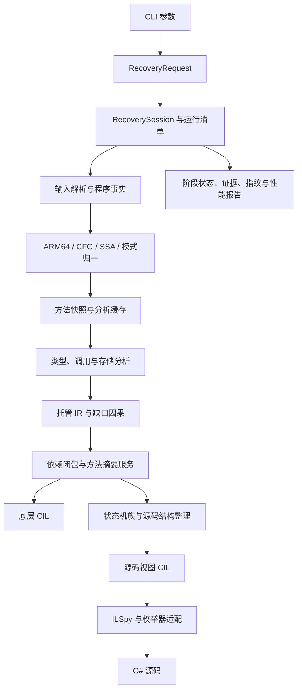

# 架构

## 模块

| 模块 | 职责 |
|---|---|
| `src/Cpp2CS.Input` | 元数据、注册表和事实缓存，连接解析库与内部模型 |
| `src/Cpp2CS.Core/Images`、`Functions`、`Model`、`Facts` | 映像与重定位、函数边界、异常表、类型与调用约定、字段布局和运行时辅助函数 |
| `src/Cpp2CS.Core/Arm64`、`Ir`、`Flow`、`Ssa`、`Lifting` | 指令语义、控制流、SSA、传播和位级运算 |
| `src/Cpp2CS.Core/Idioms` | 将 IL2CPP 生成的固定指令模式转为运行时语义操作 |
| `src/Cpp2CS.Core/Recovery` | 类型约束、值与地址、调用、结构体、异常区域和状态机恢复 |
| `src/Cpp2CS.Core/Analysis`、`Recovery/Analysis` | 结构比较、效果、有限迭代、快照、依赖缓存和诊断 |
| `src/Cpp2CS.Core/Storage` | 存储范围、读取快照、常量下标、初始化与完整值覆盖 |
| `src/Cpp2CS.Core/Calls`、`Structure` | 调用候选和摘要契约、状态机族与迭代器协议 |
| `src/Cpp2CS.Output` | 元数据骨架、依赖收集、CIL 写出、库调用整理与 ILSpy 反编译 |
| `src/Cpp2CS.Output/Source/Enumeration` | 枚举器 AST 的路径识别、清理配对与 foreach 输出 |
| `src/Cpp2CS.Pipeline` | 范围选择、并行恢复、访问器证据、依赖闭包、摘要服务与产物发布 |
| `src/Cpp2CS.Cli` | 参数、日志和退出状态 |
| `tests/Cpp2CS.Tests`、`tests/oracle` | 独立断言、指令对照、输出检查与原生/CIL 执行对照 |

## 恢复与输出

### 分析契约

`MethodSnapshot` 固定语句序列与 CFG 版本；分析视图只暴露只读语句序列，不携带可变块列表。替换语句、边、异常入口或已证明的 φ 后，`MethodAnalyses` 失效整个方法的分析缓存。发布后的节点禁止原地修改数组，刷新时检查这一不变量。分析期间只读 IR；领域变换仍通过原节点身份关联来源，再整体替换节点。

规则按已声明的依赖拓扑运行。每步记录输入、输出版本、类型数量和耗时。类型求解与源码归约分别使用有限迭代，区分稳定、循环和预算耗尽；类型未收敛登记洞，源码未收敛退回整理前的方法体。

可预期的恢复失败由 `RecoveryResult<T>` 传递，不通过逻辑异常控制流。成功空值表示规则未匹配；失败携带地址、稳定编号和根因。内部不变量错误直接抛出。`HoleLedger` 保留根因与派生关系，部分方法体的缺口仍留在原位置。

帧快照使用 `RewriteResult` 分开候选与提交，记录完整读取、支配关系、不重叠写入和不逃逸的证据；拒绝与冲突不提交替换。其他规则保留各自必要的证明边界，不以相似语法替代语义检查。

### 身份与所有权

`NativeBinding` 保存特定入口的引用、标量、聚合或完全共享布局，托管泛型参数的相等关系保持原语义。原生布局缓存与方法摘要的键另含绑定身份，避免同一定义的不同入口互相污染。

`CallBindingState` 按方法持有调用候选、绑定和诊断，以 IR 节点身份关联来源。临时绑定同时依赖类型版本和 IR 版本；由隐藏参数或帧布局证明提交的绑定保留稳定身份，不能被后来的启发式候选静默覆盖。节点替换、等价复制和类型失效分别通过明确操作更新状态。多候选无法唯一解释时保留冲突。

`MethodSummaryService` 由会话持有，先登记批量恢复的结果。源码变换只读取摘要；会话收集缺失请求、恢复、缓存，再重放仍缺依赖的方法，已完成的方法不随其他依赖重跑。失败摘要也缓存。Output 不创建恢复器；摘要键包含方法、原生入口、恢复模式与布局绑定，缓存存在不代表依赖已经写出。

`SourcePreparation` 逐方法执行源码整理，独立持有库模式缓存、临时变量与规则日志，依赖补齐后重新生成该方法的结果。原生入口、静态字段读取方法索引及已完成的库方法整理由会话内的 `SourceLibraryIndex` 共享，避免逐方法扫描整个程序。读取共享整理结果前仍先查询摘要，缺失请求不会被缓存掩盖。`ManagedSafety` 集中表达路径非空事实支持的安全读取；未知调用仍需专门证明，不能仅凭语法移除异常区域。

状态机族关联启动入口与唯一 MoveNext，缺少或部分成员单独报告。迭代器清理在结构层恢复；枚举器的 AST 形态集中在输出适配层，共用类型协议，保留各形态的正常退出、异常清理、引用空值和副作用边界。

完整枚举与带结果枚举先识别候选，再由 `ForeachRewrite` 集中提交循环、初始化、出口和清理节点的替换。候选使用克隆的循环体，识别失败不会改动原 AST。

### 写出边界

`BodyEmitter` 提供批量检查与写出入口，`EmissionPolicy` 每次调用显式传入。`BodyValidation` 只检查 IR 与权限，不修改骨架或写出证据；同一类型的构造初始化仍按整批检查。失败结果 `EmissionProblem` 携带类别、方法、地址和可读说明，访问器恢复依赖类别，不解析中文说明。

`CilBodyWriter` 每个方法创建一次，独立拥有局部变量、跳转标签、异常区间和当前方法上下文。`EmissionSymbols` 只共享程序集辅助符号及写出证据。校验失败保留原骨架或此前成功写出的体；完整体、部分体与源码体继续分别统计。

### 产物与追踪

输出目录必须为空。`run.json` 记录输入和实现哈希、选项、环境、阶段耗时、峰值内存与产物哈希；阶段完成后原子更新，中断保留 `incomplete`。只有全部阶段完成才发布 `complete`。

未注册事实缓存按二进制、元数据、实现与运行配置的哈希分别保存，多个版本可以共存；文件带内容校验并原子替换。方法摘要在会话内缓存，托管 IR 尚不做跨进程重放缓存。

| 产物 | 内容 |
|---|---|
| `recovery.jsonl` | 完整体、部分体、声明、写出失败及缺口因果 |
| `analysis.jsonl`、`rules.jsonl` | 分析版本、耗时和已接入证据协议的规则判定 |
| `call-resolution.jsonl` | 调用候选、选择与阻塞 |
| `state-machine-families.jsonl` | 状态机成员及可用性 |
| `source-passes.jsonl`、`source-status.jsonl` | 源码规则变化、耗时、收敛与回退 |
| `summaries.json` | 会话摘要数量、依赖发现轮数与逐方法分析次数 |

`EmissionPolicy` 分开完整检查、恢复体、部分阅读体与源码视图。写出成功、源码编译、ILVerify 和执行验证是不同状态；运行清单不会把未执行的验证标记为通过。

程序事实提供方法身份、调用约定、类型布局和运行时结构信息。机器 IR 保留位宽、寄存器与内存效果；托管 IR 使用类型化的值、语句、控制流和异常区域。

恢复规则涵盖调用与字段、数组、委托、结构体、栈槽和部分泛型模式。异步及迭代器整理依赖入口、状态字段、挂起与恢复路径的共同信息；不能只靠方法名称折叠。

数组固定取址须证明空引用、空数组和首元素地址的所有合流路径，并保留分支中的副作用。写出 pinned 局部和真实指针访存，不给原生无检查的读写额外添加数组边界检查。

动态帧下标可按到达写入证明为常量：检查所有前驱、读取时快照与重叠写入，地址逃逸、循环或证据不足时不折叠。固定地址随后沿用栈槽提升及异常区域恢复，不直接按生成类型名删除异常代码。

返回帧中的数组引用先参与游标和复制类型的迭代推导，再绑定最终帧区域。连续宽复制保留标量尾部；剩余单次写入、不逃逸且支配所有读取的帧片段可沿用原SSA快照，不重做原始访存。

Unity 的 IL 注入注册类可能用私有嵌套类型作泛型参数。源码对已知标记下的唯一公开静态无参 void 泛型方法，通过类型查找和 Action 绑定保留调用及原异常；普通 CIL 仍保留直接调用，依赖类型的访问权限不变。重载歧义和复杂签名不作此转换。

未解析的类型、调用或控制流通过诊断记录。完整方法体和部分方法体分别处理；部分输出保留缺口标记，不计入完整写出指标。

符合 ECMA-335 II.14.6 的委托运行时成员按继承关系、实现标志和签名核验，保留为 `delegate` 声明。`recovery.jsonl` 单独记为 `runtime-declaration`，不写普通 CIL 方法体，也不计入原生方法体字节覆盖率。

原生导入从 IL2CPP 缓存包装的参数结构恢复库名、入口和调用约定，同时核对缓存合流、标量参数原样转调及额外副作用。确认后写回原 `extern` 声明，按 `PlatformInvoke` 单列；涉及字符串、结构体等封送的包装仍需独立恢复。

泛型定义从注册表选择入口，恢复体保留类型参数。引用共享及标量实例提供传参布局；标量泛型只允许复制、默认值和拆箱，不能把具体实例的算术推广到所有类型参数。布尔传参的低位规范化只在 bool 布局已确认时折叠。`--methods` 可指定已登记的实例名或开放泛型名；同一定义只允许选一个入口，避免多个实例体覆盖同一 CIL 方法。动态大小的完全共享实例仍可能留洞。

`emitted.tsv` 记录实际恢复入口；泛型方法定义本身可能没有地址。导出统计只覆盖所选入口，不包含同一定义的其他原生实例；计算固定范围的原生字节覆盖率时，需要另行保留这些实例的分母。

内联认回可能依赖额外方法。依赖收集检查实际输出集合，并递归补齐所需方法；分析缓存命中不代表依赖已经写出。`--verified-accessors` 可读取带身份和方法体指纹的验证证据，`--rejected-accessors` 可排除被拒绝的自动属性合成。

`assemblies/` 保留底层恢复结果；`assemblies-src/` 承载异步提升、集合调用和可读性整理，供 ILSpy 生成 C#。两种输出各有用途，源码更简洁不代表原生行为已经验证。

## 边界

- 运行时结构和 ARM64 调用约定存在版本与平台约束；更换输入需核对解析和布局诊断。
- 泛型共享、内联、栈槽复用和异常布局可能导致无法唯一解释的片段。
- 元数据裁剪可能使源码缺少编译所需声明；骨架程序集不是原始运行库。
- 合成运行时只覆盖已建模的行为，不能代替完整 Unity 环境。
