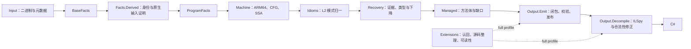

# 架构

## 项目与依赖

| 项目 | 职责 | 允许依赖 |
|---|---|---|
| Core | 映像、模型、事实、机器 IR、L2、托管 IR、L3 | BCL |
| Input | Il2CppDumper 适配、事实构建与缓存 | Core |
| Output | 元数据骨架、CIL、反编译与合法性修正 | Core |
| Extensions | 访问器认回、内联认回、async、源码与 AST 整理 | Core、Output |
| Pipeline | 请求、阶段、profile、摘要和报告 | 上述项目 |
| Cli | 参数、兼容环境选项、日志与退出状态 | Pipeline 等入口 |

Core 内部按 `Image → Model → Ir → Facts → Machine → Idioms → Recovery` 分层。`Facts.Derived` 可以使用提升与 L2；基础 Facts 不依赖它们。`Managed` 是恢复与写出的契约，不引用 Recovery。模型通过 `ITypeLayouts` 读取布局，布局推断由 Facts 实现。

`architecture` 按 Roslyn 符号检查禁止的依赖方向，包含别名和完整类型名。Core、Output 都不引用 Extensions；Output 不访问恢复器内部状态。

## L2 与机器层

`IdiomRewriter` 是入口，`IdiomState` 保存单方法状态，`IdiomPipeline` 明确列出步骤顺序。各步骤位于 `Idioms/Passes/`。跨函数输入证明位于 `Facts/Derived/NativeCalleeFacts`；转发构造、本地副本、清理跳板等原生形状判断位于 `NativeMethodFacts`。两者的缓存仍由各恢复器实例独立持有。

`Machine/Algebra` 提供地址分解、直线路径、用途索引、编号供给、语句改写、步骤追踪与支配关系缓存。地址策略明确区分左右加法树、常量符号、定义展开和根判定，不合并原本不同的证明条件。

`PassList` 保留清理和非短路执行次序，记录输入、输出语句数、变化、耗时，以及不动点的轮数和收敛状态。达到原有预算时记录 `BudgetExhausted`，不伪装为收敛，也不额外改动恢复结果。

## L3 状态与规则

`MethodRecovery` 保留外部入口。每个方法创建 `RecoveryScope`，按准备、分析、下降、证明四段运行。状态由 `MethodState` 的签名、运行时、构造、帧、结构体、异常、调用、数组、类型和下降计划十张表持有。

- `[Analysis]` 读取机器 IR，写入证据；框架检查它没有改写 IR。
- `[MachinePass]` 声明分析失效范围，允许改写机器 IR；框架随后刷新快照。
- 下降规则接收 `LoweringScope`，只读证据视图，通过 `ValueRecoveryService` 恢复值、生成托管语句。

规则位于 Signature、Generics、Runtime、Memory、Frames、Structs、Construction、Calls、Exceptions、Control、Values、Lowering、Typing 各目录。`RuleRegistry` 扫描带属性的静态方法，按原有 `After`、`Order` 拓扑排序；缺少依赖、签名不匹配或成环直接报错。表达式定型与下降共用同一套值恢复实现。

`StatementList` 的所有写操作都经过 `StatementRewriter` 通知证据表；规则也可直接调用改写器。含语句身份键的表声明替换和删除策略，诊断与调用绑定同时迁移。`MethodSnapshot` 检查已发布节点的数组未被原地修改；IR 变化使方法分析缓存失效。支配关系按独立的控制流快照复用。

`NativeBinding` 保留特定入口的泛型布局见证。调用的临时绑定依赖类型与 IR 版本，已提交的身份证据不能被候选静默覆盖。方法摘要的键包含入口、恢复模式和布局身份；缓存存在不等于依赖已发布。

可预期失败通过 `RecoveryResult<T>` 和 `HoleLedger` 传递。洞的编码显式指定，独立于成员重命名；`Category` 用于分类，根因与派生关系保留。异常布局使用状态枚举判断成功，不解析中文原因。

## 发布与扩展

核心依赖闭包只补齐透明构造与内联调用，不扩张普通调用。候选迭代只调用 `Check`；`BodyPublication` 在每个视图中仅发布一次方法体。完整体、带缺口的部分体、运行时声明和骨架占位分别处理。

`IEmissionTransforms` 注入写出前的可读性整理及源码入口处理，`IDecompileTransformProvider` 把外围 IL/AST 变换注册到原来的插入位置。合法性修正留在 Output。源码整理失败时退回整理前的体；仍不满足写出条件时保留恢复视图发布体。

`--profile core` 运行事实、选择、恢复、核心闭包、发布、反编译与报告，直接从 `assemblies/` 生成 C#。默认的 `full` 在扩展点加入认回和源码整理，额外生成 `assemblies-src/`。

遵循仓库的异常规范，内部错误直接抛出。ILSpy 的类型反编译错误仍中止运行，`run.json` 保留 `incomplete`；不通过捕获逻辑异常把运行标成完成。

## 选项与产物

`RecoveryOptions`、`DiagnosticOptions` 在入口解析后传入事实和恢复器。Core、Output 不读取环境变量，也不直接写控制台；诊断通过 `IDiagnosticSink` 输出。兼容环境变量的解析位于 Pipeline。

默认事实缓存核对输入、实现、运行时与栈槽选项。显式的 `--fact-cache-file` 固定快照，仅绕过实现哈希变化，仍核对输入与运行配置；路径和内容摘要写入运行清单。固定快照不能代替冷启动事实核对。

| 产物 | 内容 |
|---|---|
| `recovery.jsonl`、`emitted.tsv` | 状态、缺口、部分体和完整写出清单 |
| `publication.jsonl` | 恢复视图各方法的程序集、token 和 CIL 摘要 |
| `analysis.jsonl`、`rules.jsonl` | 分析版本、机器步骤、收敛、耗时与规则证据 |
| `call-resolution.jsonl` | 调用候选、选择与阻塞 |
| `source-passes.jsonl`、`source-status.jsonl` | full 的源码整理与回退 |
| `state-machine-families.jsonl`、`summaries.json` | full 的状态机和摘要服务记录 |
| `run.json` | profile、解析后选项、输入与实现摘要、阶段状态和产物摘要 |

输出目录必须为空。全部阶段完成后才发布 `complete`。写出成功、源码编译、ILVerify、合成执行对照和游戏实际运行是独立结论。
