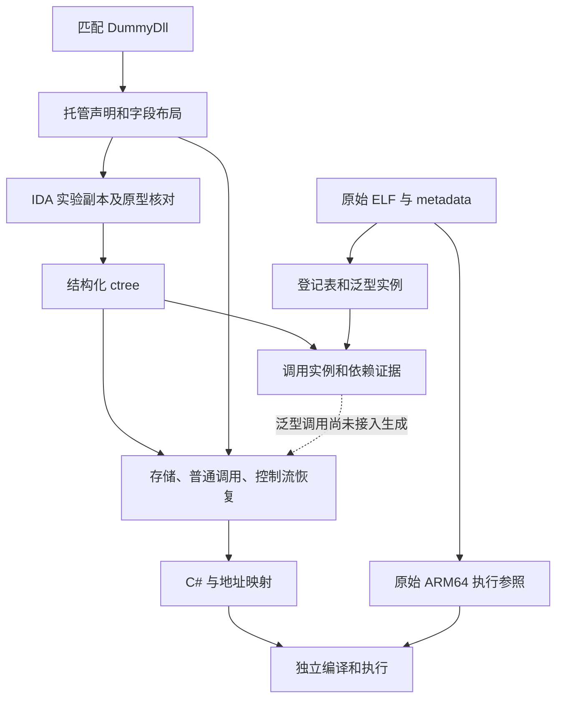

# Grid 与 API：进度及未完成项

2026-10-16。**当前没有完成 GridAreaData 或 API 请求链的交付。** 本轮完成了公共调用、控制流基础，以及一个实际依赖 `GridAreaCell` 的整类恢复。下面分别记录实际执行结果和分析结果。

## 已执行验证

| 范围 | 结果 | 边界 |
| --- | --- | --- |
| GridAreaCell | 4 个真实方法自动恢复，生成项目独立编译；10,280 次原始 ARM64 调用，6,170 项 C# 断言 | GridPosition 仅提供已核对的四字节布局，没有声称恢复其方法 |
| 普通调用与控制流 | 8,058 项断言；值类型构造的 ref 写回、getter、while/do/for、break/continue、switch 穿透、跨条件块跳转 | 调用点和控制流用例为合成 ctree；被调用的 StaminaData 方法体来自真实 ctree |
| 首组回归 | 10,408 项断言；六类错误输入与行为变异仍能被拒绝/检出 | 仍是首组两个小型类型，不代表请求链完成 |
| 泛型依赖分析 | 原始槽位身份检查 8 项，真实上下文与支配关系检查 15 项 | 检查身份和共享规则，尚未证明完整原生 ABI 或方法行为 |

GridAreaCell 包括构造、TilePosition getter、私有 setter 和 SetPosition。验证覆盖任意四字节位型、私有访问性、对象初始值，以及对象头和字段后哨兵字节。生成代码不链接 DummyDll，不使用手写目标方法体。

## 公共层改动

- 元数据读取支持跨程序集布局和显式选择依赖成员。部分依赖写入 manifest，不能计入完整类型数。
- 调用使用程序集、类型、Token 和原生地址绑定；地址歧义、错误参数数量、缺少被调用方法体会直接失败。
- 值类型构造使用生成的 ref 初始化方法，保持对调用方存储的写回，不把它误写成临时对象构造。
- 分支、循环、switch 和 goto 统一为基本块，再生成普通 C# 标签与跳转。输出层不解析伪代码，不运行解释器。
- 登记表适配器读取原始 ELF 和 metadata，保存两者哈希、方法定义、泛型实例、类型结构及泛型上下文槽位。
- 依赖分析解析 MethodInfo 的实际字段路径，并用支配关系检查局部别名。多次赋值、地址逃逸、跳转绕过赋值时不猜测来源。
- IDA 探针记录原型修正前后内容，每次导出前清除该函数的反编译缓存；实验数据库退出时不保存。

## 当前架构



依赖分析和恢复器目前仍有明确断点：恢复器接纳的是原型已核对、MethodInfo 为零的普通直接调用；`context_plan.py` 的泛型绑定结果尚未转成恢复器可消费的闭合类型与调用。因此不能把分析报告称为已经能生成或执行泛型方法。

## 实际发现

### GridAreaData

9 个本类方法和 6 个编译器生成的辅助方法已导出。复杂点集中在公共机制：

1. List.Add 的快路径被内联成数组写入、size/version 更新，扩容走泛型上下文中的 AddWithResize。
2. Enumerator 返回值是结构体，需要核对 ARM64 返回缓冲区和调用方写入。
3. GridPosition 存在窄字段打包、部分位读取及静态初始化。
4. Rotate、复制构造含枚举器清理；ctree 中的普通控制流不能代替完整异常清理证据。
5. GetInnerState 包含静态委托缓存及 LINQ 调用。

已从 `Setup` 的真实 `MethodInfo → klass → rgctx[14]` 读取路径绑定到 `List<GridAreaCell>.AddWithResize`。类型实参来自登记表，不依赖显示名称。

### API 请求链

已检查 `GetSuiteUserPartsApi → APICaller.Call → APIManager.CallAPI → APICore`，以及 `SendRequest` 的状态机。

- GetSuiteUserPartsApi.Execute 合并完成回调、构造路径，并传入本实例的 OnCallBack。
- APICaller 的类型实参 `EmptyRequest / SuiteUser` 通过类泛型槽位变成 APIManager.CallAPI 的方法泛型实参，已用真实 ctree 验证绑定。
- SendRequest.MoveNext 有 1,118 行原始伪代码，包含请求头构造、可选头合并、HTTP 方法分支、发送、协程等待、响应状态分类和回调。
- 通用非 GET 分支还包含序列化和加密；当前入口选择 GET，不能把其它分支的未验证行为称为已支持。
- 响应经过 ConvertResponse、CallBackReponse 和 Completed；入口成功回调继续调用 UserDataManager.UpdateAll。

因此“构造 URL，再用本地 HTTP 返回一个成功结果”不足以验证此链路。需对照请求内容、状态变化、回调顺序和用户数据更新，同时明确哪些环境依赖由测试宿主提供。

## 尚需完成

1. 将泛型上下文绑定接入元数据实例化和恢复器；核对结构体参数、返回缓冲区、未使用参数与共享代码 ABI。
2. 实现可验证的对象分配、类初始化、数组/集合存储和别名模型，再恢复 GridAreaData 全部成员。
3. 恢复委托和协程调度，以及异常清理，继续请求、响应、业务回调的完整依赖。
4. 为两个根 case 建立真正的原始执行对照。所有目标成员恢复、无占位、独立编译、行为对照通过后才标记交付。

`context_plan.json` 目前只展开直接调用；报告明确标出委托、虚调用、协程分派、静态初始化、异常清理尚未覆盖，`complete` 为 false。导出函数数、已绑定调用数和子依赖通过数均不能替代以上验收。

## 复现

GridAreaCell 的完整重放：

```powershell
python -X utf8 scripts/run_grid_storage.py D:/Cpp2CS/attempt-10/ida-session/libil2cpp.i64
```

调用与控制流回归：

```powershell
python -X utf8 tests/check_calls.py D:/Cpp2CS/attempt-10/ida-session/first
```

登记表适配器依赖固定版本的 Il2CppDumper 子模块，只复用二进制和元数据解析，不引入第九次的语义恢复管线。

```powershell
dotnet run --project src/Cpp2CS.MetadataProbe -- ../lib/arm64/libil2cpp.so ../lib/arm64/global-metadata.dat ../.re-jp-pjsk-7.0.0/dump/script.json artifacts/second/runtime-index.json
python -X utf8 tests/check_contexts.py artifacts/second/runtime-index.json D:/Cpp2CS/attempt-10/ida-session/second D:/Cpp2CS/attempt-10/ida-session/dependencies
```

本地产物：`artifacts/grid-storage/` 保存生成源码、原生结果和验证报告；`artifacts/second/` 保存根方法清单、登记表及依赖分析。D 盘保存 ctree、运行时布局和原型修正记录。以上生成物、游戏二进制和 IDA 数据库不提交 Git。
