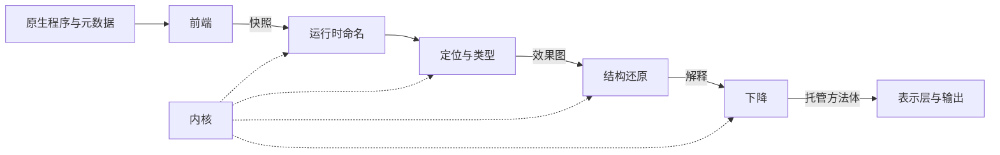

# 设计

Cpp2CS 从 Unity IL2CPP 生成的原生程序与配套元数据恢复托管方法，输出 CIL 程序集、C# 源码和未恢复部分的诊断。本文定下恢复核心的设计：按什么语义判断“恢复得对”，内核提供什么，中间层怎样组织，采纳怎样强制经过证明，以及什么事实出现时这套设计不成立。

文中的要求分两类：

- **契约**：层与层之间、实现与验证之间的约定。改动契约先改本文。
- **做法**：达到契约的一种方式，可以换成更好的。

各层内部的具体模型（运行时命名、定位与类型、检查、守卫、内联逆、异常区域等）各有单独的语义说明，第 18 节列出它们接在内核的哪个位置。

## 1. 概览

一个托管操作——一次字段读取、一次 `newobj`、一次方法调用——经过生成链之后，在原生代码里是一小组**效果**：检查、读、写、调用、分配。il2cpp 按固定模板把每个操作展开成这组效果；编译器随后只做保持行为的事：把互不影响的效果换位，把不同路径上相同的效果合成一份，把一份复制到多条路径，删掉多余的。

恢复是反过来：把属于同一个托管操作的效果收回同一个点，换成这个操作。收回是否正确只取决于两件事：

1. 这些效果合起来，是不是这个操作的定义所说的那一组；
2. 每个被收回的效果，与它途中越过的效果是否互不影响。

本设计把这两件事各放在唯一的一处，其余部分围绕它们组织：

| 部件 | 做什么 | 形式 |
|---|---|---|
| 操作目录 | 每个托管操作的定义：IL 写法，加它展开成的效果（效果模板） | 数据 |
| 独立关系 | 哪两种效果互不影响，可以换位 | 数据，一张表 |
| 等价引擎 | 按路径对照“这些效果”与“这个操作的模板”，并用独立关系核对每一次越过 | 内核，唯一的证明入口 |
| 发现器 | 猜：指出哪几处效果可能是哪个操作 | 可以用经验；猜错只会证不出来 |
| 选择 | 从证明成立的说法里，取互不重叠、洞最少的一组 | 内核，唯一的选择步骤 |
| 下降 | 照选中的结果写出托管代码，没有解释的地方写 `Unrecovered` | 机械 |

合流、循环、内联、复制这些由编译器造成的形态，只在内核解释路径的那一处出现，不出现在任何操作的定义、任何独立关系的行、任何发现器的条件里。补一类形态因此落在一处：缺操作就加一条目录项，编译器的某种搬动没被认可就加一行独立关系，值没有名字就补一条事实。

## 2. 目标、范围与输出口径

**目标。** 输出 CIL 程序集、C# 源码和未恢复部分的诊断，服务三种用途：逆向分析时直接阅读；方法论研究，结论有证据、可复现；作为开源工具，在陌生项目上给出可信的结果。

**范围。**

- 首个目标是 Android ARM64、Unity 2022.3、元数据 v31。其他目标（Android x86_64、Windows x64 等）只经目标描述接入；其他 Unity 与元数据版本经规格数据接入。
- 可读性（控制结构、状态机提升、命名）属于表示层，与恢复核心分开，排在核心之后。

**输出口径。**

| 状态 | 含义 | 是否计入覆盖率 |
|---|---|---|
| 完整写出 | 方法体里没有洞，每一处替换都经过证明 | 计入 |
| 部分写出 | 方法体里有洞，洞处写 `Unrecovered`，附没换掉的原生项和原因。整个方法视为不可信 | 不计入，单独统计 |
| 未写出 | 没有可用的方法体 | 不计入 |

部分写出的方法里，洞之外的语句与完整写出的方法走同一套经过证明的变换，只在洞处停下。没有为了可读而补全的启发式路径。

## 3. 成功标准与原则

**成功标准。** 四项同时成立：

1. **每条规则有理论出处。** 能说明它逆的是生成链的哪一步（il2cpp 的哪个模板，或编译器的哪种变换），正确性依据是什么。没有形态意义上的多维规则。
2. **正确性有全量证据。** 语料的 IL 对照，加上真实样本的全量执行对照，不以抽样代替。写出数、编译通过、执行对照一致是不同的结论，分别报告。
3. **补洞只动一处。** 补一类形态，只在一个地方加一条有依据的数据或模型，其他方法不退化，不依靠全量回归排查影响。
4. **多样本恢复率。** 在多个项目上分别报告，不以单一样本的数字代表整体。

**原则。**

- **条件分两种。** 正确性前提回答“为什么这样替换是安全的”（异常去向不变、没有别名、有访问权限），删掉就会写错，是正当的条件。形态描述回答“它长什么样”；形态出现第二个维度（“合流后的某某”“带事件的某某”），说明缺的是模型。判别方法：去掉这个条件，会不会写出错误的代码。
- **发现可以靠经验，采纳只凭证明。** 找候选可以用启发式、次序和预算；一次替换被采纳，只能经过统一的证明，并且在构造上无法绕过（第 11 节）。
- **证明不足就留洞。** 高频形态说不清出处时保持为洞，不加经验规则。频率只决定研究的先后。
- **停滞时回到模型。** 恢复率停滞时复查模型，不放宽判定或验证。
- **先问生成器。** 遇到新形态，先查明它由哪个模板或哪种变换生成，再决定属于哪个模型；查不清就先不写代码。

**架构约束。**

- 按生成链的逆序分层：前端 → 运行时命名 → 定位与类型 → 结构还原 → 下降 → 表示层与输出。层的边界是词汇契约。
- 前端产出的原生 IR 是不可变快照，后面各层不改写它。
- 先写 CIL，再由 CIL 生成 C#。
- 平台差异只进入目标描述与规格数据；恢复逻辑不按业务方法、名称或地址特判。

## 4. 依据：生成链

| 段 | 工具 | 做了什么 | 逆向时对应 |
|---|---|---|---|
| C# 到 IL | C# 编译器 | 降级：状态机、闭包、foreach、using、lock | 表示层 |
| IL 到 C++ | il2cpp | 逐方法模板展开，基本不优化。判空、越界、类初始化、元数据惰性初始化、分派、装箱都写成固定序列；类型擦除成指针与结构体；小方法另生成强制内联的副本 | 运行时命名、定位与类型、操作目录 |
| C++ 到优化后的中间表示 | 编译器中端 | 内联、聚合体拆分、读取复用、合流与下沉、公共指令上提、路径复制、位技巧 | 结构还原 |
| 到机器码 | 后端 | 指令选择、寄存器分配、帧布局、调用约定、异常表、尾部合并 | 前端；尾部合并归结构还原 |
| 到二进制 | 链接器 | 重定位、相同代码折叠、导入 | 前端 |

设计依赖的事实：

- **il2cpp 的翻译是模板展开。** 同一种 IL 构造总是翻成同一组效果，变化只来自类型。所以每个托管操作可以写出一份效果模板。
- **优化保持值，打乱结构。** “某对象的类的第 n 个虚表槽”这样的值在优化前后不变；变的是效果发生在哪个块、是否被复用、是否与别的路径合流。所以值可以直接命名，结构要靠证明收回。
- **编译器只做合法的搬动。** 它交换两个效果、把效果挪过一段代码，都以这两者互不影响为前提。所以搬动造成的差别只是若干对独立效果的换位；内核的独立关系覆盖到编译器所用的依据，这些差别就能收回，没覆盖到的只会成为洞。
- **被内联方法自己的代码仍在产物中。** 强制内联的副本之外，被调方法另有带注册入口的定义，可以作为“这次调用会做什么”的定义。

## 5. 结构

### 5.1 层与契约



| 层 | 逆的是 | 产出 | 出口词汇 |
|---|---|---|---|
| 前端 | 链接、后端、ABI | 快照（7.1） | 块、块参数、带实参行的出口、读写与调用的出现、项。没有寄存器、标志位、指令字、异常表格式 |
| 运行时命名 | il2cpp 模板里值与调用的部分 | 事实 | 运行时结构上的读取是具名的项，对运行时函数的调用是登记的运行时操作；其余标为“未命名” |
| 定位与类型 | il2cpp 的类型擦除 | 事实 | 每次内存访问有位置，每个值有定义类型；其余标为“未定位” |
| 结构还原 | 编译器中端；il2cpp 把一个操作拆成多个效果的部分 | 解释：一组带凭据的声明，加洞 | 每个可观察的效果要么被恰好一条声明占用，要么在洞里 |
| 下降 | 无，机械步骤 | 托管方法体 | IL 词汇与 `Unrecovered` |
| 表示层与输出 | C# 编译器的降级 | CIL 程序集、C# 源码 | |

内核不是一层，是各层共用的机制。

### 5.2 两种结论

中间层的结论分两种，组合方式不同，不混用：

| | 值的事实 | 效果的解释 |
|---|---|---|
| 说的是什么 | 关于快照的真命题：这个值是什么、这次访问落在哪、两个值是否相同 | 一种说法：这几处效果合起来是这个托管操作 |
| 彼此的关系 | 都为真，可以同时成立；只增不改 | 互相排斥：一处效果只能归一个操作 |
| 怎样组合 | 累积，与次序无关 | 选择（9.7） |
| 判定者 | 值判定（7.8） | 等价引擎（9.3） |
| 所在的层 | 运行时命名、定位与类型 | 结构还原 |

除这两个判定者之外，系统里没有第三处判断“相同”或“等价”。

### 5.3 信任边界

| | 包含 | 出错的后果 |
|---|---|---|
| 可信部分 | 快照契约；事实规则；规格数据（结构布局、运行时操作登记、操作目录、独立关系）；内核（项的规范化、合流的解释、值判定、等价引擎、选择的记账、下降） | 可能写出错误的代码 |
| 不可信部分 | 发现器、候选索引、次序、预算、选择的搜索策略 | 只会多洞或换一种同样正确的写法 |

可信部分要小、要慢改；常改的扩展点（目录项、独立关系的行、规格条目）都是带依据的数据。

### 5.4 全局事实与逐方法恢复

- **全局事实**对整个二进制建立一次：映像、元数据模型、运行时规格、代码地图（函数范围、方法入口与候选身份、运行时函数的识别）、元数据全局槽与实体的对应。
- **逐方法恢复**是纯函数：输入是该方法的快照、全局事实和它查询到的其他方法的事实，输出是方法体与方法记录（第 12 节）。方法之间可以并行，结果不依赖线程数与次序。
- **跨方法只读事实，不读恢复结果。** 一个方法需要别的方法的地方只有三种：调用目标的身份、调用的效果摘要、被调方法的效果图（作为调用的模板，9.1）。三者都由被调方法的快照与事实得出，不依赖被调方法是否恢复成功，所以方法之间没有恢复次序，也没有递归截断的问题。

## 6. 语义

“恢复得对”的含义只有本节一个定义。等价引擎、独立关系、语料对照、执行对照都以它为准。

### 6.1 可观察行为

程序按托管语义解释。

- **事件**：不透明调用、对象分配、精确的类初始化、抛出（含判空、越界、类型不符等隐式抛出）、其他可观察的运行时操作。每个事件观察此刻的整个托管堆。
- **写入不是事件。** 写入只在下一个事件或结局处被观察。
- **读取不是事件。** 读取可能伴随的抛出是事件；原生代码里显式的检查与 IL 访问隐含的检查是同一事件的不同写法。
- **不可观察的效果**：元数据惰性初始化、时机不受约束的类初始化、写屏障、栈保护、运行时私有状态的读写、未逃逸帧对象的读写。
- **结局**：返回（带值）、抛出。
- **等价**：对每个入口状态，事件序列逐个相同（同种、同操作数、发生时堆相同），结局相同。

### 6.2 效果词

一条路径上依次发生的效果排成一个词。两个词等价，是指一个能经下面的规则变成另一个。引擎只使用这些规则；增加规则先改本节。

| 规则 | 内容 | 依据 |
|---|---|---|
| 换位 | 相邻两个独立的效果可以交换（独立关系见 7.6） | 独立的定义 |
| 不可观察 | 不可观察的效果可以删去或插入 | 6.1 |
| 可弃 | 结果无人使用的读取、未暴露且所属类没有终结器的新对象，可以删去 | 读取不是事件；新对象在首次被使用前不可见 |
| 幂等 | 后置条件已经成立时，幂等事件等于不执行 | 精确的类初始化只执行一次 |
| 写入归并 | 两个观察点之间，只比较观察点上各位置的内容 | 写入不是事件 |
| 展开 | 托管操作等于它的效果模板；目标唯一的调用等于被调方法的效果图 | 模板展开；调用的定义 |
| 复制 | 把汇合块的一段前缀按入边各复制一份，不改变行为 | 路径不变 |

### 6.3 证明的对象

设原生程序在某条路径上的效果词是 w。输出程序在对应路径上是一串托管操作；把每个操作按“展开”换回效果，得到词 x。恢复正确，就是对每条路径 w 与 x 等价。第 9 节的声明、凭据与组合定理把这个整体命题拆成互不依赖的局部证明。

## 7. 内核

### 7.1 快照

前端的产物是每个方法一张不可变的图。它是事实的唯一来源，任何步骤都不改写它；后面各层的结论都是附在它上面的标注。

| 概念 | 契约 |
|---|---|
| 块与块参数 | 每个块只使用自己的参数和块内按次序产生的值。跨块传值时，源块在每条出口上为目标块逐项给出实参 |
| 出口与边 | 一个块可能离开的每个地方都是出口：条件分支的两臂、跳转表的各项、返回、不返回的调用、带异常出口的调用（正常出口与展开出口各是一个出口）、条件陷阱。每个出口带目标块、整行实参和离开时的内存版本。边的身份是（源块，出口序号）；两条边即使起点终点相同也是两条 |
| 出现 | 块内占位置的项：内存读取、内存写入、调用、动态栈分配，以及块末的终结。出现的身份是（块，序号） |
| 项 | 纯计算不占位置，是带位宽的项（7.2）。出现的操作数与结果都是项 |
| 入口 | 入口块专用，参数是按抽象槽位给出的实参；原生代码跳回第一条指令时，前端另设循环头 |
| 内存版本 | 每次写入、每次可能写内存的调用产生一个版本；块入口的版本由各入边传入 |
| 追溯 | 每个出现记录原生地址，只用于诊断，不作身份 |

三处约定把指令层面的事实原样留在快照里，判断留给内核：

- **由跳转完成的调用。** 指令集里的跳转离开了本函数的已知范围（跳往别的地址的直接跳转，不是跳转表的间接跳转）时，前端写成一次带“由跳转完成”标记的调用，加一个返回出口：返回行里的结果取这次调用的结果，返回地址、栈指针与各保存寄存器取跳转那一刻的值。前端不判断它是不是尾调用。把它读成“调用后返回”有两个前提，都由内核核对，不成立时这次调用是未命名的效果：目标是一个函数入口（代码地图里的入口，或规格登记为代码指针的运行时字段的值）；返回行满足与普通返回相同的条件（返回地址、栈指针、保存寄存器等于入口处的值）。前者是这种写法特有的前提：调用指令的目标按指令的含义就是函数，跳转指令的目标不是。后者使栈指针是否归位、返回地址是留在寄存器里还是从栈上取回，都只是“返回行是否等于入口值”这一个判断的不同证明途径，不成为分类。被调函数遵守调用约定是登记的假设（16.2）。
- **实参行可以含未定义位。** 前端不知道被调方的签名。调用约定的每个实参槽位都可以列出，值未知的写成未定义；没有列出的槽位与列出而值未定义的槽位含义相同。于是同一个调用点的行与到达它的路径无关。调用实际使用哪些槽位由事实层按被调方的原型决定；被使用的槽位上是未定义位时，这个实参没有可对照的值，调用成为洞。
- **动态栈分配带当前栈基址。** 指令把栈指针改成与当前值相差不是常量的值时，写成出现“动态栈分配（基址，大小）”：基址是改写前的栈指针，大小是基址减去新值，结果是新的栈指针，此后的栈指针取这个结果。结果恒等于基址减大小，这是登记的等式（7.8）。前端只陈述栈指针的变化，不判断方向：“[结果, 基址) 是新分配的存储，与基址以上的一切不重叠”要求大小非负且不越过栈的下界，由内核用区间判定证明前者，后者属于“栈不溢出”的假设（16.2）；证明不了时结果只是一个数，没有分配的含义。相差常量的改写仍是纯计算。

快照不被改写，所以（块，序号）与（源块，出口序号）在快照的整个生存期内稳定，不需要另设跨改写的身份。快照在构造时校验值的可见性、位宽、实参行与参数个数是否一致，并带一个内容摘要。

前端构造快照的接口，以及寄存器、标志位、内存、调用、返回各自怎样写进快照的约定，见 `docs/前端.md`。

### 7.2 项

项是值的唯一表示。项在构造时规范化并驻留，结构相同就是同一个实例。

| 项 | 含义 |
|---|---|
| 常量、未定义 | 未定义用于填充和被破坏的位 |
| 入口参数、块参数 | 块参数按（块，序号）区分 |
| 出现的结果 | 读取的结果、调用的各结果槽 |
| 运算、切片、拼接、选择 | 选择保留条件与真假两支 |
| 实体、运行时属性 | 由事实层引入的具名原子：类、方法、字段、字符串；对象的类、虚表槽、数组长度等运行时不可变数据上的纯函数 |

- **规范化只用语义恒等式**，与使用位置无关：位搬运（移位、掩码、扩展、截断、寄存器对、向量车道）化成切片与拼接；只取 0 和 1 的值的各种写法归一；比较的方向与严格性、常量的结合归一；精确的浮点扩宽之后的取整与等值比较归到原值上（较窄格式的每个值在较宽格式里都能精确表示）。
- 规范化不按某个使用者的需要改变值的表示。

**未定义位的身份。** 未定义位表示“这里的位没有被规定”；来源不同的未定义位互不相关。

- **占位没有身份。** 前端与目录用 `未定义(位宽)` 构造的项只是占位，按位宽驻留成同一个实例；两处占位是同一个实例，不说明它们取值相同。所以规范化里靠“两个操作数是同一个项”得出结论的恒等式（相减得零、相等为真、同一个项上相邻的切片合并、按同一个条件同时化简），只用于不含占位的项。把含占位的项换成另一个含占位的项，只在可能的取值不减少时允许（未定义的切片仍是未定义，相邻的未定义合并）。
- **身份来自位置。** 内核读取图里的任何一行——某个出现的某个操作数、某个终结的条件、某条出口的某个实参——时，先把行里的每一处占位换成**任意值**原子，按（图，块，行，行内序号，按树形展开数到的第几处）区分。一个项被两处引用时，其中的占位按两处计。此后内核里流动的项不含占位。位置只取决于图的内容，与构造次序无关；摘要仍按占位计算。
- **任意值是值。** 它任意，但在所在路径上固定：同一个原子处处相等，可以进入一切恒等式。块参数与出现的结果同样是值——未定义位沿一条边到达块参数的那一刻，就取定为这条边这个实参位置上的原子。所以对块参数 p，`p == p` 恒为真；两处占位直接相比则不化简。两者并不矛盾：前者比较的是同一个位置取定的值，后者比较的是两个位置。
- **两侧的量化不同。** 原生一侧的任意值按全称量化：证明必须对它的一切取值成立。同一个被破坏的寄存器被使用两次，会得到两个互不相关的原子，这只会使能证明的更少。模板一侧的“结果未规定”（例如移位量不小于位宽）按存在量化：对照时与现场对应位置的值绑定，同一条路径上绑定之后不再更改。因此模板一侧的原子在**产生它的那一步**取得身份（图，块，指令偏移，步），不在使用处：按使用处区分会让同一个未规定的结果在两处取不同的值，放宽对照。
- 身份按“这一次经过”理解，与出现的结果相同：环上每一圈是新的值。

### 7.3 值的来源与合流的唯一解释

**来源关系。** 块参数的备选来源是各条入边上对应位置的实参；选择项的备选来源是它的两支，各带条件与方向。由此得到来源图：节点是值，每个备选带着完整的边身份。同一条边上的整行实参同时到达——两条边分别传入 (a, b) 与 (b, a) 时，汇合后的两个参数只能取这两种配对；把每个参数各自化成来源集合会多出 (a, a) 与 (b, b)。来源图保留回边、并行边与重复实参。

**三个操作。** 合流只在内核的这三个操作里被解释：

| 操作 | 含义 |
|---|---|
| 按边代入 | 给定一条边和一个项，把项里属于目标块的参数同时换成这条边上的整行实参 |
| 分情况 | 给定一个程序点和若干项，沿入边与选择条件向后展开，得到有限张情况表：每个情况是一组边的选择与选择条件的真假，各情况互斥，合起来覆盖到达该点的全部路径；表里的项不再含展开范围内的合流。展开在回边处停止，循环头的参数保留为原子，表示“这一次迭代的值” |
| 走查 | 给定一个窗口（一组入口点和一组出口点，其间无环），枚举从入口到出口或到结局的每条路径；每过一条边就按边代入；给出该路径上依次经过的出现、各操作数在这条路径上的取值和累积的路径条件 |

**环。** 走查的窗口在入口与出口之间无环。从一个块的入口开始走查时，这个块的参数保留为原子。含环的区域由等价引擎在切点处切成无环的段，逐段走查（9.3）；除此之外没有别的地方处理环。

**逐情况提升。** 写给“输入不是合流”的规则（例如“常量槽位地址上的读取是该槽的实体”），由内核对每个情况各用一次，结果是一张情况表；各情况结果相同时就是这个结果。规则的作者看不到合流。

**情况、路径与可行性。** 分情况与走查只做两件事：枚举结构上的选择，按边代入。一个情况带着它所选各条边的条件文字与所选选择条件的真假，与走查给出的路径是同一种记录。某个情况或某条路径是否可行、某个项在它的条件下取什么值，只由路径条件格回答（7.7）；分情况与走查不保留自己的矛盾判断，只在项规范化成常量时直接取用。逐情况提升只看可行的情况。

**约束。** 内核之外的代码拿不到入边，也不遍历来源图去得出结论。发现器可以取“一个项的叶子集合”当作找候选的索引；结论只能来自上面三个操作之上的两个判定者。

### 7.4 内存与读取

全部内存按运行时规格分成五类，划分先于一切识别建立：

| 类别 | 例 | 处理 |
|---|---|---|
| 帧对象 | 局部、溢出槽、结果缓冲区 | 按生存期分版本；地址没有逃逸的不可观察；逃逸到未知用途的保留为可寻址的存储 |
| 运行时不可变数据 | 对象头的类指针、虚表、数组长度、已初始化的元数据槽 | 纯函数，读取是运行时属性项，没有版本 |
| 单调状态 | 类初始化标志、方法的元数据初始化标志 | 只会从未就绪变为就绪，以路径条件表达 |
| 托管堆 | 实例字段、静态字段、数组元素、经引用或指针的位置 | 按别名类分版本，调用带效果摘要 |
| 运行时私有状态 | 活跃异常栈、栈保护值 | 托管语义下不可观察 |

- **读取的身份**是它读的位置，加上沿内存版本往回最近的、可能改写这个位置的定义。身份相同的两次读取同值。
- 映像里装入后只读的指针字（全局偏移表等）是链接期常量；类型的元数据槽上的读取是该类型的实体，字符串字面量的槽上的读取是该字符串的实体，槽在初始化调用前后各读一次是同一个实体。其余用途的元数据槽（类型句柄、方法、字段）初始化之后同样不变，读取没有版本。元数据初始化调用返回槽的内容时，结果与读这个槽相同。
- 运行时不可变的位置不被任何写入改变：排在一次不能证明不重叠的写入之后的读取，仍是同一个值。
- 类结构上的读取（类指针加常量偏移：初始化完成标志、静态区指针）读的是运行时的数据，属于运行时不可变数据与单调状态：它有读取的身份，不是托管位置上的读取，不是效果。
- 规格登记的取值范围（例如数组长度不超过 0x7fffffff）进入路径条件格，与成立的比较一起供区间判定使用。
- **别名判定只有一处**，三值：必然相同、必然不同、不能判定。
- **单调。** 别名知识只增；知识增加只会让“最近的可能改写”更早，已有的同值结论不被推翻。

### 7.5 效果

事实层把每个出现读成托管语义下的效果，得到**效果图**：快照加上每个出现的效果。一个出现可以有几个效果分量（一次对象分配含类初始化与新对象两个分量）。

| 效果 | 含义 | 可观察性 |
|---|---|---|
| 读 | 读一个已定位的位置，结果是一个值 | 不是事件 |
| 写 | 向一个已定位的位置写入一个值 | 在下一个事件或结局处被观察 |
| 调用 | 对托管方法或可观察运行时操作的一次调用 | 事件 |
| 新对象 | 分配一个指定类的对象或数组，结果是新引用 | 事件；首次被使用前不可见 |
| 类初始化 | 确保某个类已初始化 | 精确的是幂等事件；时机不受约束的不可观察 |
| 条件抛出 | 条件成立时抛出某种异常：一条通往“只抛出尾”的边 | 条件成立时是事件与结局 |
| 抛出 | 抛出一个异常对象 | 事件与结局 |
| 分支 | 按条件选择出口 | 不是事件 |
| 无 | 不可观察的效果：写屏障、元数据惰性初始化、栈保护、私有状态 | 不可观察 |
| 未命名 | 事实层没能读懂的出现 | 当作与一切相关的事件 |

- **是否返回。** 前端把调用一律按会返回写；只有调用是函数范围里的最后一条指令时，块以“不返回”的出口结束。一次调用不返回的依据有三种。任何一种成立，路径都在这次调用处结束，快照里排在它后面的出现与出口不属于任何执行：
  1. **规格**：运行时操作的登记项写明它不返回。这样的调用是抛出效果；只抛出尾由此判定，与前端在那里写了什么出口无关。
  2. **被调方法的效果摘要**：被调托管方法自己的快照里没有返回出口——每条路径都以不返回的调用、陷阱结束，或不终止。这是关于被调方法快照的事实，不依赖它的恢复结果（5.4）。把返回留给别的函数的方法不在此列：由跳转完成的调用带着返回出口。
  3. **调用点**：这次调用是函数范围里的最后一条指令。它若返回，接着执行的是函数范围之外的字节，不对应生成代码的任何行为；编译器保持语义，所以有定义的执行里它不返回（16.2）。函数范围取自代码地图。

  后两种依据不改变效果的种类：不返回的托管调用仍是调用效果，是事件，不是只抛出尾；没有命名的调用仍是未命名的效果。依据不足时按会返回处理，只会少结束路径。
- **运行时操作的效果种类**也是规格的一栏，内核只按种类处理：抛出运行时构造的异常（不返回）；不可观察（只动运行时私有状态，例如元数据惰性初始化、写屏障）；类初始化；纯函数（结果是登记的具名函数作用在实参上，没有内存效果）；构造一个种类已知的运行时异常对象（抛出之前不可见）；抛出实参给出的异常对象（不返回）。登记里没有的调用是未命名的效果。可能失败的运行时查找（接口查找的慢路径）是可观察的运行时调用：事件的身份是函数与实参，返回的值与失败时的抛出都属于这一个事件，两侧对上之后相互绑定；引擎不枚举它会抛出什么。异常种类只登记模板写明、要逐个对照的那些（条件抛出的种类，以及唯一效果就是抛出或构造某种异常的运行时操作）。
- **抛出的操作数。** 运行时构造的异常只有种类（16.2：同种异常彼此不可区分）；抛出托管代码给出的异常对象时，事件的操作数是这个对象，双方抛出的须是同一个对象。
- **只抛出尾按边区分。** 几处检查共用同一个只抛出块时，这个块按进入它的边分别计入各自的检查。
- **占用的单位是效果分量。** 默认覆盖经过它的全部路径。只有一种细分：按进入某个汇合块的入边区分（6.2 的“复制”），下降时把该块的相应前缀按入边复制。
- **效果索引。** 按种类、按操作数的项查出现，供发现器取候选。

### 7.6 独立关系

`独立(u, v)` 回答：两个效果相邻时交换次序，是否不改变可观察行为。回答只有“已证明独立”和“不能证明”。全系统只有这一处判断“一个效果能否越过另一个”。

| 一对效果 | 何时独立 | 依据 |
|---|---|---|
| 读、读 | 总是 | 读取不是事件 |
| 读、写；写、写 | 两个位置已证明不重叠 | 别名判定 |
| 读、调用 | 调用的效果摘要已证明不写该位置 | 效果摘要 |
| 写、调用 | 该位置在这次调用处不可观察（未暴露的新对象的字段、未逃逸的帧对象），且调用不读它 | 事件观察整个堆 |
| 写、条件抛出 | 该位置在抛出的去向上不可观察 | 同上 |
| 条件抛出、读 | 总是 | 读取不是事件 |
| 条件抛出、条件抛出 | 两者抛出的异常相同（同种类、同操作数）且去向相同 | 同时成立时分不出先后 |
| 条件抛出、调用或其他事件 | 不独立 | 事件的先后可观察 |
| 新对象、其他效果 | 该效果在这条路径上的操作数不含这个新对象 | 新对象在首次被使用前不可见 |
| 类初始化、其他效果 | 时机不受约束或该类没有静态构造时总是；精确时，与事件、托管堆的读写不独立 | ECMA-335 I.8.9.5 |
| 调用、调用 | 不独立 | |
| 未命名、任何效果 | 不独立 | |

- 表里的“位置不重叠”“操作数不含”“不可观察”都取自事实层的正面证明；“这条路径上的操作数”由走查按边代入后给出。
- **缺一行只会多洞；多写一行不成立的独立才会写错。** 所以每一行附语义依据（ECMA-335 条款或运行时源码）和一个语料用例。行的条件只许是语义条件；出现“在合流之后”“在循环里”这类条件，说明模型有问题（第 17 节）。
- 表是数据。每一行有自己的摘要，引擎记录每次查询用到的行（第 12 节）。
- 规格里登记的只有语料用到的行，目前是三行：读与读、条件抛出与读、条件抛出与条件抛出。上表其余各行在有语料用例用到时登记；没有登记的一对效果不能证明独立。

### 7.7 路径条件

沿边成立的文字：非空、类型检查成立、比较结果、整数区间、某个类已初始化。全系统只有一个路径条件格。

- 对外只有一个判定：给定条件与程序点，回答真、假或不能判定。
- 每条成立的文字带着**确立它的出现**（哪次检查、哪条分支边、哪个事件的后置条件）。
- **入口处成立的文字**由事实层给出，确立者是方法入口，各带出处。例：实例方法的 this 非空（16.2）；共享泛型代码的入口经隐含的方法实参读内存时，这个实参是本方法的方法结构（18.3）；`System.Boolean` 的形参只取 0 与 1，它的值就是最低位（生成代码把它写成 C++ 的 `bool`，16.2）；类型初始化器（`.cctor`）的入口处，“所属类的初始化已触发”成立——初始化器只在该类的初始化过程中由运行时调用，同一线程在其间再次请求初始化会立即返回（ECMA-335 I.8.9.5；运行时的 `Runtime::ClassInit`）。
- **模板一步的有定义条件**（9.1）在这一步之后并入路径条件，确立者是这一步。
- **路径中途登记的不可变位置**（模板把一个位置当作运行时不可变数据使用：数组长度、对象的类、元素类、类型判断内联体里的读取，7.4、9.3）：已成立的文字、等式与上界里这个位置上的读取按读取身份换成没有版本的写法；换写之后两条文字成了同一个条件而取值相反（例如写入前后两次读长度做的两次下标检查，一次通过、一次不通过），或同一个项等于两个不同的常量，这条路径不存在。
- 格的结论与文字的列举次序无关：矛盾不因换写而丢失，区间取各条文字给出的界里最紧的一个。

### 7.8 值判定

`同值(a, b, 程序点)` 是值层唯一的判定者。它成立的途径只有：规范化后是同一个项；读取身份相同；逐情况在各自的路径条件下求值相同；规格登记的等式（运行时操作的结果等于哪个运行时属性）。

规格登记的等式里有一类随目标而变：具名函数在某个目标上的定义，带登记的有定义条件（例如 `CastDoubleToInt32(x)` 在 arm64 上是“x 为正无穷时取最小值，否则饱和转换”，条件是 x 为正无穷或截断后可表示）。目标由快照给出，内核按它选行，不出现目标的名字。模板里的具名项按这一行换成定义时，有定义条件按 9.1 并入路径条件：用到这条等式的结论只对条件成立的执行有效，凭据与正向核对都记下用到了它；条件在此处不能成立时不用这条等式。

事实层的规则只提出“这个值等于那个具名的项”的候选，由值判定证明；证明成立的等式累积成同值关系。例如类型判断被内联成几条路径的合流时，各来源在各自路径条件下都等于同一个运行时属性项，这个合流就是该项，不需要为它写形态规则。

### 7.9 查询

事实以查询的形式提供：纯函数，输入是快照、全局事实和其他查询的结果，结果带记忆，每次求值记录它读过的依赖与结果摘要（第 12 节）。成环的依赖（类型与位置沿循环互相依赖、调用的效果摘要沿调用图成环）显式声明为单调不动点组，写明单调量与终止依据；到达预算是洞，不当作收敛。失败的查询返回原因，原因沿依赖传递，洞由此得到归因链。预算一律按步数计，结果可复现。

### 7.10 经内存传递的值类型

调用约定（AAPCS64 §6.8.2、§6.9）把值类型分三种放法：不超过 16 字节的放进整数槽；同质浮点聚合体（成员全是同一种浮点类型，至多四个）每个成员占一个向量槽；其余的经内存传递。前两种的值就是各槽位内容的拼接。第三种的槽位里是一个地址，值在内存里。

**三种私有区域。** 帧对象的规则（7.4）推广到三种区域，各有一个基：

| 区域 | 基 | 大小 | 初始内容 |
|---|---|---|---|
| 帧 | 入口处的栈指针 | — | 未初始化 |
| 形参副本 | 入口处第 i 个经内存传递的形参所在的槽位的值 q | 该形参的大小 | 这个形参的值 |
| 结果位置 | 入口处间接结果寄存器（x8）的值 r | 返回值的大小 | 未初始化 |

- 地址写成“基加常量偏移”、整个访问落在区域之内时，它是这个区域上的访问；读写规则与帧槽相同：读到的是最近一次写入的值（完全落在一次写入之内时取相应的切片），没有写入过就是初始内容的切片。它们不是效果。
- 区域彼此不重叠，也不与堆重叠。出处是调用约定与源程序的语义：按值传递的形参是被调方自己的对象，结果位置在被调方返回之前只有被调方能写。调用者省掉复制、直接交出一个已有对象的地址时，编译器保证被调方分辨不出来。这是登记的假设（16.2）。
- 形参的值：模板一侧的形参绑定到“形参副本的初始内容”这个项。返回值：到达返回出口时结果位置的内容。
- 基的地址作别的用途（写进内存，或作为普通实参交给调用）是逃逸，同帧对象一样是未命名的效果。

**调用点。** 被调方法有名字时，它的签名说明哪些实参经内存传递、返回值是否经内存返回。

- **实参。** 槽位里的地址 a 落在调用者的某个私有区域里（帧，或调用者自己的形参副本）时，这个实参的值是调用那一刻 [a, a+n) 的内容。调用之后这段内容**未定**：被调方可以改写自己的副本。这不是逃逸——被调方只在调用期间拥有这段内存，返回之后不保留它的地址（16.2）。
- **结果。** 间接结果寄存器里的地址 a 落在调用者的私有区域里（帧，或调用者自己的结果位置）时，调用返回之后 [a, a+n) 的内容是这次调用的结果值；调用之前这段内容被作废。
- a 指向别处（堆上的对象：编译器省掉了复制）时，相当于调用之前有一次对该位置的整体读取；这种情形目前不解释，是未命名的效果。
- 一次调用交出的各段内存互不重叠，否则是未命名的效果。

**值的比较**沿用值类型在寄存器里传递时的口径：按成员，填充字节不比较。

**放法是双方共用的假设。** 共同执行的两侧按同一张放法表取值，放法错了两侧会一致地错，终点核对发现不了。所以每一种放法在接入样本之前，必须先在语料里有带真实 IL 的用例，并通过正向核对：形参、返回值、与别的实参混排各一例。

## 8. 事实层

运行时命名、定位与类型两层只产出事实。事实的契约：

- **事实是关于快照的真命题。** 它不依赖任何声明是否被采纳。
- **只增不改。** 规则是单调的：输入的事实增多，输出的事实只增不减。
- **不以缺少事实为依据得出有利的结论。** “没有发现别名”不是“没有别名”；独立、不可观察、未逃逸都要正面证明。
- **规则写给非合流的输入。** 合流由内核逐情况提升（7.3）。

各项的要点：

- **值的命名。** 每个项有一个粗的种类（托管引用、某种运行时结构的指针、帧地址、整数或浮点位型），由定义给出：形参按签名，真实调用的结果按被调方的原型，读取按位置或规格。在此之上，按规格把运行时结构上的读取解释成运行时属性项，把元数据槽的读取解释成实体，把对运行时函数的调用解释成登记的运行时操作（登记项写明输入、结果、内存效果、可观察性、幂等性）。
- **定位。** 一次访问的事实是（根对象的值，字节范围，根的布局类型）。同一段字节可以有几种托管写法（整个结构体字段，或它内部的字段路径）；选哪种写法是解释层的事，不是事实。
- **类型。** 值的类型取自它的原生定义：形参按签名，真实调用的结果按被调方，读取按所读位置的声明类型，新对象按被分配的类，合流取各来源的并。被内联的调用在原生代码里没有“调用结果”，它的返回类型不进入事实；它只影响输出的静态类型，由选择核对（9.7）。
- **效果分类。** 每个出现的效果分量由命名与定位给出。读不懂的是“未命名”，它不会被任何目录项解释，成为洞。

**实体的身份。** 实体项的 Key 取自元数据模型，事实一侧与模板一侧用同一套：

| 实体 | Key | 说明 |
|---|---|---|
| 类型 | 模型的运行时类型表里，与它结构相同的最小下标 | 结构相同不计修饰位与按引用标记。类型定义、泛型实例、数组、指针同在这一个空间；元数据槽给出的类型下标规范化后就是 Key |
| 方法 | 方法定义的下标；泛型实例是 2³² 加方法实例表里结构相同的最小下标 | 身份是托管方法，不是代码：共享同一份代码的几个实例是几个实体，“入口相同”是代码地图上的事实 |
| 字段 | 字段定义的下标；所属类型是泛型实例时，高 32 位是（该实例的类型 Key + 1） | 泛型实例的字段偏移按实例计算 |
| 字符串 | 字面量表里内容相同的最小下标 | 字符串字面量的身份是内容 |

编号只取决于二进制与元数据文件，与查询次序无关。模型里没有的实体（二进制没有用到的构造类型）没有 Key，引用它的模板不能展开。

内核对元数据的需求是一个按实体提问的接口（方法的签名、分派方式与所属的类；字段的类型、所属的类、偏移与是否静态；类型的栈上类别、存储位宽与布局；类有无静态构造、初始化是否精确；方法是不是所属类的类型初始化器）。它由模型上的一个适配器实现，适配器属于事实层：它引用内核与元数据模型，不读文件；泛型实例的布局按运行时的布局算法由模型算出。只有核对工具读托管程序集：记号到实体的解析按 ECMA-335 对引用的解析规则进行（定义按所在映像与记号，引用按解析范围、名称与签名找到定义，构造类型按结构），解析的结果是上表的 Key，名称不作身份。

**命名的依据。** 把一个地址认成某个运行时函数、把一段内存认成某个运行时结构的字段，依据必须是可核对的东西。每个命名记录它的依据；依据是“形状相似”的不是事实，只能作发现的线索。没有命名的调用是未命名的效果。

样本之内的依据：符号表、元数据登记表与代码登记表里的指针、元数据槽里的编码。托管方法的身份只来自登记表；参照指纹只用于运行时函数，登记为托管入口的地址不经它命名。

样本之外的依据是**参照指纹**：规格里按运行时版本、目标与工具链登记的一张表。它来自带符号、带调试信息的参照构建，出处是参照构建的构建标识与符号文件，属于可信的规格数据。

**表的内容。**

- **行是参照函数，按参照里的地址区分。** 一个地址上的全部符号名是这一行的名字集合：同一段代码的几个名字（同址的两个构造函数符号、折叠后的别名）行为相同，名字随地址走，不逐组登记。
- **只收运行时库的函数**：参照构建的调试信息里，编译单元属于运行时库及其依赖库的函数。生成代码里的函数（托管方法、调用器、注册函数）随项目而变，不入表；指向它们的引用记为“表外”。
- 每行登记屏蔽位置字段之后的函数体，以及各个**引用**：被屏蔽的位置字段指向的目标，按位置排列。引用分四种——代码（调用、尾分支、取地址的函数入口）、只读数据（登记内容的摘要）、可写数据（登记参照里的地址）、表外。
- **参照类**在建表时算出：函数体相同、只读数据内容相同、可写数据地址相同、各代码引用的目标同类，满足这些条件的最粗划分。同类的参照函数行为相同，名字集合取并。非空集合中的每个名字都登记为同一运行时操作时，该类才取得这个操作。缺项或操作冲突时按未登记处理；建表时另报登记冲突。

**局部相同。** 样本地址 a 与参照函数 N 局部相同，是只比较这一个函数的结论：屏蔽之后逐字节相同（各引用的位置与种类因此相同），只读数据的内容相同。它不涉及代码引用与可写数据引用的目标。结论三值：相同、不同、不可比（缺完整的函数边界、页地址的用途不明、只读内容无法核实）。不可比只是这一个函数的结论，不沿调用链扩散。

**配对。** 命名的结论是配对：样本的函数地址对到一个参照类，样本的可写数据地址对到参照的一个可写数据地址。配对由三条规则从空集推出，取最小不动点；每一对记下得到它的规则与层数。

| 规则 | 得到什么 | 条件 |
|---|---|---|
| 锚点 | a 对到名字集合含 X 的类 | 样本之内的依据给 a 的名字是 X：动态符号，导入桩经重定位表得到的名字 |
| 传递 | 已配对的 a 的第 k 个引用的目标，对到参照里对应引用的目标：代码引用对到目标所在的类，可写数据引用对到那个地址 | a 已对到类 K，且与 K 的成员局部相同。表外的引用不传递 |
| 同体 | a 对到类 K | a 与 K 的成员局部相同；a 的每个代码引用、可写数据引用的目标都已配对，且就是 K 对应引用的目标；满足条件的类只有这一个。互相引用的几个函数可以一同加入：组内的引用以组内这次的配对为准，允许成环 |

- **传递给没法比较的函数名字。** 被传递到的函数自己的代码可以不可比：它是那个参照函数，只因为同一个源函数编成了同样的指令，并在同一处引用它。传递只要求父函数自己局部相同，不要求父函数的整棵调用树都配上；一个函数配不上，不影响调用它的函数。
- **同体靠代码相同，不靠唯一。** 代码相同、每个引用的目标逐个对上，行为就相同，所以样本一侧不要求唯一：同一个内联函数的几份副本各自对到同一个类。可写数据不作假设：读一个全局量的小函数与读另一个全局量的小函数屏蔽之后相同，它引用的地址已经由传递对上，才配对。
- **有歧义就没有名字。** 与 a 相符的类不止一个（只在尚未配对的引用上有别）时不配对，等传递从父函数把它们分开。
- 托管方法的身份只来自登记表：登记为托管入口的地址不参加配对。

**准入。** 传递的前提是“样本与参照出自同一份运行时源码、同一套工具链”：这时同一个源函数在同一处引用的是同一个源函数。这个前提不能从单个函数看出，是登记的假设（16.2），由反例检验。

- **反例**有两种。一是已配对的一对里双方可比而局部不同（锚点对上的、传递对上的都算）；二是配对冲突：一个地址对到两个类，一个可写地址对到两个参照地址或两个可写地址对到同一个参照地址，登记为托管入口的地址被对到运行时函数。
- 配对推完之后没有反例，这张表才用于这个样本。有一个反例，整张表不用，三条规则都不给名字。不可比的函数不是反例。
- 检验的力度写进命名记录：比较过的配对数、其中的锚点数、不可比的个数。没有一个锚点局部相同时，传递推不出任何配对，等于没有这张表。
- 版本只决定先试哪张表。

配对给出的名字进入可信部分。它们的裁判是执行对照（第 15 节），以及两份独立的参照构建互相命名、再对照符号的盲测（错误须为零）。去掉参照表只会少名字，不改变已有的结论。

**包装函数不命名。** 被调地址自己的代码就在样本里，内核读它的快照：整个函数只有一次由跳转完成的调用，或一次登记为不返回的调用，实参行原样取自入口时，对它的调用就是对那个目标的调用——这是“展开”（6.2）用在运行时函数上，前提与 7.1 相同：目标有命名依据，返回行等于入口值，被目标的原型用到的实参槽在包装里没有改动。包装自己不需要名字，也不按指令的样子识别；多做了事的函数（改动实参、调用之后另取返回值）不满足这些前提，按普通函数处理。

## 9. 解释层

### 9.1 操作目录

每个托管操作是目录里的一项：

- **IL 写法**：下降时写出的指令与操作数。
- **效果模板**：它展开成的效果，写成直线序列加条件抛出，操作数是模板的形参。来源是 il2cpp 对这条指令的翻译模板与运行时头文件。
- **主效果**：模板里用来定位这个操作的那个效果，供通用发现器使用。
- **出处**：对应的生成步骤与语料用例。

例：

```text
ldfld F（对象 o）
    o 为空 ⇒ 抛出 NullReference
    结果 = 读 字段(o, F)

stelem.ref（数组 a，下标 i，值 v）
    a 为空 ⇒ 抛出 NullReference
    v 非空 且 IsInst(v, 元素类(类(a))) 为空 ⇒ 抛出 ArrayTypeMismatch
    (uint)i ≥ 长度(a) ⇒ 抛出 IndexOutOfRange
    写 元素(a, i) ← v

newobj T::.ctor（实参 x…）
    r = 新对象(T)                      // 含 T 的类初始化分量
    调用 T::.ctor(r, x…)
    结果 = r

callvirt M（接收者 o，实参 x…），M 的目标唯一
    o 为空 ⇒ 抛出 NullReference
    调用 M(o, x…)
```

**有定义条件与实现偏差。** 模板写的是 il2cpp 的翻译，不是标准。翻译在某些输入上没有定义时（生成的 C++ 在那里是未定义行为），那一步带一个**有定义条件**；标准在这些输入上另有规定时，目录项同时登记一条**实现偏差**：条件、标准规定的行为、出处。

```text
div（a，b），整数
    b 为零 ⇒ 抛出 DivideByZero
    结果 = a ÷ b                     有定义条件：非（a 是最小值 且 b 是 −1）
    偏差：条件成立时 ECMA-335 III.3.31 规定抛出 ArithmeticException；翻译是 C++ 的除法，只检查零

rem（a，b），整数
    b 为零 ⇒ 抛出 DivideByZero
    结果 = a 模 b                    有定义条件同上
    条件成立时 ECMA-335 III.3.55 允许抛出 ArithmeticException，也允许不抛出（数学上的结果是 0）；不登记为偏差，登记为“由实现决定”
```

- 有定义条件属于操作的这一次执行，不附在结果的位上：结果被丢弃时它仍然存在。
- 共同执行在这一步之后把有定义条件并入路径条件（7.7）。理由是生成链：编译器只对有定义的执行保持行为，条件不成立的输入上原生代码做什么都不构成反驳。用到它的凭据记下用到了哪条；没有用到时（例如现场就是同一条除法指令，两侧的项相同）凭据不依赖它。
- 证明的结论相应地限定为：对不触发任何有定义条件的执行，原生代码与输出等价。触发条件的输入由外部对照按目录项上登记的条件识别，归为实现偏差或由实现决定，单独计数（16.2）。输出的指令不变：原方法在这里就是这条指令。
- **有定义条件不能排除一条走得到的路径。** 上面的理由以“模板就是原方法”为前提，对真实 IL 的正向核对成立：真实 IL 在一条路径上恒无定义时，这条路径不要求等价。声明与写出的方法体是待证的一方：走到某一步时路径条件已经推出它的有定义条件不成立，输出在现场走得到的这条路径上没有定义，“对有定义的执行等价”在这里是空的——这是反驳（对应），不是通过。否则把 `throw` 的操作数换成空常量的声明能解释任何效果。条件未定时照旧并入路径条件并记入凭据：此后事件对上，条件所说的值就是现场那次操作的值，它是现场一侧那次运行时操作自己的前提。
- 目录项不随目标而变。各目标在条件成立时的实际行为（不陷入并得到回绕的商，或者陷入）不进入模板。

**静态调用的类初始化。** 调用没有 this 的方法，被调方法所属的类有静态构造函数时，模板是“类初始化（该类），调用”；类初始化的时机是否精确取自元数据（ECMA-335 I.8.9.5：没有 beforefieldinit 时，首次调用该类的静态方法触发初始化）。所属的类没有静态构造函数时模板只有调用。出处是生成代码在调用点先写 `il2cpp_codegen_runtime_class_init_inline` 再调用。类在自己的类型初始化器里访问本类的静态字段、调用本类的静态方法，模板不变；其中的类初始化由入口处成立的“已触发”按幂等免除（7.7）。

**调用的两种读法。** 模板里的“调用 M”在对照时有两种等价的读法（6.2 的“展开”）：现场也有一次对 M 的真实调用时，它是一个事件；现场是 M 的内联副本时，它展开成 **M 自己原生代码的效果图**，形参换成实参。后一种读法就是内联的逆。模板取被调方法自己的原生代码，是因为“调用 M”按定义就是执行那段代码；它不依赖 M 的恢复结果。展开只对目标唯一的调用成立（非虚方法，值类型、密封类或 final 的虚方法）。效果图里未命名的效果按原样对照：同一个原生操作，操作数在绑定下相同。

强制内联的运行时函数（例如接口查找）同样是一次调用，只是它在产物里没有独立的定义：它的效果图取自规格，按运行时头文件登记为该函数的内联体。内联体可以带环（14.6）。

**空操作**也是一条目录项（`nop`）：模板没有效果，IL 写法为空，下降时不写指令。它用来消费两臂在可观察行为上相同的分支（9.5）。

目录项里没有控制流形态。一个操作被编译器搬动、合并、复制之后怎样认回来，不写在目录项里。

### 9.2 声明

声明是一条不含语义的记录：

| 成员 | 含义 |
|---|---|
| 操作 | 目录项的标识，加它引用的元数据实体（字段、方法、类型） |
| 操作数 | 模板各形参对应的项 |
| 落点 | 这个操作写在哪个程序点。区域形的声明（模板带内部分支）落在区域的出口 |
| 占用 | 它解释的效果分量的集合，包括被它消费的分支 |
| 定义 | 操作的结果代表哪个原生值 |

声明只有标识，没有语义：操作的含义来自目录，调用的含义来自被调方法的效果图，前提由引擎从模板推出。发现器不写前提，也没有地方写。

**写法的约定。**

- 操作数与定义是取定之后的项（各条入边传入同一个值的块参数就是那个值），位宽是这个值在求值栈上的位宽：存储较窄的整数按类型扩展到 32 位。
- 落点是一个程序点：某个块里某个出现之前。主效果是条件抛出的操作（整数的除与余）落在检查通过的那个后继块的开头。
- 占用可以为空。这样的声明只说“这个操作在落点处没有可观察的效果”；它的结果仍须是声明的定义，用到的条件照常记为依赖。
- 分支在占用里写成它的出口边。通往只抛出尾的边是条件抛出；占用一条不通往只抛出尾的边，就是消费这个分支（9.5），这时它每条走得到的出口都要在占用里。

**窗口**由内核从占用与落点算出：从被占用的效果出发能到达落点的那些程序点。窗口的入口是各条路径上最早的被占用效果。窗口里不属于占用的效果叫**旁观效果**。

### 9.3 凭据与五项义务

`证明(声明)` 是唯一的证明入口，返回凭据或反驳。凭据成立，当且仅当五项义务都成立。每一项都是正确性前提：表的最后一列是去掉它会写错的情形。

| 义务 | 内容 | 去掉它会写错 |
|---|---|---|
| 覆盖 | 每一次到达落点的执行都先经过窗口的入口：从方法入口到落点、从落点回到落点的每条路径都穿过入口 | 汇合块另有一条入边带来已有的对象，却把那里的构造调用写成 `newobj` |
| 对应 | 窗口的每条路径上，被占用的效果与模板在同一路径条件下产生的效果相同：事件逐个同种、同操作数，事件发生时双方写过的位置内容相同，结果与出口状态相同。任何一侧的分支在路径条件下可判定时走确定的一侧，否则分叉。模板有而现场没有的检查，必须在该处被路径条件判定为不成立。用到的路径条件若由窗口之外某个可被占用的效果确立，记为依赖（9.4） | 把针对另一个数组、另一个值的检查当成这次存入的检查 |
| 搬移 | 每条路径上，被占用的效果与它之后、落点之前的每个旁观效果独立（7.6）；被消费的分支的各臂上没有旁观效果；中途离开窗口的路径上，已经经过的被占用效果都是可弃的（6.2） | 检查与存入之间隔着一次调用，仍把检查并进存入；对象在构造之前已经交给别的代码 |
| 去向 | 被占用的可能抛出的效果去向相同：这个去向就是操作在输出里受到的保护（18.2）；区域的各出口能归并（9.5） | 把 try 之外的分配并进 try 之内的构造调用 |
| 合法 | 这个操作在本方法里能合法写出：成员可访问；调用按写出的方式分派，目标就是模板取自的那个方法；写法通得过验证（见下） | 直接读写别的类的私有字段；把某个具体方法的方法体当成虚调用的模板；在构造函数里直接调用祖父类的构造函数 |

**“合法”的规则。** 共同执行只证明行为相同；同一个行为可以有几种写法，其中有的通不过验证。这一项逐条列出写法上的要求，出处是 ECMA-335 的可验证性规则：

- **可访问。** 声明引用的字段与方法在宿主方法所属的类里可访问（II.23.1.5、II.23.1.10）。
- **`call` 引用类型的普通实例方法**按令牌直接调用，不检查接收方是否为空（III.3.19）。目标为虚方法时，接收方须是宿主的入口 this。虚方法标志不可知时不能证明合法。
- **`callvirt` 的目标**不是构造函数，也不声明在值类型上（III.4.2）。非虚的调用在引用类型上写成 `call` 或 `callvirt` 只差一次判空；值类型的方法不经虚表，接收方是托管指针，只有 `call` 合法。
- **`call` 引用类型的实例构造函数**只用于在构造函数里初始化 this（III.1.8.1.4、III.3.19）：宿主是实例构造函数，接收方是宿主入口处的 this，目标属于宿主的类或它的直接基类。值类型的构造函数可以对着一个地址直接调用。原生代码里直接调用了更远的祖先的构造函数时（编译器把直接基类的构造函数内联了，或几个相同的构造函数被链接器合并到一个地址），合法的解释是“调用直接基类的构造函数”：它的入口与现场不同，按调用的第二种读法展开被调方法来证明（9.1、14.2）；候选由发现器提出。
- **构造函数初始化 this**（方法体一级，III.1.8.1.4）。引用类型的实例构造函数里（`System.Object` 的除外），每条到达返回的路径上恰有一次上一条所说的调用。在它之前，this 只用作给本类字段赋值的对象和这次调用的接收方。下降在方法体写全后按凭据的落点和写出次序检查操作数，沿快照的可达边传递初始化次数。合流保留各入边的状态。违反要求时整个方法体只留下入口处的“合法”洞，并记录违反要求的程序点。
- 验证器的其余规则（求值栈上的类型、`initonly` 字段的写入、受保护成员经由的对象类型）没有对应的条目。输出之后用外部验证器核对；每出现一类错误，就在这里补一条规则和一个反例，而不是在输出层绕过。

引擎的做法是共同执行：用走查枚举窗口的路径，现场与模板在共享的路径条件下同步推进。读取先查本侧自窗口入口以来的写入，再查此前经过的旁观写入，都没有就是入口处的堆。遇到旁观效果时查独立关系：它必须与此前被占用的效果独立，也必须与模板已经读写过的位置独立（输出里旁观效果都排在这个操作之前）。引擎不知道声明来自哪个发现器，也不按操作的种类分支。

**一条声明的证明。**

- 模板由内核自己取：把“各操作数入栈，这一条指令”按目录展开，与正向核对用的是同一个展开器；声明里的操作数代入模板的形参。
- 现场从方法入口出发，沿每条路径走到落点。被占用的效果在同步点上与模板的效果对照：被占用的事件、被占用的边之后的抛出、落点。旁观效果按独立关系核对。
- 走进到不了落点的块，就是中途离开了窗口：此前经过的被占用效果必须可弃。
- 依赖分两遍确定。第一遍只把本声明占用的检查确立的条件并入路径条件；不成立时做第二遍，并入全部条件，把用到的、窗口之外的确立者记为依赖。
- 模板把某个位置当作运行时不可变数据使用时（数组的长度），现场对同一位置的被占用读取不必逐个对应。
- **被消费的分支。** 路径经过被消费的分支之后、到达落点之前，输出里没有这一段：其间出现旁观效果，或出现没被占用而在路径条件下不能判定的分支，搬移不成立；路径没有到达落点而从别处离开（返回、旁观的抛出、走进到不了落点的块），去向不成立；被消费的分支有走得到而没被占用的出口，对应不成立。经过被占用的边也算经过了窗口的入口。
- 目前不出凭据的情形，都记为反驳而不是放宽：出口的归并只实现了第一种形式（9.5），各出口不是同一个程序点时反驳在“去向”；通往落点的路径经过环上的块（切点处的归纳尚未建立，一次走查只代表第一次经过）；方法里有展开出口（异常区域的模型尚未建立，反驳在“去向”）；时机不受约束的类初始化一律按精确的事件对照。

- **调用的两种对法。** 现场在同一处调用了同一个入口时，实参按被调方法的签名逐个相同，双方的结果是同一个事件结果。否则把模板里的这次调用换成被调方法自己的原生效果图，继续共同执行：实参按调用约定放在入口槽位的低位，槽位的其余位与别的槽位是这次展开独有的符号；它的帧是另一个帧；它在堆上的读写记在模板一侧；它返回时按调用约定取出结果。被调方法的效果图与它自己的 IL 等价是另一条凭据（9.4）。
- **不返回的调用。** 现场的一次托管调用不返回（7.5 的后两种依据）时，它照常作为事件对照；对上之后，双方的词都在这次调用处结束，其后的部分不再对照。证明一条声明时，这样的路径是在落点之前离开了窗口，除非落点就在这次调用之后。模板一侧正在展开的被调方法里出现不返回的调用，同样处理。
- **写入的对照。** 事件与结局处，双方做了同一串写入（次序、位置、值都相同）时内存相同；次序不同时，要求每一侧的写入两两已证明不重叠，再逐位置比较最后写入的值。
- **幂等的类初始化。** 路径条件里某个类的初始化已触发时，任何一侧对它的初始化调用都等于不执行。

- 落点不早于被占用的效果：效果只向后收。
- **窗口内的环。** 现场的环只有与模板（被调方法或运行时内联体的效果图）的环对应时才能证明。引擎在双方的环上各取一个切点配成一对，在切点对上提出一个模拟不变式：现场每个循环携带的值等于模板循环携带值的哪个项，加上每次到达时都成立的路径条件。核对是归纳：从窗口入口共同执行到切点对时不变式成立；从切点对出发共同执行一圈，双方要么同时回到这对切点且不变式仍然成立，要么同时从对应的出口离开。切开之后每一段无环，五项义务逐段照常核对；环上的效果都属于占用。双方步步对应，所以不终止的行为同样被保持，不需要终止性的假设。切点与不变式的候选可以靠经验取（循环头或环上的其他块；归纳变量之间的线性关系），采纳只凭这次归纳。现场有环而模板没有，或配不成对（例如现场的环被展开过），是洞。
- 预算按步数计；耗尽是反驳，原因是预算。
- 反驳给出第一处不成立的义务、路径和位置，洞的原因由此而来。

### 9.4 组合定理

**落点约束。** 凭据可以附带对别的原生效果落在哪里的要求，由选择核对。约束只涉及原生效果的落点，不涉及别的声明的内容。

- **依赖的效果。** “对应”里用到的路径条件，若是由某个可被占用的效果确立的（一次检查通过、一个事件的后置条件），凭据把这个效果记为依赖。约束：它的落点不晚于本声明的落点，落点相同时排在本声明之前。理由：检查被向后收之后，输出在它之前会多执行一段操作；这段操作的证明不能以“它已经通过”为前提。凭据记的是确立者所在的块（块末的检查，或块里的事件），选择按块核对：那个块里被别的声明占用的效果，其落点都不得晚于本声明。这比按效果核对保守。
- **推后的旁观效果（登记的扩展）。** 旁观效果 v 与在它之前的被占用效果不独立、但与在它之后的被占用效果都独立时，可以让 v 自己的声明落在本声明之后；凭据附约束“v 的落点不早于本声明的落点”。连续两次数组访问、检查被提前到一起的方法用到它：后一次访问的越界检查位于前一次访问的判空与元素读取之间。没被占用的 v 留在原位，原位早于本声明的落点，约束不成立。

**定理。** 设选中的声明两两占用不交，各自持有凭据，凭据所附的落点约束都成立。则对方法的每一次执行，原生的效果词与输出展开后的效果词等价。

**证明要点。**

1. 由“对应”，每条声明在每条路径上占用的效果，与它的模板在该路径条件下产生的效果是同一组（至多差不可观察、可弃、幂等的效果与写入归并）。所以两个词含同一组效果，只是次序不同：输出里，被占用的效果位于所属声明的落点，其余留在原位。
2. 任取路径上两个不独立、不属于同一条声明的效果 u、v，原生次序中 u 在前（同一条声明内部的次序由“对应”保证）。落点不早于被占用的效果，所以 v 在输出里的位置不早于它的原生位置，也就在 u 的原生位置之后。假如输出里 v 排到了 u 之前，那么 v 的原生位置落在 u 与 u 的落点之间，v 是 u 所属声明的旁观效果；“搬移”要求此时 u 与 v 独立，矛盾。
3. 落点相同的两条声明，彼此的效果都在对方的搬移范围之内，由第 2 步互相独立，先后任取（有依赖约束的按约束）。
4. 某次条件抛出在一次执行里成立时，原生代码在它的位置就结束；输出要到它的落点才抛出，此前多执行的只有原生次序上位于两者之间的效果所属的操作。这些效果与这次抛出独立（第 2 步），在抛出的去向上不可观察；这些操作的凭据不依赖这次检查（依赖约束），所以它们在这次执行里的行为仍由各自的凭据保证。

5. 按 9.5 的第三种形式归并出口时，原本走被舍弃一份的执行，在输出里走保留的一份。该形式的第一条义务给出两份代码从被舍弃出口的状态出发等价；后两条给出保留出口之后的事实在这个状态下同样成立，所以保留一份里其他声明的凭据对改道的执行仍然有效。

所以两个词只差独立效果的换位。∎

**推论。**

- **凭据互不依赖。** 一条凭据成立与否只取决于快照与事实，与别的声明是否被采纳无关。声明之间的相互作用只有占用重叠、值是否可得、落点约束三种，都由选择机械地核对。
- **否定前提不会被推翻。** “路径上没有观察者”这类前提，量化的是窗口里的原生效果，不是别的声明；采纳更多声明不改变任何原生效果，也就不改变任何前提。
- **洞不破坏其余部分的证明。** 没被占用的效果留在原位，并且与一切不独立，任何声明都不能越过它。

### 9.5 窗口里的分支与出口

- **被消费的分支。** 窗口内部的分支——两臂在窗口内重新汇合，或经被占用的条件抛出离开——是操作内部的判断（模板里一个条件的求值方式，或被调方法体里的分支）。它由声明占用，不出现在输出里。
- **出口的归并。** 区域形的声明把整个区域换成一个操作，区域的各条路径离开区域之后必须接到同一个续点。合法的形式只有三种：各出口是同一个程序点且实参行相同；各出口可由操作的结果或其他可得的值区分，写成操作之后的一次分支；各出口之后的代码已证明等价（引擎对两段原生代码共同执行），保留一份。
- **第一种形式的核对。** 经过被消费的分支的每条路径都到达落点，由引擎核对（9.3）。“实参行相同”不由引擎逐项比较：下降只在一个块的每条走得到的入边都被输出写出时，才把这个块的参数当作可得的值（第 10 节）；区域内各条路径上不一致的值因此在输出里不可得，用到它的地方是洞。各条入边传入同一个值的参数由事实层取定成那个值，不受影响。
- **第三种形式的义务。** 保留一份、舍弃其余之后，原本走被舍弃一份的执行改走保留的一份。所以这条声明要多证三件事，每一件都是正确性前提：
  1. 从被舍弃出口的状态出发，保留的一份与被舍弃的一份共同执行，直到同一个程序点且实参行与写入相同，或同一个结局。保留一份里的读取与分支，按被舍弃出口处的事实求值。
  2. 保留路径在区域内确立的路径条件，在被舍弃的出口也成立。
  3. 被舍弃路径在区域内发生的效果，保留路径上都有对应（对应到模板的同一个效果）。

  后两条保证保留出口之后的事实对改道的执行同样成立，那里的其他声明因此不需要知道这次归并。被舍弃一份的效果计入本声明的占用。去掉任何一条会写错的情形见 14.5。
- **不可表达的分支。** 条件只依赖不可观察状态或运行时不可变数据的分支（初始化标志的测试、接口查找里的比较）不能留在输出里，必须由某条声明消费；它的两臂按出口的归并处理。没有托管操作可以归属的（元数据惰性初始化的守卫），由空操作的声明消费（9.1）。守卫的演算见 14.5，接口查找见 14.6。

### 9.6 发现

发现器是纯函数：输入是只读的查询面（效果图、效果索引、项的叶子集合、路径条件的确立者、支配关系、目录、元数据），输出是声明。发现器看不到别的发现器的产出，也看不到选择的结果。

- **通用发现器**由目录驱动：对每个效果，找主效果与它相符的目录项，由主效果的操作数定出模板形参；模板里其余的效果，按操作数在效果索引里取候选，或沿被绑定操作数的叶子集合取候选（新对象）。直线模板的操作都由它发现，新增这类操作不需要写发现器。
- **内联调用的发现器**以调用方不可访问的成员访问、缺少构造调用的新对象为起点，按区域访问的字段集合与调用序列在索引里取候选方法，提出“这个区域等于对该方法的一次调用”。
- **守卫的发现器**以不可表达的分支为起点（9.5）：条件只依赖运行时状态上的读取。它提出空操作的声明；条件依赖某个类的初始化完成标志时，另对汇合之后同一个类的静态字段读写与静态方法调用提出相应操作的声明，占用里带上守卫（14.5）。
- 发现器可以多提、错提。同一处可以有多条互相重叠的声明。

### 9.7 选择

选择是唯一决定“采纳哪些声明”的步骤，输入是带凭据的声明，输出是一份**解释**。

**约束。**

- 占用两两不交。
- 值可得：每条声明用到的操作数，在它的落点处由方法参数、常量、可表达的纯运算，或别的选中声明的定义给出，并且静态类型相容。不补转换。托管指针指向的类型须与操作要求的相同（经地址访问字段时，是含该字段的值类型）：数值相同的两个地址——外层的值与它偏移为零的字段——不是同一个类型的地址。按目录展开 IL 时做同样的核对，类型不对的写法不能展开。
- 凭据所附的落点约束成立。

**目标。** 洞最少（没被占用的可观察效果，加上不可得的值）；并列时取登记在前的规则的声明；仍并列按声明的稳定键。洞数优先是契约，并列时的偏好是做法。

**做法。**

- 声明按占用重叠、落点约束和值的供求连成分量，分量之间互不影响。只有一种解释、与别的声明没有这三种关系的声明先行选中，不参与连通。
- 规则（目录项与发现器）按登记次序编号，选择逐级进行。第 k 级的候选是编号不超过 k 的规则的声明；它从第 k−1 级的结果出发，只在仍有洞、且被第 k 号规则的声明触及的分量里重新求解，只在洞严格减少时替换原结果。没有洞的分量不再证明后面规则的候选。
- 分量内的求解在预算内是精确的。超出预算时保留第 k−1 级的结果，并在方法记录里标记“选择不精确”。
- 值可得由试写核对：候选的一组声明交给下降的写出部件试写，有声明的操作数写不出来时这一组不满足约束；洞数就是试写留下的独立洞数。
- 规则的编号是目录项的登记次序，专门的发现器登记在其后。
- 验证可以指定一条必须采纳的声明再选择（对抗声明的裁判，第 15 节）；与它占用重叠的声明不参加。

**性质。**

- 追加在末尾的规则，对每个方法只有两种结果：不变，或洞严格减少。完整写出的方法不变，不需要重跑。
- 候选集合只增（事实增多、独立关系加行）时，精确求解的分量不会变差；标记为不精确的分量没有这个保证，由记录的比对检测（第 12 节）。
- 选择不影响正确性：任何一组占用不交、带凭据、落点约束成立的声明都满足组合定理。

### 9.8 洞

洞是一条记录：没被占用的效果（附原生地址）或不可得的值，加上原因——触及它的声明里最接近成立的那条的反驳（哪项义务、哪条路径、哪个位置）及其归因链。由别的洞导致的洞标为派生，统计时只数独立洞。报告与普查读记录，不解析文本。

洞按所在的层与被反驳的义务归类。层有：事实（未命名、未定位的效果）、目录（没有目录项）、发现（没有声明触及）、解释（声明被反驳，附哪项义务）、引擎与预算（证明没有做完）、选择（有凭据而没有被选中）、值（不可得的值）、骨架（控制转移写不出）。

## 10. 下降

下降只读解释与事实，照着执行：

- **骨架。** 输出的控制流是快照的控制流，去掉被消费的分支与只抛出尾；区域形的声明把区域收成“入口前缀、操作、续点”；按入边细分的占用使相应的块前缀按入边复制。被消费的分支写成直接转到消费它的声明的落点所在的块，其间的块不写。
- **语句。** 每条选中的声明在落点处写出目录项的 IL 写法，操作数取声明里的项；落点相同的先按落点约束、再按稳定次序排列。
- **值。** 项成为表达式；声明的定义成为局部；块参数成为局部并在入边并行赋值，被声明定义的块参数不再赋值。可能抛出的运算（取数组长度、除法、带检查的转换）不是表达式，是目录里的操作，经声明写出。每个表达式写出之后按目录展开回项，与要表达的项相同才采用（同一个展开器，同一个值判定）；找不到这样的表达式，值不可得。选择项写成带栈上汇合的转移：条件的写法与分支相同，转移去往一支，另一支顺序执行后转到汇合处，两支在栈上的类别相同。展开回项不是下降的事，是按目录展开的读法：内核里下降之外的一个部件，入口只有一个——给定指令序列、各形参与局部变量绑定的项、可选的转移，返回它代表的项或空；它从最后一个块的参数出发用分情况（7.3）读出取值：一个情况且没有条件时就是那个值，两个情况各只有同一个分支条件的一真一假时是按这个条件的选择，其余的不当作表达式。块参数按用到的低位宽度各成为一个局部变量；局部变量的类型取各条入边上的值的类型。块参数可得的条件是它所在的块每条走得到的入边都由输出写出并赋值：源块被一个被消费的分支略去、或源块的块末被消费的入边不算写出（源块是只抛出尾的不计）。返回值只要求存储位宽之内的低位相同。
- **不可达的续点。** 块在一次不返回的调用处结束时（7.5），原生代码在它之后没有后续，IL 的调用指令之后却必须有合法的后续。下降在这个操作之后写 `ldnull`、`throw`：它在任何区域、任何栈深、任何返回类型下都合法。它不属于任何执行，依据就是使路径在此结束的那条事实；写什么都不改变行为。终点核对里现场的路径在那次调用处已经结束，走不到它；写在走得到的地方就是输出在那条路径上没有定义，按 9.1 是反驳。以 `throw` 结束的操作之后不写。
- **洞。** 没被占用的效果在原位写成 `Unrecovered`，附洞的记录。
- **异常区域。** 保护范围取自语句的去向，即调用点的实际展开目标；范围的构造、子句的写出见 18.2。

**托管方法体**是指令的序列：助记符、引用的元数据实体、标号、带类型的局部变量；洞是原位的伪指令，带洞的记录。没有洞的方法体可以写成 IL 字节供按目录展开，引用实体的指令带的记号是一张实体表里的序号；写成程序集里的方法（真实的元数据记号、局部变量签名、异常子句）属于输出。骨架目前写出单出口、二路分支、返回与不可达的续点；多路分支、展开出口与陷阱写作骨架层的洞。

下降不识别形态，不保存跨语句的状态，不走查路径，不解释合流；创建项只发生在核对表达式的时候。需要这些时，缺的是某个事实或某条声明。

## 11. 构造上的强制

“采纳只凭证明”由类型与程序集边界保证：

```csharp
public sealed class Claim { /* 操作的标识、操作数、落点、占用、定义：只有标识，没有语义 */ }

public sealed class Certificate   { internal Certificate(/* … */) { } }   // 只有等价引擎能构造
public sealed class Explanation   { internal Explanation(/* … */) { } }   // 只有选择能构造，成员都是带凭据的声明
public sealed class ManagedBody   { internal ManagedBody(/* … */) { } }   // 只有下降能构造，输入只有 Explanation

public interface IDiscoverer { IEnumerable<Claim> Propose(FactView facts); }   // FactView：效果图、元数据、运行时布局
```

- **凭据造不出来。** 凭据的构造函数只在内核程序集内可见；发现器在另一个程序集，只引用内核的只读查询面。凭据绑定声明的摘要与快照的摘要，选择在采纳前核对。
- **语义带不进来。** 声明只能引用目录项的标识；模板、独立关系、被调方法的效果图都由内核自己取。发现器无法提供模板、前提或要写出的 IL。
- **输出只有一条路。** CIL 写出只接受下降产出的方法体；下降只接受选择产出的解释；解释里的每条声明都带凭据。
- **记账。** 选择产出解释时核对：每个可观察的效果分量被恰好一条声明占用或在洞里；每个被用到的值有定义；凭据所附的落点约束都成立。
- **机检。** 架构检查扫描程序集：发现器所在的程序集不引用内核的内部类型、不使用反射；内核程序集不向它开放内部成员；入边与来源图的遍历接口不在只读查询面上；下降的代码不引用走查与独立关系。

程序集的划分是做法，信任边界与依赖方向是契约：

| 程序集 | 内容 | 可引用 | 可信 |
|---|---|---|---|
| 元数据模型 | 程序集、类型、字段、方法、泛型实例、字面量与代码地图 | — | 是 |
| 输入 | 可执行文件与元数据文件的读取，建立元数据模型与代码地图 | 元数据模型 | 是 |
| 快照 | 快照、项与规范化、目标接口 | 元数据模型 | 是 |
| 目标 | 指令集、ABI、异常模型的各个实现（前端） | 快照、输入 | 是 |
| 规格 | 结构布局、运行时操作登记、操作目录、独立关系的数据与读取 | 快照 | 是 |
| 内核 | 查询、合流的解释、内存与读取、效果、路径条件、值判定、等价引擎、选择、下降 | 快照、规格 | 是 |
| 事实 | 运行时命名、定位与类型的事实规则；元数据模型上的适配器（8） | 内核、元数据模型 | 是 |
| 发现 | 发现器、候选索引 | 内核的只读查询面 | 否 |
| 输出 | CIL 写出、程序集生成、表示层、C# 导出 | 托管方法体、元数据模型与实体事实 | 写出部分是 |

输出按映像建立程序集，用模型定义、泛型实参和签名合成模块内的引用。没有完整恢复体的定义保留空 RVA。封闭实例的证明只覆盖该实例；程序里呈现的是泛型定义的方法体（18.4）。在定义体通过逐实例核对之前，逐实例的恢复结果写成附属的静态方法（原声明类型上、签名已代入、接收方为显式首参）：它是调试用的产物，不计入合法性口径。生成器属于可信输出层。终点核对用 System.Reflection.Metadata 打开生成的 PE，按程序集身份、嵌套名称与成员签名重新匹配模型，逐个核对指令中的实体与局部类型，再用回读体展开对照。无法解码的可选参数默认值按方法与参数序号报告，参数保留可选标志。属性、事件与自定义特性暂不生成。

恢复逻辑引用不到“目标”：平台差异只经快照与规格进入。

## 12. 记录与增量

每个方法的恢复留下一份**方法记录**，它是恢复过程读过的全部东西的清单，成功与失败都记：

| 栏 | 内容 |
|---|---|
| 输入 | 快照的摘要 |
| 事实 | 每次查询：提供者与它的摘要、键、结果的摘要。否定结果（未命名、未定位、不能判定）同样记，连同查询的键 |
| 规格 | 读过的每个规格条目的摘要：布局字段、运行时操作登记项、目录项、独立关系的行 |
| 跨方法 | 读过的其他方法的事实及其摘要 |
| 发现 | 每个发现器及其摘要、起点、提出的声明；没有提出声明也记 |
| 证明 | 每条声明的结论；反驳时是哪项义务、哪个位置；用到的独立关系的行（无论回答是独立还是不能证明）；所附的落点约束；步数 |
| 选择 | 选中的声明、洞、是否精确 |
| 触发特征 | 方法里出现的效果种类与主效果模式的集合，含未命名与未定位的 |
| 输出 | 方法体的摘要 |

**单位与摘要。** 规格数据按条目取摘要；事实提供者与发现器按单元取摘要（构建时由单元的源文件算出）；内核的核心（项的规范化、合流的解释、值判定、引擎、选择、下降）合成一个单元。

**改动之后重跑哪些方法。**

| 改动 | 重跑范围 |
|---|---|
| 某个规格条目、目录项、独立关系的行改了 | 记录里读过它的方法，包括只在失败的证明里读过它的 |
| 某个事实提供者或发现器改了 | 记录里用过它的方法。自底向上重算；某一步的结果摘要与旧记录相同时，它的下游沿用旧结果 |
| 新增规格条目 | 记录里有键相符的否定查询的方法 |
| 在末尾新增目录项或发现器 | 有洞、且触发特征与新规则的起点相交的方法。完整写出的方法由选择的逐级性质保证不变 |
| 内核的核心改了 | 全部方法的解释层重算；事实按各自的摘要沿用 |

**比对。** 每次重跑之后与旧记录比对，把方法自动分成四类：洞减少；不变；洞相同而输出不同；洞增加。第四类只可能出现在标记为“选择不精确”或预算耗尽的地方；出现在别处是内核的缺陷。这份比对代替“跑全量回归再排查”。

## 13. 七个设计问题

**一、中间层怎样组织。** 分成值的事实与效果的解释两种结论（5.2）。事实只增不改、互不排斥，累积即可；解释互相排斥，走“声明—凭据—选择”。发现器只提出声明，声明只有标识；前提不由发现器书写，由引擎从目录项的模板推出，统一成五项义务（9.3）。理由：规则随“编译器变换 × 托管操作”增长，根源是每个恢复器自己决定哪些路径能走、哪些效果能越过；把“能否越过”收进一张独立关系，把“路径怎样走”收进走查，托管操作就只剩它的定义，编译器变换就只剩独立关系的行，两者不再相乘。

**二、连锁识别怎样处理。** 证明在效果层进行，嵌套在效果层是平的：外层方法的模板是它自己原生代码的效果图，其中已经含有里层被内联的效果；里层在一处是真实调用、另一处是内联副本时，引擎用“展开”把调用换成被调方法的效果图（9.1）。所以不需要先把里层换回调用、再去认外层，也就不需要改写程序，不需要声明建立在声明之上。声明之间只剩值是否可得、落点先后两种机械关系，在选择时核对，不进入证明。

**三、类型与定位怎样和结构还原配合。** 类型与位置是快照上的事实，取自值的原生定义，不依赖任何声明（第 8 节）；结构还原只消费已定位的效果。被内联调用的返回类型不进入事实，只在选择时作为“值可得且静态类型相容”的约束（9.7）。于是没有“定位依赖类型、类型依赖选中的声明”的环；事实内部沿循环的互相依赖是单调不动点（7.9）。

**四、怎样保证新增规则不让其他方法变差。** 分三层回答。正确性：凭据互不依赖（9.4），新增规则不可能使别处写错。事实：规则单调、只增不改（第 8 节），已成立的结论不被推翻。覆盖：选择逐级进行，追加的规则只在洞严格减少时替换原结果（9.7）。做不到完全保证的地方是预算：引擎、值判定、选择的步数上限耗尽时，结果可能因候选增多而不同。边界可见——方法记录标出每一处预算耗尽与不精确的选择；检测是记录的四类比对（第 12 节），“洞增加”出现在未标记处即为缺陷。改动已有规则（而不是追加）不享有构造上的保证，同样由比对检测。

**五、“采纳只凭证明”怎样在构造上强制。** 第 11 节：凭据只有引擎能构造；声明只有标识，带不进语义；输出只能经“凭据—解释—方法体”这一条路；记账与架构检查机检。

**六、怎样只重跑受影响的方法。** 第 12 节：方法记录记下读过的每个事实、规格条目、发现器与证明（含失败的尝试与否定的查询），各单位带摘要；改动后按摘要取交集。内核的核心改动时全部方法的解释层重算，事实沿用，并用四类比对核对没有方法变差。

**七、值的来源用什么表示。** 用块参数与带身份的边：每条边携带整行实参与离开时的内存版本，来源图保留边身份、并行边与回边，快照不可变（7.1、7.3）。在此之上做三处调整：纯计算是驻留的项，不占块内位置；带异常出口的调用、条件陷阱都是带实参行的出口；合流只经“按边代入、分情况、走查”三个操作解释，并提供逐情况提升。理由：来源集合、路径配对、原始读取三类需求要能从同一份表示取得；整行同时到达保住了配对；读取带着所在的内存版本保住了时点。

## 14. 演算

下面六段演算使用同一组内核设施。各段末尾列出它用到了什么；没有任何一段需要自己的路径遍历或合流解释。凭据带落点约束的只有两处：14.4 末尾的情形，14.6 里连续两次调用共用一次判空的情形。

### 14.1 合流后的构造

```csharp
static void ThrowEither(int v)
{
    if (v == 0) throw new CaseError("left");
    throw new CaseError("right");
}
```

编译器把两臂的尾部合成一份。效果图：

```text
B0(v):   分支 v == 0 → B1 | B2
B1:      a1 = 新对象(CaseError)            → J(a1, "left")
B2:      a2 = 新对象(CaseError)            → J(a2, "right")
J(p, s): 调用 CaseError::.ctor(p, s)
         抛出 p
```

- **事实。** 两处分配的类是同一个实体；字符串槽位的读取是实体。槽位地址若被合成 J 的一个参数，“常量槽位地址上的读取是实体”这条规则由内核逐情况提升：两条入边各得一个字符串，s 是它们的合流。
- **发现。** 通用发现器遇到 J 里对实例构造函数的调用，它是 `newobj` 的主效果：T 取 CaseError，实参取 s，接收者取 p。模板还需要一个结果为 p 的新对象；取 p 的叶子集合，得到 a1、a2，它们都是新对象效果。提出声明：操作 `newobj CaseError::.ctor`，操作数 s，落点是 J 里的构造调用，占用 {B1 的新对象，B2 的新对象，J 的构造调用}，定义 p。
- **凭据。** 窗口有两个入口。走查给出两条路径；经 B1 的那条上，按边代入得 p = a1、s = "left"。
  - 覆盖：J 的入边只有 B1、B2，到达落点的路径都穿过入口。
  - 对应：路径上的 [新对象 → a1，调用 .ctor(a1, "left")] 与模板 [r = 新对象，调用 .ctor(r, s)] 相同，结果 r 对应 p。另一条路径同理。
  - 搬移：新对象与落点之间没有可观察的旁观效果。
  - 去向：分配与构造调用的异常处理目标相同。
  - 合法：构造函数可访问。
- **选择与下降。** 这三处效果没有别的解释，声明被选中。输出：B1、B2 各给 s 赋值后跳到 J；J 里写 `p = newobj CaseError::.ctor(s)`，再 `throw p`。p 由声明定义，入边上不再给它赋值。
- **必须拒绝的情形**落在同一组义务上：某一臂在汇合前把对象交给别的代码——那次调用的操作数含这个新对象，与它不独立，搬移不成立；J 另有一条入边带来已有的对象——覆盖不成立；分配在 try 之外而构造调用在 try 之内——去向不成立；两臂分配的类不同——对应不成立（模板只有一个 T），这时需要按入边细分的占用，各臂各写一次 `newobj`。
- **两臂实参交叉。** 一臂是 `new Node(x, y)`、另一臂是 `new Node(y, x)` 时，J 的两个实参参数在两条边上分别是 (x, y) 与 (y, x)。走查按整行代入，两条路径各自对上模板；不会出现 (x, x)。

用到的内核设施：效果索引，叶子集合（只用于找候选），走查与按边代入，独立关系，目录项 `newobj`。发现器没有枚举入边；“合流”一词没有出现在目录项、独立关系或发现器的条件里。

### 14.2 带事件的访问器内联

```csharp
public sealed class Bag
{
    private object[] items; private int count;

    [MethodImpl(MethodImplOptions.AggressiveInlining)]
    public void Push(object v)
    {
        object[] a = items; int n = count;
        if ((uint)n < (uint)a.Length) { count = n + 1; a[n] = v; }
        else Grow(v);
    }
}

static int Use(Bag b, object v) { b.Push(v); return Support.Opaque(1); }
```

`Use` 的效果图：

```text
B0(b, v): b 为空 ⇒ 抛出 NullReference
          a = 读 b.items ;  n = 读 b.count
          a 为空 ⇒ 抛出 NullReference
          分支 (uint)n < 长度(a) → B1 | B4
B1:       写 b.count ← n + 1
          分支 v 为空 → B3 | B2
B2:       IsInst(v, 元素类(类(a))) 为空 ⇒ 抛出 ArrayTypeMismatch
B3:       写 元素(a, n) ← v                  → B5
B4:       调用 Bag::Grow(b, v)               → B5
B5:       r = 调用 Support::Opaque(1) ;  返回 r
```

（存入的越界检查已被 B0 的分支条件蕴含，这里按编译器把它删去来写；若它保留在现场或模板的任何一侧，共同执行时在路径条件下走确定的一侧。）

- **发现。** `b.items`、`b.count` 对 `Use` 不可访问，是起点。候选索引按“读写 items、count，调用 Grow”给出 `Bag::Push`。提出声明：操作 `callvirt Bag::Push`，操作数 (b, v)，落点是进入 B5 的边，占用 B0 至 B4 的全部效果与分支。
- **模板。** `callvirt` 的调用点模板（接收者判空）加上 `Bag::Push` 自己原生代码的效果图，this 换成 b，形参换成 v。
- **凭据。** 引擎让现场与模板共同执行。
  - 对应：双方的读取在入口堆上是同一个读取身份，分支条件是同一个项，所以两侧同进同退，联合路径与现场路径一样多。快路径上没有事件，出口处双方的写入表都是 {b.count ↦ n + 1，元素(a, n) ↦ v}。类型不符的路径上，抛出事件发生时双方的写入表都是 {b.count ↦ n + 1}。慢路径上是同一次对 `Grow` 的调用，实参相同。现场比模板多出或少掉的检查，凡在路径条件下可判定的，走确定的一侧，不产生差异。
  - 搬移：区域里没有旁观效果。
  - 覆盖、去向：区域单入口；两个出口是同一个程序点 B5，实参行相同；各抛出的处理目标与落点相同。
  - 合法：`Push` 可访问，`Bag` 是密封类，目标唯一。
- **选择与下降。** 这片效果另有的声明都不成立或不可得：`ldfld items` 不合法；对元素的 `stelem.ref` 即使得到凭据，它的操作数 a 也是一次不可访问读取的结果，值不可得。`callvirt Bag::Push(b, v)` 使这一片没有洞，被选中。输出：`callvirt Bag::Push(b, v)`，随后是 B5。
- **不是维度的东西。** 模板有没有事件、事件是哪一种、区域的出口是普通续点、循环头还是函数返回、有没有返回值，都没有成为规则的条件：前两者只是共同执行时经过的效果，出口只是窗口的出口点，返回值只是“结果”要对上的那个项。区域里那次引用数组存入连同它的类型检查，没有被单独识别——它在两侧的效果图里本来就是同一组效果。

用到的内核设施：效果索引，走查，路径条件的判定，读取身份，展开，独立关系。

### 14.3 引用数组存入的检查

```csharp
static void Store(object[] a, int i, object v) { a[i] = v; }
```

效果图：

```text
B0(a, i, v): a 为空 ⇒ 抛出 NullReference
             分支 v 为空 → B2 | B1
B1:          IsInst(v, 元素类(类(a))) 为空 ⇒ 抛出 ArrayTypeMismatch
B2:          (uint)i ≥ 长度(a) ⇒ 抛出 IndexOutOfRange
             写 元素(a, i) ← v ;  返回
```

- **事实。** 对运行时函数 `IsInst` 的调用是登记的纯运行时操作，它的结果是项 `IsInst(v, 元素类(类(a)))`；三条通往只抛出尾的边是条件抛出；写屏障不可观察。
- **发现。** 通用发现器遇到对引用元素位置的写入，它是 `stelem.ref` 的主效果，定出 (a, i, v)。模板的三个检查，按“写入点成立的路径条件由谁确立”取候选，得到三条条件抛出和 B0 的分支。提出声明：操作 `stelem.ref`，操作数 (a, i, v)，落点是写入，占用三条条件抛出、B0 的分支与写入。
- **凭据。**
  - 对应：v 为空的路径上，模板第二个检查的条件在路径条件下为假；v 非空的路径上，现场与模板在同一个条件下抛出同一种异常；其余同理。
  - 搬移：每个检查与写入之间没有旁观效果；被消费的分支两臂上没有旁观效果。
  - 覆盖、去向、合法：成立。
- **选择与下降。** 输出一条 `stelem.ref`。
- **必须拒绝的情形**落在同一组义务上：检查针对另一个数组或另一个值——它与模板的检查操作数不同，不在占用里，而模板自己的检查在现场既没有对应、又不能被路径条件免除，对应不成立；检查与写入之间插着一次调用——条件抛出与调用不独立，搬移不成立；下标不同——越界检查对不上，对应不成立。
- **证明由谁持有。** “这一次检查由这一次访问吸收”就是这条声明的凭据：占用列出了被吸收的效果，凭据证明了成功与失败的出口。下降只照着写，不再寻找后续的写入，也不保存跨语句的表。存入若位于一段内联调用之内（14.2），它根本不需要单独的声明。

用到的内核设施：效果索引，路径条件及其确立者，走查，独立关系，目录项 `stelem.ref`。

### 14.4 扩展：延后分配

需求：分配与构造调用之间隔着别的效果时，仍写成 `newobj`。例如 il2cpp 把求值栈上的类型转换推迟到消费它的语句里：

```csharp
static void ThrowFrom(object o) { throw new CaseError((string)o); }
```

```text
B0(o): a = 新对象(CaseError)
       o 非空 且 IsInst(o, String) 为空 ⇒ 抛出 InvalidCast
       调用 CaseError::.ctor(a, o)
       抛出 a
```

`newobj` 的声明与 14.1 是同一种：落点是构造调用，占用新对象与构造调用。分配与落点之间多了一个旁观效果（类型转换的条件抛出）。凭据是否成立只看 7.6：

- 新对象分量与这个条件抛出独立——条件抛出的操作数不含这个新对象；在抛出的那条路径上新对象未暴露，可弃。
- 类初始化分量与它独立，当且仅当 CaseError 的初始化时机不受约束或没有静态构造。

输出里类型转换在原位，`newobj` 在构造调用处，次序与 IL 一致。

所以“支持延后分配”就是独立关系里“新对象”“类初始化”两行的内容。**只加这一处。** 目录项不动，发现器不动，引擎不动，下降不动。直接分配、合流后的分配（14.1）、两者叠加——一臂有推迟的转换，汇合后才构造——同时生效，因为路径怎样走由走查决定，与这两行无关。同样消费新对象的其他操作（数组创建、装箱、委托构造）也同时得到这项能力。

类带有精确的静态构造时，类初始化分量不能越过中间的事件，声明被反驳，原因指向这一行。输出仍可正确：类初始化在原位写成显式的一次（由另一条目录项占用），`newobj` 模板里的类初始化在落点处由“该类已初始化”的路径条件按幂等免除；这条凭据依赖原位的那次类初始化，它落在前面，约束成立。

### 14.5 初始化守卫

il2cpp 的两种守卫是同一个写法：测一个只会从未就绪变为就绪的标志，未就绪时先执行使它就绪的操作。

```cpp
// 元数据惰性初始化：每个方法一个标志，位于方法体开头
static bool s_Il2CppMethodInitialized;
if (!s_Il2CppMethodInitialized) { il2cpp_codegen_initialize_runtime_metadata(&槽); /* … */ s_Il2CppMethodInitialized = true; }

// 类初始化：位于每个需要它的访问之前
if (!klass->cctor_finished_or_no_cctor) il2cpp_codegen_runtime_class_init(klass);
```

两种守卫共用的事实：

- 方法的初始化标志位于映像的可写数据区，不是任何托管位置，属于运行时私有状态；全映像对它的写入只有常量 1 时，它是单调状态（16.2）。类的“初始化完成”字段按结构布局识别，同样是单调状态。
- `il2cpp_codegen_initialize_runtime_metadata` 是登记的运行时操作，不可观察。元数据槽的读取是实体；槽在调用前后被各读一次时，两次读取是同一个实体。
- `il2cpp_codegen_runtime_class_init` 是类初始化效果。它正常返回之后，以及标志非零的那条边之后，路径条件“该类的初始化已触发”成立；此后同一个类的类初始化按幂等等于不执行（按运行时的实现，返回时该类要么已初始化完成，要么正由本线程初始化）。
- 测试这两种标志的分支，条件只依赖不可观察状态，是不可表达的分支（9.5），必须被某条声明消费。
- 类型初始化器自己的方法体里，本类的“已触发”在入口处成立（7.7）。生成代码在那里不写守卫；模板里的类初始化按幂等免除，两侧一致。

**一、元数据惰性初始化。**

```csharp
[MethodImpl(MethodImplOptions.AggressiveInlining)]
static Type Token() { return typeof(Box); }

static Type Pick(bool c) { if (c) { Support.Opaque(1); return Token(); } Support.Opaque(2); return Token(); }
```

`Support.Opaque` 是一个没有副作用、不内联的方法。效果图：

```text
B0(c):  f = 读 标志                                  分支 f ≠ 0 → B2 | B1
B1:     调用 初始化元数据(槽 typeof(Box))
        调用 初始化元数据(槽 类 Type)
        写 标志 ← 1                                  → B2
B2:     h = 读 槽 typeof(Box)
        （Type 的类初始化守卫，见下一小节）
        r = 调用 Type::GetTypeFromHandle(h) ;  返回 r
```

编译器证明了 `Opaque` 没有副作用，删去两次调用；两臂因此相同，被合成一份，`c` 不再被使用。

- **发现。** 守卫发现器以不可表达的分支为起点，提出声明：操作 `空操作`，落点是 B2 的入口，占用 B0 的分支与 B1 的全部效果。空操作是一条目录项，模板没有效果，IL 写法为空（9.1）。
- **凭据。** 走查给出两条路径。
  - 对应：直接到 B2 的路径上没有被占用的效果；经 B1 的路径上有三个，都不可观察，按 6.2 删去后与空模板相同。两条路径到达同一个程序点，实参行相同，写入只落在私有状态，是出口归并的第一种形式。
  - 搬移、覆盖、去向、合法：区域里没有旁观效果，单入口。
  - 证明没有解释标志的含义：无论条件是什么，两臂在可观察行为上相同的分支都可以这样消费。
- **选择与下降。** 守卫整体不出现在输出里。`Token` 的内联体只访问可访问的成员，按展开写出：`ldtoken Box`，`call Type::GetTypeFromHandle`。输出里没有对 `Opaque` 的调用，也没有 `c` 上的分支；它与源码等价，依据是“展开”（`Opaque` 自己的效果图里没有效果）与“可弃”。

**二、精确的类初始化。**

```csharp
static class Initialized { public static int Value; static Initialized() { Value = Environment.ProcessorCount; } }

static int Sum(Box a) { if (a == null) return Initialized.Value; return a.Value + Initialized.Value; }
```

`Initialized` 有显式的静态构造，初始化是精确的。效果图（方法开头的元数据守卫略去）：

```text
B0(a):  分支 a 为空 → B4 | B1
B1:     x = 读 a.Value
        g = 读 初始化完成(Initialized)                分支 g ≠ 0 → B3 | B2
B2:     调用 类初始化(Initialized)                    → B3
B3:     v = 读 Initialized.Value ;  返回 x + v
B4:     （与 B1 至 B3 同形：守卫，读 Initialized.Value，返回）
```

- **事实。** 类指针在调用之后被重新读取，B3 入口因此有一个参数，两条入边上分别是调用前后对同一个元数据槽的读取；值判定逐情况得出这个参数就是实体 `Initialized`。B3 的读取定位为静态字段 `Initialized.Value`。
- **发现。** 通用发现器遇到静态字段的读取，它是 `ldsfld` 的主效果。模板是“类初始化(T)，结果 = 读 静态字段(F)”；类初始化分量按“落点处‘已触发’这个路径条件由谁确立”取候选，得到 B1 的分支与 B2 的调用。提出声明：操作 `ldsfld Initialized::Value`，落点是 B3 的读取，占用 B1 的分支、B2 的类初始化与 B3 的读取，定义 v。
- **凭据。**
  - 对应：标志非零的路径上，现场只有读取；模板的类初始化在“已触发”下按幂等免除，剩下同一个读取。另一条路径上，现场的类初始化与模板的类初始化是同一个事件，随后是同一个读取。
  - 搬移：被占用的效果与落点之间没有旁观效果；被消费的分支两臂上没有旁观效果（重读类指针是不可变数据上的项，不是效果）。
  - 覆盖、去向、合法：B3 的入边只有这两条；字段可访问。
- **选择与下降。** 两臂各写一条 `ldsfld`，守卫不出现在输出里。`stsfld`、静态方法调用、`newobj` 的模板同样带类初始化分量，守卫由它们以同样的方式消费，不需要各写一遍。初始化时机不受约束的类，类初始化不可观察，守卫也可以由空操作消费；选哪一种由洞数决定。
- **精确在哪里起作用。** 只在独立关系的“类初始化”一行：声明想把类初始化收过一个事件或一次托管堆读写时，搬移不成立。上例里读取 `a.Value` 在守卫之前，与 IL 的次序相同，不需要搬动。

**三、守卫之后的代码被复制进两臂。** 编译器常把守卫之后的一小段代码在快臂与慢臂各放一份（慢臂外置，或把后续分支的两个方向分别接到两臂）。

```csharp
static int Scale(int v) { int f = Initialized.Value; if (v == 0) return 0; return Support.Opaque(v) * f; }
```

```text
B0(v):  g = 读 初始化完成(Initialized)                分支 g ≠ 0 → B1 | B2
B1:     f = 读 Initialized.Value                      分支 v == 0 → B4 | B3(f)       快臂
B2:     调用 类初始化(Initialized)
        f′ = 读 Initialized.Value                     分支 v ≠ 0 → B3(f′) | B4       慢臂里的副本
B3(p):  r = 调用 Support::Opaque(v) ;  返回 r * p
B4:     返回 0
```

- **发现。** 与上一小节相同的声明 `ldsfld Initialized::Value`，区域有两个出口：B1 的读取之后，B2 的读取之后。声明保留慢臂一侧：落点是 B2 的读取，占用 B0 的分支、B2 的类初始化、两处读取，以及被舍弃的那一份后续（B1 的分支）。
- **凭据。** 两条路径上被占用的效果都与模板对上，与上一小节相同。两个出口不是同一个程序点，按出口归并的第三种形式（9.5）：
  - 从被舍弃出口（B1 的读取之后）的状态出发，让保留的后续（B2 的分支）与被舍弃的后续（B1 的分支）共同执行。两个条件规范化后是同一个项，两侧同进同退：都到 B4，或都到 B3 且实参都是这次操作的结果。到达同一个程序点、实参行相同，收敛。
  - 保留路径在区域内确立的路径条件只有“已触发”，它在被舍弃的出口也成立（由标志非零的边确立）。
  - 被舍弃路径在区域内发生的效果只有读取，保留路径上有对应的一个；保留路径多出的是类初始化。
- **选择与下降。** 输出：`f = ldsfld Initialized::Value`，随后是保留的那个分支。快臂的副本不出现在输出里。
- **为什么保留慢臂。** 归并之后，原本走被舍弃一份的执行改走保留的一份；保留一份里其他声明的凭据是按原生路径上的事实证明的，必须对改道的执行同样成立。慢臂经过的效果更多，那里的事实更弱，对快臂来的执行都成立；反过来不行。例：

  ```csharp
  static int Twice(Holder h) { int a = h.X; int b = Initialized.Value; return a + h.X + b; }
  ```

  快臂上编译器复用了守卫之前读到的 `h.X`，返回 `a + a + b`；慢臂上静态构造可能改写 `h.X`，重新读取。保留快臂会把两次读取写成一次，对经过静态构造的执行是错的。保留快臂时，第三种形式的义务挡住它：从慢臂出口的状态出发，快臂的后续与慢臂的后续对不上（重读的值不能证明等于 `a`）；即使两份后续的代码逐条相同，被舍弃的慢臂在区域内多一次类初始化，保留的快臂上没有对应，第三条义务不成立——快臂之后“守卫前后堆没有变”这个事实，对改道的执行不成立。保留慢臂时三条都成立：慢臂的后续在快臂出口的状态下重读，得到与 `a` 相同的读取身份，两侧相同。

**必须拒绝的情形**落在同一组义务上：把甲类的守卫配给乙类的静态字段访问——模板的类初始化(乙)在现场没有对应，也不能被路径条件免除，对应不成立；守卫与访问之间隔着一次调用，声明想把精确的类初始化收过去——搬移不成立；另有一条入边绕过守卫到达落点——覆盖不成立；标志地址在映像里另有写入别的值的地方——它不是单调状态，事实不成立，守卫是洞；两份后续不等价，或保留的一份依赖只在自己路径上成立的事实——第三种形式的义务不成立。

用到的内核设施：走查与按边代入，路径条件及其确立者，值判定，独立关系的“类初始化”一行，出口的归并（9.5），目录项 `空操作` 与 `ldsfld`。三种形态没有成为三条规则：第一种是模板为空的声明，第二种是模板带类初始化分量的普通声明，第三种是同一条声明的出口多了一个；发现器没有枚举入边，目录项里没有“守卫”一词。

### 14.6 共享慢路径的接口分派

il2cpp 把接口调用翻成一次查找加一次间接调用。查找是运行时头文件里强制内联的函数，体内有一个循环：

```cpp
const Il2CppClass* klass = obj->klass;
for (uint16_t i = 0; i < klass->interface_offsets_count; i++)
    if (klass->interfaceOffsets[i].interfaceType == itf)
        return klass->vtable[klass->interfaceOffsets[i].offset + slot];
return GetInterfaceInvokeDataFromVTableSlowPath(obj, itf, slot);     // 不内联
```

目录项是直线模板，其中的查找是对这个运行时函数的一次调用；函数的内联体按头文件登记在规格里（9.1）：

```text
callvirt I::M（接收者 o，实参 x…），M 是接口方法
    o 为空 ⇒ 抛出 NullReference
    d = 调用 接口查找(o, I, M 的槽号)
    调用 间接 读 d.入口 (o, x…, 读 d.方法)

接口查找(o, I, s) 的内联体，k = 类(o)：
T0:      → TH(0)
TH(i):   分支 i < 接口数(k) → TB(i) | TS
TB(i):   分支 读 接口表(k)[i].接口 == I → TF(i) | TH(i + 1)
TF(i):   返回 虚表项地址(k, 读 接口表(k)[i].偏移 + s)
TS:      返回 调用 慢路径(o, I, s)
```

```csharp
static int Tail(IValue a, bool c, int x) { int r; if (c) r = a.Evaluate(x); else r = a.Evaluate(-x); return r + 1; }
```

编译器把两个调用点的判空提到分支之前合成一次，两处查找各留一份，慢路径、快路径的尾和间接调用各合成一份。效果图（元数据守卫略去；k = 类(a)，I = 实体 IValue）：

```text
B0(a, c, x):  a 为空 ⇒ 抛出 NullReference
              分支 c → B1 | B2
B1:           分支 接口数(k) == 0 → S(x) | L1(接口数(k), 接口表(k) 第 0 项)
L1(n, p):     分支 读 p.接口 == I → F(p, x) | L1′
L1′:          分支 n − 1 ≠ 0 → L1(n − 1, p 的下一项) | S(x)
B2:           （与 B1、L1、L1′ 同形，实参是 −x，循环头是 L2）
S(u):         d = 调用 慢路径(a, I, 0)                 → J(d, u)        四条入边
F(p, u):      d′ = 虚表项地址(k, 读 p.偏移 + 0)        → J(d′, u)       两条入边
J(d, u):      r = 调用 间接 读 d.入口 (a, u, 读 d.方法)
              返回 r + 1
```

现场的循环与源码相比做了旋转（入口先测一次，回跳处再测），计数改成递减，下标改成步进的指针；另一个目标上是字节偏移与上界。两个目标都没有展开。

- **事实。** 类、接口数、接口表、虚表项是运行时不可变数据上的项。慢路径函数是登记的运行时操作：只读运行时不可变数据，找不到实现时抛出。
- **发现。** 发现器以慢路径调用为线索：它的实参给出接收者、接口与槽号，槽号定出方法；间接调用取自以这次调用的结果为叶子的调用目标；判空按“落点处‘a 非空’由谁确立”取候选；查找的分支在效果索引里按“条件只含运行时不可变数据的分支”取。提出声明：操作 `callvirt IValue::Evaluate`，操作数 (a, u)，落点是 J 的间接调用，占用 B0 的判空、两处查找的全部分支、S 的慢路径调用与 J 的间接调用，定义 r。
- **凭据。** 窗口从判空到间接调用，其中有 L1、L2 两个环。模板展开接口查找之后也有一个环。引擎把现场的环与模板的环配成切点对（9.3）；以 c 为真的一侧为例：
  - 切点对是 (L1, TB)，不变式是：n = 接口数(k) − i；p 是 接口表(k) 的第 i 项；i < 接口数(k)。
  - 入口：现场的 `接口数(k) == 0` 与模板的 `0 < 接口数(k)` 同进同退——同到慢路径，或同到切点对，此时 i = 0，不变式成立。
  - 一圈：双方的比较在不变式下是同一个项，同进同退。命中时同到 F 与 TF，两个结果是同一个项。未命中时，现场的 `n − 1 ≠ 0` 与模板的 `i + 1 < 接口数(k)` 在不变式下等价：同回切点对，i 换成 i + 1，不变式仍然成立；或同到慢路径。
  - 慢路径上，双方调用同一个运行时函数，实参相同，是同一个事件；两个结果相互绑定。
  - 查找之后，间接调用的目标与模板是同一个项，实参按边代入后是 (a, x)，另一侧是 (a, −x)，与模板的 (o, x…) 在绑定 o = a 下相同。
  - 搬移：判空与落点之间的旁观只有 c 上的分支与取负，都不是事件；环上没有旁观效果。
  - 覆盖、去向、合法：到达 J 的每条路径都经过 B0 的判空；`IValue::Evaluate` 可访问，按接口分派写出。
- **不需要的东西。** “命中的是表里第一个相符的项”“走到慢路径时前面各项都不相符”都不需要单独证明，也不需要登记成等式：双方步步对应，现场在第几项命中，模板就在第几项命中。接口表里同一个接口出现两次（数组类型按元素类型的继承层级逐层收集接口，不去重；泛型实例的表由定义逐行代入得到）不影响结论。循环是否终止也不需要假设。
- **选择与下降。** 输出：c 上的分支两臂各给 u 赋值，汇合后写一条 `callvirt IValue::Evaluate(a, u)`，再 `r + 1`。源码里的两次调用成为一次，两者等价。
- **两个接收者。** `if (c) r = a.Evaluate(x); else r = b.Evaluate(x);` 编译后两臂各有自己的判空、查找与慢路径，只共用间接调用：J 的参数是 (入口, 方法, 接收者)，两条入边上分别是 a 的调用数据配 a、b 的调用数据配 b。走查按整行代入，两条路径各自对上模板，接收者是块参数；不会出现“a 的方法配 b”。两处判空都在占用里，各自只在自己的路径上。
- **同一接收者连续两次。** `a.Evaluate(x) + a.Evaluate(x + 1)` 编译后只有一次判空、两处查找、两次间接调用。两条声明各占自己的查找与调用；判空归第一条，第二条模板里的判空由路径条件免除，凭据依赖这次判空，它的落点在前（9.4）。
- **必须拒绝的情形**落在同一组义务上：把一个接收者的判空或查找配给另一个接收者的调用——该路径上双方的比较不是同一个项，或间接调用的目标对不上，对应不成立；判空与间接调用之间隔着一次调用——条件抛出与调用不独立，搬移不成立；现场的环与模板的环配不成对（多比一项、少比一项、步长不同、被展开）——不变式过不了归纳，是洞；环上有模板没有的写入或调用——它是环上的旁观效果，不允许。
- **不是维度的东西。** 几个调用点共用慢路径、共用快路径的尾、共用间接调用，接收者是不是合流，现场的循环怎样计数，都没有成为规则的条件：前三者只是 S、F、J 的入边数，走查逐条路径处理；接收者只是模板的一个操作数；计数方式只体现在引擎为切点对找到的不变式里。目录项没有随目标而变。

用到的内核设施：走查与按边代入（整行），切点配对与模拟不变式的归纳（9.3），项的线性规范化，路径条件的判定（序与区间），独立关系，运行时操作登记与运行时内联体，目录项 `callvirt`。

## 15. 验证

- **测试要有出处。** 每个测试项指向一个事实来源：语料用例的真实 IL、运行时源码、ECMA-335 条款。反编译的正确性只靠外部度量，不写手编形态的单元测试；需要反例时，用真实构建链做成语料用例。测试总时长有上限，超出时删减测试。

| 手段 | 检验什么 | 范围 |
|---|---|---|
| 正向核对 | 把语料方法的真实 IL 按目录展开成效果，与原生效果图共同执行。它不经过发现与选择，直接检验目录、事实、独立关系与引擎。含循环的方法按循环头切成无环的段逐段对照，切不开的记为不适用 | 语料全部方法，各目标 |
| IL 对照 | 恢复出的 IL 与真实 IL 都按目录展开，由引擎证明等价；按用例报告等价、不等价、有洞。调用的两种读法（9.1）在这里同样适用：双方调用同一个方法时它是同一个事件；否则，目标唯一的调用换成被调方法的真实 IL 按目录展开的效果图，调用点的类初始化仍是要对上的事件。没有 IL 方法体的方法与同步方法不展开。另做交叉对照：一个用例的真实 IL 配上签名相同的另一个用例的恢复结果，必须被反驳。在同一批输入上解释执行、比较事件与堆的对照尚未建立 | 语料全部方法，各目标 |
| 跨目标一致 | 同一方法从不同目标恢复出的解释在托管层相同 | 语料 |
| 执行对照 | 原生码与恢复出的 CIL 在同一批输入上执行，比较事件与堆。它独立于本文的引擎，是模型本身的裁判 | 真实样本全量 |
| 对抗声明 | 在语料的真实快照上提交错误的声明：把检查配给另一次访问，把别的路径上的分配配给这次构造，扩大或缩小占用，换一个落点。引擎必须反驳；判定“错误”的依据是该用例的真实 IL：变异取自已被真实 IL 证明等价的恢复结果，被反驳的不再追究，拿到凭据的连同该用例其余带凭据的声明重新选择并强制采纳，能写全时写出的方法体必须与真实 IL 等价。它检验五项义务确实在拦截，不需要手编的形态 | 语料 |
| 行的必要性 | 把独立关系的一行临时改成“独立”重跑，语料的 IL 对照必须出现不等价；没有出现，说明这一行还没有语料用例覆盖 | 语料 |
| 单调性审计 | 关掉一条事实规则或独立关系的一行重跑，原先成立的凭据不得因为加回它而失效 | 语料 |
| 记录比对 | 改动前后的四类比对（第 12 节） | 每次改动 |
| 架构检查 | 第 11 节的机检项 | 每次构建 |

正向核对把“理论不够”与“没找到”分开：正向核对通过而恢复有洞，缺的是发现；正向核对不通过，缺的是目录项、事实或独立关系的行，或者理论本身。

**度量。**

- 恢复率：每个样本分别给出完整写出的方法数与按原生字节计的比例；部分写出与未写出单独统计。
- 语料：与真实 IL 等价的用例数与用例总数，各目标分别统计；正向核对通过的用例数。
- 洞：只数独立洞，按所在的层与被反驳的义务归类。
- 写出数、编译通过、执行对照一致是不同的结论，分别报告。

## 16. 证伪条件与假设

### 16.1 证伪条件

出现下面任何一条，说明本设计的对应部分不成立，应当回到模型而不是加规则。

| 编号 | 观察到的事实 | 被否定的部分 |
|---|---|---|
| F1 | 某个方法的声明凭据齐全、所用事实为真，输出却与真实 IL 或原生执行不等价 | 语义（第 6 节）、独立关系的某一行，或组合定理 |
| F2 | 真实构建里有一个托管操作，把它的效果收回一点时，必须把某个效果向前挪过与它不独立的效果 | “效果只向后收”（9.3） |
| F3 | 为了正确，独立关系的某一行必须加上形态条件（是否经过合流、是否在循环里、出口的种类） | 独立关系按效果种类与操作数定义（7.6） |
| F4 | 某个发现器必须自己枚举入边、遍历路径或解释合流才能提出声明；或某条目录项必须写明控制流形态 | 合流的唯一解释（7.3）、目录（9.1） |
| F5 | 某条声明的证明必须假设另一条声明已被采纳（落点约束与值可得之外） | 凭据互不依赖（9.4） |
| F6 | 语料里某个方法的正向核对不通过，原因不是缺目录项、缺事实或缺独立关系的行 | 效果模型本身 |
| F7 | 实现 14.4 的扩展时，改动超出独立关系与规格数据 | “补洞只动一处” |
| F8 | 内联的语料用例上，被调方法自己的效果图与内联副本因两处优化不同而对不上；或在真实样本上这成为内联声明被反驳的主要原因 | 调用的模板取被调方法的原生效果图（9.1） |
| F9 | 窗口路径枚举耗尽预算的声明超过全部声明的 1% | 按路径对照的可行性 |
| F10 | 标记为“选择不精确”的方法超过 1%；或未标记的地方出现洞增加 | 选择的做法与性质（9.7） |
| F11 | 增加一条为真的事实，使原先成立的凭据失效 | 事实的单调性（第 8 节） |
| F12 | 同一方法在两个目标上得到不同的托管层解释，且不能归因于两边编译器做了不同的内联或合并 | 层的划分（5.1） |
| F13 | 一种托管操作的效果无法写成“直线序列加条件抛出”的模板，也不是一次调用 | 目录的形式（9.1） |

F9、F10 的阈值是起点，按首次全量的实测调整，调整要写明依据。

### 16.2 假设登记

| 假设 | 检验 | 不成立时 |
|---|---|---|
| 编译器保持语义：原生代码与生成的 C++ 行为相同 | 执行对照 | 没有补救，恢复对象本身无定义 |
| il2cpp 的翻译保持托管语义，已知偏差单列：推迟求值的类型转换晚于其间的调用与判空；一条指令的几种异常同时成立时的先后以本运行时为准 | 语料的 IL 对照把满足条件的输入归为实现差异，单独计数 | 偏差涉及的形态保持洞 |
| 分配失败、栈溢出、线程中止不属于可观察行为；未被使用且没有终结器的新对象不可观察 | 语料的 IL 对照 | “可弃”去掉新对象一项，涉及的搬移改为洞 |
| 运行时抛出的同种异常彼此不可区分（不比较消息、栈轨迹与对象身份） | 执行对照的比较口径与此一致 | “条件抛出、条件抛出”一行收紧为不独立 |
| 等价按单线程语义定义；显式的同步访问是事件 | 执行对照是单线程的 | 涉及的写入归并改为洞 |
| 带 beforefieldinit 的类，初始化时机不可观察（ECMA-335 I.8.9.5） | 语料的 IL 对照 | 一律按精确初始化处理 |
| 实例方法入口处 this 非空（il2cpp 不在被调方检查 this） | 语料里以空 this 进入的行为与运行时源码 | this 上的访问保留显式判空 |
| 初始化标志只被登记的守卫模板测试（生成代码里没有别的代码读它） | 语料上全映像核对标志地址的全部访问 | 不符合的地址不作单调状态，相应守卫保持洞 |
| 被调函数遵守调用约定：返回到调用时给出的返回地址，返回时栈指针与被调方保存的寄存器等于调用时的值 | 执行对照 | 调用之后的保存寄存器按未定义处理；由跳转完成的调用不读成“调用后返回” |
| 翻译没有定义的输入（有定义条件不成立）不要求等价：整数 `div` 在最小值除以 −1 时标准规定抛出，翻译不检查；`rem` 在同一输入上由实现决定 | 外部对照按目录项登记的条件识别这些输入，单独计数 | 相应的目录项去掉有定义条件，只在两侧的项相同时成立 |
| 栈不溢出：栈指针下移得到的区域是新的存储 | 执行对照 | 动态栈分配的结果不带分配的含义，其上的访问按可能重叠处理 |
| 托管代码里经过的 C++ 异常都是包着托管异常对象的包装类型；别的类型的 C++ 异常（运行时内部的错误）不属于可观察行为（18.2） | 执行对照；语料上落地块的动作表里，带类型的子句只有包装类型与全捕获 | 展开出口上的选择子不能判定，落地块里按选择子的分支成为洞 |
| 共享泛型代码的每次调用都传入确切的方法实例；被调入口不读的实参可以没有传。读隐含实参的入口处，它是本方法的方法结构（18.3） | 全映像上对“读隐含实参的泛型入口”的直接调用，隐含实参已命名的，都登记在被调入口上；被调入口不读的调用点另外计数，不核对；执行对照 | 入口处的隐含实参是未知的值，由它取出的类与方法没有名字 |
| 登记在代码地图里的入口保持调用约定：它们经方法指针表间接可达，编译器不能改它们的签名，只能省掉调用者一侧对死实参的赋值。被改了签名的只能是没有登记的函数（内联的副本、特化的克隆），调用它们是未命名的调用 | 同上一行的核对：“读了却没有传”会表现为不符 | 入口事实与按调用约定取实参都不成立，涉及的方法整个是洞 |
| 类的元数据初始化不失败：`InitFromCodegenSlow` 只动运行时私有状态，类型加载错误不属于可观察行为；上下文表在被读取时已经填好（18.3） | 执行对照 | 这个调用是未命名的效果，守卫保持洞 |
| 经内存传递的值类型：形参副本与结果位置在被调方执行期间表现为它私有的对象，彼此与别的内存都不重叠；被调方返回之后不保留它们的地址（7.10） | 语料里带真实 IL 的用例的正向核对；全映像上统计被调方把这两种地址写进内存或交给别的调用的次数；执行对照 | 经内存传递的形参与返回值不建模，涉及的方法是洞 |
| 调用约定的放法（整数槽、每个成员一个向量槽、经内存）照 AAPCS64，是共同执行两侧共用的前提（7.10） | 每种放法在语料里有带真实 IL 的用例并通过正向核对，之后才用于样本 | 那一种放法不接入 |
| 函数范围之外的字节不属于这个函数：排在范围末尾的调用不返回（7.5） | 语料全映像上逐个核对范围末尾的调用：目标登记为会返回的运行时操作，或是快照里有返回出口的托管方法，就是反例；执行对照 | 块末的“不返回”出口不作依据，这样的块末是骨架层的洞 |
| 类型的元数据槽在被读取时已经初始化：生成代码在方法入口用方法级的标志保证，初始化调用对编译器不透明，槽的读取不会被提到它之前 | 执行对照 | 元数据槽的读取只是数据区里的一个字，类指针无法命名，守卫与静态字段成为洞 |
| 参照指纹适用于样本：通过准入（配对推完没有反例）的参照表与样本出自同一份运行时源码、同一套工具链，传递对上的函数因此就是参照里的那个函数（第 8 节） | 准入的反例检验；两份参照构建互相命名的盲测；执行对照 | 这张表不用，由它得到的名字都撤回，相应的调用是未命名的效果 |
| `System.Boolean` 的存储只取 0 与 1：生成代码用 C++ 的 `bool`，调用约定规定它的取值，编译器据此只测最低位。标准允许任何非零字节表示真 | 执行对照；外部对照把其他取值的输入归为实现偏差 | 布尔形参按 8 位的值绑定，只测最低位的代码成为洞 |

## 17. 停止信号

出现下面任何一种情况，停止加规则，回到模型：

- 目录项、独立关系的行、发现器的条件里出现形态的第二个维度（“合流后的”“带事件的”“循环里的”）。
- 内核之外需要新的路径遍历、合流解释、别名判断或值相等判断。
- 一条声明的前提要引用另一条声明。
- 补一类形态要同时改两处（例如既改发现器又改下降，或一处扩展要在两个地方各改一遍）。
- 引擎需要按操作的种类分支；选择需要为某类操作调整优先级才能得到正确结果。
- 放宽某个判定之后又要收紧。
- 需要样本里的具体常量、名称或地址。
- 想放宽验证的比较。

前五条对应第 16 节的 F3 至 F5、F7，可以由架构检查与评审发现；它们是架构红灯。

## 18. 待定的模型

下面的模型各自单独给出语义与正确性标准。表里写明它们接在内核的哪个位置；任何一个都不得引入第二个判定者或第二处合流解释。

| 模型 | 逆的是 | 接在哪 |
|---|---|---|
| 运行时命名 | il2cpp 模板里的值与调用 | 事实规则；运行时操作登记；值判定的候选 |
| 定位与类型 | 类型擦除；泛型共享 | 事实规则；单调不动点 |
| 帧对象 | 栈着色、溢出与重载；被取过地址的局部（18.1） | 内存类别与读取身份（7.4） |
| 位来源 | 聚合体拆分、寄存器对、向量打包 | 项的规范化；整体访问的目录项 |
| 检查 | 判空、越界、类型不符、除零的模板 | 条件抛出的种类；显式检查的目录项 |
| 守卫 | 类初始化、元数据惰性初始化的模板，及其被复制后的形态 | 不可观察与幂等的登记；出口的归并（9.5） |
| 调用与分派 | 虚表、接口、委托、泛型虚方法的分派序列 | 值的命名；调用类的目录项 |
| 内联逆 | 强制内联的副本与编译器的内联 | 内联调用的发现器；展开；出口的归并 |
| 异常区域 | 异常表与处理入口；finally 的展开（18.2） | 出口与去向；区域的构造属于下降 |
| 运行时泛型上下文 | 共享泛型代码经隐含的方法实参取类、类型句柄与方法（18.3） | 入口事实；值的命名 |
| 泛型定义的方法体 | 一个定义按实例各编译一份（18.4） | 输出层的发现器提出定义体；逐实例的终点核对 |
| 表示层 | C# 编译器的降级 | 托管方法体之后，不进入恢复核心 |

### 18.1 被取过地址的局部

il2cpp 把局部变量写成 C++ 的局部，`ldloca` 是取它的地址；被调方经地址写它，之后的 `ldloc` 读到写入的值。

```csharp
static object PopOrNull(Bag b) { object v; return b.TryPop(out v) ? v : null; }
```

- **模板一侧。** 方法体里出现过 `ldloca i`（或 `ldarga i`）的局部是一个帧对象，这是 IL 的语法性质，不看路径：它属于这次执行的帧，大小是局部类型的存储大小，进入方法时按 InitLocals 置零（形参置成实参）。`ldloca` 的结果是这个帧对象的地址，一个按（帧，局部序号）区分的原子，类型是指向局部类型的托管指针；`ldloc`、`stloc` 是这个位置上的读与写，与经地址的读写是同一个位置。没被取过地址的局部仍然是值。
- **可观察性。** 帧对象属于 7.4 的第一类。地址没有交给不展开的调用时，它的读写不可观察，与现在的帧槽相同。地址作为实参交给一次不展开的调用之后，这个帧对象是**已暴露**的：这次调用以及此后的每个事件都观察它的内容（事件相同要求双方已暴露帧对象的内容相同），事件之后它的内容是这个事件的新结果，要重读。暴露只增不减，是路径上的事实，不是声明的条件；“地址没有逃出本方法”不作为任何规则的前提。
- **两侧的对应。** 模板一侧的地址原子按存在量化（7.2）：它第一次与现场对照——作为同一次调用的同一个实参——时，绑定到现场的一个帧地址（相对入口栈指针的常量偏移），此后在这条路径上不再更改。绑定须是单射，绑定到的原生区间之间不重叠。现场把这个局部提升成了值、地址从不出现时（被调方已经内联），模板的帧对象始终没有暴露，它的读写不可观察，只在值被用到时照常比较。
- **展开。** 被内联的被调方按自己的原生效果图展开（9.1）时，地址形参绑定到模板的地址原子，它经地址的读写落在模板的帧对象上，记在模板一侧的帧里；这是现有“另一个帧”的做法多了一个可寻址的对象。
- **恢复的方向。** 现场有地址被交给调用的帧槽时，这个帧槽是可寻址的帧对象：它上面的读写是效果（位置是帧对象），由目录里按被取地址的局部写的 `ldloc`、`stloc` 占用；它的地址是可表达的值，写成 `ldloca`。输出为每个这样的帧对象声明一个局部，类型取自被调方的形参类型（托管指针指向的类型）。两个声明用到的地址是不是同一个局部，就是它们是不是同一个原生区间。

需要新增的只有：展开器里“被取过地址的局部”的读写与取地址三条目录项；引擎里已暴露帧对象在事件处的比较与事件之后的重读；地址原子的绑定。不需要新的路径遍历，也没有按形态分类的条件。

### 18.2 异常处理区域

**生成形态。** il2cpp 把抛出写成 C++ 异常：`il2cpp_codegen_raise_exception` 抛出包着托管异常对象的 `Il2CppExceptionWrapper`。受保护的范围写成 C++ 的 `try`，处理块有两种写法：

```cpp
// catch：先按类型过滤，通过的登记为活动异常后转入处理块，都不通过的继续抛出
catch (Il2CppExceptionWrapper& e)
{
    if (il2cpp_codegen_class_is_assignable_from(类₁, il2cpp_codegen_object_class(e.ex))) { IL2CPP_PUSH_ACTIVE_EXCEPTION(e.ex); goto CATCH₁; }
    if (il2cpp_codegen_class_is_assignable_from(类₂, il2cpp_codegen_object_class(e.ex))) { IL2CPP_PUSH_ACTIVE_EXCEPTION(e.ex); goto CATCH₂; }
    throw e;
}

// finally：处理块是一个局部对象的析构动作；离开这个作用域时运行，存过异常就在运行之后重新抛出
{
    auto __finallyBlock = il2cpp::utils::Finally([&] { FINALLY: … return; });
    try { … }
    catch (Il2CppExceptionWrapper& e) { __finallyBlock.StoreException(e.ex); }
}
```

出处是语料 Construction.ThrowInTry 的生成代码与运行时的 `vm-utils/Finally.h`（`FinallyHelper` 的析构函数：运行处理块，`m_Exception` 非空时 `RethrowException`；fault 只在存过异常时运行）。活动异常栈 `__active_exceptions` 是方法里的一个局部对象，`PUSH`、`GET`、`POP` 是它上面的读写。编译之后 finally 的处理块在每条离开作用域的路径上各有一份：正常离开的各个出口，以及存过异常的那一条。

**语义。** 抛出是事件，也是控制转移：它去往包住抛出点的最内层、过滤通过的处理块，没有时离开方法成为结局。一个效果的**去向**是它抛出时到达的处理入口（没有时是调用者）：原生一侧，是它所在的那次调用的展开出口通到的落地块，条件抛出取它的只抛出尾里那次调用的；这次调用不带展开出口时是调用者。两个效果去向相同，是指这个入口相同。

**快照（前端）。** 前端只陈述异常表，不判断什么是 catch、什么是 finally：

- 异常表里带落地块的调用点范围内，每次调用写成带展开出口的调用。展开出口的实参行里，异常指针与选择子是这次调用在展开出口上的结果（Unwind 槽 0 与 1），被调方保存的寄存器与栈指针取调用时的值，其余未定义。
- 调用点的**动作表**原样附在这次调用上：按次序的子句，每条是选择子的取值与类型信息对象的地址（全捕获的地址为零）；另有一位说明是否带清理。前端不解释类型信息对象是什么。
- 只有调用会抛出（判空、越界、除零、类型不符都是对运行时函数的显式调用），所以效果的去向就是它所在调用的展开出口；条件抛出的去向是它的只抛出尾里那次调用的展开出口。不需要给别的出现标落地块。

**事实。**

- **展开出口上的值。** 托管异常都是包装类型的 C++ 异常；别的类型的 C++ 异常不属于托管语义（16.2）。所以展开出口上，选择子等于动作表里第一条类型为包装类型或全捕获的子句的取值，没有这样的子句时为零（不带清理时这次抛出不在这里落地，直接去往调用者）；动作表里别的类型的子句（例如运行时的线程中止异常）从不被选中；异常指针所指的包装对象里的那个字段，就是这次抛出的异常对象，它非空（抛出的有定义条件）。
- **类型信息对象的身份**取自样本之内的依据：符号，或对象里的类型名串。
- **落地块里的运行时调用**是登记的运行时操作：取出包装对象的地址（`__cxa_begin_catch`）是纯函数；离开处理（`__cxa_end_catch`）不可观察；继续展开（`_Unwind_Resume`、`__cxa_rethrow`）与重新抛出存下的异常（`RethrowException`）是“抛出实参给出的那个异常对象”，不返回；`__clang_call_terminate` 只出现在别的类型的异常经过的路径上。
- **类型过滤。** `il2cpp_codegen_class_is_assignable_from` 是登记的纯函数（两个类，结果是 C++ 的 `bool`），带一条登记的等式：对象非空时，`可赋值(T, 类(x))` 为真当且仅当 `IsInst(x, T)` 非空。按类型过滤的分支只依赖运行时不可变数据，是不可表达的分支。
- **活动异常栈是帧对象。** 它的读写按帧对象的现有规则处理（7.4）：`GET` 读到的就是 `PUSH` 存入的异常对象，不需要另外登记。finally 存下异常的那个字同样是帧上的字。
- **两个结局。** 可能抛出的事件（调用、类初始化、抛出）在带展开出口时有两个结局：返回，或抛出一个异常对象沿展开出口到达落地块；后者的异常对象是这次事件的结果。运行时构造的异常是一个种类已知的新对象，它的类取自种类。

**模板一侧。** 展开器读方法体的异常子句，写出与原生一侧同样形式的图：受保护范围里每个可能抛出的效果是它所在块的最后一个出现，块以带展开出口的调用结束，展开出口通到这个范围的处理分派，局部变量按抛出时的值传入，求值栈清空，异常对象是这次事件的结果。

- catch 子句的分派是“`IsInst(X, T)` 非空时进入处理块，栈上是 X；否则试下一条子句；都不通过时向外层范围传播”。类型是 `System.Object` 的子句不测试，直接进入。
- finally 的处理块在每个进入方式下各展开一份：`leave` 离开受保护范围时展开一份，之后转到 `leave` 的目标；异常到达时展开一份，之后以同一个异常对象向外层传播。fault 只有后一份。这与原生代码里处理块各有一份是同一种复制（6.2）。
- `leave`、`endfinally`、`rethrow` 各是一条目录项；`rethrow` 抛出所在处理块进入时的那个异常对象。

**证明。** 共同执行在每个对上的、带展开出口的事件处分成返回与抛出两臂。抛出一臂上双方的异常对象是同一个事件结果，现场走展开出口，模板走处理分派；之后照常同步推进：现场的选择子分支由上面的事实判定，过滤分支与模板的 catch 测试经登记的等式是同一个条件。一侧带展开出口而另一侧没有时，没有的一侧是抛出离开方法的结局。

“去向”一项成为真正的比较：一条声明占用的可能抛出的效果去向相同；这个去向就是它的操作在输出里应当受到的保护。操作在某条路径上不抛出（模板的检查已由路径条件判定为不成立）时，去向不构成约束。

**下降。**

- **保护范围。** 每条写出的语句带着它的去向（声明占用的可能抛出的效果的去向；不可能抛出的语句没有）。去向为 P 的语句归入 P 的保护范围；范围在输出里必须是连续的、只从第一条指令进入的一段，所以它取“从支配这些语句的最近的一点起，到它们为止”的全部语句，其中去向不同又不嵌套在内的可能抛出的语句使范围写不出来，是骨架层的洞。范围的嵌套取自落地块自身的去向：落地块的代码里向外传播的那次调用的展开出口，就是外层的范围。块的排列次序由下降自己定（每个块都以显式的转移结束），按范围成组；离开范围的转移写成 `leave`，范围里的返回写成 `leave` 到范围之外的返回。
- **子句只有一种：捕获一切。** 每个落地块 L 写成一条子句：保护范围是 L 的范围，类型是 `System.Object`，处理块只有两条指令——把异常对象存进一个局部变量，`leave` 到 L 的代码。L 的代码照普通代码下降，排在 L 的范围之外：选择子上的分支已由事实判定；类型过滤的分支是可表达的（条件就是 `isinst` 的结果是否为空）；向外传播（继续展开、重新抛出存下的异常）是对同一个异常对象的 `throw`，它的去向是外层的范围或调用者。这与原生代码做的事逐步相同——C++ 的 catch 接住包装对象、离开 catch、继续执行——所以不需要专门的目录项，也不需要出口归并。
- **finally 不在恢复核心里归并。** 处理块的各份副本照原生代码原样写出：正常离开的各条路径上是内联的一份，异常路径上是落地块代码里的一份，后面跟着对存下的异常的 `throw`。行为相同，IL 合法，只是与原方法的写法不同。
- **带类型的 catch 与 finally 属于表示层。** “捕获一切，处理块里先 `isinst` 再决定处理还是重新抛出”改写成带类型的 catch 子句，“各条路径上相同的代码加一份捕获后重抛”改写成 finally，是对 il2cpp 翻译的逆写，在托管方法体之后进行；后者要证明各份副本等价（9.5 的第三种形式）。在 il2cpp 的语义里两种写法没有区别：它的展开只有一遍，不比较栈轨迹（16.2）。
- 骨架里带展开出口的调用只写正常出口；展开出口由子句表达。

**接入的次序。** 每一步都能单独核对：① 前端给出动作表，事实层认出包装类型与导入的 C++ 异常运行时函数；② 展开器读异常子句，语料里带子句的方法能展开；③ 引擎的两个结局，正向核对通过 ThrowInTry、PushInTry；④ 证明里的去向比较，下降构造保护范围并写出捕获一切的子句，终点核对由第 ②、③ 步读回；⑤ 表示层把它们改写成带类型的 catch 与 finally。语料里要补 finally 的用例（foreach、using、lock 各一），用真实构建核对上面写的生成形态。

### 18.3 运行时泛型上下文

**生成形态。** 共享的泛型代码一份代码服务多个实例，实例之间不同的东西——类、类型句柄、被调方法——经隐含的方法实参从运行时泛型上下文里取（出处：`codegen/il2cpp-codegen-il2cpp.h` 的 `InitializedTypeInfo`、`il2cpp_rgctx_data`、`il2cpp_rgctx_type`、`il2cpp_rgctx_method`、`il2cpp_rgctx_method_init`；`vm/ClassInlines.h` 的 `InitFromCodegen`；语料 mscorlib 的 `ValueTuple_2_GetHashCode…_gshared`）：

```cpp
il2cpp_rgctx_method(InitializedTypeInfo(method->klass)->rgctx_data, i)   // 泛型类型的方法：上下文挂在类上
il2cpp_rgctx_data(method->rgctx_data, i)                                 // 泛型方法：上下文挂在方法上，入口处先 il2cpp_rgctx_method_init(method)

InitializedTypeInfo(k)   = k->initialized_and_no_error ? k : InitFromCodegenSlow(k)
il2cpp_rgctx_data(r, i)  = InitializedTypeInfo(r[i].klass)
```

这一族全部是值的命名（第 8 节），不需要新的效果、目录项或证明规则：

- **入口事实（7.7）。** 登记为泛型代码入口的方法，如果它的机器码经入口处隐含的方法实参读了内存（快照里有一次读取，地址是这个入口值或它加常量偏移），这个入口值就是本方法的方法结构。出处是生成代码对共享泛型方法的每次调用都传入确切的方法实例。前提不能省：**被调方不读的实参，编译器可以不传**——生成的 C++ 照样写了这个实参，编译器看出被调方用不到，就省掉调用者一侧的赋值，调用点上那个寄存器里是别的值。机器码读了它，说明源程序用到了这个形参，调用者就必须按源程序传值。不共享的方法得到的是空指针，没有这条事实。这是登记的假设（16.2）。
- **调用点上的隐含实参**同理：它是被调方法身份的依据，只在被调入口读隐含实参时成立。被调入口登记了多个方法而它不读隐含实参时，这次调用的是哪个方法没有依据，调用没有名字；只登记一个方法时按地址命名，不看隐含实参。
- **方法结构与类结构上的不可变字段。** `method->klass` 是该方法所属的类（实例）的类指针；`method->rgctx_data`、`klass->rgctx_data` 是该方法、该类的上下文表，写成具名属性；表的第 i 项是元数据里这个泛型定义的第 i 条上下文定义代入该实例的类型实参之后的实体（类、类型句柄或方法）。表由运行时在初始化类或方法时填好，之后不变，属于运行时不可变数据（7.4）；它在被读取时已经填好，由前面的守卫保证，与元数据槽同列（16.2）。
- **守卫。** 两种，都是单调状态上的判定，慢路径登记为不可观察、结果就是实参，守卫由空操作消费，与 14.5 的元数据守卫同形：
  - 类：判 `initialized_and_no_error`，慢路径是 `InitFromCodegenSlow`（类的元数据初始化，不运行静态构造函数）。汇合之后的类指针在两条入边上是同一个值。
  - 泛型方法：`InitRgcxFromCodegen` 判的是 `method->rgctx_data` 本身是否为空，慢路径是 `InitRgctxFromCodegenSlow`。这个字从空变成表之后不再改变；判空的那次读取读的是状态，守卫之后的读取才是表。两次读取写成同一个具名属性，判空的分支不由事实判定，两条路径都走。
- **调用。** 被调方是共享入口时，隐含实参（上下文表的一项，已命名为方法实体）定出被调的托管方法；这是已有的“隐含实参等于期望实体”，没有新东西。

证明按实例进行：方法体里的实体是代入之后的。把泛型定义的方法体写进程序集时，上下文表的每一项按元数据定义里的开放写法（类型变量）写出；这一步在输出层，不进入恢复核心。

### 18.4 泛型定义的方法体

**问题。** 原程序里一个泛型方法只有一个方法体，写在定义上；原生代码里它有若干份：引用类型实参共用的一份（共享实例），每组值类型实参各一份。恢复按实例进行，得到的是代入之后的方法体。把某个实例的方法体原样写进程序集，没有合法的位置：它不是定义的方法体（类型已经代入），写成定义类型上的静态方法则通不过验证——构造函数里对 this 的初始化、成员的访问，都按“定义自己的实例”判定。

**裁定。** 输出里呈现的是定义的方法体，写在原来的成员上：实例方法仍是实例方法，构造函数仍是构造函数。

- **正确性的口径。** 定义体 D 正确，是指对映像里存在的每个实例 I，把 I 的类型实参代入 D 之后按目录展开，与 I 的原生快照共同执行等价。预先编译的程序在运行时不会出现映像里没有的实例，所以这就是整个程序的行为。核对走正向核对的同一条路径（展开器按实例的泛型上下文解析记号），逐实例做。有一个实例没有通过或不能核对（它的快照没有，或恢复有洞而无从对照），定义体不写出，按定义报告“实例 n 个，通过 k 个”。
- **定义体从哪里来。** 提出定义体不是可信的一步，由输出层的发现器做，口径把关：
  1. 有共享实例时，取它的恢复结果，运行时泛型上下文的各项按元数据定义里的开放写法写出（18.3）。这是主要来源：共享实例的代码本来就不知道类型实参是什么。
  2. 只有值类型实例时，取一个实例的恢复结果反代入：实参类型出现的位置换成类型变量。哪些位置该换，从一个实例看不出来（`int` 可能是 T，也可能就是 `int`）：有两个以上实例时把它们的方法体对齐，取处处相容的最特殊的写法；只有一个实例时任取与签名相容的一种——口径只要求对存在的实例成立。值类型实例里被特化掉的写法（受约束的调用变成了直接调用，装箱被消去）在候选里写回带 `constrained.` 的开放形式，由逐实例核对裁决。
- 完全共享的泛型代码（按大小与偏移操作值的那一种）是另一族，不在这里。

## 19. 开放问题

下面各项要么理论还没有，要么理论写了而没有实现。实现状况不在这里记；这里只列问题和它卡在哪。

| 问题 | 状况 | 卡在哪 |
|---|---|---|
| 异常区域：模板一侧的展开、引擎的两个结局、去向的比较、保护范围与捕获一切的子句（18.2） | 理论已定 | 依次接入；每一步的核对标准见 18.2 末尾 |
| 表示层：带类型的 catch 与 finally 的改写（18.2）；出口归并的第三种形式（9.5） | 只有轮廓 | finally 要证明“同一张快照里两段代码等价”：两个入口、各自的活跃值之间的对应、出口的对应。共同执行的引擎能做（IL 对 IL 的对照已经是两张图），对应关系从哪里来、以哪一份为准还没有演算 |
| 出口归并的第二种形式（按结果分支，9.5） | 没有理论 | — |
| 环：切点处的归纳（9.3） | 没有理论 | 切点的配对、不变式由谁提出 |
| 多路分支的下降；陷阱出口的含义 | 多路分支是照着做的事；陷阱没有找到生成它的模板 | 语料与样本里都没有陷阱的实例 |
| 调用与分派：虚调用、接口、委托、泛型虚方法（第 18 节的表） | 接口分派有演算（14.6），其余没有 | 虚表槽号与委托字段的命名 |
| 内联的逆（14.2）：发现器 | 引擎能按第二种读法展开被调方法；没有提出候选的发现器 | 候选从哪里枚举而不靠形态 |
| 验证器的其余规则（9.3 末条） | 没有条目 | 操作数在求值栈上的类型现在不是凭据的一部分 |
| 经内存传递的实参指向堆（省掉了复制）：调用前隐含的整体读取（7.10） | 没有规则 | 这次读取不是任何一个出现，效果图里没有它的位置；调用之后内容是否不变要靠被调方的效果摘要 |
| 整块复制（`memcpy`、128 位的向量读写）在私有区域之间、区域与堆之间搬值类型 | 没有规则 | 复制要登记成“把一段内容搬到另一段”的运行时操作；堆的一端是整体的读或写 |
| 死实参：被调方不读的显式实参，调用点上是任意值（18.3 的同一个原因） | 没有规则 | 恢复出的实参是寄存器里碰巧留着的值，行为相同但类型可能不符；要用被调方法的效果摘要判定“不读”，再定写什么 |
| 泛型定义的方法体（18.4）：反代入的候选、逐实例核对 | 口径已定 | 候选的枚举；一个定义的实例名单从模型里取 |
| 完全共享的泛型代码 | 没有理论 | 值按大小与偏移操作，类型只在运行时泛型上下文里 |
| 运行时泛型上下文里的类型句柄（18.3） | 没有实体表示 | 项里的类型实体代表类指针，类型句柄是另一个指针 |
| 事件次序：现场先分配再检查转换，或先判数组为空 | 没有理论 | 是登记实现偏差，还是扩充独立关系 |
| 由形参类型证明引用数组存入的检查恒成立（14.3） | 没有理论 | 类型事实进入路径条件的途径 |
| 值类型构造函数里字段的初始化要求 | 没有核实 | 验证器对值类型的构造函数是否要求每个字段都赋过值，没有对照过 |
| IL 对 IL 的对照不知道调用不返回（7.5） | 已知的宽松 | 它只是外部对照的工具；被调方法没有 IL 可展开时，不可达的续点按“没有定义”被接受 |

## 术语

| 术语 | 含义 |
|---|---|
| 快照 | 前端产出的不可变原生 IR，每个方法一张图 |
| 出现 | 快照里占位置的一项：读、写、调用、终结 |
| 项 | 值的表示，构造时规范化并驻留 |
| 边 | （源块，出口序号），携带整行实参与内存版本 |
| 情况 | 一组边的选择与选择条件的真假；分情况得到的表的一行 |
| 走查 | 内核对窗口内路径的枚举，沿途按边代入 |
| 效果 | 出现在托管语义下的含义；一个出现可以有几个效果分量 |
| 效果图 | 快照加上每个出现的效果 |
| 事实 | 关于快照的真命题，只增不改 |
| 独立 | 两个效果相邻时可以交换而不改变可观察行为 |
| 托管操作、目录项 | 一个 IL 层的操作，及其 IL 写法与效果模板 |
| 声明 | “这几处效果在这个落点等于这个托管操作”的说法，只含标识 |
| 占用 | 一条声明解释的效果分量 |
| 落点 | 操作写出的程序点 |
| 窗口 | 被占用的效果到落点之间的程序点 |
| 旁观效果 | 窗口里不属于占用的效果 |
| 凭据 | 等价引擎签发的证明，五项义务都成立 |
| 解释 | 选择的结果：一组占用不交、带凭据的声明，加洞 |
| 洞 | 没被解释的效果或不可得的值，附原因 |
| 方法记录 | 一个方法的恢复过程读过的全部事实、规则与证明的清单 |
| 规格 | 以数据形式存在的运行时结构布局、运行时操作登记、操作目录、独立关系 |
| 目标描述 | 文件格式、指令集、ABI、异常模型、OS 约定、运行时规格的组合 |
