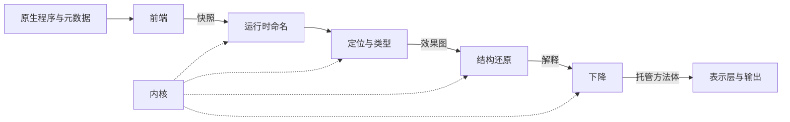

# 设计

Cpp2CS 从 Unity IL2CPP 生成的原生程序与配套元数据恢复托管方法，输出 CIL 程序集、C# 源码和未恢复部分的诊断。本文定下恢复核心的设计：按什么语义判断“恢复得对”，内核提供什么，中间层怎样组织，采纳怎样强制经过证明，以及什么事实出现时这套设计不成立。

文中的要求分两类：

- **契约**：层与层之间、实现与验证之间的约定。改动契约先改本文。
- **做法**：达到契约的一种方式，可以换成更好的。

各层内部的具体模型（运行时命名、定位与类型、检查、守卫、内联逆、异常区域等）各有单独的语义说明，第 18 节列出它们接在内核的哪个位置。

## 1. 概览

一个托管操作——一次字段读取、一次 `newobj`、一次方法调用——经过生成链之后，在原生代码里是一小组**效果**：检查、读、写、调用、分配。il2cpp 按固定模板把每个操作展开成这组效果；编译器随后只做保持行为的事：把互不影响的效果换位，把不同路径上相同的效果合成一份，把一份复制到多条路径，删掉多余的。

恢复是反过来：把属于同一个托管操作的效果收回同一个点，换成这个操作。收回是否正确只取决于两件事：

1. 这些效果合起来，是不是这个操作的定义所说的那一组；
2. 每个被收回的效果，与它途中越过的效果是否互不影响。

本设计把这两件事各放在唯一的一处，其余部分围绕它们组织：

| 部件 | 做什么 | 形式 |
|---|---|---|
| 操作目录 | 每个托管操作的定义：IL 写法，加它展开成的效果（效果模板） | 数据 |
| 独立关系 | 哪两种效果互不影响，可以换位 | 数据，一张表 |
| 等价引擎 | 按路径对照“这些效果”与“这个操作的模板”，并用独立关系核对每一次越过 | 内核，唯一的证明入口 |
| 发现器 | 猜：指出哪几处效果可能是哪个操作 | 可以用经验；猜错只会证不出来 |
| 选择 | 从证明成立的说法里，取互不重叠、洞最少的一组 | 内核，唯一的选择步骤 |
| 下降 | 照选中的结果写出托管代码，没有解释的地方写 `Unrecovered` | 机械 |

合流、循环、内联、复制这些由编译器造成的形态，只在内核解释路径的那一处出现，不出现在任何操作的定义、任何独立关系的行、任何发现器的条件里。补一类形态因此落在一处：缺操作就加一条目录项，编译器的某种搬动没被认可就加一行独立关系，值没有名字就补一条事实。

## 2. 目标、范围与输出口径

**目标。** 输出 CIL 程序集、C# 源码和未恢复部分的诊断，服务三种用途：逆向分析时直接阅读；方法论研究，结论有证据、可复现；作为开源工具，在陌生项目上给出可信的结果。

**范围。**

- 首个目标是 Android ARM64、Unity 2022.3、元数据 v31。其他目标（Android x86_64、Windows x64 等）只经目标描述接入；其他 Unity 与元数据版本经规格数据接入。
- 可读性（控制结构、状态机提升、命名）属于表示层，与恢复核心分开，排在核心之后。

**输出口径。**

| 状态 | 含义 | 是否计入覆盖率 |
|---|---|---|
| 完整写出 | 方法体里没有洞，每一处替换都经过证明 | 计入 |
| 部分写出 | 方法体里有洞，洞处写 `Unrecovered`，附没换掉的原生项和原因。整个方法视为不可信 | 不计入，单独统计 |
| 未写出 | 没有可用的方法体 | 不计入 |

部分写出的方法里，洞之外的语句与完整写出的方法走同一套经过证明的变换，只在洞处停下。没有为了可读而补全的启发式路径。

## 3. 成功标准与原则

**成功标准。** 四项同时成立：

1. **每条规则有理论出处。** 能说明它逆的是生成链的哪一步（il2cpp 的哪个模板，或编译器的哪种变换），正确性依据是什么。没有形态意义上的多维规则。
2. **正确性有全量证据。** 语料的 IL 对照，加上真实样本的全量执行对照，不以抽样代替。写出数、编译通过、执行对照一致是不同的结论，分别报告。
3. **补洞只动一处。** 补一类形态，只在一个地方加一条有依据的数据或模型，其他方法不退化，不依靠全量回归排查影响。
4. **多样本恢复率。** 在多个项目上分别报告，不以单一样本的数字代表整体。

**原则。**

- **条件分两种。** 正确性前提回答“为什么这样替换是安全的”（异常去向不变、没有别名、有访问权限），删掉就会写错，是正当的条件。形态描述回答“它长什么样”；形态出现第二个维度（“合流后的某某”“带事件的某某”），说明缺的是模型。判别方法：去掉这个条件，会不会写出错误的代码。
- **发现可以靠经验，采纳只凭证明。** 找候选可以用启发式、次序和预算；一次替换被采纳，只能经过统一的证明，并且在构造上无法绕过（第 11 节）。
- **证明不足就留洞。** 高频形态说不清出处时保持为洞，不加经验规则。频率只决定研究的先后。
- **停滞时回到模型。** 恢复率停滞时复查模型，不放宽判定或验证。
- **先问生成器。** 遇到新形态，先查明它由哪个模板或哪种变换生成，再决定属于哪个模型；查不清就先不写代码。

**架构约束。**

- 按生成链的逆序分层：前端 → 运行时命名 → 定位与类型 → 结构还原 → 下降 → 表示层与输出。层的边界是词汇契约。
- 前端产出的原生 IR 是不可变快照，后面各层不改写它。
- 先写 CIL，再由 CIL 生成 C#。
- 平台差异只进入目标描述与规格数据；恢复逻辑不按业务方法、名称或地址特判。

## 4. 依据：生成链

| 段 | 工具 | 做了什么 | 逆向时对应 |
|---|---|---|---|
| C# 到 IL | C# 编译器 | 降级：状态机、闭包、foreach、using、lock | 表示层 |
| IL 到 C++ | il2cpp | 逐方法模板展开，基本不优化。判空、越界、类初始化、元数据惰性初始化、分派、装箱都写成固定序列；类型擦除成指针与结构体；小方法另生成强制内联的副本 | 运行时命名、定位与类型、操作目录 |
| C++ 到优化后的中间表示 | 编译器中端 | 内联、聚合体拆分、读取复用、合流与下沉、公共指令上提、路径复制、位技巧 | 结构还原 |
| 到机器码 | 后端 | 指令选择、寄存器分配、帧布局、调用约定、异常表、尾部合并 | 前端；尾部合并归结构还原 |
| 到二进制 | 链接器 | 重定位、相同代码折叠、导入 | 前端 |

设计依赖的事实：

- **il2cpp 的翻译是模板展开。** 同一种 IL 构造总是翻成同一组效果，变化只来自类型。所以每个托管操作可以写出一份效果模板。
- **优化保持值，打乱结构。** “某对象的类的第 n 个虚表槽”这样的值在优化前后不变；变的是效果发生在哪个块、是否被复用、是否与别的路径合流。所以值可以直接命名，结构要靠证明收回。
- **编译器只做合法的搬动。** 它交换两个效果、把效果挪过一段代码，都以这两者互不影响为前提。所以搬动造成的差别只是若干对独立效果的换位；内核的独立关系覆盖到编译器所用的依据，这些差别就能收回，没覆盖到的只会成为洞。
- **被内联方法自己的代码仍在产物中。** 强制内联的副本之外，被调方法另有带注册入口的定义，可以作为“这次调用会做什么”的定义。

## 5. 结构

### 5.1 层与契约



| 层 | 逆的是 | 产出 | 出口词汇 |
|---|---|---|---|
| 前端 | 链接、后端、ABI | 快照（7.1） | 块、块参数、带实参行的出口、读写与调用的出现、项。没有寄存器、标志位、指令字、异常表格式 |
| 运行时命名 | il2cpp 模板里值与调用的部分 | 事实 | 运行时结构上的读取是具名的项，对运行时函数的调用是登记的运行时操作；其余标为“未命名” |
| 定位与类型 | il2cpp 的类型擦除 | 事实 | 每次内存访问有位置，每个值有定义类型；其余标为“未定位” |
| 结构还原 | 编译器中端；il2cpp 把一个操作拆成多个效果的部分 | 解释：一组带凭据的声明，加洞 | 每个可观察的效果要么被恰好一条声明占用，要么在洞里 |
| 下降 | 无，机械步骤 | 托管方法体 | IL 词汇与 `Unrecovered` |
| 表示层与输出 | C# 编译器的降级 | CIL 程序集、C# 源码 | |

内核不是一层，是各层共用的机制。

### 5.2 两种结论

中间层的结论分两种，组合方式不同，不混用：

| | 值的事实 | 效果的解释 |
|---|---|---|
| 说的是什么 | 关于快照的真命题：这个值是什么、这次访问落在哪、两个值是否相同 | 一种说法：这几处效果合起来是这个托管操作 |
| 彼此的关系 | 都为真，可以同时成立；只增不改 | 互相排斥：一处效果只能归一个操作 |
| 怎样组合 | 累积，与次序无关 | 选择（9.7） |
| 判定者 | 值判定（7.8） | 等价引擎（9.3） |
| 所在的层 | 运行时命名、定位与类型 | 结构还原 |

除这两个判定者之外，系统里没有第三处判断“相同”或“等价”。

### 5.3 信任边界

| | 包含 | 出错的后果 |
|---|---|---|
| 可信部分 | 快照契约；事实规则；规格数据（结构布局、运行时操作登记、操作目录、独立关系）；内核（项的规范化、合流的解释、值判定、等价引擎、选择的记账、下降） | 可能写出错误的代码 |
| 不可信部分 | 发现器、候选索引、次序、预算、选择的搜索策略 | 只会多洞或换一种同样正确的写法 |

可信部分要小、要慢改；常改的扩展点（目录项、独立关系的行、规格条目）都是带依据的数据。

### 5.4 全局事实与逐方法恢复

- **全局事实**对整个二进制建立一次：映像、元数据模型、运行时规格、代码地图（函数范围、方法入口与候选身份、运行时函数的识别）、元数据全局槽与实体的对应。
- **逐方法恢复**是纯函数：输入是该方法的快照、全局事实和它查询到的其他方法的事实，输出是方法体与方法记录（第 12 节）。方法之间可以并行，结果不依赖线程数与次序。
- **跨方法只读事实，不读恢复结果。** 一个方法需要别的方法的地方只有三种：调用目标的身份、调用的效果摘要、被调方法的效果图（作为调用的模板，9.1）。三者都由被调方法的快照与事实得出，不依赖被调方法是否恢复成功，所以方法之间没有恢复次序，也没有递归截断的问题。

## 6. 语义

“恢复得对”的含义只有本节一个定义。等价引擎、独立关系、语料对照、执行对照都以它为准。

### 6.1 可观察行为

程序按托管语义解释。

- **事件**：不透明调用、对象分配、精确的类初始化、抛出（含判空、越界、类型不符等隐式抛出）、其他可观察的运行时操作。每个事件观察此刻的整个托管堆。
- **写入不是事件。** 写入只在下一个事件或结局处被观察。
- **读取不是事件。** 读取可能伴随的抛出是事件；原生代码里显式的检查与 IL 访问隐含的检查是同一事件的不同写法。
- **不可观察的效果**：元数据惰性初始化、时机不受约束的类初始化、写屏障、栈保护、运行时私有状态的读写、未逃逸帧对象的读写。
- **结局**：返回（带值）、抛出。
- **等价**：对每个入口状态，事件序列逐个相同（同种、同操作数、发生时堆相同），结局相同。

### 6.2 效果词

一条路径上依次发生的效果排成一个词。两个词等价，是指一个能经下面的规则变成另一个。引擎只使用这些规则；增加规则先改本节。

| 规则 | 内容 | 依据 |
|---|---|---|
| 换位 | 相邻两个独立的效果可以交换（独立关系见 7.6） | 独立的定义 |
| 不可观察 | 不可观察的效果可以删去或插入 | 6.1 |
| 可弃 | 结果无人使用的读取、未暴露且所属类没有终结器的新对象，可以删去 | 读取不是事件；新对象在首次被使用前不可见 |
| 幂等 | 后置条件已经成立时，幂等事件等于不执行 | 精确的类初始化只执行一次 |
| 写入归并 | 两个观察点之间，只比较观察点上各位置的内容 | 写入不是事件 |
| 展开 | 托管操作等于它的效果模板；目标唯一的调用等于被调方法的效果图 | 模板展开；调用的定义 |
| 复制 | 把汇合块的一段前缀按入边各复制一份，不改变行为 | 路径不变 |

### 6.3 证明的对象

设原生程序在某条路径上的效果词是 w。输出程序在对应路径上是一串托管操作；把每个操作按“展开”换回效果，得到词 x。恢复正确，就是对每条路径 w 与 x 等价。第 9 节的声明、凭据与组合定理把这个整体命题拆成互不依赖的局部证明。

## 7. 内核

### 7.1 快照

前端的产物是每个方法一张不可变的图。它是事实的唯一来源，任何步骤都不改写它；后面各层的结论都是附在它上面的标注。

| 概念 | 契约 |
|---|---|
| 块与块参数 | 每个块只使用自己的参数和块内按次序产生的值。跨块传值时，源块在每条出口上为目标块逐项给出实参 |
| 出口与边 | 一个块可能离开的每个地方都是出口：条件分支的两臂、跳转表的各项、返回、不返回的调用、带异常出口的调用（正常出口与展开出口各是一个出口）、条件陷阱。每个出口带目标块、整行实参和离开时的内存版本。边的身份是（源块，出口序号）；两条边即使起点终点相同也是两条 |
| 出现 | 块内占位置的项：内存读取、内存写入、调用、动态栈分配，以及块末的终结。出现的身份是（块，序号） |
| 项 | 纯计算不占位置，是带位宽的项（7.2）。出现的操作数与结果都是项 |
| 入口 | 入口块专用，参数是按抽象槽位给出的实参；原生代码跳回第一条指令时，前端另设循环头 |
| 内存版本 | 每次写入、每次可能写内存的调用产生一个版本；块入口的版本由各入边传入 |
| 追溯 | 每个出现记录原生地址，只用于诊断，不作身份 |

快照不被改写，所以（块，序号）与（源块，出口序号）在快照的整个生存期内稳定，不需要另设跨改写的身份。快照在构造时校验值的可见性、位宽、实参行与参数个数是否一致，并带一个内容摘要。

### 7.2 项

项是值的唯一表示。项在构造时规范化并驻留，结构相同就是同一个实例。

| 项 | 含义 |
|---|---|
| 常量、未定义 | 未定义用于填充和被破坏的位 |
| 入口参数、块参数 | 块参数按（块，序号）区分 |
| 出现的结果 | 读取的结果、调用的各结果槽 |
| 运算、切片、拼接、选择 | 选择保留条件与真假两支 |
| 实体、运行时属性 | 由事实层引入的具名原子：类、方法、字段、字符串；对象的类、虚表槽、数组长度等运行时不可变数据上的纯函数 |

- **规范化只用语义恒等式**，与使用位置无关：位搬运（移位、掩码、扩展、截断、寄存器对、向量车道）化成切片与拼接；只取 0 和 1 的值的各种写法归一；比较的方向与严格性、常量的结合归一。
- **未定义的位不是值。** 靠“两个操作数是同一个项”得出结论的规则，要求这个项不含未定义的位。
- 规范化不按某个使用者的需要改变值的表示。

### 7.3 值的来源与合流的唯一解释

**来源关系。** 块参数的备选来源是各条入边上对应位置的实参；选择项的备选来源是它的两支，各带条件与方向。由此得到来源图：节点是值，每个备选带着完整的边身份。同一条边上的整行实参同时到达——两条边分别传入 (a, b) 与 (b, a) 时，汇合后的两个参数只能取这两种配对；把每个参数各自化成来源集合会多出 (a, a) 与 (b, b)。来源图保留回边、并行边与重复实参。

**三个操作。** 合流只在内核的这三个操作里被解释：

| 操作 | 含义 |
|---|---|
| 按边代入 | 给定一条边和一个项，把项里属于目标块的参数同时换成这条边上的整行实参 |
| 分情况 | 给定一个程序点和若干项，沿入边与选择条件向后展开，得到有限张情况表：每个情况是一组边的选择与选择条件的真假，各情况互斥，合起来覆盖到达该点的全部路径；表里的项不再含展开范围内的合流。展开在回边处停止，循环头的参数保留为原子，表示“这一次迭代的值” |
| 走查 | 给定一个窗口（一组入口点和一组出口点，其间无环），枚举从入口到出口或到结局的每条路径；每过一条边就按边代入；给出该路径上依次经过的出现、各操作数在这条路径上的取值和累积的路径条件 |

**逐情况提升。** 写给“输入不是合流”的规则（例如“常量槽位地址上的读取是该槽的实体”），由内核对每个情况各用一次，结果是一张情况表；各情况结果相同时就是这个结果。规则的作者看不到合流。

**约束。** 内核之外的代码拿不到入边，也不遍历来源图去得出结论。发现器可以取“一个项的叶子集合”当作找候选的索引；结论只能来自上面三个操作之上的两个判定者。

### 7.4 内存与读取

全部内存按运行时规格分成五类，划分先于一切识别建立：

| 类别 | 例 | 处理 |
|---|---|---|
| 帧对象 | 局部、溢出槽、结果缓冲区 | 按生存期分版本；地址没有逃逸的不可观察；逃逸到未知用途的保留为可寻址的存储 |
| 运行时不可变数据 | 对象头的类指针、虚表、数组长度、已初始化的元数据槽 | 纯函数，读取是运行时属性项，没有版本 |
| 单调状态 | 类初始化标志、方法的元数据初始化标志 | 只会从未就绪变为就绪，以路径条件表达 |
| 托管堆 | 实例字段、静态字段、数组元素、经引用或指针的位置 | 按别名类分版本，调用带效果摘要 |
| 运行时私有状态 | 活跃异常栈、栈保护值 | 托管语义下不可观察 |

- **读取的身份**是它读的位置，加上沿内存版本往回最近的、可能改写这个位置的定义。身份相同的两次读取同值。
- **别名判定只有一处**，三值：必然相同、必然不同、不能判定。
- **单调。** 别名知识只增；知识增加只会让“最近的可能改写”更早，已有的同值结论不被推翻。

### 7.5 效果

事实层把每个出现读成托管语义下的效果，得到**效果图**：快照加上每个出现的效果。一个出现可以有几个效果分量（一次对象分配含类初始化与新对象两个分量）。

| 效果 | 含义 | 可观察性 |
|---|---|---|
| 读 | 读一个已定位的位置，结果是一个值 | 不是事件 |
| 写 | 向一个已定位的位置写入一个值 | 在下一个事件或结局处被观察 |
| 调用 | 对托管方法或可观察运行时操作的一次调用 | 事件 |
| 新对象 | 分配一个指定类的对象或数组，结果是新引用 | 事件；首次被使用前不可见 |
| 类初始化 | 确保某个类已初始化 | 精确的是幂等事件；时机不受约束的不可观察 |
| 条件抛出 | 条件成立时抛出某种异常：一条通往“只抛出尾”的边 | 条件成立时是事件与结局 |
| 抛出 | 抛出一个异常对象 | 事件与结局 |
| 分支 | 按条件选择出口 | 不是事件 |
| 无 | 不可观察的效果：写屏障、元数据惰性初始化、栈保护、私有状态 | 不可观察 |
| 未命名 | 事实层没能读懂的出现 | 当作与一切相关的事件 |

- **只抛出尾按边区分。** 几处检查共用同一个只抛出块时，这个块按进入它的边分别计入各自的检查。
- **占用的单位是效果分量。** 默认覆盖经过它的全部路径。只有一种细分：按进入某个汇合块的入边区分（6.2 的“复制”），下降时把该块的相应前缀按入边复制。
- **效果索引。** 按种类、按操作数的项查出现，供发现器取候选。

### 7.6 独立关系

`独立(u, v)` 回答：两个效果相邻时交换次序，是否不改变可观察行为。回答只有“已证明独立”和“不能证明”。全系统只有这一处判断“一个效果能否越过另一个”。

| 一对效果 | 何时独立 | 依据 |
|---|---|---|
| 读、读 | 总是 | 读取不是事件 |
| 读、写；写、写 | 两个位置已证明不重叠 | 别名判定 |
| 读、调用 | 调用的效果摘要已证明不写该位置 | 效果摘要 |
| 写、调用 | 该位置在这次调用处不可观察（未暴露的新对象的字段、未逃逸的帧对象），且调用不读它 | 事件观察整个堆 |
| 写、条件抛出 | 该位置在抛出的去向上不可观察 | 同上 |
| 条件抛出、读 | 总是 | 读取不是事件 |
| 条件抛出、条件抛出 | 两者抛出的异常相同（同种类、同操作数）且去向相同 | 同时成立时分不出先后 |
| 条件抛出、调用或其他事件 | 不独立 | 事件的先后可观察 |
| 新对象、其他效果 | 该效果在这条路径上的操作数不含这个新对象 | 新对象在首次被使用前不可见 |
| 类初始化、其他效果 | 时机不受约束或该类没有静态构造时总是；精确时，与事件、托管堆的读写不独立 | ECMA-335 I.8.9.5 |
| 调用、调用 | 不独立 | |
| 未命名、任何效果 | 不独立 | |

- 表里的“位置不重叠”“操作数不含”“不可观察”都取自事实层的正面证明；“这条路径上的操作数”由走查按边代入后给出。
- **缺一行只会多洞；多写一行不成立的独立才会写错。** 所以每一行附语义依据（ECMA-335 条款或运行时源码）和一个语料用例。行的条件只许是语义条件；出现“在合流之后”“在循环里”这类条件，说明模型有问题（第 17 节）。
- 表是数据。每一行有自己的摘要，引擎记录每次查询用到的行（第 12 节）。

### 7.7 路径条件

沿边成立的文字：非空、类型检查成立、比较结果、整数区间、某个类已初始化。全系统只有一个路径条件格。

- 对外只有一个判定：给定条件与程序点，回答真、假或不能判定。
- 每条成立的文字带着**确立它的出现**（哪次检查、哪条分支边、哪个事件的后置条件）。

### 7.8 值判定

`同值(a, b, 程序点)` 是值层唯一的判定者。它成立的途径只有：规范化后是同一个项；读取身份相同；逐情况在各自的路径条件下求值相同；规格登记的等式（运行时操作的结果等于哪个运行时属性）。

事实层的规则只提出“这个值等于那个具名的项”的候选，由值判定证明；证明成立的等式累积成同值关系。例如类型判断被内联成几条路径的合流时，各来源在各自路径条件下都等于同一个运行时属性项，这个合流就是该项，不需要为它写形态规则。

### 7.9 查询

事实以查询的形式提供：纯函数，输入是快照、全局事实和其他查询的结果，结果带记忆，每次求值记录它读过的依赖与结果摘要（第 12 节）。成环的依赖（类型与位置沿循环互相依赖、调用的效果摘要沿调用图成环）显式声明为单调不动点组，写明单调量与终止依据；到达预算是洞，不当作收敛。失败的查询返回原因，原因沿依赖传递，洞由此得到归因链。预算一律按步数计，结果可复现。

## 8. 事实层

运行时命名、定位与类型两层只产出事实。事实的契约：

- **事实是关于快照的真命题。** 它不依赖任何声明是否被采纳。
- **只增不改。** 规则是单调的：输入的事实增多，输出的事实只增不减。
- **不以缺少事实为依据得出有利的结论。** “没有发现别名”不是“没有别名”；独立、不可观察、未逃逸都要正面证明。
- **规则写给非合流的输入。** 合流由内核逐情况提升（7.3）。

各项的要点：

- **值的命名。** 每个项有一个粗的种类（托管引用、某种运行时结构的指针、帧地址、整数或浮点位型），由定义给出：形参按签名，真实调用的结果按被调方的原型，读取按位置或规格。在此之上，按规格把运行时结构上的读取解释成运行时属性项，把元数据槽的读取解释成实体，把对运行时函数的调用解释成登记的运行时操作（登记项写明输入、结果、内存效果、可观察性、幂等性）。
- **定位。** 一次访问的事实是（根对象的值，字节范围，根的布局类型）。同一段字节可以有几种托管写法（整个结构体字段，或它内部的字段路径）；选哪种写法是解释层的事，不是事实。
- **类型。** 值的类型取自它的原生定义：形参按签名，真实调用的结果按被调方，读取按所读位置的声明类型，新对象按被分配的类，合流取各来源的并。被内联的调用在原生代码里没有“调用结果”，它的返回类型不进入事实；它只影响输出的静态类型，由选择核对（9.7）。
- **效果分类。** 每个出现的效果分量由命名与定位给出。读不懂的是“未命名”，它不会被任何目录项解释，成为洞。

## 9. 解释层

### 9.1 操作目录

每个托管操作是目录里的一项：

- **IL 写法**：下降时写出的指令与操作数。
- **效果模板**：它展开成的效果，写成直线序列加条件抛出，操作数是模板的形参。来源是 il2cpp 对这条指令的翻译模板与运行时头文件。
- **主效果**：模板里用来定位这个操作的那个效果，供通用发现器使用。
- **出处**：对应的生成步骤与语料用例。

例：

```text
ldfld F（对象 o）
    o 为空 ⇒ 抛出 NullReference
    结果 = 读 字段(o, F)

stelem.ref（数组 a，下标 i，值 v）
    a 为空 ⇒ 抛出 NullReference
    v 非空 且 IsInst(v, 元素类(类(a))) 为空 ⇒ 抛出 ArrayTypeMismatch
    (uint)i ≥ 长度(a) ⇒ 抛出 IndexOutOfRange
    写 元素(a, i) ← v

newobj T::.ctor（实参 x…）
    r = 新对象(T)                      // 含 T 的类初始化分量
    调用 T::.ctor(r, x…)
    结果 = r

callvirt M（接收者 o，实参 x…），M 的目标唯一
    o 为空 ⇒ 抛出 NullReference
    调用 M(o, x…)
```

**调用的两种读法。** 模板里的“调用 M”在对照时有两种等价的读法（6.2 的“展开”）：现场也有一次对 M 的真实调用时，它是一个事件；现场是 M 的内联副本时，它展开成 **M 自己原生代码的效果图**，形参换成实参。后一种读法就是内联的逆。模板取被调方法自己的原生代码，是因为“调用 M”按定义就是执行那段代码；它不依赖 M 的恢复结果。展开只对目标唯一的调用成立（非虚方法，值类型、密封类或 final 的虚方法）。效果图里未命名的效果按原样对照：同一个原生操作，操作数在绑定下相同。

目录项里没有控制流形态。一个操作被编译器搬动、合并、复制之后怎样认回来，不写在目录项里。

### 9.2 声明

声明是一条不含语义的记录：

| 成员 | 含义 |
|---|---|
| 操作 | 目录项的标识，加它引用的元数据实体（字段、方法、类型） |
| 操作数 | 模板各形参对应的项 |
| 落点 | 这个操作写在哪个程序点。区域形的声明（模板带内部分支）落在区域的出口 |
| 占用 | 它解释的效果分量的集合，包括被它消费的分支 |
| 定义 | 操作的结果代表哪个原生值 |

声明只有标识，没有语义：操作的含义来自目录，调用的含义来自被调方法的效果图，前提由引擎从模板推出。发现器不写前提，也没有地方写。

**窗口**由内核从占用与落点算出：从被占用的效果出发能到达落点的那些程序点。窗口的入口是各条路径上最早的被占用效果。窗口里不属于占用的效果叫**旁观效果**。

### 9.3 凭据与五项义务

`证明(声明)` 是唯一的证明入口，返回凭据或反驳。凭据成立，当且仅当五项义务都成立。每一项都是正确性前提：表的最后一列是去掉它会写错的情形。

| 义务 | 内容 | 去掉它会写错 |
|---|---|---|
| 覆盖 | 每一次到达落点的执行都先经过窗口的入口：从方法入口到落点、从落点回到落点的每条路径都穿过入口 | 汇合块另有一条入边带来已有的对象，却把那里的构造调用写成 `newobj` |
| 对应 | 窗口的每条路径上，被占用的效果与模板在同一路径条件下产生的效果相同：事件逐个同种、同操作数，事件发生时双方写过的位置内容相同，结果与出口状态相同。任何一侧的分支在路径条件下可判定时走确定的一侧，否则分叉。模板有而现场没有的检查，必须在该处被路径条件判定为不成立。用到的路径条件若由窗口之外某个可被占用的效果确立，记为依赖（9.4） | 把针对另一个数组、另一个值的检查当成这次存入的检查 |
| 搬移 | 每条路径上，被占用的效果与它之后、落点之前的每个旁观效果独立（7.6）；被消费的分支的各臂上没有旁观效果；中途离开窗口的路径上，已经经过的被占用效果都是可弃的（6.2） | 检查与存入之间隔着一次调用，仍把检查并进存入；对象在构造之前已经交给别的代码 |
| 去向 | 被占用的可能抛出的效果，异常处理目标与落点处相同；区域的各出口能归并（9.5） | 把 try 之外的分配并进 try 之内的构造调用 |
| 合法 | 这个操作在本方法里能合法写出：成员可访问；调用按写出的方式分派，目标就是模板取自的那个方法 | 直接读写别的类的私有字段；把某个具体方法的方法体当成虚调用的模板 |

引擎的做法是共同执行：用走查枚举窗口的路径，现场与模板在共享的路径条件下同步推进。读取先查本侧自窗口入口以来的写入，再查此前经过的旁观写入，都没有就是入口处的堆。遇到旁观效果时查独立关系：它必须与此前被占用的效果独立，也必须与模板已经读写过的位置独立（输出里旁观效果都排在这个操作之前）。引擎不知道声明来自哪个发现器，也不按操作的种类分支。

- 落点不早于被占用的效果：效果只向后收。
- 窗口内无环。含循环的模板需要循环不变式，目前是洞。
- 预算按步数计；耗尽是反驳，原因是预算。
- 反驳给出第一处不成立的义务、路径和位置，洞的原因由此而来。

### 9.4 组合定理

**落点约束。** 凭据可以附带对别的原生效果落在哪里的要求，由选择核对。约束只涉及原生效果的落点，不涉及别的声明的内容。

- **依赖的效果。** “对应”里用到的路径条件，若是由某个可被占用的效果确立的（一次检查通过、一个事件的后置条件），凭据把这个效果记为依赖。约束：它的落点不晚于本声明的落点，落点相同时排在本声明之前。理由：检查被向后收之后，输出在它之前会多执行一段操作；这段操作的证明不能以“它已经通过”为前提。
- **推后的旁观效果（登记的扩展）。** 旁观效果 v 与在它之前的被占用效果不独立、但与在它之后的被占用效果都独立时，可以让 v 自己的声明落在本声明之后；凭据附约束“v 的落点不早于本声明的落点”。本文的演算不需要它。

**定理。** 设选中的声明两两占用不交，各自持有凭据，凭据所附的落点约束都成立。则对方法的每一次执行，原生的效果词与输出展开后的效果词等价。

**证明要点。**

1. 由“对应”，每条声明在每条路径上占用的效果，与它的模板在该路径条件下产生的效果是同一组（至多差不可观察、可弃、幂等的效果与写入归并）。所以两个词含同一组效果，只是次序不同：输出里，被占用的效果位于所属声明的落点，其余留在原位。
2. 任取路径上两个不独立、不属于同一条声明的效果 u、v，原生次序中 u 在前（同一条声明内部的次序由“对应”保证）。落点不早于被占用的效果，所以 v 在输出里的位置不早于它的原生位置，也就在 u 的原生位置之后。假如输出里 v 排到了 u 之前，那么 v 的原生位置落在 u 与 u 的落点之间，v 是 u 所属声明的旁观效果；“搬移”要求此时 u 与 v 独立，矛盾。
3. 落点相同的两条声明，彼此的效果都在对方的搬移范围之内，由第 2 步互相独立，先后任取（有依赖约束的按约束）。
4. 某次条件抛出在一次执行里成立时，原生代码在它的位置就结束；输出要到它的落点才抛出，此前多执行的只有原生次序上位于两者之间的效果所属的操作。这些效果与这次抛出独立（第 2 步），在抛出的去向上不可观察；这些操作的凭据不依赖这次检查（依赖约束），所以它们在这次执行里的行为仍由各自的凭据保证。

所以两个词只差独立效果的换位。∎

**推论。**

- **凭据互不依赖。** 一条凭据成立与否只取决于快照与事实，与别的声明是否被采纳无关。声明之间的相互作用只有占用重叠、值是否可得、落点约束三种，都由选择机械地核对。
- **否定前提不会被推翻。** “路径上没有观察者”这类前提，量化的是窗口里的原生效果，不是别的声明；采纳更多声明不改变任何原生效果，也就不改变任何前提。
- **洞不破坏其余部分的证明。** 没被占用的效果留在原位，并且与一切不独立，任何声明都不能越过它。

### 9.5 窗口里的分支与出口

- **被消费的分支。** 窗口内部的分支——两臂在窗口内重新汇合，或经被占用的条件抛出离开——是操作内部的判断（模板里一个条件的求值方式，或被调方法体里的分支）。它由声明占用，不出现在输出里。
- **出口的归并。** 区域形的声明把整个区域换成一个操作，区域的各条路径离开区域之后必须接到同一个续点。合法的形式只有三种：各出口是同一个程序点且实参行相同；各出口可由操作的结果或其他可得的值区分，写成操作之后的一次分支；各出口之后的代码已证明等价（引擎对两段原生代码共同执行），保留一份。
- **不可表达的分支。** 条件只依赖不可观察状态的分支（初始化标志的测试）不能留在输出里，必须由某条声明消费；它的两臂按出口的归并处理。单调守卫（测试一个单调标志，未成立一臂先执行确立该标志的事件）的归并规则与依据在守卫模型里给出。

### 9.6 发现

发现器是纯函数：输入是只读的查询面（效果图、效果索引、项的叶子集合、路径条件的确立者、支配关系、目录、元数据），输出是声明。发现器看不到别的发现器的产出，也看不到选择的结果。

- **通用发现器**由目录驱动：对每个效果，找主效果与它相符的目录项，由主效果的操作数定出模板形参；模板里其余的效果，按操作数在效果索引里取候选，或沿被绑定操作数的叶子集合取候选（新对象）。直线模板的操作都由它发现，新增这类操作不需要写发现器。
- **内联调用的发现器**以调用方不可访问的成员访问、缺少构造调用的新对象为起点，按区域访问的字段集合与调用序列在索引里取候选方法，提出“这个区域等于对该方法的一次调用”。
- 发现器可以多提、错提。同一处可以有多条互相重叠的声明。

### 9.7 选择

选择是唯一决定“采纳哪些声明”的步骤，输入是带凭据的声明，输出是一份**解释**。

**约束。**

- 占用两两不交。
- 值可得：每条声明用到的操作数，在它的落点处由方法参数、常量、可表达的纯运算，或别的选中声明的定义给出，并且静态类型相容。不补转换。
- 凭据所附的落点约束成立。

**目标。** 洞最少（没被占用的可观察效果，加上不可得的值）；并列时取登记在前的规则的声明；仍并列按声明的稳定键。洞数优先是契约，并列时的偏好是做法。

**做法。**

- 声明按占用重叠、落点约束和值的供求连成分量，分量之间互不影响。只有一种解释、与别的声明没有这三种关系的声明先行选中，不参与连通。
- 规则（目录项与发现器）按登记次序编号，选择逐级进行。第 k 级的候选是编号不超过 k 的规则的声明；它从第 k−1 级的结果出发，只在仍有洞、且被第 k 号规则的声明触及的分量里重新求解，只在洞严格减少时替换原结果。没有洞的分量不再证明后面规则的候选。
- 分量内的求解在预算内是精确的。超出预算时保留第 k−1 级的结果，并在方法记录里标记“选择不精确”。

**性质。**

- 追加在末尾的规则，对每个方法只有两种结果：不变，或洞严格减少。完整写出的方法不变，不需要重跑。
- 候选集合只增（事实增多、独立关系加行）时，精确求解的分量不会变差；标记为不精确的分量没有这个保证，由记录的比对检测（第 12 节）。
- 选择不影响正确性：任何一组占用不交、带凭据、落点约束成立的声明都满足组合定理。

### 9.8 洞

洞是一条记录：没被占用的效果（附原生地址）或不可得的值，加上原因——触及它的声明里最接近成立的那条的反驳（哪项义务、哪条路径、哪个位置）及其归因链。由别的洞导致的洞标为派生，统计时只数独立洞。报告与普查读记录，不解析文本。

## 10. 下降

下降只读解释与事实，照着执行：

- **骨架。** 输出的控制流是快照的控制流，去掉被消费的分支与只抛出尾；区域形的声明把区域收成“入口前缀、操作、续点”；按入边细分的占用使相应的块前缀按入边复制。
- **语句。** 每条选中的声明在落点处写出目录项的 IL 写法，操作数取声明里的项；落点相同的先按落点约束、再按稳定次序排列。
- **值。** 项成为表达式；声明的定义成为局部；块参数成为局部并在入边并行赋值，被声明定义的块参数不再赋值。可能抛出的运算（取数组长度、除法、带检查的转换）不是表达式，是目录里的操作，经声明写出。
- **洞。** 没被占用的效果在原位写成 `Unrecovered`，附洞的记录。
- **异常区域。** 保护范围取自调用点的实际展开目标。

下降不识别形态，不保存跨语句的状态，不走查路径，不解释合流，不创建项。需要这些时，缺的是某个事实或某条声明。

## 11. 构造上的强制

“采纳只凭证明”由类型与程序集边界保证：

```csharp
public sealed class Claim { /* 操作的标识、操作数、落点、占用、定义：只有标识，没有语义 */ }

public sealed class Certificate   { internal Certificate(/* … */) { } }   // 只有等价引擎能构造
public sealed class Explanation   { internal Explanation(/* … */) { } }   // 只有选择能构造，成员都是带凭据的声明
public sealed class ManagedBody   { internal ManagedBody(/* … */) { } }   // 只有下降能构造，输入只有 Explanation

public interface IDiscoverer { IEnumerable<Claim> Propose(IFactView facts); }
```

- **凭据造不出来。** 凭据的构造函数只在内核程序集内可见；发现器在另一个程序集，只引用内核的只读查询面。凭据绑定声明的摘要与快照的摘要，选择在采纳前核对。
- **语义带不进来。** 声明只能引用目录项的标识；模板、独立关系、被调方法的效果图都由内核自己取。发现器无法提供模板、前提或要写出的 IL。
- **输出只有一条路。** CIL 写出只接受下降产出的方法体；下降只接受选择产出的解释；解释里的每条声明都带凭据。
- **记账。** 选择产出解释时核对：每个可观察的效果分量被恰好一条声明占用或在洞里；每个被用到的值有定义；凭据所附的落点约束都成立。
- **机检。** 架构检查扫描程序集：发现器所在的程序集不引用内核的内部类型、不使用反射；内核程序集不向它开放内部成员；入边与来源图的遍历接口不在只读查询面上；下降的代码不引用走查与独立关系。

程序集的划分是做法，信任边界与依赖方向是契约：

| 程序集 | 内容 | 可引用 | 可信 |
|---|---|---|---|
| 快照 | 快照、项与规范化、目标接口 | 元数据模型 | 是 |
| 目标 | 文件格式、指令集、ABI、异常模型的各个实现（前端） | 快照 | 是 |
| 规格 | 结构布局、运行时操作登记、操作目录、独立关系的数据与读取 | 快照 | 是 |
| 内核 | 查询、合流的解释、内存与读取、效果、路径条件、值判定、等价引擎、选择、下降 | 快照、规格 | 是 |
| 事实 | 运行时命名、定位与类型的事实规则 | 内核 | 是 |
| 发现 | 发现器、候选索引 | 内核的只读查询面 | 否 |
| 输出 | CIL 写出、表示层、C# 导出 | 托管方法体 | 写出部分是 |

恢复逻辑引用不到“目标”：平台差异只经快照与规格进入。

## 12. 记录与增量

每个方法的恢复留下一份**方法记录**，它是恢复过程读过的全部东西的清单，成功与失败都记：

| 栏 | 内容 |
|---|---|
| 输入 | 快照的摘要 |
| 事实 | 每次查询：提供者与它的摘要、键、结果的摘要。否定结果（未命名、未定位、不能判定）同样记，连同查询的键 |
| 规格 | 读过的每个规格条目的摘要：布局字段、运行时操作登记项、目录项、独立关系的行 |
| 跨方法 | 读过的其他方法的事实及其摘要 |
| 发现 | 每个发现器及其摘要、起点、提出的声明；没有提出声明也记 |
| 证明 | 每条声明的结论；反驳时是哪项义务、哪个位置；用到的独立关系的行（无论回答是独立还是不能证明）；所附的落点约束；步数 |
| 选择 | 选中的声明、洞、是否精确 |
| 触发特征 | 方法里出现的效果种类与主效果模式的集合，含未命名与未定位的 |
| 输出 | 方法体的摘要 |

**单位与摘要。** 规格数据按条目取摘要；事实提供者与发现器按单元取摘要（构建时由单元的源文件算出）；内核的核心（项的规范化、合流的解释、值判定、引擎、选择、下降）合成一个单元。

**改动之后重跑哪些方法。**

| 改动 | 重跑范围 |
|---|---|
| 某个规格条目、目录项、独立关系的行改了 | 记录里读过它的方法，包括只在失败的证明里读过它的 |
| 某个事实提供者或发现器改了 | 记录里用过它的方法。自底向上重算；某一步的结果摘要与旧记录相同时，它的下游沿用旧结果 |
| 新增规格条目 | 记录里有键相符的否定查询的方法 |
| 在末尾新增目录项或发现器 | 有洞、且触发特征与新规则的起点相交的方法。完整写出的方法由选择的逐级性质保证不变 |
| 内核的核心改了 | 全部方法的解释层重算；事实按各自的摘要沿用 |

**比对。** 每次重跑之后与旧记录比对，把方法自动分成四类：洞减少；不变；洞相同而输出不同；洞增加。第四类只可能出现在标记为“选择不精确”或预算耗尽的地方；出现在别处是内核的缺陷。这份比对代替“跑全量回归再排查”。

## 13. 七个设计问题

**一、中间层怎样组织。** 分成值的事实与效果的解释两种结论（5.2）。事实只增不改、互不排斥，累积即可；解释互相排斥，走“声明—凭据—选择”。发现器只提出声明，声明只有标识；前提不由发现器书写，由引擎从目录项的模板推出，统一成五项义务（9.3）。理由：规则随“编译器变换 × 托管操作”增长，根源是每个恢复器自己决定哪些路径能走、哪些效果能越过；把“能否越过”收进一张独立关系，把“路径怎样走”收进走查，托管操作就只剩它的定义，编译器变换就只剩独立关系的行，两者不再相乘。

**二、连锁识别怎样处理。** 证明在效果层进行，嵌套在效果层是平的：外层方法的模板是它自己原生代码的效果图，其中已经含有里层被内联的效果；里层在一处是真实调用、另一处是内联副本时，引擎用“展开”把调用换成被调方法的效果图（9.1）。所以不需要先把里层换回调用、再去认外层，也就不需要改写程序，不需要声明建立在声明之上。声明之间只剩值是否可得、落点先后两种机械关系，在选择时核对，不进入证明。

**三、类型与定位怎样和结构还原配合。** 类型与位置是快照上的事实，取自值的原生定义，不依赖任何声明（第 8 节）；结构还原只消费已定位的效果。被内联调用的返回类型不进入事实，只在选择时作为“值可得且静态类型相容”的约束（9.7）。于是没有“定位依赖类型、类型依赖选中的声明”的环；事实内部沿循环的互相依赖是单调不动点（7.9）。

**四、怎样保证新增规则不让其他方法变差。** 分三层回答。正确性：凭据互不依赖（9.4），新增规则不可能使别处写错。事实：规则单调、只增不改（第 8 节），已成立的结论不被推翻。覆盖：选择逐级进行，追加的规则只在洞严格减少时替换原结果（9.7）。做不到完全保证的地方是预算：引擎、值判定、选择的步数上限耗尽时，结果可能因候选增多而不同。边界可见——方法记录标出每一处预算耗尽与不精确的选择；检测是记录的四类比对（第 12 节），“洞增加”出现在未标记处即为缺陷。改动已有规则（而不是追加）不享有构造上的保证，同样由比对检测。

**五、“采纳只凭证明”怎样在构造上强制。** 第 11 节：凭据只有引擎能构造；声明只有标识，带不进语义；输出只能经“凭据—解释—方法体”这一条路；记账与架构检查机检。

**六、怎样只重跑受影响的方法。** 第 12 节：方法记录记下读过的每个事实、规格条目、发现器与证明（含失败的尝试与否定的查询），各单位带摘要；改动后按摘要取交集。内核的核心改动时全部方法的解释层重算，事实沿用，并用四类比对核对没有方法变差。

**七、值的来源用什么表示。** 用块参数与带身份的边：每条边携带整行实参与离开时的内存版本，来源图保留边身份、并行边与回边，快照不可变（7.1、7.3）。在此之上做三处调整：纯计算是驻留的项，不占块内位置；带异常出口的调用、条件陷阱都是带实参行的出口；合流只经“按边代入、分情况、走查”三个操作解释，并提供逐情况提升。理由：来源集合、路径配对、原始读取三类需求要能从同一份表示取得；整行同时到达保住了配对；读取带着所在的内存版本保住了时点。

## 14. 演算

下面四段演算使用同一组内核设施。各段末尾列出它用到了什么；没有任何一段需要自己的路径遍历或合流解释。四段里的凭据，除 14.4 末尾的一种情形外都不带落点约束。

### 14.1 合流后的构造

```csharp
static void ThrowEither(int v)
{
    if (v == 0) throw new CaseError("left");
    throw new CaseError("right");
}
```

编译器把两臂的尾部合成一份。效果图：

```text
B0(v):   分支 v == 0 → B1 | B2
B1:      a1 = 新对象(CaseError)            → J(a1, "left")
B2:      a2 = 新对象(CaseError)            → J(a2, "right")
J(p, s): 调用 CaseError::.ctor(p, s)
         抛出 p
```

- **事实。** 两处分配的类是同一个实体；字符串槽位的读取是实体。槽位地址若被合成 J 的一个参数，“常量槽位地址上的读取是实体”这条规则由内核逐情况提升：两条入边各得一个字符串，s 是它们的合流。
- **发现。** 通用发现器遇到 J 里对实例构造函数的调用，它是 `newobj` 的主效果：T 取 CaseError，实参取 s，接收者取 p。模板还需要一个结果为 p 的新对象；取 p 的叶子集合，得到 a1、a2，它们都是新对象效果。提出声明：操作 `newobj CaseError::.ctor`，操作数 s，落点是 J 里的构造调用，占用 {B1 的新对象，B2 的新对象，J 的构造调用}，定义 p。
- **凭据。** 窗口有两个入口。走查给出两条路径；经 B1 的那条上，按边代入得 p = a1、s = "left"。
  - 覆盖：J 的入边只有 B1、B2，到达落点的路径都穿过入口。
  - 对应：路径上的 [新对象 → a1，调用 .ctor(a1, "left")] 与模板 [r = 新对象，调用 .ctor(r, s)] 相同，结果 r 对应 p。另一条路径同理。
  - 搬移：新对象与落点之间没有可观察的旁观效果。
  - 去向：分配与构造调用的异常处理目标相同。
  - 合法：构造函数可访问。
- **选择与下降。** 这三处效果没有别的解释，声明被选中。输出：B1、B2 各给 s 赋值后跳到 J；J 里写 `p = newobj CaseError::.ctor(s)`，再 `throw p`。p 由声明定义，入边上不再给它赋值。
- **必须拒绝的情形**落在同一组义务上：某一臂在汇合前把对象交给别的代码——那次调用的操作数含这个新对象，与它不独立，搬移不成立；J 另有一条入边带来已有的对象——覆盖不成立；分配在 try 之外而构造调用在 try 之内——去向不成立；两臂分配的类不同——对应不成立（模板只有一个 T），这时需要按入边细分的占用，各臂各写一次 `newobj`。
- **两臂实参交叉。** 一臂是 `new Node(x, y)`、另一臂是 `new Node(y, x)` 时，J 的两个实参参数在两条边上分别是 (x, y) 与 (y, x)。走查按整行代入，两条路径各自对上模板；不会出现 (x, x)。

用到的内核设施：效果索引，叶子集合（只用于找候选），走查与按边代入，独立关系，目录项 `newobj`。发现器没有枚举入边；“合流”一词没有出现在目录项、独立关系或发现器的条件里。

### 14.2 带事件的访问器内联

```csharp
public sealed class Bag
{
    private object[] items; private int count;

    [MethodImpl(MethodImplOptions.AggressiveInlining)]
    public void Push(object v)
    {
        object[] a = items; int n = count;
        if ((uint)n < (uint)a.Length) { count = n + 1; a[n] = v; }
        else Grow(v);
    }
}

static int Use(Bag b, object v) { b.Push(v); return Support.Opaque(1); }
```

`Use` 的效果图：

```text
B0(b, v): b 为空 ⇒ 抛出 NullReference
          a = 读 b.items ;  n = 读 b.count
          a 为空 ⇒ 抛出 NullReference
          分支 (uint)n < 长度(a) → B1 | B4
B1:       写 b.count ← n + 1
          分支 v 为空 → B3 | B2
B2:       IsInst(v, 元素类(类(a))) 为空 ⇒ 抛出 ArrayTypeMismatch
B3:       写 元素(a, n) ← v                  → B5
B4:       调用 Bag::Grow(b, v)               → B5
B5:       r = 调用 Support::Opaque(1) ;  返回 r
```

（存入的越界检查已被 B0 的分支条件蕴含，这里按编译器把它删去来写；若它保留在现场或模板的任何一侧，共同执行时在路径条件下走确定的一侧。）

- **发现。** `b.items`、`b.count` 对 `Use` 不可访问，是起点。候选索引按“读写 items、count，调用 Grow”给出 `Bag::Push`。提出声明：操作 `callvirt Bag::Push`，操作数 (b, v)，落点是进入 B5 的边，占用 B0 至 B4 的全部效果与分支。
- **模板。** `callvirt` 的调用点模板（接收者判空）加上 `Bag::Push` 自己原生代码的效果图，this 换成 b，形参换成 v。
- **凭据。** 引擎让现场与模板共同执行。
  - 对应：双方的读取在入口堆上是同一个读取身份，分支条件是同一个项，所以两侧同进同退，联合路径与现场路径一样多。快路径上没有事件，出口处双方的写入表都是 {b.count ↦ n + 1，元素(a, n) ↦ v}。类型不符的路径上，抛出事件发生时双方的写入表都是 {b.count ↦ n + 1}。慢路径上是同一次对 `Grow` 的调用，实参相同。现场比模板多出或少掉的检查，凡在路径条件下可判定的，走确定的一侧，不产生差异。
  - 搬移：区域里没有旁观效果。
  - 覆盖、去向：区域单入口；两个出口是同一个程序点 B5，实参行相同；各抛出的处理目标与落点相同。
  - 合法：`Push` 可访问，`Bag` 是密封类，目标唯一。
- **选择与下降。** 这片效果另有的声明都不成立或不可得：`ldfld items` 不合法；对元素的 `stelem.ref` 即使得到凭据，它的操作数 a 也是一次不可访问读取的结果，值不可得。`callvirt Bag::Push(b, v)` 使这一片没有洞，被选中。输出：`callvirt Bag::Push(b, v)`，随后是 B5。
- **不是维度的东西。** 模板有没有事件、事件是哪一种、区域的出口是普通续点、循环头还是函数返回、有没有返回值，都没有成为规则的条件：前两者只是共同执行时经过的效果，出口只是窗口的出口点，返回值只是“结果”要对上的那个项。区域里那次引用数组存入连同它的类型检查，没有被单独识别——它在两侧的效果图里本来就是同一组效果。

用到的内核设施：效果索引，走查，路径条件的判定，读取身份，展开，独立关系。

### 14.3 引用数组存入的检查

```csharp
static void Store(object[] a, int i, object v) { a[i] = v; }
```

效果图：

```text
B0(a, i, v): a 为空 ⇒ 抛出 NullReference
             分支 v 为空 → B2 | B1
B1:          IsInst(v, 元素类(类(a))) 为空 ⇒ 抛出 ArrayTypeMismatch
B2:          (uint)i ≥ 长度(a) ⇒ 抛出 IndexOutOfRange
             写 元素(a, i) ← v ;  返回
```

- **事实。** 对运行时函数 `IsInst` 的调用是登记的纯运行时操作，它的结果是项 `IsInst(v, 元素类(类(a)))`；三条通往只抛出尾的边是条件抛出；写屏障不可观察。
- **发现。** 通用发现器遇到对引用元素位置的写入，它是 `stelem.ref` 的主效果，定出 (a, i, v)。模板的三个检查，按“写入点成立的路径条件由谁确立”取候选，得到三条条件抛出和 B0 的分支。提出声明：操作 `stelem.ref`，操作数 (a, i, v)，落点是写入，占用三条条件抛出、B0 的分支与写入。
- **凭据。**
  - 对应：v 为空的路径上，模板第二个检查的条件在路径条件下为假；v 非空的路径上，现场与模板在同一个条件下抛出同一种异常；其余同理。
  - 搬移：每个检查与写入之间没有旁观效果；被消费的分支两臂上没有旁观效果。
  - 覆盖、去向、合法：成立。
- **选择与下降。** 输出一条 `stelem.ref`。
- **必须拒绝的情形**落在同一组义务上：检查针对另一个数组或另一个值——它与模板的检查操作数不同，不在占用里，而模板自己的检查在现场既没有对应、又不能被路径条件免除，对应不成立；检查与写入之间插着一次调用——条件抛出与调用不独立，搬移不成立；下标不同——越界检查对不上，对应不成立。
- **证明由谁持有。** “这一次检查由这一次访问吸收”就是这条声明的凭据：占用列出了被吸收的效果，凭据证明了成功与失败的出口。下降只照着写，不再寻找后续的写入，也不保存跨语句的表。存入若位于一段内联调用之内（14.2），它根本不需要单独的声明。

用到的内核设施：效果索引，路径条件及其确立者，走查，独立关系，目录项 `stelem.ref`。

### 14.4 扩展：延后分配

需求：分配与构造调用之间隔着别的效果时，仍写成 `newobj`。例如 il2cpp 把求值栈上的类型转换推迟到消费它的语句里：

```csharp
static void ThrowFrom(object o) { throw new CaseError((string)o); }
```

```text
B0(o): a = 新对象(CaseError)
       o 非空 且 IsInst(o, String) 为空 ⇒ 抛出 InvalidCast
       调用 CaseError::.ctor(a, o)
       抛出 a
```

`newobj` 的声明与 14.1 是同一种：落点是构造调用，占用新对象与构造调用。分配与落点之间多了一个旁观效果（类型转换的条件抛出）。凭据是否成立只看 7.6：

- 新对象分量与这个条件抛出独立——条件抛出的操作数不含这个新对象；在抛出的那条路径上新对象未暴露，可弃。
- 类初始化分量与它独立，当且仅当 CaseError 的初始化时机不受约束或没有静态构造。

输出里类型转换在原位，`newobj` 在构造调用处，次序与 IL 一致。

所以“支持延后分配”就是独立关系里“新对象”“类初始化”两行的内容。**只加这一处。** 目录项不动，发现器不动，引擎不动，下降不动。直接分配、合流后的分配（14.1）、两者叠加——一臂有推迟的转换，汇合后才构造——同时生效，因为路径怎样走由走查决定，与这两行无关。同样消费新对象的其他操作（数组创建、装箱、委托构造）也同时得到这项能力。

类带有精确的静态构造时，类初始化分量不能越过中间的事件，声明被反驳，原因指向这一行。输出仍可正确：类初始化在原位写成显式的一次（由另一条目录项占用），`newobj` 模板里的类初始化在落点处由“该类已初始化”的路径条件按幂等免除；这条凭据依赖原位的那次类初始化，它落在前面，约束成立。

## 15. 验证

- **测试要有出处。** 每个测试项指向一个事实来源：语料用例的真实 IL、运行时源码、ECMA-335 条款。反编译的正确性只靠外部度量，不写手编形态的单元测试；需要反例时，用真实构建链做成语料用例。测试总时长有上限，超出时删减测试。

| 手段 | 检验什么 | 范围 |
|---|---|---|
| 正向核对 | 把语料方法的真实 IL 按目录展开成效果，与原生效果图共同执行。它不经过发现与选择，直接检验目录、事实、独立关系与引擎。含循环的方法按循环头切成无环的段逐段对照，切不开的记为不适用 | 语料全部方法，各目标 |
| IL 对照 | 恢复出的 IL 与真实 IL 在同一批输入上解释执行，比较事件与堆；能切段的方法另由引擎证明等价 | 语料全部方法，各目标 |
| 跨目标一致 | 同一方法从不同目标恢复出的解释在托管层相同 | 语料 |
| 执行对照 | 原生码与恢复出的 CIL 在同一批输入上执行，比较事件与堆。它独立于本文的引擎，是模型本身的裁判 | 真实样本全量 |
| 对抗声明 | 在语料的真实快照上提交错误的声明：把检查配给另一次访问，把别的路径上的分配配给这次构造，扩大或缩小占用，换一个落点。引擎必须反驳；判定“错误”的依据是该用例的真实 IL。它检验五项义务确实在拦截，不需要手编的形态 | 语料 |
| 行的必要性 | 把独立关系的一行临时改成“独立”重跑，语料的 IL 对照必须出现不等价；没有出现，说明这一行还没有语料用例覆盖 | 语料 |
| 单调性审计 | 关掉一条事实规则或独立关系的一行重跑，原先成立的凭据不得因为加回它而失效 | 语料 |
| 记录比对 | 改动前后的四类比对（第 12 节） | 每次改动 |
| 架构检查 | 第 11 节的机检项 | 每次构建 |

正向核对把“理论不够”与“没找到”分开：正向核对通过而恢复有洞，缺的是发现；正向核对不通过，缺的是目录项、事实或独立关系的行，或者理论本身。

**度量。**

- 恢复率：每个样本分别给出完整写出的方法数与按原生字节计的比例；部分写出与未写出单独统计。
- 语料：与真实 IL 等价的用例数与用例总数，各目标分别统计；正向核对通过的用例数。
- 洞：只数独立洞，按所在的层与被反驳的义务归类。
- 写出数、编译通过、执行对照一致是不同的结论，分别报告。

## 16. 证伪条件与假设

### 16.1 证伪条件

出现下面任何一条，说明本设计的对应部分不成立，应当回到模型而不是加规则。

| 编号 | 观察到的事实 | 被否定的部分 |
|---|---|---|
| F1 | 某个方法的声明凭据齐全、所用事实为真，输出却与真实 IL 或原生执行不等价 | 语义（第 6 节）、独立关系的某一行，或组合定理 |
| F2 | 真实构建里有一个托管操作，把它的效果收回一点时，必须把某个效果向前挪过与它不独立的效果 | “效果只向后收”（9.3） |
| F3 | 为了正确，独立关系的某一行必须加上形态条件（是否经过合流、是否在循环里、出口的种类） | 独立关系按效果种类与操作数定义（7.6） |
| F4 | 某个发现器必须自己枚举入边、遍历路径或解释合流才能提出声明；或某条目录项必须写明控制流形态 | 合流的唯一解释（7.3）、目录（9.1） |
| F5 | 某条声明的证明必须假设另一条声明已被采纳（落点约束与值可得之外） | 凭据互不依赖（9.4） |
| F6 | 语料里某个方法的正向核对不通过，原因不是缺目录项、缺事实或缺独立关系的行 | 效果模型本身 |
| F7 | 实现 14.4 的扩展时，改动超出独立关系与规格数据 | “补洞只动一处” |
| F8 | 内联的语料用例上，被调方法自己的效果图与内联副本因两处优化不同而对不上；或在真实样本上这成为内联声明被反驳的主要原因 | 调用的模板取被调方法的原生效果图（9.1） |
| F9 | 窗口路径枚举耗尽预算的声明超过全部声明的 1% | 按路径对照的可行性 |
| F10 | 标记为“选择不精确”的方法超过 1%；或未标记的地方出现洞增加 | 选择的做法与性质（9.7） |
| F11 | 增加一条为真的事实，使原先成立的凭据失效 | 事实的单调性（第 8 节） |
| F12 | 同一方法在两个目标上得到不同的托管层解释，且不能归因于两边编译器做了不同的内联或合并 | 层的划分（5.1） |
| F13 | 一种托管操作的效果无法写成“直线序列加条件抛出”的模板，也不是一次调用 | 目录的形式（9.1） |

F9、F10 的阈值是起点，按首次全量的实测调整，调整要写明依据。

### 16.2 假设登记

| 假设 | 检验 | 不成立时 |
|---|---|---|
| 编译器保持语义：原生代码与生成的 C++ 行为相同 | 执行对照 | 没有补救，恢复对象本身无定义 |
| il2cpp 的翻译保持托管语义，已知偏差单列：推迟求值的类型转换晚于其间的调用与判空；一条指令的几种异常同时成立时的先后以本运行时为准 | 语料的 IL 对照把满足条件的输入归为实现差异，单独计数 | 偏差涉及的形态保持洞 |
| 分配失败、栈溢出、线程中止不属于可观察行为；未被使用且没有终结器的新对象不可观察 | 语料的 IL 对照 | “可弃”去掉新对象一项，涉及的搬移改为洞 |
| 运行时抛出的同种异常彼此不可区分（不比较消息、栈轨迹与对象身份） | 执行对照的比较口径与此一致 | “条件抛出、条件抛出”一行收紧为不独立 |
| 等价按单线程语义定义；显式的同步访问是事件 | 执行对照是单线程的 | 涉及的写入归并改为洞 |
| 带 beforefieldinit 的类，初始化时机不可观察（ECMA-335 I.8.9.5） | 语料的 IL 对照 | 一律按精确初始化处理 |
| 实例方法入口处 this 非空（il2cpp 不在被调方检查 this） | 语料里以空 this 进入的行为与运行时源码 | this 上的访问保留显式判空 |
| 初始化标志只被登记的守卫模板测试（生成代码里没有别的代码读它） | 语料上全映像核对标志地址的全部访问 | 不符合的地址不作单调状态，相应守卫保持洞 |

## 17. 停止信号

出现下面任何一种情况，停止加规则，回到模型：

- 目录项、独立关系的行、发现器的条件里出现形态的第二个维度（“合流后的”“带事件的”“循环里的”）。
- 内核之外需要新的路径遍历、合流解释、别名判断或值相等判断。
- 一条声明的前提要引用另一条声明。
- 补一类形态要同时改两处（例如既改发现器又改下降，或一处扩展要在两个地方各改一遍）。
- 引擎需要按操作的种类分支；选择需要为某类操作调整优先级才能得到正确结果。
- 放宽某个判定之后又要收紧。
- 需要样本里的具体常量、名称或地址。
- 想放宽验证的比较。

前五条对应第 16 节的 F3 至 F5、F7，可以由架构检查与评审发现；它们是架构红灯。

## 18. 待定的模型

下面的模型各自单独给出语义与正确性标准。表里写明它们接在内核的哪个位置；任何一个都不得引入第二个判定者或第二处合流解释。

| 模型 | 逆的是 | 接在哪 |
|---|---|---|
| 运行时命名 | il2cpp 模板里的值与调用 | 事实规则；运行时操作登记；值判定的候选 |
| 定位与类型 | 类型擦除；泛型共享 | 事实规则；单调不动点 |
| 帧对象 | 栈着色、溢出与重载 | 内存类别与读取身份（7.4） |
| 位来源 | 聚合体拆分、寄存器对、向量打包 | 项的规范化；整体访问的目录项 |
| 检查 | 判空、越界、类型不符、除零的模板 | 条件抛出的种类；显式检查的目录项 |
| 守卫 | 类初始化、元数据惰性初始化的模板，及其被复制后的形态 | 不可观察与幂等的登记；出口的归并（9.5） |
| 调用与分派 | 虚表、接口、委托、泛型虚方法的分派序列 | 值的命名；调用类的目录项 |
| 内联逆 | 强制内联的副本与编译器的内联 | 内联调用的发现器；展开；出口的归并 |
| 异常区域 | 异常表与处理入口；finally 的展开 | 出口与去向；区域的构造属于下降 |
| 表示层 | C# 编译器的降级 | 托管方法体之后，不进入恢复核心 |

## 术语

| 术语 | 含义 |
|---|---|
| 快照 | 前端产出的不可变原生 IR，每个方法一张图 |
| 出现 | 快照里占位置的一项：读、写、调用、终结 |
| 项 | 值的表示，构造时规范化并驻留 |
| 边 | （源块，出口序号），携带整行实参与内存版本 |
| 情况 | 一组边的选择与选择条件的真假；分情况得到的表的一行 |
| 走查 | 内核对窗口内路径的枚举，沿途按边代入 |
| 效果 | 出现在托管语义下的含义；一个出现可以有几个效果分量 |
| 效果图 | 快照加上每个出现的效果 |
| 事实 | 关于快照的真命题，只增不改 |
| 独立 | 两个效果相邻时可以交换而不改变可观察行为 |
| 托管操作、目录项 | 一个 IL 层的操作，及其 IL 写法与效果模板 |
| 声明 | “这几处效果在这个落点等于这个托管操作”的说法，只含标识 |
| 占用 | 一条声明解释的效果分量 |
| 落点 | 操作写出的程序点 |
| 窗口 | 被占用的效果到落点之间的程序点 |
| 旁观效果 | 窗口里不属于占用的效果 |
| 凭据 | 等价引擎签发的证明，五项义务都成立 |
| 解释 | 选择的结果：一组占用不交、带凭据的声明，加洞 |
| 洞 | 没被解释的效果或不可得的值，附原因 |
| 方法记录 | 一个方法的恢复过程读过的全部事实、规则与证明的清单 |
| 规格 | 以数据形式存在的运行时结构布局、运行时操作登记、操作目录、独立关系 |
| 目标描述 | 文件格式、指令集、ABI、异常模型、OS 约定、运行时规格的组合 |
