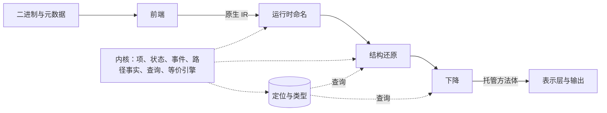

# 设计

本文是新一轮重写的设计：目标、依据、设计哲学、各层的职责与契约、施工节奏。上一轮的实现与经验保存在 `attempt-12` 分支的 `docs/架构.md` 与 `docs/经验.md`，本文只复述其中决定本设计的部分；上一轮已经成熟的具体模型（位来源、结构体写法、async 形态等）仍以那两份文档为参考。

工程上的落法（工程结构、核心概念怎样建模、流程、起步的工作包）见 [实施](实施.md)。

文中的要求分两类：

- **契约**：层与层之间、实现与验证之间的约定。要改它，先改本文。
- **做法**：达到契约的一种方式。执行者可以换成更好的，第 13 节列出哪些属于这一类。

## 1. 目标与范围

Cpp2CS 从 Unity IL2CPP 二进制与匹配的元数据恢复托管方法，输出 CIL 程序集、C# 源码和未恢复部分的诊断。

目标按优先级排列：

1. **准确**：写出的方法体与原生代码语义等价；证明不足的部分报洞，不写可能错误的代码。
2. **通用**：同一套恢复逻辑适用于不同指令集、ABI、编译器、Unity 版本和不同项目，差异只进入目标描述与规格数据。
3. **覆盖**：完整写出的方法占比，按原生字节加权。
4. **可读**：结构接近源码。不追求变量名和逐字还原。

范围：

- 首批目标是 Android ARM64 与 Android x86_64。后者只换指令集和 ABI，用来检验可移植边界；Windows x64 同时换编译器、ABI 和异常模型，排在其后。
- 运行时从 Unity 2022.3、元数据 v31 起步，其他版本经规格数据接入。
- 核心精力放在“原生 IR 到托管方法体”这一段。元数据读取、CIL 写出、C# 导出、执行对照沿用上一轮（第 14 节）。

不做的事，都有上一轮或更早的证据：

- 不先把指令集语义做全。指令只提升到用到的程度，未支持的指令是洞。
- 不以通用反编译器的伪代码为底层。
- 不跳过 CIL 直接写 C#。

## 2. 依据

### 2.1 生成链

| 段 | 工具 | 做了什么 | 逆向时对应 |
|---|---|---|---|
| C# 到 IL | Roslyn | 降级：状态机、闭包、foreach、using、lock | 表示层与输出 |
| IL 到 C++ | il2cpp | 逐方法模板展开，基本不优化。判空、越界、类初始化、元数据惰性初始化、分派、装箱都写成固定序列；类型擦除成指针与结构体；小方法另生成 `_inline` 副本 | 运行时命名、定位与类型 |
| C++ 到优化后的中间表示 | clang 或 MSVC 的中端 | 内联、聚合体拆分、读取复用、合流与下沉、位技巧、路径复制 | 结构还原 |
| 到机器码 | 后端 | 指令选择、寄存器分配、帧布局、调用约定、异常表 | 前端 |
| 到二进制 | 链接器 | 重定位、相同代码折叠、导入 | 前端 |

### 2.2 设计所依赖的事实

- **C++ 只有一份。** 一次构建只做一次 IL 到 C++ 的转换，各架构共用；跨平台时两边共有的函数 99.4% 逐字相同，差别是全程序索引和少数 BCL 平台方法。
- **平台差异在后端。** 同一批函数在 ARM64 与 x86_64 上，98% 以上调用序列与条件分支数相同，差异来自指令选择、块排布和少数内联决定。
- **`_inline` 副本决定了大部分内联。** 这些副本在 clang 上强制内联，被调方法带注册入口的定义仍在产物中，可以作为证明的模板。
- **全程序索引只在单个二进制内有效。** 虚表槽号、RGCTX 下标随裁剪结果变化，只能从该二进制自身的元数据解析。
- **优化保持值，打乱结构。** 一个值是“哪个类的虚表第几槽”，优化前后不变；变的是读取发生在哪个块、是否被复用、是否与别的路径合流。

### 2.3 上一轮留下的问题

上一轮在一个 11 万方法的样本上完整写出 99.26%。下面这些问题是它的上限所在，也是本设计的出发点。

| 问题 | 证据 | 本设计的对应 |
|---|---|---|
| 识别放在优化后的形态上，需要的事实却在它之后才产生 | 恢复层 8 处回调惯用法改写；单个方法的分析里有三个循环和一次整体重跑；惯用法层有 12 个“合流 × 某种惯用法”的规则 | 状态模型先于识别；值与结构分开处理（第 6、7 节） |
| 同一语义有四套表示，之间的约定是隐含的 | 机器表达式、符号值、托管值、内联证明的项；帧内存有版本而堆没有；历次回退集中在这些交界处 | 一套项语言，层按词汇划分，契约可机检（第 4、6 节） |
| 值的表示被全局改写，一个使用者的需要波及其他使用者 | “先定类型再定位”“值层改写波及装箱”等回退 | 分析是查询，同一对象允许多个视图（6.5） |
| 平台知识没有归属 | 提升器之外 54 个文件含架构或平台知识；寄存器被上层当作实参位置；事实层按指令字做指纹；运行时偏移 169 处引用、跨三层 | 目标描述；可移植边界画在 ABI 之后；规格是数据（第 5、7.1 节） |
| 验证靠抽样，样本只有一个 | 共享规则的影响要等全量才看得到；阈值在单一样本上调出 | 真值进入开发回路（第 11 节） |
| 帧槽复用、`stackalloc`、被闭包捕获的帧槽没有模型 | 剩余空方法体的主要来源之一 | 帧对象按生存期建模，从一开始就在状态模型里（6.2） |
| 内联证明不支持调用序列、多入口区域、带循环或异常区域的模板 | 未完整写出的方法里约三成只差内联或构造证明 | 证明建立在内核的项与状态上，按这个次序扩展（8.2） |

历次尝试还有一条共同的教训：每一轮推倒的都是“机器 IR 到托管语义”这一层，失控的方式都是规则随组合增长。横切机制要先存在，具体形态只是它的输入。

## 3. 设计哲学

1. **每层只逆生成链的一段，层的边界是一份词汇契约。** 一层的工作就是把上一层的词汇换成下一层的词汇。换不掉的东西留在原处，成为洞。
2. **值在项上命名，结构靠等价证明还原。** 优化保持值，所以值的含义可以直接在优化后的代码上确定；被打乱的结构（守卫、检查的位置、内联的边界、合流）不靠形态匹配，靠证明“这一段与那一段行为相同”。
3. **横切机制先于形态。** 内存与状态、项的规范形、路径事实、位置与类型、等价证明各只有一份，所有模板和所有变换都用它们。规则名或条件里出现第二个维度（“合流后的某某”“共享泛型下的某某”），说明缺的是机制。
4. **一个概念只有一处定义，分析不改写。** 事实由查询给出，谁需要谁去问；会改变程序的步骤只有少数几种，各自显式存在。
5. **发现可以激进，采纳只凭复核。** 找候选的启发式、次序、预算只影响找不找得到；一次变换被采纳的唯一标准是变换前后经共同执行证明等价。正确性因此不依赖启发式，也不依赖编译器。
6. **证明不足就报洞。** 洞写明没能换掉的项或没能成立的证明步骤，是待补模型的清单。不把失败改写成另一种标记，不写执行不到的占位语句，不为让某个样本通过而放宽判定。
7. **规格是数据。** 运行时结构的布局、运行时函数的原型与语义、调用约定、平台约定都以数据或单一实现的形式存在，恢复逻辑按名字引用。允许对编译器、运行时和库的模式做特化，不对业务方法、名称或地址特判。
8. **真值在回路里。** 每个模型都有来自真实构建链的用例；指标对真值计算；大样本用于普查选题，不用于调阈值。
9. **先问生成器，先写语义。** 遇到新形态，先找出它由哪个模板或哪种变换生成，再决定属于哪个模型；对难的模型先写出语义与正确性标准，再实现。答不出来就先不写代码。
10. **准确优先于覆盖，长期优先于短期。** 可以接受写出率暂时回退，不接受写错。

## 4. 总体架构

### 4.1 层与契约

| 层 | 逆的是 | 出口契约 | 随什么变化 |
|---|---|---|---|
| 前端 | 链接、后端、ABI | 原生 IR（第 5 节）。没有寄存器、标志位、节名、指令字、异常表格式 | 目标描述 |
| 运行时命名 | il2cpp 模板中值与调用的部分 | 对运行时结构的访问都是具名的项，对运行时函数的调用都是运行时操作；剩下的计入“运行时残留” | 运行时规格 |
| 定位与类型 | il2cpp 的类型擦除 | 每次托管内存访问有位置，每个值有 IL 类型；以查询结果的形式存在，不改写程序 | 无 |
| 结构还原 | 编译器中端 | 不可观察的效果已消去，检查与守卫归位，内联换回调用，定位不了的合流已拆开；没成立的证明是洞 | 编译器剖面，只影响发现 |
| 下降 | 无，机械步骤 | 托管方法体：只含 IL 词汇，其余是洞 | 无 |
| 表示层与输出 | Roslyn 的降级 | CIL 程序集、C# 源码 | 无 |

- 内核不是一层，是各层共用的机制。
- 定位与类型和结构还原交替进行：结构变换产生新的程序快照，查询在新快照上重新求值。
- 每层出口有检查器核对词汇。检查不过是实现缺陷，不是洞。
- 洞记录所在的层、位置、没能换掉的项或没能成立的证明步骤，以及原因链；由别的洞导致的洞标为派生，统计时只数独立洞。

### 4.2 全局事实与逐方法恢复

- **全局事实**对整个二进制建立一次：映像、元数据模型、运行时规格、代码地图（函数范围、方法入口与候选身份、调整桩、调用器、运行时函数的识别）、元数据全局槽与实体的对应。全局事实可缓存。
- **逐方法恢复**是纯函数：输入是方法、入口、全局事实和其他方法的摘要，输出是方法体或洞。方法之间可以并行，结果不依赖线程数与恢复次序。
- **跨方法的摘要**按需计算：调用的效果摘要、作为内联证明模板的方法体。模板的良基性沿用上一轮的规则：只取已完成、没有读到递归截断的结果。

### 4.3 项目划分

依赖方向由编译器保证：目标相关的项目只被装配处引用，恢复逻辑引用不到它们。下面是建议的划分，名称与粒度可以调整，方向不可以反。

| 项目 | 内容 | 可依赖 |
|---|---|---|
| Model | 元数据模型、类型与布局 | 无 |
| Native | 原生 IR、项的核心（项的种类、项表、规范化）、目标接口、映像的中立抽象 | Model |
| Targets.* | 文件格式、指令集、ABI、异常模型、OS 约定的各个实现 | Native |
| Runtime | 运行时规格、运行时函数目录、运行时词汇 | Model、Native |
| Kernel | 状态模型、事件、路径事实、查询、等价引擎，以及依赖状态模型的项（读取身份） | 以上除 Targets |
| Recovery | 运行时命名、定位与类型、结构还原、下降 | Kernel、Runtime |
| Managed | IL 词汇与方法体契约 | Model |
| Output | CIL 写出、表示层、C# 导出 | Managed |
| Pipeline、Cli | 装配、参数、报告 | 全部 |

### 4.4 目标描述

平台相关的知识有七个维度，各自独立变化，合成一个目标描述对象。前端之外的代码只通过它的接口取用。

| 维度 | 提供什么 | 首批实现 |
|---|---|---|
| 文件格式 | 节与段、重定位、导入导出、函数范围、展开表 | ELF；PE |
| 指令集 | 解码与提升 | ARM64；x86_64 |
| ABI | 签名到实参槽位的分类、被调保存集合、栈实参区与入口帧基址的关系 | AAPCS64；SysV；之后 Win64 |
| 异常模型 | 调用点到处理入口的对应、处理入口取得异常的方式 | Itanium 异常表；之后 MSVC funclet |
| OS 约定 | 线程指针、栈保护槽、导入符号的含义（不返回的函数、libc、libm） | Bionic；之后 Windows |
| 编译器剖面 | 发现用的启发式与预算 | clang `-Os`；之后 MSVC `/Ox` |
| 运行时规格 | 运行时结构布局、运行时函数目录、元数据版本 | Unity 2022.3 |

## 5. 前端：从二进制到原生 IR

前端负责载入、函数发现、提升、控制流图、SSA 和 ABI 归位，把机器层的身份全部消去。

### 5.1 原生 IR 的契约

| 概念 | 契约 |
|---|---|
| 值 | 带位宽的项。部分寄存器写入与向量车道已化成切片与拼接，标志位已化成比较；没化成的是前端的洞 |
| 入口 | 寄存器类的实参槽各带一个入口值；传入的栈实参区给出地址，内容由状态模型读取；隐藏的方法信息参数、间接结果槽各有名字 |
| 调用 | 目标（映像内函数的入口、导入符号，或一个项）、各寄存器类实参槽的值、传出栈实参区的地址、各结果槽的定义、是否不返回、稳定的调用点身份。一个入口对应哪些托管方法由代码地图回答。尾调用写成调用加返回 |
| 帧 | 帧地址相对入口帧基址。被调保存的寄存器与返回地址在入口处是“调用方的值”，一种按序号区分、不含寄存器名的原子。它们的保存与恢复、栈保护的读写在原生 IR 里是普通的帧读写，前端不消去，由内核用通用的办法处理：没有读取的写入、结果没有使用的读取、不可观察的运行时私有状态。返回地址在栈上的目标不为它设原子：入口帧基址处的那个槽是调用方的数据，返回指令的弹栈由约定里的偏移表达。前端只核对返回与尾调用处栈指针回到约定的位置。动态栈分配是显式操作。帧对象的划分不在前端，由状态模型做 |
| 内存 | 读与写带地址项和位宽。地址的根分为帧、映像、线程指针和其他；前三种各是一个约定的原子（入口帧基址、映像基址、线程指针），映像内的地址写成映像基址加偏移，“其他”是分类的结果而不是原子 |
| 映像数据 | 只读数据可折叠为常量；可写全局是具名的槽；经 GOT 一类的间接已解析 |
| 控制流 | 基本块、分支、跳转表、返回、合流。间接跳转要么解析成跳转表，要么是尾调用（调用加返回），都不是时整个函数报洞。一条指令内部在某个条件下触发的硬件陷阱（除法出错）写成一条条件陷阱语句：条件为真是陷阱的结局，其后的语句只在条件为假时执行；不为它拆块，它有稳定身份 |
| 异常 | 可能抛出的调用带展开边，指向处理入口；处理入口给出异常对象、匹配到的子句的选择值与子句表；继续展开是显式操作。调用没有展开边只表示本函数内没有它的处理入口，是否可能抛出由被调的效果回答 |

**实参槽。** 槽位是抽象的：第 i 个整数槽、第 i 个浮点槽、栈实参区的偏移、间接结果槽。槽位与寄存器的对应只有前端知道。签名确定之后，ABI 的分类函数把一个 C 层签名映成各形参占用的槽位片段，上层据此取“第 i 个实参”。目标未定的间接调用保留全部槽位的值，目标解析之后再分类。

**C 层签名。** il2cpp 为每个托管方法生成的 C++ 函数签名（this、各参数、末尾隐藏的方法信息参数；值类型按值，引用与 ref 都是指针）由元数据和布局推出，与平台无关。运行时函数的原型来自规格。两者经同一个分类函数落到槽位。

**身份。** 调用点、合流、读取、写入、动态分配的帧对象、块有稳定身份，改写保留身份，复制产生新身份并记录来源。原生地址只用于追溯，不代替身份。

**核心运算。** 项是没有类型的位型，同宽的整数与浮点之间没有转换运算。核心运算的语义与目标无关并逐个写明，包括除数为零、溢出、移位量不小于位宽、NaN、浮点转整数越界这些情形；规定为未定义的情形，由前端把目标的实际行为用选择等显式写出来。

### 5.2 两个前端

x86_64 前端从纵切开始就存在。它的作用是检验契约：上一轮泄漏到上层的不只是寄存器编号，还有“入口栈指针低四位为零”“被调入口的栈指针等于调用时的栈指针”“窄的向量寄存器写入零扩展”这类语义假设，静态检查抓不到，只有第二个前端能暴露。

x86_64 比 ARM64 多出的问题都在契约之内解决：

- 部分寄存器写入与标量 SSE 的合并写入，化成插入，再由位来源代数处理。
- 多数指令改写标志位，按惰性标志提升后化成比较。
- 内存操作数、`push`/`pop`、栈指针在函数内变化、红区，都在帧归位时消去。
- 入口时返回地址在栈上，栈实参区相对入口帧基址的偏移由 ABI 给出。

**检验。** 同一份 C# 在两个目标上提升后的原生 IR 应当同构：调用序列、分支结构、对堆与全局数据的访问相同；帧的布局和指令选择造成的写法差别不计。同构率是分层是否彻底的直接度量。

**节制。** x86_64 只提升当前纵切用到的指令，只跑语料，进度跟着托管语义走。

### 5.3 留给实现的

解码库的选择、提升器的组织、SSA 的构造算法、函数发现与跳转表恢复的方法、异常表归一放在哪一步。

## 6. 内核

**程序的表示。** 一个方法是一张控制流图。块里按次序放着有位置的东西：写入、事件、分支；纯计算不占位置，只作为项被引用。程序快照不可变，变换产生新的快照；调用点、合流、帧对象的身份跨快照保持。

### 6.1 项

项是值的唯一表示，从前端一直用到下降。项在构造时规范化并驻留，结构相同就是同一个实例。

| 项 | 含义 |
|---|---|
| 常量、未定义、未知 | 未定义用于填充和被破坏的位；未知带原因，是一等值，不当作 0 |
| 形参、入口状态 | 方法入口处的输入 |
| 实体 | 元数据实体：类、方法、字段、字符串、类型句柄、泛型上下文项 |
| 运行时属性 | 运行时不可变数据上的纯函数：对象的类、虚表槽、继承链的项、数组长度、元素大小等 |
| 运算 | 算术、位运算、比较、转换、选择 |
| 切片、拼接 | 位来源：取一段位，按低位在前拼接 |
| 合流 | 块入口的合流，按身份区分 |
| 读取 | 身份是（位置或地址，最近的可能改写），见 6.2 |
| 事件结果 | 调用、分配等事件的返回值与写出值 |
| 地址 | 帧对象的地址、托管位置的地址 |

**未定义的位。** 项的每一位或者有值，或者未定义。

- 切片与拼接逐位搬运，未定义的位搬到哪里，哪里未定义。其他运算读到未定义的位，或者落在运算自己没有规定的情形时，结果的每一位都未定义。选择只读条件和被选中的一支。
- 未定义的位不是值：同一个未定义项的两次出现不代表相同的内容。靠“两个操作数是同一个项”得出常量的规则，要求这个项不含未定义的位。
- 未知项是有身份的确定值，只是不知道是多少；同一个未知项处处相同。
- 规范化的口径是精化：改写前有定义的每一位，改写后值相同。改写前未定义的位改写后可以有定义，前提是这条规则对这些位的任意取值都成立，例如与 0 相与、取片时丢掉未定义的一段。

**规范化**只用语义恒等式，与使用位置无关。上一轮验证过的几族保留：

- 位搬运（移位、掩码、扩展、截断、寄存器对、向量车道）化成切片与拼接，合流按相同边界下推到各片。
- 只取 0 和 1 的值的各种写法归一。
- 比较的方向与严格性、常量的结合、下标的扩展归一。

规范化不做的事：按某个使用者的需要改变值的表示。那属于视图（6.5）。

### 6.2 状态模型

全部内存按运行时规格分成五类。这个划分先于一切识别建立。

| 类别 | 例 | 处理 |
|---|---|---|
| 帧对象 | 局部、溢出槽、结果缓冲区、`stackalloc` 区域、被闭包按引用捕获的槽 | 按生存期分版本；地址逃逸到未知用途的保留为可寻址的存储 |
| 运行时不可变数据 | 对象头的类指针、虚表、继承链、接口偏移表、数组长度与维界、字符串长度、方法信息、已初始化的元数据槽 | 当作纯函数，读取是运行时属性项，没有版本 |
| 单调状态 | 类初始化标志、方法的元数据初始化标志、RGCTX 的惰性项 | 只会从未就绪变为就绪，以路径事实表达 |
| 托管堆 | 实例字段、静态字段、数组元素、经引用或指针的位置 | 按别名类分版本，调用带效果摘要 |
| 运行时私有状态 | 活跃异常栈、GC 位图、栈保护值 | IL 层不可观察 |

**读取的身份。** 每个内存区域有一条定义链（写入、可能改写它的调用、合流）。一次读取的身份是它读的位置，加上沿链往回最近的、可能改写这个位置的定义。身份相同的两次读取同值；最近的定义恰好是对同一位置的完整写入时，读取就是写入的值；部分重叠时按位组合。这里的同值是对同一个动态环境说的：读取每一次执行时读到的值，等于模型给出的项在当时的值，项里每个原子取它的定义点最近一次执行的结果；循环的不同轮次之间不作比较。项里未定义的位不在这个保证之内（6.1）：写入的值含未定义的位时照样转发，使用者按 6.1 对待。

**身份凭据。** 一个地址归入哪一类要有依据。运行时结构的字段由规格给出，指针项的种类来自入口的 C 层签名和规格里的字段类型。没有名字的全局字节（方法的元数据初始化标志）由一条全局事实给出：对整个二进制普查，这个地址的全部访问只有“读出来测试”和“在元数据初始化之后写 1”两种。凭据不成立的地址不归入单调状态。

**单调。** 区域的划分只能细化，别名的知识只能增加。知识增加只会让“最近的可能改写”更早，已有的同值结论不会被推翻。

**别名类。** 不同字段定义不重叠；同一字段只在所在对象可能相同时重叠；数组元素按元素类型和下标；两次不同分配的结果不重叠；违反类型安全的访问落入“其他”类，与所有类可能重叠。判定只有一处。

**调用的效果摘要**有三个来源：运行时操作的登记、已恢复方法体的摘要、未知时取上界。

**帧对象的生存期。** 同一段帧先后承载不同对象时，完整写入开始新的生存期；`stackalloc` 区域是动态的帧对象；闭包按引用捕获的槽在闭包展开之后与普通帧对象相同。

### 6.3 事件与可观察性

程序的含义按托管语义解释。这一节把上一轮内联证明的语义模型提升为全局的语义。

- **事件**：不透明调用、分配、精确的类初始化、抛出（含判空、越界、类型不符的隐式抛出）、其他运行时操作。每个事件观察此刻的整个堆。
- **写入不是事件**：写入只在下一个事件或结局处被观察，所以观察点之间写入的重排、下沉、合并不影响等价。
- **读取不是事件**，但 IL 的访问可能抛出，那次抛出是事件。原生代码里显式的检查与 IL 访问隐含的检查是同一事件的不同写法。
- **不可观察的效果**：元数据惰性初始化、时机不受约束的类初始化（beforefieldinit）、写屏障的通知、栈保护、运行时私有状态的读写。它们不是事件。
- **幂等事件**：在自己的后置条件已经成立时执行等于不执行。精确的类初始化属于这一类。
- **结局**：到达汇合点、返回、抛出。
- **等价**：在入口事实描述的状态上，事件序列逐个相同，结局相同。

### 6.4 路径事实

沿边成立的文字：非空、已初始化、类型检查成立、比较结果、整数区间。全系统只有一个事实格，检查的吸收、守卫的消去、等价引擎的判定、活跃性都用它，不各自维护。

### 6.5 查询

- **分析以查询的形式提供**：纯函数，输入是一个不可变的程序快照和其他查询的结果，结果带记忆。次序由依赖决定，不靠手工排列。
- **成环的依赖显式声明**为单调不动点组，并写明单调量与终止依据。已知的一组：调用目标、调用的内存效果、读取的身份、位置与类型。到达预算是洞，不当作收敛。组内一个键的失败只属于这个键，看作格的顶，不波及同组的其他键；结果因此与请求的次序无关。
- **失败的查询返回原因**，原因沿依赖传递，洞由此得到归因链。
- **视图**：同一个值、同一块内存可以有多个表示（按位的、按类型的、按位置的），由使用点取用。一个使用者的需要不改变其他使用者看到的东西。
- **改变程序的步骤**只有：闭包展开、异常归一、守卫与检查的归位、路径拆分、内联替换、表示层的形态还原。每次产生新快照，查询在新快照上重新求值。
- **每层摘要**：每个方法在每层出口的产物记一个摘要。两次全量之间比较摘要，直接得到每个方法第一处变化所在的层。

### 6.6 等价引擎

一个引擎回答所有“两段代码是否等价”的问题。它在共享的路径条件下同步执行两段代码，按 6.3 比较事件与结局；可判定的分支走确定的一侧，否则分叉。上一轮内联证明的共同执行是它的起点，那份理论（项的两个命名空间、绑定、堆的写入表、展开调用、复核的汇合规则）整体保留。

使用者：

| 使用者 | 两段代码 |
|---|---|
| 内联逆 | 被调方法的模板与调用方的一段区域 |
| 守卫消去 | 守卫的两臂 |
| finally 还原 | catch 路径与各出口路径 |
| 尾部合并的逆 | 待合并或待复制的各条路径 |
| 复核 | 任何变换的前后 |
| 语料对照 | 恢复出的 IL 与真实 IL |

- 证明的范围是区域：区域入口处的活跃值与内存当作自由的符号，区域之外的代码与证明无关。区域由支配与后支配这类通用查询界定。区域的出口是一个正常续点加上若干终结边；多个区域共用的只抛出块按进入它的边分别计入各自的区域，不使区域失去单入口。
- 预算按步数计，结果可复现；耗尽是一种洞。
- 失败时给出第一处不等价的联合路径和种类：事件、堆、结局、别名、写回、合法性、预算。

## 7. 运行时语义

### 7.1 规格

| 规格 | 内容 | 来源 |
|---|---|---|
| 结构布局 | 运行时结构的字段、偏移、大小，按 Unity 版本与数据模型 | 对应版本的 libil2cpp 头文件，生成 |
| 运行时函数目录 | 名称、C 原型、对应的运行时操作、内存效果、是否返回、识别依据 | 头文件与实验 |
| 运行时操作登记表 | 每种操作的输入用途与类型、结果类型与有效位宽、内存效果、可观察性与幂等性、在 IL 中的写法 | 一项定义一次，各层共用 |
| 模板目录 | 每种 IL 构造对应的 C++ 模板在运行时词汇下的写法，关联语料用例 | 生成的 C++ 与头文件 |

代码按名字引用布局（“类的虚表”），不写数值。运行时函数的识别不看指令字：依据是导出与导入符号、从导出接口沿调用关系定位、在原生 IR 上与目录里的参考形状比对。

### 7.2 值的命名

每个项有一个粗的种类：托管引用、某种运行时结构的指针、帧地址、映像地址、托管位置的地址、整数或浮点位型。种类由定义给出（形参按签名，调用结果按被调方的原型，读取按位置或规格）。

在此之上，按规格把对运行时结构的读取解释成具名的项：

- 元数据全局槽的读取是实体。依据是生成代码保证先初始化、后使用。
- 对象头的读取是对象的类；类上的读取是虚表槽、继承深度、继承链的项、接口偏移表、静态字段块、元素类、元素大小、RGCTX。
- 方法信息、委托、数组头、字符串头上的读取同理。

这些读取属于不可变数据，是运行时属性项，身份与读取发生在哪个块、是否被复用、是否合流无关。虚调用的目标因此直接是“某对象的类的第 n 个虚表槽”，不需要为合流、复用各写规则。

对运行时函数的调用按目录成为运行时操作，带登记表里的效果与可观察性。登记的结果关系（结果等于哪个规格项，失败时返回空还是抛出）是项上的等式，路径查询可以用；抛出函数的实参是事件的一部分，只比较异常的种类不够。

### 7.3 区域的识别

模板里带控制流的部分不按形态匹配，由下面几个通用机制处理。

| 机制 | 含义 | 覆盖的模板 |
|---|---|---|
| 不可观察效果的消去 | 分支只依赖不可观察的状态、各臂只有不可观察的效果时，整个菱形消去 | 元数据惰性初始化守卫、RGCTX 的惰性项、时机不受约束的类初始化、写屏障、栈保护 |
| 受守卫的幂等事件 | 以单调标志为条件、臂内是建立该标志的幂等事件时，等于无条件的幂等事件 | 精确的类初始化检查 |
| 条件抛出 | 通往“只抛出”块的每条边是一次检查；相邻的同类检查之间只有纯计算时可合并条件 | 判空、越界、数组存入的类型检查、除零、溢出、转换失败 |
| 同一规格项的合流 | 合流的各来源在各自路径事实下都等于同一个规格项时，合流就是这个项 | 类型检查的快路径与运行时函数、接口查找的快慢路径、拆箱 |
| 两臂等价 | 编译器把后续代码复制到守卫两臂时，由等价引擎证明两臂相同，保留一臂 | 以上各类被复制之后的形态 |
| 规格登记的参考形状 | 少数带循环的内联运行时函数体，按目录里的参考形状在项上识别 | 接口偏移表的查找循环等 |

约束：形态识别只允许用于规格里登记的模板，并且写在项上。编译器优化造成的变形不得用形态规则处理。

### 7.4 调用与分派

- **身份**：一个地址可以对应多个方法（相同代码折叠、泛型共享），保留为候选集，机器签名一致时共用。调整桩、调用器、反向包装各有自己的参数约定，不当作方法体。
- **实例见证**：隐藏的方法信息实参、RGCTX 项、接收者的静态类型给出确切的泛型实例。
- **分派**：虚调用按接收者的静态类型与槽号，接口调用按接口与槽号，委托取 `Invoke`，另有泛型虚方法、调用器、约束调用。解析是查询，属于 6.5 的不动点组；目标只增不减。
- **没有注册入口的函数**：翻译单元内的内联副本、未被内联的闭包和头文件内联函数。前者按调用点的方法信息或与注册方法同形来认；后者在 SSA 之前展开回调用方。

### 7.5 泛型共享

- 完全共享泛型的类型参数大小与种类只有运行时可知，生成代码只经地址操作它。这类值按位置处理，不观察它是值类型还是引用类型。
- 泛型定义的方法体取自原生见证实例。多个见证并存时可以互相印证；从见证到开放定义的反代入按可靠程度使用共享见证、签名锚点、程序集可见性和多实例对照，都不成立时保留具体类型并诊断。

### 7.6 异常

- 前端给出中立的模型：调用点到处理入口。托管异常以包装对象抛出，处理入口的类型判断折叠成 catch 子句的类型。
- 落地跳板与只做转发的处理体在 IL 中没有对应，收缩掉。
- 区域构造满足 ECMA-335 的约束：区域只嵌套或不相交，try 只能从第一条指令进入，多入口的 try 加分派块。
- finally 在 C++ 里是析构闭包，被编译器展开并按路径复制；还原的判定交给等价引擎，逐路径比较 catch 路径与各出口路径。

## 8. 结构还原

| 编译器的变换 | 打乱了什么 | 机制 |
|---|---|---|
| 聚合体拆分（SROA）、局部提升（mem2reg）、寄存器对、向量打包 | 结构体与局部被拆成位片 | 位来源（项的规范化） |
| 栈着色、溢出与重载 | 一个帧槽承载多个存储实例 | 帧对象按生存期分版本 |
| 读取复用（GVN）、写入下沉与合并 | 读写的位置与次序 | 读取的身份；写入不是事件 |
| 分支合并与下沉（SimplifyCFG）、公共指令上提、跳转线程化 | 不同路径的访问合成合流；检查与守卫漂移 | 合流的项、路径事实、7.3 的机制、按需路径拆分 |
| 位技巧（InstCombine）、除法的魔数 | 运算的写法 | 规范化 |
| 内联 | 方法边界 | 以被调方法为模板的等价证明 |
| 尾合并、出口复制 | 源码级的控制结构 | 表示层的形态还原 |

### 8.1 路径拆分

- 合流值上的访问定位不了、或调用需要单一的静态实体，而拆开之后每条路径都能定位时才拆。合流后的地址已经能表示为托管位置时保留合流。
- “来源不同”按读取的身份判断，不按语法上是不是同一个定义。溢出后读回的值与原值同身份，不构成拆分理由。
- 复制量有上限。拆分不改变语义，过度拆分只在形态指标上可见，所以这一步的回归要看语句数与 `goto`。

### 8.2 内联逆

沿用上一轮的理论：锚点（不可访问的成员访问、缺构造调用的分配）、候选、共同执行、区域与续接、复核、模板的良基性。变化如下。

- **建立在内核上。** 证明直接使用内核的项、读取身份和路径事实，不再有自己的堆模型和入口事实推导；证明发生在下降之前。
- **模板来源是接口。** 默认是被调方法自身原生代码的恢复结果；提供了与样本版本一致的参考程序集时，可以用其中的 IL。参考体不一定与二进制一致，但采纳仍然只凭复核，错的模板只会证不出来。
- **候选由证据索引。** 按区域访问的字段集合与调用序列查模板，不按名单逐个试。失败原因附所选候选。
- **发现的质量可度量。** 内联逆对不对，以真实 IL 里的调用点为准：恢复出的方法体里的调用点应当与真实 IL 一致。调试信息里的内联记录只作正面证据，有记录的地方确实内联过，可以用来区分候选选错与证明不足；没有记录不说明没有内联（见 12.4）。
- **扩展的次序**：相邻调用序列（两次内联合并了写入）、从合流块开始的多入口区域、含异常区域的模板、含循环的模板。最后一项需要循环不变式，方法未定。

### 8.3 检查的归位

原生代码里显式的检查，在 IL 中多数隐含在访问里。检查成立时随后的访问必定抛同一异常、两者之间没有可观察的动作时，检查被访问吸收；否则写成显式的条件抛出。可能抛出的位置取自原生的调用点与显式检查，不按托管语义推测。

## 9. 定位、类型与下降

这一段的具体模型上一轮已经成熟，这里只定契约，细节参考上一轮的架构文档。

- **位置**：地址解析成“根、路径、偏移、宽度”。根可以是对象、数组、静态字段块、引用、帧对象、原生指针。同一块内存允许多个候选视图，由各次访问取用；存储的类型只是视图之一，不拿它去解释所有访问。
- **整体访问**：编译器把结构体的复制拆成各段的读写。互不重叠、恰好铺满一个结构体位置、之间没有其他读写的一组写入是一次写入；整体读取同理。
- **类型**：原子的类型由定义给出（形参按签名，调用结果按被调方，读取按位置）；合流的类型由来源与使用共同约束；不受约束的整数按 IL 栈语义解释。只有一个同宽字段的值类型与该字段位型相同，沿这条表示链取所需的层。求解到达预算或成环是洞。
- **值的写法**：按位片给出的结构体值，依次尝试逐字段组成、构造函数证明、同类型复制、对象初始化器。不可访问的成员是内联逆的锚点，不直接写出。
- **下降**是机械的：事件成为语句，项成为表达式，合流成为局部并在入边并行赋值，之后按活跃性合并。读取落在不跨越其改写的位置。下降不识别形态，不保存跨语句的状态，不创建项；需要这些时，事实属于上游的某个查询。
- **托管方法体**有自己的局部身份和运算定义，不借用原生 IR 的。

## 10. 表示层与输出

- 先写 CIL，再由反编译器生成 C#。CIL 能接受栈类型检查、执行对照和回环的检验。
- 反编译器只认 C# 编译器降级后的形态。async、迭代器、foreach、闭包、finally 被两次变形之后，表示层把方法体还原成这些形态；内联证明用的方法体不经过这一步。
- CIL 能表达而 C# 不能表达的写法，在反编译的语法树上改写，逐项写明语义差别。
- `goto` 与未提升的状态机受反编译器限制。是否自研结构化，在全量对齐上一轮之后再定。

## 11. 验证与度量

| 手段 | 覆盖 | 用途 |
|---|---|---|
| 词汇检查、依赖方向 | 每个方法，每次运行 | 层的契约 |
| 复核 | 每次变换 | 采纳的唯一标准 |
| 语料真值 | 语料的全部方法 | 恢复出的 IL 与真实 IL 逐方法对照，是准确性的直接度量 |
| 跨目标一致 | 语料；带多个 ABI 的样本 | 同一方法从不同目标恢复出的 IL 应当相同；不需要真值 |
| 执行对照 | 抽样与改动涉及的方法 | 原生码在模拟器中执行，CIL 由解释器执行，比较事件与堆；是模型本身的独立旁证 |
| 全量普查 | 主样本 | 选题与回归 |
| 回环 | 接近全量 | 恢复出的程序集再经 il2cpp 和同参数的编译器，与原二进制逐函数在原生 IR 上比较；需要与样本一致的 Unity 版本 |

**语料**来自真实的构建链：按变换类别写的 C# 用例，加上常见开源库的源码，在各目标上带调试符号构建。它给出四种真值：IL、生成的 C++、运行时函数的名字，以及不完整但可靠的内联记录。语料随模型增长，每个模型至少有一个用例。

IL 对照需要一个 IL 导入器，把 CIL 方法体读成内核的程序表示，再交给等价引擎；参考程序集作内联模板时用的是同一个导入器。等价引擎可用之前，先用执行对照的解释器在同一批合成输入上执行两份 IL，比较事件与堆。

**度量**：

- 规模与覆盖：完整写出、部分写出、洞，按方法数和原生字节。
- 缺口：只数独立洞，按所在层和原因种类归类，再统计“只差这一类”的方法数，用来决定先补哪个模型。
- 形态：`goto`、未提升的状态机、编译器生成名、语句数。过度拆分和失败的形态还原只在这里可见。
- 准确：语料的 IL 等价率、跨目标一致率、执行对照的结果、生成源码的编译错误数。
- 回归：两次全量之间的状态变化、每层摘要第一处变化的分布。
- 耗时与内存。全量时间是开发回路的一部分，超过上一轮的两倍时先处理性能。

**约束**：

- 对照模型与检查的修改需要独立依据，不为通过某个样本放宽。
- 模型检查写成性质（“有字节没写就不能装箱”），不写成某个样本的结果。
- 预算和阈值都按步数或大小计、可复现、耗尽时有诊断，并且各有语料用例。
- 写出数、编译通过、执行对照一致、回环一致是四个独立的结论，分别报告。

## 12. 施工节奏

### 12.1 步骤

每一步都能从二进制走到 CIL。先纵切，再加宽。主要投入在核心恢复（第 6 至 9 节）；语料、规格与验证只做到支撑当前步骤所需。

| 步 | 做什么 | 出口判据 |
|---|---|---|
| 1 语料与规格 | 仓库骨架与沿用部分迁入；语料工程与真值抽取；运行时规格的生成；“IL 对照”与“跨目标一致”两个指标 | 语料的真值可以读取，两个指标可以计算。只做到第 2、3 步够用为止 |
| 2 验证关键假设 | 取最难的三族模板：两臂被复制的初始化守卫、共享慢路径的接口分派、带合流的类型检查；用状态模型加项上的命名处理 | 三族在语料和主样本的抽样上不靠形态规则被识别。不成立时在这里调整设计 |
| 3 纵切 | 两个前端经全部各层到 CIL，只覆盖直线代码、调用、字段访问、简单分支 | 语料中这一范围的方法：IL 与真值等价，两个目标恢复出的 IL 相同；各层检查器通过 |
| 4 横切机制 | 按普查的缺口大小补全：帧对象与读取身份、位来源、位置与类型、调用与分派、泛型共享、异常区域 | 语料上这些类别的洞为零；主样本上，只差内联或构造证明的方法不计，其余未完整写出的方法数不高于上一轮（约 110 个） |
| 5 结构还原与对齐 | 等价引擎上的守卫、拆分、内联逆、finally；接表示层与输出 | 主样本全量：完整写出不低于上一轮（112722 / 113568），生成源码编译零错误，执行对照抽样无不一致，形态残留不高于上一轮 |
| 6 回环与新目标 | 回环验证；Windows x64 | 回环一致的方法占比有报告；新目标只改目标描述与发现的启发式 |

第 4 步内部的次序由普查数据决定，可以与表中不同。

### 12.2 每个模型的做法

1. **普查**：全量里按“只差这一类”排序，取影响最大的一类。
2. **问生成器**：这类形态由哪个模板或哪种变换生成，属于哪个模型。
3. **写语义**：模型回答什么问题，正确性标准是什么，写进本文或架构文档对应的小节。
4. **语料用例**：用真实构建链做出最小用例。
5. **实现**。
6. **定向验证**：语料指标，加上主样本里这一类的方法。
7. **全量**：改动了共享机制的，跑全量并看全部度量。

### 12.3 停止信号

出现下面任何一种情况，停止加规则，回到模型：

- 规则名或条件里出现了第二个维度。
- 需要新的私有路径遍历、别名判断或值相等判断。
- 需要在调度里找一个新的插入点。
- 放宽某个判定之后又要收紧。
- 同一族出现第三份实现。
- 需要样本里的具体常量、名称或地址。
- 想放宽验证的比较。

### 12.4 假设登记

设计建立在这些假设上。每条都要在指定的步骤检验，结论记回本表。

| 假设 | 检验 | 不成立时 |
|---|---|---|
| 状态模型加项上的命名，能取代惯用法层按形态识别的规则 | 第 2 步。**初始化守卫一族成立**：主样本抽样 320 个方法，不用形态规则，元数据守卫对上 217/218，类守卫 920/942，互不支配的重复守卫 189/191；剩下的是模型的缺口（状态合流的命名、位的活跃性、深层 RGCTX 项的类型）。**类型检查一族：局部机制成立，整族未判定**：抽样 441 个方法、423 个参照点，不用形态规则证明了 44 个区域（继承链检查 3、密封类转换 8、拆箱的类型检查 33），语料三个用例在两个目标上得到相同的规格项；没证明的主要是原型的缺口，不是反例：直接调用运行时函数的 136 点没有按登记直接成为运行时操作，57 点的调用结果没有按登记的结果关系进入路径查询，72 点因共享的只抛出块被单入口的区域判据拒绝，73 点的事件或出口差异没有归因。接口分派一族不再做原型。三族都在第 3 至 5 步的主线上用语料真值检验 | 失败的那几族保留为规格登记的参考形状；其余不变 |
| 一条定义链加按需求值的读取身份，精度与速度都够用 | 第 3、4 步，与上一轮的帧提升结果对比 | 帧对象改回分区构造 SSA，堆保持按需求值 |
| 两个 64 位目标提升后的原生 IR 高度同构 | 第 3 步的同构率 | 查清不同构的来源属于前端还是编译器，后者进编译器剖面 |
| 等价引擎能同时服务内联、守卫、finally、拆分，不需要按使用者分叉 | 第 5 步 | 引擎保持一个语义定义，允许多个驱动 |
| 调试信息里的内联记录足够完整，可作为内联逆的真值 | 第 1 步。**结论：不成立。** 语料上按源码调用计，约 5.5% 找不到去向；有确定的反例：被合并的内联副本没有任何记录，两次字段读取合成一条指令后只留一条记录。已有的记录是可靠的 | 内联逆的真值改用真实 IL 里的调用点；内联记录只作正面证据；需要逐点核对时用人工标注的小对照集 |
| 参考程序集的 IL 作为模板能提高内联证明的成功率 | 第 5 步，对比两种模板来源 | 只用恢复结果作模板 |
| 统一的项语言不使全量时间超过上一轮的两倍 | 第 4 步起每次全量 | 先做性能，再继续加模型 |
| 换编译器只影响发现，不影响模型 | 第 6 步 | 把依赖编译器的部分列出来，逐项给独立依据 |

## 13. 自由度

**定下的**，改动前先改本文：

- 各层的出口契约与依赖方向。
- 采纳只凭复核；证明不足就报洞；不为样本放宽判定或验证。
- 一个概念一处定义；分析不改写程序。
- 规格是数据；不按业务名称或地址特判。
- 输出先 CIL。
- 第 6.3 节的语义模型：什么是事件，什么不可观察，什么叫等价。

**留给实现的**：

- 数据结构与算法：读取身份是沿链按需求值还是分区构造 SSA，项的驻留方式，是否使用等式饱和。
- 查询框架的形态，不动点组的调度。
- 层内的模块划分、命名与文件组织；项目的粒度。
- 上一轮的代码哪些移植、哪些重写。
- 发现的启发式、候选的排序、预算的数值。
- 步骤内部的先后，以及第 4 步按普查调整的次序。
- 测试的组织方式。
- 性能手段：缓存、并行、增量。
- 表示层是否以及何时自研结构化。

实现中发现本文的契约不合理时，写明理由后修改本文，再改代码。本文不记录过程，只描述当前的设计；实现稳定之后，各层的具体行为写进架构文档。

## 14. 沿用与重写

| 处理 | 部分 | 说明 |
|---|---|---|
| 原样带入 | 元数据输入、CIL 写出与栈类型检查、C# 导出与合法性改写、命令行与流水线、执行对照 | 与平台和恢复方式无关 |
| 解耦后带入 | 映像读取 | 把“架构”与“文件格式”分开 |
| 移植到新契约 | ARM64 提升器；AAPCS64 分类器；位来源的规范化规则；运行时操作登记表；内联证明的理论与共同执行；位置、类型、结构体写法的各个模型；async、迭代器、finally 的形态还原 | 模型保留，接口换成内核的项与查询 |
| 重写 | 事实层的指令字指纹、调用模型、惯用法层、内存提升、路径拆分、恢复的调度 | 上一轮问题集中的部分 |
| 新增 | x86_64 前端、SysV 分类器、目标描述、状态模型、查询、规格生成、语料与真值抽取 | |

## 15. 资料

| 资料 | 用途 | 何时需要 |
|---|---|---|
| 语料在各目标上的带符号构建 | 真值、跨目标一致 | 第 1 步起 |
| 各版本的 libil2cpp 头文件 | 生成运行时规格 | 第 1 步起 |
| 与样本 Unity 版本一致的 BCL 与引擎程序集 | 参考程序集：内联证明的模板来源，回环的输入 | 第 5 步 |
| 常见开源库（UniTask 等）公开发布的对应版本，源码与程序集 | 参考程序集；也可编进语料，得到带真值的库代码 | 第 4 步起 |
| 第二个 ARM64 样本，来自不同项目 | 检验通用性，避免阈值偏向单一样本 | 第 4 步 |
| x86_64 的真实样本 | 语料之外的 x86_64 检验 | 第 5 步之后 |
| Windows x64 的样本与带符号的语料构建 | 新目标 | 第 6 步 |

## 术语

| 术语 | 含义 |
|---|---|
| 项 | 值的表示，构造时规范化并驻留 |
| 词汇 | 一层允许出现的项与操作的种类 |
| 事件 | 可观察的操作：调用、分配、精确的类初始化、抛出等 |
| 位置 | 一块托管存储：根加路径 |
| 别名类 | 按托管类型安全划分的堆位置集合 |
| 读取的身份 | 位置加最近的可能改写；相同则同值 |
| 路径事实 | 沿某条边成立的文字 |
| 视图 | 同一个值或同一块内存的一种表示，由使用点取用 |
| 模板 | 被调方法的可执行语义，内联证明的证据 |
| 见证 | 泛型定义的一个原生实例 |
| 复核 | 变换前后经共同执行证明等价 |
| 洞 | 没能换成 IL 词汇的项，或没能成立的证明，附原因 |
| 目标描述 | 文件格式、指令集、ABI、异常模型、OS 约定、编译器剖面、运行时规格的组合 |
| 规格 | 以数据形式存在的运行时结构布局、运行时函数目录等 |
| 语料 | 由真实构建链产出的、带真值的用例集 |
| 回环 | 恢复出的程序集再经生成链，与原二进制比较 |
