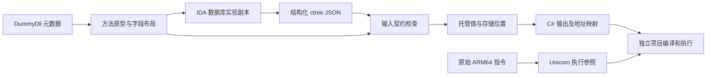

# 首组交付与验证

## 成果范围

2026-10-16，首组从真实 IDA ctree 自动恢复两个完整类型，没有手写目标方法体，也没有占位方法。

| 类型 | 完整恢复的成员 |
| --- | --- |
| Sekai.Api.MusicScoreSearchConditionRequest | 构造；四个只读字段；枚举参数及默认值 |
| Sekai.Mysekai.StaminaData | 三个实例属性、构造、Zero、加法和减法，共七个方法 |

两个依赖枚举从匹配 DummyDll 中读取。生成的 `Recovered.csproj` 可独立编译，不依赖游戏 DLL 或测试宿主替身。唯一调用依赖为 CLR 的 `System.Object` 构造。

这是第一组完整的数据类型和计算 case，不是完整 API 请求流程或 GridAreaData 整类恢复。API 执行、泛型委托、集合内联和异常清理仍是下一阶段；不把本组成功计作这些能力已完成。

## 架构



- `Metadata`：读取真实方法地址、Token、参数、字段偏移、枚举和默认值；生成原型请求。
- `scripts/ctree_export.py`：直接读取节点角色、类型、变量和参数索引；不解析伪 C 文本。
- `Input`：核对输入哈希、方法地址、已应用原型、schema 和警告。
- `Recovery`：绑定参数与字段，把 ctree 转为托管值、存储、写入、分支和返回。
- `Semantics`：独立表达值和存储位置。布局服务证明合并读写覆盖哪些字段，拒绝空洞、重叠与部分成员。
- `Output`：只消费托管表示，输出 C# 和节点/原生地址到源码行的映射。

核心中没有目标方法名、地址或公式特判。方法名仅用于元数据身份、标准构造及操作符声明；`System.Object` 构造的目标地址从匹配 mscorlib 元数据取得。case 清单仅选择类型和输入版本。

## 本轮解决的关键问题

1. **错误的值类型 this 原型**：旧 IDA 输出把实例结构体参数解释为按值传递。依据元数据和 ARM64 IL2CPP 实例方法调用形式，将实验副本中的 this 更正为结构体指针，重新反编译。修改前后原型随结果保存，退出不保存数据库。
2. **参数顺序与变量表顺序不同**：使用 `cfunc.argidx`，不按局部变量排列顺序或变量名猜参数。
3. **字段与宽整数重叠**：通过累计偏移和字段布局恢复 64 位读取/写入。读按小端位型拼接，写先保存整个右值，再拆分字段，避免赋值顺序改变输入。
4. **整数溢出**：保留操作宽度、符号和转换，生成明确的 `unchecked` 区域；验证项目开启溢出检查，确保行为不依赖调用方设置。
5. **源头可追踪**：生成的成员携带 RVA 和 Token 注释，`source-map.json` 指向原始节点和指令地址。

合并整数表达式目前仍接近编译器形式；没有为了美化而猜测等价公式。后续可在托管表示上增加有独立证据的归约。

## 验证证据

使用与前几次相同的 ARM64 二进制，SHA-256：

`6CE1DE5C0357E122F153F62D648DE1655B7F8A339B2AE1C575595868A361E4BB`

- 八个方法均从 D 盘 IDA 数据库重新导出，应用原型后无 IDA 警告。
- 1,343 组体力数据：包括三个字段的 343 组边界组合和 1,000 组固定随机输入；每组执行构造、三个属性、加法和减法。
- 1,002 组请求参数：覆盖默认参数及枚举的任意 32 位值，验证不擅自截断为已命名枚举成员。
- 原始 ARM64 方法共执行 9,061 次，包括原始 `System.Object..ctor`。读取 ELF 原始代码页，没有代写目标公式或挂钩替代构造逻辑。
- 原生侧检查字段前后的哨兵字节和 getter 不改写源数据；C# 侧检查按值参数不变、只读字段和 12 字节布局。
- 生成源码通过 10,408 项断言。两侧比较返回值与字段；没有声称逐条指令、时序或并发行为等价。
- 六类错误输入被拒绝：未知节点、字段布局空洞、输入哈希错误、IDA 警告、this 错位、原型错误。
- 删除导出文件的伪代码文本、旧节点摘要和 microcode 文本后，仍生成逐字节相同的 C#。
- 将真实条件 `< 1` 故意改成 `< 2`，生成代码仍可编译，但执行对照失败，确认验证确实检查行为。

未启动安卓模拟器，未在 Unity 游戏进程内运行。Unicorn 是原始 ARM64 指令执行参照，不是游戏运行验收。

## 使用与生成物

```powershell
python -X utf8 -u scripts/run_first.py D:/Cpp2CS/attempt-10/ida-session/libil2cpp.i64
```

脚本依次执行元数据提取、IDA 导出、恢复、独立项目编译、原生参照和 C# 执行，任一步失败即退出。无需逐方法手工编辑输出。

另行检查失败路径：

```powershell
python -X utf8 -u tests/check_failures.py D:/Cpp2CS/attempt-10/ida-session/first
```

- `artifacts/first/metadata.json`：匹配版本的托管契约。
- `artifacts/first/recovered/Recovered.cs`、`Recovered.csproj`：生成源码与独立工程。
- `artifacts/first/recovered/source-map.json`、`manifest.json`：地址映射及完整成员清单。
- `artifacts/first/native.json`、`verification.json`：原生结果与执行验证计数。
- `D:/Cpp2CS/attempt-10/ida-session/first/`：ctree、原型修改记录和原始代码字节。

生成物不提交 Git。工具、case 清单、探针、测试和复现入口提交；原数据库只读，查询在 D 盘副本执行。

## 首组交付时的边界

首组接纳无警告的非泛型公开方法、Object/ValueType 直接派生类型、32 位枚举、整数与布局明确的值类型。未知调用、异常区域、标签、浮点位重解释等会明确失败。即使可解析某种节点，也须有对应执行验证才能扩大交付承诺。

后续调用、控制流和依赖工作的实际进度见[第二组进度](第二组进度.md)。`GridAreaData` 和 API 执行链仍按“完整成员 + 无占位 + 编译 + 行为验证”验收。
